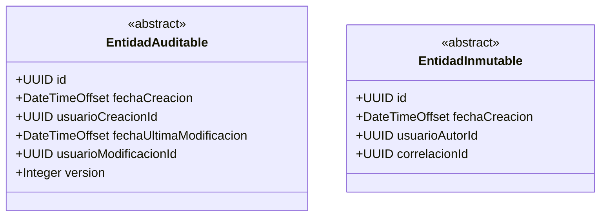
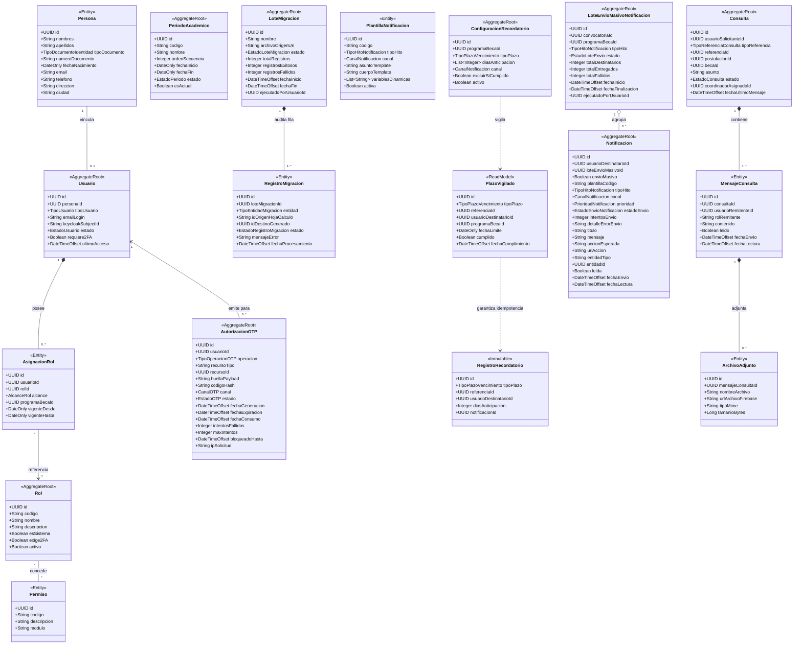
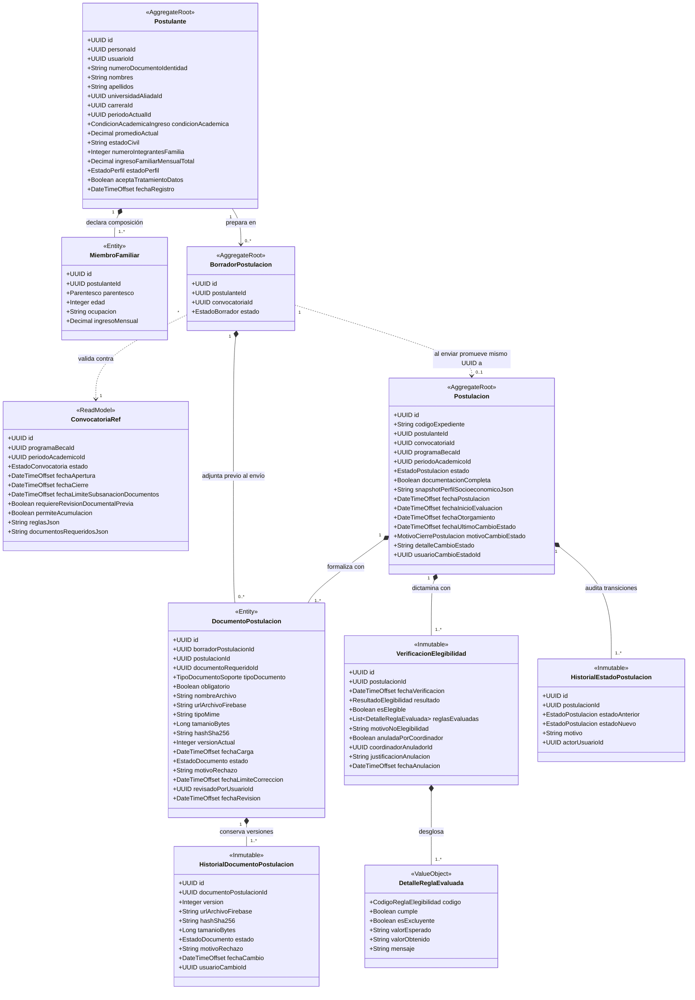
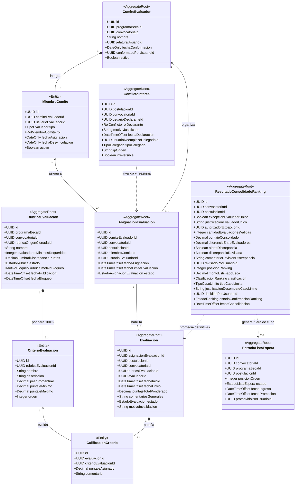
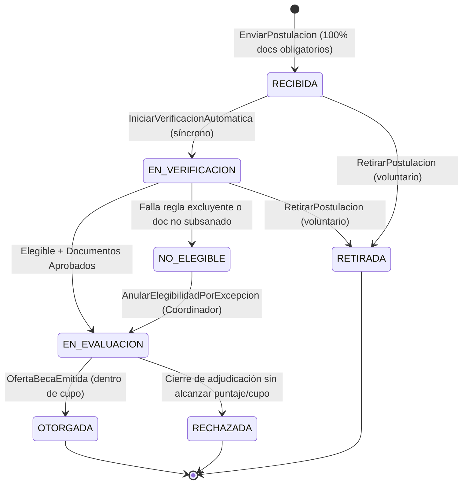
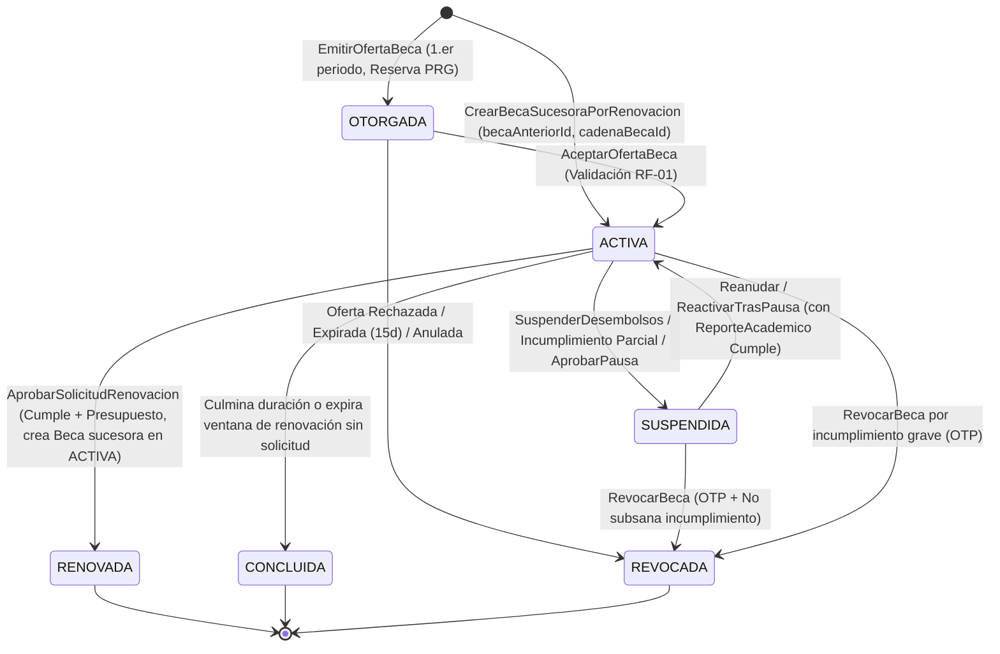
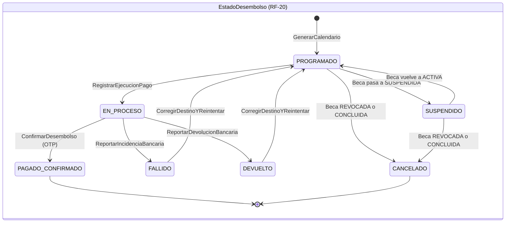

# ASCENSO — Especificación Maestra del Modelo de Dominio (DDD + SDD)
**Plataforma de Gestión de Becas y Ayudas Estudiantiles · Fundación Ascenso**  
**Fuentes:** PRD Oficial (RF-01 a RF-40), Documento General de Historias de Usuario (83 HUs) y Acuerdos Arquitectónicos del Equipo.

> **Reglas de lectura para el equipo y el motor SDD (OpenSpec):**
> - **Fuente única de verdad:** Todo lo no definido aquí no debe inventarse durante la codificación. Cualquier ambigüedad se resuelve mediante las decisiones explícitas (`DEC-xx`) de la Sección 4.1.
> - **Nomenclatura literal:** Los nombres de clases, Objetos de Valor, enumeraciones, estados y eventos de dominio en español deben respetarse literalmente en C# (.NET Core), esquemas de PostgreSQL y contratos de API/mensajería.
> - **Convenciones de tipos:** Identificadores `UUID` (UUIDv7 generados en aplicación); montos monetarios `Decimal(18,2)` en `USD`; ponderaciones y puntajes `Decimal(5,2)`; promedios académicos en escala `0.00` a `20.00`; calificaciones consolidadas en escala `0.00` a `100.00`; fechas de negocio `DateOnly`; marcas de tiempo `DateTimeOffset` en UTC (evaluando cierres en zona `America/Caracas` UTC-4 hasta las `23:59:59`).

---

## 1. Mapa Estratégico: Contextos Delimitados y Topología de Microservicios (Context Mapping)

### 1.1 Los 8 Contextos Delimitados Lógicos (Bounded Contexts) y su Empaquetado Físico

Para mantener una alta cohesión de negocio (Principio de Responsabilidad Única - SRP) y al mismo tiempo permitir que un equipo de 5 integrantes construya, despliegue y mantenga la plataforma sin sufrir transacciones distribuidas innecesarias, los **8 Contextos Delimitados conceptuales** se empaquetan físicamente en **5 Microservicios (.NET Core)**, cada uno con su propia base de datos PostgreSQL aislada:

| Microservicio Físico (.NET Solution) | BD PostgreSQL | Contextos Delimitados Lógicos que Agrupa | Subdominio | RFs Cubiertos | Agregados Raíces Principales |
| :--- | :--- | :--- | :--- | :--- | :--- |
| **1. `MS-PLT`** (`Ascenso.Plataforma`) | `ascenso_plataforma` | **BC-01:** Identidad, Acceso, Administración y ETL<br>**BC-08 (Parcial):** Comunicaciones y Mensajería | Generic (In-house) | RF-29, RF-30, RF-31, RF-32, RF-37, RF-38 (+ soporte 2FA, OTP y Migración ETL) | `Usuario`, `Rol`, `AutorizacionOTP`, `PeriodoAcademico`, `LoteMigracion`, `Notificacion`, `LoteEnvioMasivoNotificacion`, `ConfiguracionRecordatorio`, `Consulta` |
| **2. `MS-PRG`** (`Ascenso.Programas`) | `ascenso_programas` | **BC-02:** Programas, Fondos y Convenios Aliados<br>**BC-06 (Parcial):** Control de Presupuesto y Cupos | **Core** (Presupuesto) / Supporting | RF-02, RF-11, RF-12, RF-13, RF-14, RF-23 (cálculo) | `ProgramaBeca`, `BalancePresupuestarioPrograma`, `ReservaPresupuestoCupo`, `Convocatoria`, `Donante`, `UniversidadAliada` |
| **3. `MS-POS`** (`Ascenso.Postulaciones`) | `ascenso_postulaciones` | **BC-03:** Postulación, Documentación y Elegibilidad<br>**BC-04:** Evaluación, Comité y Selección | **Core** (Evaluación) / Supporting | RF-01, RF-03, RF-04, RF-05, RF-06, RF-07, RF-08, RF-09, RF-10, RF-39 | `Postulante`, `BorradorPostulacion`, `Postulacion`, `ComiteEvaluador`, `RubricaEvaluacion`, `AsignacionEvaluacion`, `Evaluacion`, `ConflictoInteres`, `ResultadoConsolidadoRanking`, `EntradaListaEspera` |
| **4. `MS-BEC`** (`Ascenso.Becas`) | `ascenso_becas` | **BC-05:** Otorgamiento y Ciclo de Vida de la Beca<br>**BC-06 (Parcial):** Desembolsos y Pagos<br>**BC-07:** Seguimiento Académico y Renovación | **Core** | RF-15, RF-16, RF-17, RF-19, RF-20, RF-21, RF-22, RF-24, RF-25, RF-26, RF-27 | `Beca`, `CalendarioDesembolso`, `DatosPagoBecario`, `ReporteAcademico`, `SolicitudRenovacion`, `PausaAplazamiento` |
| **5. `MS-AUD`** (`Ascenso.Auditoria`) | `ascenso_auditoria` | **BC-08 (Parcial):** Reportería Institucional, Impacto a Donantes y Auditoría Transversal | Supporting (Crítico RNF) | RF-18, RF-23 (export), RF-28, RF-33, RF-34, RF-35, RF-36, RF-40 | `RegistroAuditoria`, `PlantillaExportacionAuditoria`, `ExportacionAuditoriaExterna`, `ConsentimientoDatosBecario` + Read Models CQRS |

> **Justificación arquitectónica del corte físico:** Al agrupar `Beca`, `CalendarioDesembolso`, `ReporteAcademico` y `SolicitudRenovacion` dentro de `MS-BEC`, el requerimiento no funcional crítico de concurrencia del PRD (*"finanzas confirmando un desembolso mientras se revoca esa misma beca"*) se resuelve mediante un bloqueo pesimista de fila local (`SELECT ... FOR UPDATE` sobre `Beca`) en una única transacción ACID de PostgreSQL, eliminando la necesidad de sagas distribuidas complejas para operaciones monetarias.

### 1.2 Mapa de Contextos e Integración (Context Map)

```mermaid
flowchart LR
  subgraph PLT["MS-PLT: Plataforma (BC-01 / BC-08 Comms)"]
    PLT1["Persona / Usuario / Rol / 2FA"]
    PLT2["AutorizacionOTP / LoteMigracion"]
    PLT3["Notificaciones / Recordatorios / Consulta"]
    PLT4["PeriodoAcademico"]
  end
  subgraph PRG["MS-PRG: Programas y Presupuesto (BC-02 / BC-06 Presupuesto)"]
    PRG1["ProgramaBeca + BalancePresupuestarioPrograma"]
    PRG2["ReservaPresupuestoCupo / MovimientoPresupuesto"]
    PRG3["Convocatoria / Donante / UniversidadAliada"]
  end
  subgraph POS["MS-POS: Postulaciones y Evaluación (BC-03 / BC-04)"]
    POS1["Postulante / BorradorPostulacion / Postulacion"]
    POS2["ComiteEvaluador / RubricaEvaluacion / Evaluacion"]
    POS3["ResultadoConsolidadoRanking / EntradaListaEspera"]
  end
  subgraph BEC["MS-BEC: Becas, Desembolsos y Seguimiento (BC-05 / BC-06 / BC-07)"]
    BEC1["Beca / OfertaBeca / CompromisoBecario"]
    BEC2["CalendarioDesembolso / Desembolso / DatosPagoBecario"]
    BEC3["ReporteAcademico / SolicitudRenovacion / PausaAplazamiento"]
  end
  subgraph AUD["MS-AUD: Auditoría y Reportería CQRS (BC-08 Reportes)"]
    AUD1["RegistroAuditoria (Append-Only Hash Chain)"]
    AUD2["Read Models CQRS / Exportaciones / Indicadores"]
  end

  PLT -- "Open Host Service: Consumir OTP (REST /internal/v1/...)" --> BEC
  PLT -- "Published Language: PeriodoAcademicoActivado, UsuarioRolAsignado" --> PRG
  PLT -- "Published Language" --> POS
  PRG -- "Published Language: ConvocatoriaPublicada, ProgramaBecaConfigurado, ConvenioVencido, CostoMatriculaActualizado" --> POS
  PRG -- "Published Language (eventos + condiciones de programa)" --> BEC
  BEC -- "Customer/Supplier: Reservar/Confirmar/Liberar cupo+presupuesto (REST /internal/v1/... + Idempotency-Key + eventos)" --> PRG
  POS -- "Customer/Supplier: ¿Postulación adjudicable? (REST /internal/v1/...)" --> BEC
  BEC -- "Published Language: OfertaBecaEmitida/Aceptada/Rechazada/Expirada/Anulada" --> POS
  POS -- "Conformist (consulta síncrona RF-01): ¿tiene becas activas?" --> BEC
  PRG & POS & BEC & PLT -- "Sincronización de BDs y Auditoría (MassTransit + RabbitMQ Outbox/Inbox)" --> AUD
  PRG & POS & BEC -- "NotificacionSolicitada (RabbitMQ)" --> PLT
```



### 1.3 Stack Tecnológico, Arquitectura Hexagonal y Decisiones Transversales Obligatorias
- **Backend y Persistencia:** .NET Core (C#) con Entity Framework Core sobre **PostgreSQL** (una base de datos por microservicio, sin claves foráneas físicas entre microservicios; las referencias entre contextos usan `UUID`).
- **Arquitectura Hexagonal (Puertos y Adaptadores) en cada Microservicio:** Cada uno de los 5 microservicios se estructura internamente en 4 capas con inversión de dependencias estricta:
  1. **`Domain`:** C# puro sin dependencias a marcos de trabajo externos (sin EF Core, ASP.NET Core ni Firebase). Contiene Agregados Raíz, Entidades, Objetos de Valor, Estrategias, Eventos de Dominio, Excepciones de Dominio e interfaces de Puertos de Salida (Repositorios).
  2. **`Application`:** Casos de uso (Command Handlers / Query Handlers), DTOs de contrato, orquestación de validaciones previas y puertos de servicios de aplicación.
  3. **`Infrastructure`:** Adaptadores secundarios (`DbContext` de EF Core con PostgreSQL, `Transactional Outbox` / `Idempotent Inbox` de MassTransit + RabbitMQ, integración OIDC/OAuth2 con **Keycloak**, adaptador de Firebase Storage, servicio de cifrado `AES-GCM` para datos bancarios, adaptador SMTP y clientes HTTP tipados para `/internal/v1/...`).
  4. **`API`:** Adaptadores primarios (Controllers públicos expuestos tras el API Gateway validando JWT de Keycloak y endpoints internos protegidos `/internal/v1/...` autenticados con *Service Account Tokens* de Keycloak e `Idempotency-Key`).
- **Autenticación, 2FA y Tokens de Servicio (Keycloak):** **Keycloak** es el proveedor único de identidad (IdP OIDC/OAuth2) de la plataforma. Gestiona de forma centralizada las credenciales, el bloqueo por intentos fallidos de inicio de sesión, el **Segundo Factor obligatorio (2FA/TOTP)** al iniciar sesión para todo el personal de la Fundación y comité, y la emisión de **Service Tokens** (*Client Credentials Grant*) para las llamadas REST internas `/internal/v1/...`. En `MS-PLT`, `Usuario` se vincula mediante `keycloakSubjectId` (`sub`) para administrar el RBAC de dominio con alcance por programa (`AsignacionRol`), mientras que `AutorizacionOTP` se encarga exclusivamente de los códigos transaccionales de un solo uso para operaciones sensibles de negocio (`RF-20`, `RF-22` y modificación de datos de pago).
- **Fotografías de Configuración (Snapshots Inmutables):** Al instanciar expedientes de postulación (`Postulacion`), ofertas de beca (`OfertaBeca`) o nuevas filas de `Beca` por renovación semestral, se toma una fotografía (*snapshot*) de la configuración vigente de la convocatoria, el arancel vigente (`CostoMatriculaReferencia`) y la política de cobertura. Cambios posteriores en los programas o costos de matrícula aplican únicamente a nuevas ofertas o al instanciarse la `Beca` sucesora del siguiente periodo académico, sin alterar retroactivamente los contratos ni calendarios en curso.
- **Almacenamiento de Archivos (Restricción del Cliente):** **Firebase Storage** se utiliza única y exclusivamente para alojar documentos binarios (documentos de postulantes, convenios PDF, comprobantes de donantes, cartas de otorgamiento, acuerdos de compromiso firmados, reportes académicos y paquetes de exportación). En PostgreSQL solo se persiste la URI inmutable (`urlArchivoFirebase`), `hashSha256`, `tamanioBytes` y `tipoMime`.
- **Sincronización de Bases de Datos y Bus de Eventos:** **MassTransit + RabbitMQ** implementando el patrón *Transactional Outbox* (garantía *at-least-once* en la misma transacción local de PostgreSQL) e *Idempotent Inbox* (`InboxState` por `eventId`) en todos los consumidores. Este mecanismo garantiza la consistencia eventual y sincronización automática entre las 5 bases de datos (incluyendo las proyecciones CQRS de `MS-AUD` y las réplicas locales como `ConvocatoriaRef` y `PlazoVigilado`) sin necesidad de *polling* ni *websockets* complejos.
- **Trabajos en Segundo Plano (Background Jobs):** **Hangfire** respaldado en tablas de PostgreSQL para garantizar que temporizadores críticos (como los 15 días de expiración de `OfertaBeca`, cierres de convocatorias, vencimiento de convenios y lotes masivos de notificaciones) sobrevivan a reinicios de contenedores o infraestructura.

---

## 2. Catálogo de Elementos del Dominio y Diagramas de Clases (Mermaid)

### 2.0 Superclases Base y Principios de Modelado (Composición sobre Herencia)

Siguiendo los principios de diseño de la asignatura:
1. **Preferencia de Composición sobre Herencia:** Las variaciones de las reglas de negocio (como el cálculo financiero según tipo de cobertura `TOTAL`, `PARCIAL` o `MONTO_FIJO`, los criterios de elegibilidad y las condiciones de permanencia) **no** se modelan creando jerarquías de subclases de `ProgramaBeca` o `Beca`, sino componiendo Objetos de Valor inmutables (`PoliticaCobertura`, `CriteriosElegibilidadPrograma`, `CondicionesPermanencia`) que actúan como estrategias (*Strategy Pattern*).
2. **Clases Base Técnicas:** Toda entidad mutable hereda de `EntidadAuditable` (que incluye `version` como token de concurrencia optimista para EF Core), y todo registro histórico o de auditoría hereda de `EntidadInmutable` (estrictamente *append-only*, prohibiendo `UPDATE` y `DELETE`).



---

### 2.1 `MS-PLT` — Contexto 1: Identidad, Acceso, Administración Institucional y Comunicaciones (Área 7 y Área 6 Parcial)

* **Delegación de Autenticación/2FA en Keycloak y Separación `Persona` vs `Usuario`:** **Keycloak** gestiona de forma exclusiva las contraseñas, sesiones OIDC, el bloqueo por fuerza bruta en login y el segundo factor obligatorio (2FA/TOTP). En `MS-PLT`, `Persona` almacena los datos demográficos únicos de cualquier individuo y `Usuario` se enlaza con el sujeto de Keycloak (`keycloakSubjectId`) para resolver el RBAC de dominio extensible con alcance por programa (`AsignacionRol`), sin duplicar secretos de autenticación ni tablas de 2FA.
* **Vinculación criptográfica en `AutorizacionOTP` (Firma Transaccional):** Independiente del 2FA de inicio de sesión en Keycloak, cada código OTP para operaciones sensibles (`RF-20`, `RF-22`, cambio de cuenta bancaria) se ata a `(usuarioId, operacion, recursoTipo, recursoId, huellaPayload)`. Así, un OTP generado para confirmar un desembolso específico no puede reutilizarse para otro desembolso ni para revocar una beca.
* **Control de Migración (`LoteMigracion` y `RegistroMigracion`):** Modela la trazabilidad del proceso ETL para importar el historial desde las hojas de cálculo actuales de la Fundación.



**Matriz de Roles Base (`Rol.codigo`) y Política de Segundo Factor (2FA):**
- Roles con `exige2FA = true` (obligatorio al iniciar sesión por restricción del cliente): `COORDINADOR_PROGRAMA` (alcance por programa), `MIEMBRO_COMITE` (`EVALUADOR`), `ADMIN_FINANCIERO`, `DIRECCION`, `AUDITOR_INTERNO`, `AUDITOR_EXTERNO`.
- Roles con `exige2FA = false` (usan OTP puntual en operaciones sensibles cuando aplica): `POSTULANTE`, `BECARIO`, `ENLACE_UNIVERSIDAD`, `DONANTE_PATROCINADOR` (este último deshabilitado por defecto según el alcance del PRD, reservado para futura fase).

---

### 2.2 `MS-PRG` — Contexto 2 y Contexto 6 (Parcial): Programas, Fondos, Convenios y Control Presupuestario (Área 3 y Área 4 Parcial)

* **Desacoplamiento Presupuestario Sin Bloqueos:** `ProgramaBeca` contiene la configuración estructural y delega los acumuladores mutables de dinero y cupos a `BalancePresupuestarioPrograma`, respaldado por reservas con TTL (`ReservaPresupuestoCupo`) y un libro mayor contable inmutable (`MovimientoPresupuesto`).
* **Fórmula Única de Disponibilidad en Tiempo Real e Invariante Contable (RF-12 / RF-23):**
  $$\text{presupuestoDisponibleActual} = \text{presupuestoTotalAsignado} - \text{montoDesembolsadoEjecutado} - \text{comprometidoOfertasPendientes} - \text{comprometidoBecasActivas} - \text{comprometidoBecasSuspendidas} - \text{reservasRenovacionEnCurso}$$
  $$\text{cuposDisponibles} = \text{cupoTotal} - \text{cuposOcupadosActivos} - \text{cuposSuspendidos} - \text{cuposRetenidosEnOfertas}$$
  > **Invariante contable de no doble conteo:** `comprometidoBecasActivas` y `comprometidoBecasSuspendidas` representan únicamente el *saldo comprometido pendiente por desembolsar* en el periodo. Cuando se confirma un desembolso (`RF-20`), en el mismo movimiento contable se deduce el monto de `comprometidoBecasActivas` (`-= monto`) y se suma a `montoDesembolsadoEjecutado` (`+= monto`), manteniendo intacto `presupuestoDisponibleActual`. Asimismo, cuando una beca pasa de `ACTIVA ↔ SUSPENDIDA`, su saldo pendiente y su cupo se transfieren entre `comprometidoBecasActivas`/`cuposOcupadosActivos` y `comprometidoBecasSuspendidas`/`cuposSuspendidos` sin liberarse como disponibles.
* **Versionado Histórico de Matrículas (RF-14):** `CostoMatriculaReferencia` conserva las versiones anteriores como `HISTORICO` al publicar un nuevo arancel `Vigente`, evitando alterar cálculos de periodos pasados.

```mermaid
classDiagram
  direction TB

  class ProgramaBeca {
    <<AggregateRoot>>
    +UUID id
    +String codigo
    +String nombre
    +String descripcion
    +PoliticaCobertura politicaCobertura
    +Integer cupoTotal
    +Integer duracionPeriodos
    +UUID periodoInicialId
    +DateOnly vigenciaDesde
    +DateOnly vigenciaHasta
    +Boolean permiteAcumulacion
    +Boolean requiereCompromisoFirmado
    +String terminosCompromisoEspecial
    +CriteriosElegibilidadPrograma criteriosBase
    +CondicionesPermanencia condicionesPermanencia
    +EstadoPrograma estado
  }

  class PoliticaCobertura {
    <<ValueObject>>
    +TipoCobertura modalidad
    +Decimal porcentajeCobertura
    +Decimal montoFijoPeriodo
    +String moneda
  }

  class CriteriosElegibilidadPrograma {
    <<ValueObject>>
    +Decimal promedioMinimoIngreso
    +Integer edadMinima
    +Integer edadMaxima
    +Decimal topeIngresoFamiliarMensual
    +List~UUID~ universidadesElegiblesIds
    +List~UUID~ carrerasElegiblesIds
  }

  class CondicionesPermanencia {
    <<ValueObject>>
    +Decimal promedioMinimoRenovacion
    +Integer materiasMinimasAprobadas
    +Integer maximoMateriasReprobadas
    +Integer horasServicioPorPeriodo
    +FrecuenciaReporte frecuenciaReportes
    +ConsecuenciaPermanencia consecuenciaIncumplimiento
    +Decimal margenRiesgoPromedio
    +Integer duracionMaximaPausaPeriodos
    +Boolean permiteRenovacionTardiaExcepcional
  }

  class CalendarioAcademicoPrograma {
    <<Entity>>
    +UUID id
    +UUID programaBecaId
    +UUID periodoAcademicoId
    +DateOnly ventanaRenovacionInicio
    +DateOnly ventanaRenovacionFin
    +DateOnly fechaLimiteReporteAcademico
    +Boolean activo
  }

  class BalancePresupuestarioPrograma {
    <<AggregateRoot>>
    +UUID programaBecaId
    +Integer cupoTotal
    +Integer cuposOcupadosActivos
    +Integer cuposSuspendidos
    +Integer cuposRetenidosEnOfertas
    +Integer cuposDisponibles
    +Decimal presupuestoTotalAsignado
    +Decimal montoDesembolsadoEjecutado
    +Decimal comprometidoBecasActivas
    +Decimal comprometidoBecasSuspendidas
    +Decimal comprometidoOfertasPendientes
    +Decimal reservasRenovacionEnCurso
    +Decimal presupuestoDisponibleActual
    +DateTimeOffset ultimaActualizacion
    +Integer version
    +String ultimoEventoProcesadoId
  }

  class ReservaPresupuestoCupo {
    <<AggregateRoot>>
    +UUID id
    +UUID programaBecaId
    +UUID ofertaId
    +UUID becaId
    +TipoReserva tipo
    +Decimal monto
    +Integer cupos
    +EstadoReserva estado
    +DateTimeOffset expiraEn
    +String motivoLiberacion
  }

  class MovimientoPresupuesto {
    <<Inmutable>>
    +UUID id
    +UUID programaBecaId
    +TipoMovimientoPresupuesto tipoMovimiento
    +Decimal monto
    +Integer cupos
    +String referenciaTipo
    +UUID referenciaId
    +Decimal disponibleResultante
    +UUID eventoId
  }

  class Donante {
    <<AggregateRoot>>
    +UUID id
    +String razonSocialNombre
    +TipoDonante tipoDonante
    +String identificacionFiscal
    +String email
    +String telefono
    +String direccionFiscal
    +ContactoDonante contactoPrincipal
    +Decimal saldoTotalHistorico
    +Decimal saldoDisponibleAsignacion
    +EstadoDonante estado
  }

  class ContactoDonante {
    <<ValueObject>>
    +String nombreRepresentante
    +String cargo
    +String emailContacto
    +String telefonoContacto
  }

  class AporteDonante {
    <<Entity>>
    +UUID id
    +UUID donanteId
    +UUID periodoAcademicoId
    +Decimal montoAporte
    +String moneda
    +DateOnly fechaAporte
    +String bancoEmisor
    +String numeroReferenciaBancaria
    +String urlComprobanteFirebase
    +String observaciones
    +UUID registradoPorUsuarioId
    +EstadoAporte estado
  }

  class AsignacionFondoPrograma {
    <<Entity>>
    +UUID id
    +UUID programaBecaId
    +UUID donanteId
    +UUID periodoAcademicoId
    +Decimal montoAsignado
    +EstadoAsignacionDonante estado
    +DateTimeOffset fechaAsignacion
    +UUID autorizadoPorUsuarioId
  }

  class UniversidadAliada {
    <<AggregateRoot>>
    +UUID id
    +String codigoInstitucional
    +String nombre
    +String direccion
    +ContactoEnlace contactoDesignado
    +CuentaBancariaInstitucional cuentaInstitucional
    +UUID usuarioEnlaceId
    +EstadoUniversidad estado
  }

  class ContactoEnlace {
    <<ValueObject>>
    +String nombre
    +String email
    +String telefono
  }

  class CuentaBancariaInstitucional {
    <<ValueObject>>
    +String banco
    +String tipoCuenta
    +String numeroCuentaCifrado
    +String rifTitular
  }

  class Convenio {
    <<Entity>>
    +UUID id
    +UUID universidadAliadaId
    +String numeroConvenio
    +String terminosResumen
    +DateOnly fechaInicio
    +DateOnly fechaFin
    +String urlDocumentoPdfFirebase
    +Boolean permiteIntercambioAutomaticoDatos
    +EstadoConvenio estado
  }

  class CarreraElegible {
    <<Entity>>
    +UUID id
    +UUID universidadAliadaId
    +String codigoCarrera
    +String nombre
    +Integer duracionSemestres
    +Boolean activa
  }

  class CostoMatriculaReferencia {
    <<Entity>>
    +UUID id
    +UUID carreraId
    +UUID periodoAcademicoId
    +Integer numeroVersion
    +Decimal montoReferenciaMatricula
    +String moneda
    +DateOnly fechaVigenciaDesde
    +DateOnly fechaVigenciaHasta
    +EstadoVersionCosto estado
  }

  class Convocatoria {
    <<AggregateRoot>>
    +UUID id
    +UUID programaBecaId
    +UUID periodoAcademicoId
    +String codigo
    +String nombre
    +DateTimeOffset fechaApertura
    +DateTimeOffset fechaCierre
    +DateTimeOffset fechaLimiteSubsanacionDocumentos
    +DateOnly fechaInicioEvaluacion
    +DateOnly fechaCierreRevision
    +Integer cupoConvocatoria
    +Boolean requiereRevisionDocumentalPrevia
    +CriteriosElegibilidadPrograma criteriosEspecificosCiclo
    +List~ReglaElegibilidad~ reglasEvaluables
    +EstadoConvocatoria estado
    +DateTimeOffset fechaPublicacion
  }

  class ReglaElegibilidad {
    <<ValueObject>>
    +CodigoReglaElegibilidad codigo
    +OperadorComparacion operador
    +String valorEsperado
    +Boolean esExcluyente
    +String mensajeIncumplimiento
  }

  class DocumentoRequerido {
    <<Entity>>
    +UUID id
    +UUID convocatoriaId
    +TipoDocumentoSoporte tipoDocumento
    +String nombre
    +String descripcion
    +Boolean obligatorio
    +List~String~ tiposMimePermitidos
    +Integer tamanioMaximoMB
    +Integer orden
  }

  ProgramaBeca *-- PoliticaCobertura : compone estrategia
  ProgramaBeca *-- CriteriosElegibilidadPrograma : compone
  ProgramaBeca *-- CondicionesPermanencia : compone
  ProgramaBeca "1" *-- "0..*" CalendarioAcademicoPrograma : planifica
  ProgramaBeca "1" -- "1" BalancePresupuestarioPrograma : proyecta saldo en
  BalancePresupuestarioPrograma "1" <-- "0..*" ReservaPresupuestoCupo : retiene en
  BalancePresupuestarioPrograma "1" <-- "0..*" MovimientoPresupuesto : audita en
  Donante *-- ContactoDonante : compone
  Donante "1" *-- "0..*" AporteDonante : registra
  ProgramaBeca "1..*" -- "0..*" Donante : financiado por
  (ProgramaBeca, Donante) .. AsignacionFondoPrograma
  UniversidadAliada *-- ContactoEnlace : compone
  UniversidadAliada *-- CuentaBancariaInstitucional : compone
  UniversidadAliada "1" *-- "1..*" Convenio : suscribe
  UniversidadAliada "1" *-- "1..*" CarreraElegible : ofrece
  CarreraElegible "1" *-- "1..*" CostoMatriculaReferencia : versiona inmutable
  ProgramaBeca "1" <-- "0..*" Convocatoria : abre ciclo
  Convocatoria *-- "0..*" ReglaElegibilidad : parametriza
  Convocatoria "1" *-- "1..*" DocumentoRequerido : exige
```

---

### 2.3 `MS-POS` — Contexto 3 y Contexto 4: Postulación, Elegibilidad, Evaluación, Comité y Selección (Área 1 y Área 2)

#### 2.3.A Sub-modelo de Postulación, Documentación y Elegibilidad (Contexto 3)
* **Separación de `BorradorPostulacion` y `Postulacion`:** Para cumplir con la HU-2.2 (*"espacio de trabajo temporal sin asignar todavía el estado Recibida"*) y respetar simultáneamente la regla transversal del PRD que exige que `Postulacion` tenga **únicamente 7 estados oficiales**, el proceso de carga inicial vive en `BorradorPostulacion`. Al completarse el 100% de documentos obligatorios y presionar "Enviar", nace la entidad `Postulacion` con el **mismo `UUID`** directamente en su estado inicial `RECIBIDA`. En PostgreSQL, `DocumentoPostulacion` posee `borradorPostulacionId` (FK anulable) y `postulacionId` (FK anulable con `CHECK (borrador_postulacion_id IS NOT NULL OR postulacion_id IS NOT NULL)`), evitando violaciones de integridad referencial durante la etapa de borrador y vinculando formalmente `postulacionId` en la misma transacción de envío.



#### 2.3.B Sub-modelo de Comité, Rúbrica, Evaluación Ciega, Ranking y Lista de Espera (Contexto 4)
* **Entidad Intermedia `AsignacionEvaluacion`:** Separa la responsabilidad administrativa de asignar y balancear la carga de al menos 2 evaluadores independientes (o reasignar por `ConflictoInteres`) del acto de calificación ciega (`Evaluacion`).
* **Fórmulas Deterministas de Consolidación (RF-09 / HU-9.1):**
  $$\text{puntajeNormalizado}(c) = \frac{\text{puntajeAsignado}(c) - \text{puntajeMinimo}(c)}{\text{puntajeMaximo}(c) - \text{puntajeMinimo}(c)} \times 100$$
  $$\text{puntajeTotalPonderado} = \sum_{c} \left(\text{puntajeNormalizado}(c) \times \frac{\text{pesoPorcentual}(c)}{100}\right) \in [0.00, 100.00]$$
  $$\text{puntajeConsolidado} = \text{PromedioAritmético}(\text{puntajeTotalPonderado de Evaluaciones ENVIADA\_DEFINITIVA})$$
  $$\text{diferenciaEntreEvaluadores} = \max(\text{notas}) - \min(\text{notas}) \implies \text{alertaDiscrepancia} = (\text{diferencia} > \text{umbralDiscrepancia})$$



---

### 2.4 `MS-BEC` — Contexto 5, Contexto 6 (Parcial) y Contexto 7: Otorgamiento, Ciclo de Vida de la Beca, Desembolsos y Seguimiento Académico (Áreas 3, 4 y 5)

* **Modelo de Cadena de Becas por Periodo (`RENOVADA` como estado terminal del semestre + fila de `Beca` sucesora):** Para respetar al 100% la máquina de estados cerrada del PRD (donde las únicas transiciones desde `ACTIVA` por cierre de ciclo son `ACTIVA → RENOVADA` o `ACTIVA → CONCLUIDA`, sin existir `RENOVADA → ACTIVA`), cada instancia de `Beca` representa la adjudicación en un periodo académico específico y se enlaza longitudinalmente mediante `cadenaBecaId` (UUID compartido por toda la historia de esa beca desde su otorgamiento original) y `becaAnteriorId` (FK al periodo inmediatamente anterior). Cuando se aprueba una `SolicitudRenovacion` (`RF-26`), la `Beca` del semestre saliente transiciona de forma terminal a **`RENOVADA`**, y en esa misma transacción (o al abrirse el nuevo `PeriodoAcademico`) se crea una nueva fila de `Beca` sucesora directamente en estado **`ACTIVA`** con el mismo `cadenaBecaId`, `becaAnteriorId = becaSaliente.id` y `periodosCursados = becaSaliente.periodosCursados + 1`, tomando una fotografía (*snapshot*) del costo de matrícula vigente para ese nuevo semestre y asociando su propio `CalendarioDesembolso` y `ReporteAcademico`.
* **Protección de Datos Bancarios con Cifrado `AES-GCM` (`DatosPagoBecario`):** Modela la cuenta bancaria del becario cifrando el número de cuenta con **AES-GCM a nivel de aplicación** antes de persistirlo en PostgreSQL y exigiendo un `autorizacionOtpModificacionId` válido ante cualquier creación o cambio, manteniendo historial de cuentas reemplazadas.

```mermaid
classDiagram
  direction TB

  class Beca {
    <<AggregateRoot>>
    +UUID id
    +UUID cadenaBecaId
    +UUID becaAnteriorId
    +String codigoBeca
    +UUID postulanteEstudianteId
    +String numeroDocumentoEstudiante
    +UUID postulacionOrigenId
    +UUID programaBecaId
    +UUID convocatoriaOrigenId
    +UUID periodoOtorgamientoId
    +UUID periodoVigenteActualId
    +Integer periodosCursados
    +Integer duracionTotalPeriodos
    +PoliticaCobertura coberturaAplicada
    +UUID costoMatriculaReferenciaSnapshotId
    +Decimal montoComprometidoPeriodoActual
    +Decimal montoDesembolsadoPeriodoActual
    +EstadoBeca estado
    +TipoCierreBeca tipoCierre
    +Boolean permiteAcumulacion
    +Boolean requiereCompromisoFirmado
    +Boolean compromisoFirmadoAprobado
    +Boolean habilitadaParaDesembolso
    +Boolean tieneRenovacionEnCurso
    +DateOnly fechaOtorgamiento
    +DateOnly fechaActivacion
    +DateOnly fechaConclusionORevocacion
    +Integer version
  }

  class OfertaBeca {
    <<Entity>>
    +UUID id
    +UUID becaId
    +UUID postulacionId
    +UUID reservaPresupuestoId
    +Decimal montoOfertaPorPeriodo
    +Decimal montoTotalEstimadoDuracion
    +Integer duracionPeriodos
    +CondicionesPermanencia condicionesSnapshot
    +String urlCartaPdfFirebase
    +String hashCartaSha256
    +DateTimeOffset fechaEmision
    +DateTimeOffset fechaVencimientoAceptacion
    +EstadoOferta estado
    +String motivoRechazoOAnulacion
    +DateTimeOffset fechaRespuesta
    +String referenciaJobExpiracionHangfireId
    +UUID emitidaPorUsuarioId
    +UUID autorizacionOtpEmisionId
    +UUID autorizacionOtpAceptacionId
    +Integer version
  }

  class CompromisoBecario {
    <<Entity>>
    +UUID id
    +UUID becaId
    +String urlPlantillaGeneradaFirebase
    +String urlPdfFirmadoFirebase
    +String hashDocumentoSha256
    +Integer numeroIntentoCarga
    +String ipCargaFirma
    +DateTimeOffset fechaCargaFirma
    +EstadoCompromiso estado
    +String observacionesRevision
    +UUID revisadoPorCoordinadorId
    +DateTimeOffset fechaRevision
  }

  class HistorialEstadoBeca {
    <<Inmutable>>
    +UUID id
    +UUID becaId
    +EstadoBeca estadoAnterior
    +EstadoBeca estadoNuevo
    +DateTimeOffset fechaCambio
    +String motivo
    +String justificacionDetallada
    +UUID usuarioAutorId
    +UUID autorizacionOtpId
    +Boolean estadoTerminalIrreversible
  }

  class DatosPagoBecario {
    <<AggregateRoot>>
    +UUID id
    +UUID postulanteEstudianteId
    +UUID becaId
    +String nombreBanco
    +String codigoBanco
    +TipoCuentaBancaria tipoCuenta
    +String numeroCuentaCifradoAesGcm
    +String documentoTitular
    +EstadoDatosPago estado
    +UUID modificadoPorUsuarioId
    +UUID autorizacionOtpModificacionId
    +DateTimeOffset fechaUltimaModificacion
    +Integer version
  }

  class CalendarioDesembolso {
    <<AggregateRoot>>
    +UUID id
    +UUID becaId
    +UUID periodoAcademicoId
    +FrecuenciaDesembolso frecuencia
    +DestinatarioPago destinatarioPredeterminado
    +Decimal montoMaximoAprobadoPeriodo
    +Decimal sumaCuotasProgramadas
    +Integer numeroCuotas
    +DateOnly fechaInicio
    +DateOnly fechaFin
    +EstadoPlanDesembolso estadoPlan
    +UUID creadoPorUsuarioId
  }

  class Desembolso {
    <<Entity>>
    +UUID id
    +UUID calendarioDesembolsoId
    +UUID becaId
    +Integer numeroCuota
    +Decimal montoProgramado
    +Decimal montoEjecutado
    +DateOnly fechaProgramada
    +DateOnly fechaEjecucionEfectiva
    +DestinatarioPago destinatario
    +UUID datosPagoBecarioId
    +String cuentaBancariaDestinoSnapshot
    +MetodoPago metodoPago
    +EstadoDesembolso estado
    +Integer intentosEjecucion
    +String referenciaBancaria
    +String observacionIncidenciaBancaria
    +UUID registradoPorUsuarioId
    +UUID confirmadoPorUsuarioId
    +UUID autorizacionOtpConfirmacionId
    +DateTimeOffset fechaConfirmacion
    +UUID suspensionDesembolsoId
    +UUID pausaAplazamientoId
    +UUID desembolsoOrigenReintentoId
    +Integer version
  }

  class IncidenciaDesembolso {
    <<Entity>>
    +UUID id
    +UUID desembolsoId
    +TipoIncidenciaDesembolso tipo
    +String motivo
    +String observacionBanco
    +EstadoIncidencia estado
    +DateTimeOffset fechaRegistro
    +UUID registradoPorUsuarioId
    +UUID resueltoPorUsuarioId
    +DateTimeOffset fechaResolucion
  }

  class SuspensionDesembolso {
    <<Entity>>
    +UUID id
    +UUID becaId
    +TipoSuspensionBeca tipoSuspension
    +String motivoSuspension
    +String requisitosParaReanudar
    +DateOnly fechaInicio
    +DateOnly fechaRevisionProgramada
    +Boolean esIndefinida
    +EstadoSuspension estado
    +UUID registradaPorCoordinadorId
    +UUID levantadaPorCoordinadorId
    +DateTimeOffset fechaResolucion
  }

  class ReporteAcademico {
    <<AggregateRoot>>
    +UUID id
    +UUID becaId
    +UUID periodoAcademicoId
    +Decimal promedioPeriodo
    +Integer materiasAprobadas
    +Integer materiasReprobadas
    +Integer materiasCursando
    +Integer creditosAprobados
    +EstadoMatricula estadoMatricula
    +String urlComprobanteNotasFirebase
    +FuenteReporte fuenteEntrega
    +UUID universidadAliadaId
    +DateTimeOffset fechaEntrega
    +DateOnly fechaLimitePeriodo
    +Boolean entregaTardia
    +EstadoReporteAcademico estado
    +UUID revisadoPorUsuarioId
    +DateTimeOffset fechaRevision
  }

  class EvaluacionPermanencia {
    <<Entity>>
    +UUID id
    +UUID reporteAcademicoId
    +UUID becaId
    +DateTimeOffset fechaEvaluacion
    +Boolean cumpleCondiciones
    +List~CondicionPermanenciaEvaluada~ detalleCondiciones
    +ConsecuenciaPermanencia consecuenciaRecomendada
    +ConsecuenciaPermanencia consecuenciaAplicada
    +EstadoConsecuencia estadoConfirmacion
    +String motivoDecision
    +String siguientePasoBecario
    +UUID evaluadoPorCoordinadorId
  }

  class CondicionPermanenciaEvaluada {
    <<ValueObject>>
    +TipoCondicionPermanencia condicion
    +String valorRequerido
    +String valorObtenido
    +Boolean cumple
  }

  class SolicitudRenovacion {
    <<AggregateRoot>>
    +UUID id
    +UUID becaId
    +UUID periodoOrigenId
    +UUID periodoSolicitadoId
    +DateTimeOffset fechaSolicitud
    +DateOnly fechaLimiteVentanaRenovacion
    +Boolean cumpleRendimientoAcademico
    +Boolean tienePresupuestoDisponible
    +Decimal montoReservadoRenovacion
    +UUID reservaPresupuestoId
    +EstadoRenovacion estado
    +String motivoDecision
    +UUID evaluadoPorCoordinadorId
    +DateTimeOffset fechaDecision
    +String referenciaJobVencimientoId
    +Integer version
  }

  class PausaAplazamiento {
    <<AggregateRoot>>
    +UUID id
    +String numeroSolicitud
    +UUID becaId
    +TipoPausa tipoPausa
    +String motivo
    +String justificacionDictamen
    +DateOnly fechaInicio
    +DateOnly fechaFinEstimada
    +DateOnly fechaFinReal
    +DateOnly fechaRevisionObligatoria
    +Integer duracionPeriodosSolicitada
    +String urlDocumentoSoporteFirebase
    +EstadoPausa estado
    +String requisitosReactivacion
    +UUID reporteAcademicoReactivacionId
    +UUID evaluacionPermanenciaReactivacionId
    +UUID solicitadoPorUsuarioId
    +UUID aprobadoPorCoordinadorId
    +DateTimeOffset fechaSolicitud
    +DateTimeOffset fechaAprobacion
  }

  Beca *-- PoliticaCobertura : aplica
  Beca "1" *-- "1" OfertaBeca : formalizada por
  Beca "1" *-- "0..1" CompromisoBecario : sujeta a compuerta
  Beca "1" *-- "1..*" HistorialEstadoBeca : audita cambios
  Beca "1" *-- "0..*" SuspensionDesembolso : registra pausas
  Beca "1" <-- "0..*" CalendarioDesembolso : planifica por periodo
  CalendarioDesembolso "1" *-- "1..*" Desembolso : programa cuotas
  Desembolso "1" *-- "0..*" IncidenciaDesembolso : reporta fallos
  Desembolso ..> DatosPagoBecario : transfiere a
  Beca "1" <-- "0..*" ReporteAcademico : recibe por periodo
  ReporteAcademico "1" *-- "0..1" EvaluacionPermanencia : dictamina
  EvaluacionPermanencia *-- "1..*" CondicionPermanenciaEvaluada : verifica
  Beca "1" <-- "0..*" SolicitudRenovacion : tramita continuidad
  Beca "1" <-- "0..*" PausaAplazamiento : solicita aplazamiento
```



---

### 2.5 `MS-AUD` — Contexto 8 (Parcial): Auditoría Inmutable, Historial Unificado CQRS y Reportería Institucional (Área 6 y Área 7)

* **Inmutabilidad Criptográfica (*Hash Chain*):** `RegistroAuditoria` opera en un esquema `audit` donde el usuario de base de datos de la aplicación solo posee permisos `INSERT` y `SELECT` (un trigger en PostgreSQL bloquea `UPDATE`/`DELETE`), encadenando `hashAnterior` y `hashRegistro` (SHA-256) por `secuencia`.
* **Anonimización Estricta en Origen (RF-33):** Las proyecciones de reportería (`ReporteImpactoDonante`, `BecaResumenAnonimizadoVista`) solo almacenan `RangoIngresoFamiliar` y datos agregados; el ingreso familiar exacto jamás sale de `MS-POS`, y los casos individuales solo se incluyen si existe un `ConsentimientoDatosBecario` activo (`permiteDatosIndividuales = true` y `revocado = false`).

```mermaid
classDiagram
  direction TB

  class RegistroAuditoria {
    <<Inmutable>>
    +UUID id
    +Long secuencia
    +DateTimeOffset fechaHoraExacta
    +String microservicioOrigen
    +UUID usuarioAutorId
    +String rolAutor
    +TipoAccionAuditoria tipoAccion
    +String entidadAfectada
    +UUID idEntidadAfectada
    +UUID postulanteEstudianteId
    +UUID becaId
    +UUID programaBecaId
    +String estadoAnterior
    +String estadoNuevo
    +String datosAntesJson
    +String datosDespuesJson
    +String motivoJustificado
    +String direccionIp
    +String userAgent
    +Boolean operacionCriticaConOTP
    +UUID eventoOrigenId
    +String hashAnterior
    +String hashRegistro
  }

  class RegistroAccesoConsulta {
    <<Inmutable>>
    +UUID id
    +UUID usuarioConsultanteId
    +String rolConsultante
    +String direccionIp
    +String tipoConsulta
    +String parametrosFiltroJson
    +DateTimeOffset fechaHoraConsulta
  }

  class EventoHistorialBecario {
    <<ReadModel>>
    +UUID id
    +String identificacionEstudiante
    +UUID postulanteEstudianteId
    +UUID cadenaBecaId
    +UUID becaId
    +UUID programaBecaId
    +String codigoPeriodoAcademico
    +TipoEventoHistorial tipoEvento
    +UUID entidadReferenciaId
    +String estadoEspecificoEvento
    +Decimal montoDesembolsadoAcumulado
    +String urlCartaOtorgamientoFirebase
    +String urlCompromisoFirebase
    +String descripcion
    +Boolean alertaConflictoDobleBeneficio
    +DateTimeOffset fechaEvento
  }

  class BecaResumenAnonimizadoVista {
    <<ReadModel>>
    +UUID becaId
    +String seudonimoBecario
    +UUID programaBecaId
    +String codigoPeriodoAcademico
    +UUID universidadAliadaId
    +UUID carreraId
    +String estadoBeca
    +RangoIngresoFamiliar rangoIngresoFamiliar
    +Decimal ultimoPromedioAcademico
    +Decimal montoAprobado
    +Decimal montoDesembolsado
    +Boolean enRiesgoIncumplimiento
    +Boolean consienteDatosIndividuales
  }

  class ConsentimientoDatosBecario {
    <<AggregateRoot>>
    +UUID id
    +UUID postulanteEstudianteId
    +UUID becaId
    +UUID donanteId
    +Boolean permiteDatosIndividuales
    +String alcanceConsentimiento
    +DateTimeOffset fechaConsentimiento
    +Boolean revocado
    +DateTimeOffset fechaRevocacion
  }

  class ReporteImpactoDonante {
    <<Entity>>
    +UUID id
    +UUID donanteId
    +UUID programaBecaId
    +UUID periodoAcademicoId
    +DateTimeOffset fechaGeneracion
    +DateTimeOffset fechaCorteDatos
    +Integer numeroBecariosFinanciados
    +Decimal totalAportado
    +Decimal totalDesembolsado
    +Decimal porcentajeEjecucion
    +Decimal tasaRetencionAcademica
    +String distribucionPorCarrerasJson
    +String perfilGeneralAnonimizadoJson
    +String resultadosAcademicosAgregadosJson
    +Boolean incluyeCasosIndividualesConConsentimiento
    +Boolean selloInstitucionalIncluido
    +FormatoArchivoExportacion formato
    +String urlReporteExportadoFirebase
    +String hashArchivoSha256
    +UUID generadoPorUsuarioId
  }

  class ReporteFinancieroPrograma {
    <<Entity>>
    +UUID id
    +UUID programaBecaId
    +UUID periodoAcademicoId
    +DateTimeOffset fechaCorte
    +Decimal presupuestoTotal
    +Decimal comprometidoActivas
    +Decimal comprometidoSuspendidas
    +Decimal comprometidoRenovacionPendiente
    +Decimal liberadoRevocadas
    +Decimal desembolsado
    +Decimal disponible
    +FormatoArchivoExportacion formato
    +String urlArchivoFirebase
    +String hashArchivoSha256
    +UUID generadoPorUsuarioId
  }

  class ReporteConsolidadoInstitucional {
    <<ReadModel>>
    +UUID id
    +UUID periodoAcademicoFiltroId
    +UUID universidadAliadaFiltroId
    +UUID carreraFiltroId
    +DateTimeOffset fechaCorte
    +Integer totalProgramasActivosEHistoricos
    +Integer totalPostulantes
    +Integer totalBecariosActivos
    +Decimal presupuestoTotalAsignado
    +Decimal presupuestoTotalDesembolsado
    +String desglosePorProgramaJson
    +String desglosePorUniversidadJson
    +String desglosePorCarreraJson
    +String urlReporteGeneradoFirebase
    +UUID generadoPorUsuarioId
  }

  class IndicadorDireccion {
    <<ReadModel>>
    +UUID id
    +UUID programaBecaId
    +UUID periodoAcademicoId
    +Integer postulantesActivosCiclo
    +Decimal tasaAprobacionPorcentaje
    +Decimal presupuestoGestionadoTotal
    +Decimal presupuestoEjecutado
    +Decimal presupuestoDisponible
    +Integer conteoBecariosEnRiesgoIncumplimiento
    +DateTimeOffset ultimaActualizacionTiempoReal
  }

  class PlantillaExportacionAuditoria {
    <<AggregateRoot>>
    +UUID id
    +String nombrePlantilla
    +List~UUID~ periodosAcademicosIds
    +List~UUID~ programasIds
    +List~UUID~ donantesIds
    +List~UUID~ universidadesIds
    +Boolean incluirResumenFondosDesembolsados
    +Boolean incluirNominasBecarios
    +Boolean incluirRespaldosContables
    +FormatoArchivoExportacion formatoPreferido
    +UUID creadoPorUsuarioId
    +Boolean activa
  }

  class ExportacionAuditoriaExterna {
    <<AggregateRoot>>
    +UUID id
    +UUID plantillaOrigenId
    +String parametrosFiltroAplicadosJson
    +FormatoArchivoExportacion formato
    +DateTimeOffset fechaCorteDatos
    +Boolean verificado2FAEnSolicitud
    +EstadoExportacion estado
    +Integer cantidadRegistrosExportados
    +Decimal sumatoriaDesembolsosVerificada
    +String urlPaqueteComprimidoFirebase
    +String hashArchivoPaqueteSha256
    +UUID solicitadoPorUsuarioId
    +String ipSolicitud
    +DateTimeOffset fechaSolicitud
    +DateTimeOffset fechaGeneracion
    +String detalleError
  }

  ReporteImpactoDonante ..> ConsentimientoDatosBecario : verifica autorización
  ReporteImpactoDonante ..> BecaResumenAnonimizadoVista : agrega métricas de
  PlantillaExportacionAuditoria "1" <-- "0..*" ExportacionAuditoriaExterna : parametriza
```


---

## 3. Catálogo de Enumeraciones y Máquinas de Estado Estrictas (Mermaid)

**Reglas transversales de las máquinas de estado en el código (C#):**
1. Ninguna propiedad `Estado*` tiene `set` público. Solo se modifica mediante el método de dominio `Transicionar(nuevoEstado, actorId, justificacion)` del Agregado Raíz.
2. Si la dupla `(estadoActual, nuevoEstado)` no está explícitamente listada en las tablas siguientes, el agregado lanza `TransicionEstadoInvalidaException` (HTTP `409 Conflict`, código `TRANSICION_INVALIDA`).
3. Toda transición marcada con **Justif. = Sí** exige un texto de justificación no vacío (`Trim().Length >= 10`). Toda transición marcada con **OTP = Sí** exige un `AutorizacionOTP` validado y consumido para ese `recursoId` y `huellaPayload` en la misma petición.

### 3.1 Máquina de Estados de `Postulacion` (`EstadoPostulacion` — 7 estados exactos del PRD)

> **Garantía de cumplimiento del PRD:** Una `Postulacion` solo existe en uno de los 7 estados oficiales (`RECIBIDA`, `EN_VERIFICACION`, `EN_EVALUACION`, `NO_ELEGIBLE`, `OTORGADA`, `RECHAZADA`, `RETIRADA`). La edición inicial ocurre en `BorradorPostulacion`. Una vez que una postulación alcanza `OTORGADA` al emitirse su carta de otorgamiento, **su ciclo como postulación culmina exitosamente** (jamás retrocede a `RETIRADA` ni `RECHAZADA`); cualquier declinación posterior del estudiante o vencimiento del plazo de 15 días es absorbido por `OfertaBeca` y por la transición `OTORGADA → REVOCADA` de la entidad `Beca` con `tipoCierre ∈ {OFERTA_RECHAZADA, OFERTA_EXPIRADA, OFERTA_ANULADA}` (las cuales se excluyen de las métricas de incumplimiento/revocación de becarios en `MS-AUD`).



| Origen → Destino | Disparador | Actor | Guardas de Dominio | Justif. | OTP | Evento Emitido |
| :--- | :--- | :--- | :--- | :---: | :---: | :--- |
| `∅ → RECIBIDA` | `EnviarPostulacion` | Postulante | `Convocatoria.estado == PUBLICADA`, `ahora <= fechaCierre`, `Postulante.estadoPerfil == COMPLETO`, 100% de `DocumentoRequerido` obligatorios cargados, pre-validación RF-01 superada | No | No | `PostulacionRecibida` |
| `RECIBIDA → EN_VERIFICACION` | Automático al recibir | Sistema | Ejecución inmediata en la misma transacción del envío | No | No | `VerificacionElegibilidadIniciada` |
| `RECIBIDA / EN_VERIFICACION → RETIRADA` | `RetirarPostulacion` | Postulante titular | Estado estrictamente previo a `EN_EVALUACION` (RF-05) | No | No | `PostulacionRetiradaVoluntariamente` |
| `EN_VERIFICACION → EN_EVALUACION` | Automático / Aprobación doc. | Sistema / Coordinador | `VerificacionElegibilidad.esElegible == true` **y** (`!requiereRevisionDocumentalPrevia` **o** todos los `DocumentoPostulacion` obligatorios en `APROBADO`) | No | No | `PostulacionElegibleParaEvaluacion` |
| `EN_VERIFICACION → NO_ELEGIBLE` | Automático / Vencimiento doc. | Sistema | Alguna `DetalleReglaEvaluada.esExcluyente` incumplida **o** documento rechazado vence sin subsanar | Auto | No | `PostulacionDictaminadaNoElegible` |
| `NO_ELEGIBLE → EN_EVALUACION` | `AnularElegibilidad` | Coordinador (sin conflicto) | Único camino de reconsideración en casos límite (RF-04) | **Sí** | No | `ElegibilidadAnuladaPorExcepcion` |
| `EN_EVALUACION → OTORGADA` | Consumo `OfertaBecaEmitida` | Sistema | Postulación `DENTRO_DE_CUPO` o promovida de `EntradaListaEspera` con `OfertaBeca` emitida | No | No | `PostulacionOtorgada` |
| `EN_EVALUACION → RECHAZADA` | `FinalizarConvocatoria` | Coordinador / Sistema | Cierre de adjudicación del ciclo sin alcanzar puntaje o cupo disponible | Auto / **Sí** | No | `PostulacionRechazada` |

---

### 3.2 Máquina de Estados de `Beca` (`EstadoBeca` — 6 estados exactos del PRD) y Sincronización con `OfertaBeca`, `SolicitudRenovacion` y `PausaAplazamiento`

> **Garantía de cumplimiento estricto del PRD:** `Beca` tiene únicamente los 6 estados del PRD (`OTORGADA`, `ACTIVA`, `SUSPENDIDA`, `RENOVADA`, `CONCLUIDA`, `REVOCADA`) y **respeta literalmente las únicas transiciones permitidas en el PRD**. Los estados `RENOVADA`, `CONCLUIDA` y `REVOCADA` son terminales para la fila del periodo académico. Al aprobarse una `SolicitudRenovacion` (`RF-26`), la `Beca` del periodo saliente pasa de `ACTIVA → RENOVADA` (cerrando exitosamente ese semestre) y se instancia una nueva fila de `Beca` sucesora directamente en estado `ACTIVA` para el nuevo `PeriodoAcademico` vinculada mediante `cadenaBecaId` y `becaAnteriorId`.



| Origen → Destino | Disparador / Sincronización | Actor | Guardas de Dominio | Justif. | OTP | Evento Emitido |
| :--- | :--- | :--- | :--- | :---: | :---: | :--- |
| `∅ → OTORGADA` | `EmitirOfertaBeca` (`OfertaBeca = PENDIENTE_RESPUESTA`) | Coordinador | Postulación adjudicable, convenio `VIGENTE`, `ReservaPresupuestoCupo` confirmada en `MS-PRG`, `cadenaBecaId = id`, `becaAnteriorId = null`, job de 15 días en Hangfire | No | Opcional (HU) | `OfertaBecaEmitida` |
| `OTORGADA → ACTIVA` | `AceptarOfertaBeca` (`OfertaBeca → ACEPTADA`) | Postulante | `ahora <= fechaVencimientoAceptacion`, validación estricta de No Doble Beneficio (`RN-BEC-01`) en tx `Serializable` (sin exigir OTP por RNF de Accesibilidad del PRD) | No | No | `BecaActivada` |
| `OTORGADA → REVOCADA` | `RechazarOferta`, `ExpirarOfertaJob` o `AnularOferta` | Postulante / Hangfire / Coordinador | `OfertaBeca` pasa a `RECHAZADA_POR_POSTULANTE`, `EXPIRADA` o `ANULADA_POR_COORDINACION`; registra `tipoCierre ∈ {OFERTA_RECHAZADA, OFERTA_EXPIRADA, OFERTA_ANULADA}` (excluido de conteo de revocación disciplinaria en `MS-AUD`) y libera cupo y presupuesto | **Sí** / Auto | No | `OfertaBecaRechazada` / `Expirada` / `Anulada` |
| `ACTIVA → SUSPENDIDA` | `SuspenderBeca` (RF-21), `EvaluacionPermanencia` (RF-25) o `PausaAplazamiento = APROBADA_ACTIVA` (RF-27) | Coordinador | Registra `SuspensionDesembolso` con `fechaRevisionProgramada` o `esIndefinida = true`; detiene cuotas `PROGRAMADO → SUSPENDIDO`; transfiere saldo a `comprometidoBecasSuspendidas` y cupo a `cuposSuspendidos` | **Sí** | No | `DesembolsosBecaSuspendidos` / `PausaBecaAprobada` |
| `SUSPENDIDA → ACTIVA` | `ReanudarBeca` o `ReactivarTrasPausa` (`PausaAplazamiento → REACTIVADA`) | Coordinador | Si proviene de `PausaAplazamiento`, exige nuevo `ReporteAcademico` con `EvaluacionPermanencia.cumpleCondiciones == true`; reanuda cuotas a `PROGRAMADO` y restaura saldo/cupo a activos | **Sí** | No | `DesembolsosBecaReanudados` / `BecaReactivadaTrasPausa` |
| `ACTIVA → RENOVADA` (+ `∅ → ACTIVA` en sucesora) | `AprobarRenovacion` (`SolicitudRenovacion → APROBADA`) | Coordinador | `EvaluacionPermanencia.cumpleCondiciones == true` y `ReservaPresupuestoCupo(RENOVACION)` confirmada; cierra la `Beca` actual en `RENOVADA` y crea la `Beca` sucesora en `ACTIVA` (`cadenaBecaId` igual, `becaAnteriorId = actual.id`, `periodosCursados + 1`) | **Sí** | No | `RenovacionBecaAprobada` + `BecaActivadaNuevoPeriodo` |
| `ACTIVA → CONCLUIDA` | `ConcluirBecaJob` (`SolicitudRenovacion → EXPIRADA_CONCLUIDA` o fin de carrera) | Sistema / Coordinador | `periodosCursados == duracionTotalPeriodos` **o** vencimiento de `fechaLimiteVentanaRenovacion` sin solicitud (salvo `permiteRenovacionTardiaExcepcional`); libera el cupo en `MS-PRG` | Auto / **Sí** | No | `BecaConcluidaPorVencimientoRenovacion` |
| `OTORGADA / ACTIVA / SUSPENDIDA → REVOCADA` | `RevocarBecaDefinitivamente` (RF-22) | Coordinador / Dirección | Incumplimiento grave, datos falsos o retiro definitivo (`tipoCierre = REVOCACION_DEFINITIVA`); cancela cuotas futuras (`CANCELADO`), libera saldo no ejecutado y cupo, cierra sin cobro lo ya pagado | **Sí** | **Sí** | `BecaRevocadaDefinitivamente` |

---

### 3.3 Máquinas de Estado de Entidades Operativas Secundarias



| Enumeración | Valores Permitidos | Reglas de Transición Estrictas |
| :--- | :--- | :--- |
| **`EstadoOferta`** | `PENDIENTE_RESPUESTA, ACEPTADA, RECHAZADA_POR_POSTULANTE, EXPIRADA, ANULADA_POR_COORDINACION` | Nace en `PENDIENTE_RESPUESTA`; transiciona en la misma transacción local que `Beca` hacia cualquiera de los 4 estados terminales. |
| **`EstadoDocumento`** | `CARGADO, EN_REVISION, APROBADO, RECHAZADO, CORREGIDO, NO_SUBSANADO` | `CARGADO → EN_REVISION → APROBADO / RECHAZADO`. De `RECHAZADO → CORREGIDO` (solo si `ahora <= fechaLimiteCorreccion`, creando versión N+1 en `HistorialDocumentoPostulacion`) o `→ NO_SUBSANADO` (al vencer plazo). `CORREGIDO → APROBADO / RECHAZADO`. |
| **`EstadoRubrica`** | `BORRADOR, PUBLICADA, BLOQUEADA` | `BORRADOR → PUBLICADA` (exige $\sum \text{pesos} = 100.00\%$). `PUBLICADA → BLOQUEADA` automático al iniciar evaluación del ciclo o registrarse la 1.ª calificación (lo que ocurra primero). `BLOQUEADA` es terminal e inmutable en servidor. |
| **`EstadoAsignacionEvaluacion`** | `PENDIENTE, EN_PROGRESO, COMPLETADA, REASIGNADA_POR_CONFLICTO` | `PENDIENTE → EN_PROGRESO → COMPLETADA`. Desde `PENDIENTE` o `EN_PROGRESO → REASIGNADA_POR_CONFLICTO` al declararse `ConflictoInteres`. |
| **`EstadoEvaluacion`** | `BORRADOR, ENVIADA_DEFINITIVA, INVALIDADA_POR_CONFLICTO` | `BORRADOR → ENVIADA_DEFINITIVA` (exige 100% de criterios dentro de rango y ciclo abierto). Si declara conflicto posterior al envío, pasa a `INVALIDADA_POR_CONFLICTO` (se conserva en auditoría pero se excluye del promedio). |
| **`EstadoCompromiso`** | `PENDIENTE_CARGA, EN_REVISION, APROBADO, RECHAZADO` | `PENDIENTE_CARGA → EN_REVISION → APROBADO` (activa `habilitadaParaDesembolso = true`) o `→ RECHAZADO` (con observaciones, habilita re-subida). |
| **`EstadoRenovacion`** | `SOLICITADA_EN_CURSO, APROBADA, RECHAZADA, EXPIRADA_CONCLUIDA` | `SOLICITADA_EN_CURSO → APROBADA` (pasa `Beca` actual a `RENOVADA` y crea la `Beca` sucesora en `ACTIVA`) o `→ RECHAZADA` (libera reserva). `EXPIRADA_CONCLUIDA` cuando vence la ventana sin acción del becario. |
| **`EstadoPausa`** | `SOLICITADA, EN_REVISION, APROBADA_ACTIVA, RECHAZADA, REACTIVADA` | `SOLICITADA → EN_REVISION → APROBADA_ACTIVA` (pasa `Beca` a `SUSPENDIDA`) o `→ RECHAZADA`. De `APROBADA_ACTIVA → REACTIVADA` (pasa `Beca` a `ACTIVA` previa validación académica). |
| **`EstadoOTP`** | `EMITIDA, CONSUMIDA, EXPIRADA, BLOQUEADA, CANCELADA` | `EMITIDA → CONSUMIDA` (1 solo uso, vigencia 5 min). Al 3.er fallo pasa a `BLOQUEADA` (15 min de bloqueo + auditoría). |
| **`EstadoReserva`** | `PENDIENTE, CONFIRMADA, ACTIVADA, LIBERADA, EXPIRADA` | `PENDIENTE` (TTL 5 min) `→ CONFIRMADA` (al emitir oferta) `→ ACTIVADA` (al aceptar beca) `→ LIBERADA` (al rechazar/vencer/revocar/concluir). |
| **`EstadoConsulta`** | `ABIERTA, RESPONDIDA, CERRADA` | `ABIERTA ↔ RESPONDIDA` según quién envíe el último mensaje; `→ CERRADA` terminal por coordinación. |
| **`EstadoLoteEnvio` / `EstadoExportacion` / `EstadoLoteMigracion`** | `EN_PROCESO, FINALIZADO, FALLIDO` / `SOLICITADA, EN_PROCESO_SEGUNDO_PLANO, GENERADA, FALLIDA` / `PENDIENTE, EN_PROCESO, COMPLETADO, COMPLETADO_CON_ERRORES, FALLIDO` | Gestionan el ciclo de vida de los jobs asíncronos de Hangfire en segundo plano. |

---

## 4. Decisiones de Diseño (`DEC-xx`), Reglas de Negocio para TDD (`RN-xxx`) y Concurrencia

### 4.1 Decisiones de Diseño Consolidadas (`DEC-xx`)

| Código | Conflicto o Ambigüedad entre PRD e Historias de Usuario | Decisión Definitiva del Equipo |
| :--- | :--- | :--- |
| **`DEC-01`** | El PRD fija 7 estados para `Postulacion`, pero la HU-2.2 exige un espacio temporal antes de `RECIBIDA` y la HU-1.1 habla de `Perfil Incompleto`. | `EstadoPerfil` (`INCOMPLETO`, `COMPLETO`) vive en `Postulante`. El espacio temporal previo al envío vive en `BorradorPostulacion`. `Postulacion` nace directamente en `RECIBIDA` conservando los 7 estados exactos del PRD. |
| **`DEC-02`** | El PRD exige pasar de `RECIBIDA → EN_VERIFICACION → EN_EVALUACION`, combinando elegibilidad automática síncrona (RF-04) y revisión de documentos (RF-03). | `EN_VERIFICACION` abarca tanto el motor automático síncrono de reglas (RF-04) como la aprobación documental (RF-03). Si un documento es `RECHAZADO`, la postulación permanece retenida en `EN_VERIFICACION` hasta que sea `APROBADO` o venza el plazo. |
| **`DEC-03`** | ¿Qué ocurre con `Postulacion` y `Beca` si un postulante seleccionado rechaza la `OfertaBeca` o deja vencer los 15 días? | `Postulacion` **permanece en `OTORGADA`** (no retrocede a `RETIRADA` ni `RECHAZADA`). Quien cambia es `OfertaBeca` (`RECHAZADA_POR_POSTULANTE` o `EXPIRADA`) y `Beca` transiciona de `OTORGADA → REVOCADA` con `tipoCierre ∈ {OFERTA_RECHAZADA, OFERTA_EXPIRADA, OFERTA_ANULADA}`, liberando cupo y presupuesto. En `MS-AUD` (`RF-18`, `RF-23`, `RF-40`), las becas cerradas con estos `tipoCierre` se clasifican como *ofertas declinadas/expiradas* y **no** como revocaciones disciplinarias (`REVOCACION_DEFINITIVA`). |
| **`DEC-04`** | El PRD lista `ACTIVA → RENOVADA` pero no incluye la transición inversa `RENOVADA → ACTIVA` para el semestre siguiente. | Se adopta el **modelo de cadena de becas por periodo**: `RENOVADA` se trata como estado terminal exitoso del semestre saliente (`ACTIVA → RENOVADA`) y, al aprobarse `SolicitudRenovacion`, se crea una nueva fila de `Beca` sucesora directamente en estado **`ACTIVA`** para el nuevo `PeriodoAcademico` con el mismo `cadenaBecaId` y `becaAnteriorId = becaAnterior.id`, cumpliendo 100% las transiciones permitidas del PRD. |
| **`DEC-05`** | Regla transversal de No Doble Beneficio (1 sola beca `TOTAL` activa en la Fundación) vs RF-01 (no postular con beca activa en el mismo periodo salvo acumulación). | Se aplican ambas invariantes: **(a)** prohibición absoluta de 2 becas `ACTIVA` con `modalidad == TOTAL` para el mismo estudiante en cualquier programa/periodo; **(b)** prohibición de 2 becas `ACTIVA` en el mismo `PeriodoAcademico` salvo que ambos programas tengan `permiteAcumulacion == true`. Se pre-valida al postular (MS-POS) y se blinda transaccionalmente al aceptar la oferta (MS-BEC). |
| **`DEC-06`** | El PRD declara "Portal de autoservicio para donantes" fuera de alcance, pero la HU-33A menciona al rol donante. | El rol `DONANTE_PATROCINADOR` queda registrado en el esquema RBAC pero **inactivo/deshabilitado por defecto**. Los reportes de impacto (`ReporteImpactoDonante`) los genera y exporta el personal de la Fundación. |
| **`DEC-07`** | El PRD exige código OTP estrictamente para 3 operaciones: desembolsar (RF-20), revocar beca (RF-22) y modificar datos de pago del becario, mientras que el RNF de Accesibilidad pide evitar fricción al postulante. | El OTP es **estrictamente obligatorio** en las **3 operaciones del PRD** (`CONFIRMAR_DESEMBOLSO`, `REVOCAR_BECA` con `tipoCierre == REVOCACION_DEFINITIVA`, y `MODIFICAR_DATOS_PAGO`). `AutorizacionOTP` soporta además en su enumeración las operaciones administrativas de oferta (`EMITIR_OFERTA_BECA`, `ANULAR_OFERTA_BECA`), pero `AceptarOfertaBeca` no exige OTP al postulante para cumplir el RNF de Accesibilidad en conexiones limitadas. |

---

### 4.2 Catálogo de Reglas de Negocio como Aserciones para TDD (`RN-xxx`)

Cada regla `RN-xxx` se traduce directamente en una prueba unitaria o de integración (`Debe_<Resultado>_Cuando_<Condicion>`). Las reglas marcadas con 🔒 son invariantes críticas de base de datos/concurrencia.

#### A. Reglas de Identidad (Keycloak), Seguridad 2FA/OTP, Calendario y Comunicaciones (`MS-PLT`)
- **`RN-PLT-01` 🔒 (2FA Obligatorio gestionado en Keycloak):** Ningún usuario asignado a un rol con `exige2FA == true` (`COORDINADOR_PROGRAMA`, `MIEMBRO_COMITE`, `ADMIN_FINANCIERO`, `DIRECCION`, `AUDITOR_INTERNO`, `AUDITOR_EXTERNO`) puede obtener un JWT operativo en **Keycloak** sin haber completado el segundo factor TOTP (validado en los microservicios mediante el claim OIDC `acr` / `amr` del token de Keycloak, retornando `401 SEGUNDO_FACTOR_REQUERIDO`).
- **`RN-PLT-02` 🔒 (Aislamiento RBAC Evaluador y Finanzas):** Un usuario con rol `MIEMBRO_COMITE` jamás puede leer calificaciones de otros evaluadores mientras el ciclo esté en evaluación (`403 EVALUACION_CONFIDENCIAL`), y un `ADMIN_FINANCIERO` jamás puede crear, editar ni publicar una `RubricaEvaluacion` (`403 PERMISO_DENEGADO`).
- **`RN-PLT-03` 🔒 (Ciclo de Vida y Vinculación OTP):** Todo `AutorizacionOTP` tiene 6 dígitos, vigencia de 5 minutos, se almacena como `codigoHash` y solo es válido para la tupla exacta `(usuarioId, operacion, recursoId, huellaPayload)`. Al 3.er intento fallido consecutivo pasa a `BLOQUEADA`, bloquea temporalmente la operación por 15 minutos (`403 OTP_BLOQUEADO`) y emite `EventoSeguridadOTP` a auditoría.
- **`RN-PLT-04` 🔒 (Fuente Única Temporal):** Solo puede existir un `PeriodoAcademico` con `esActual == true` a la vez (garantizado por índice único filtrado `WHERE es_actual = true`). Activar un nuevo periodo cierra el anterior en la misma transacción sin interrumpir las `SolicitudRenovacion` en curso del periodo saliente (`409 PERIODO_ACTUAL_DUPLICADO`).
- **`RN-PLT-05` (Privacidad en Notificaciones al Comité):** Ninguna notificación enviada a evaluadores (RF-31) puede contener nombres, cédula ni ingresos del postulante; únicamente incluye `codigoExpediente`, nombre del programa, fecha límite y URL de evaluación.
- **`RN-PLT-06` 🔒 (Idempotencia y Exclusión en Recordatorios RF-30):** El job diario de recordatorios no envía avisos si `PlazoVigilado.cumplido == true` (usuario ya entregó documento, renovación, reporte o evaluación) y registra `RegistroRecordatorio` único por `(tipoPlazo, referenciaId, usuarioDestinatarioId, diasAnticipacion)` para no duplicar envíos.

#### B. Reglas de Programas, Presupuesto, Donantes y Universidades (`MS-PRG`)
- **`RN-PRG-01` 🔒 (Transición a Configurado):** Un `ProgramaBeca` nace en `BORRADOR` con presupuesto y cupos ocupados en `0`. Solo puede pasar a `CONFIGURADO` si `presupuestoTotalAsignado > 0`, `cupoTotal > 0` y todas sus universidades elegibles tienen un `Convenio` en estado `VIGENTE` (`422 PROGRAMA_NO_CONFIGURABLE`).
- **`RN-PRG-02` 🔒 (Asignación Multi-Donante Atómica):** Asignar fondos de un `Donante` a un `ProgramaBeca` exige `Donante.estado == ACTIVO` y `montoAsignado <= Donante.saldoDisponibleAsignacion`. En una sola transacción serializable deduce el saldo del donante, registra `AsignacionFondoPrograma` e incrementa `BalancePresupuestarioPrograma.presupuestoTotalAsignado` (`409 SALDO_DONANTE_INSUFICIENTE`). Se prohíbe reducir/desasignar fondos si el programa está `ACTIVO` con convocatoria en curso (`409 PRESUPUESTO_EN_EJECUCION`).
- **`RN-PRG-03` 🔒 (Invariante de No Sobregiro de Presupuesto y Cupos):** En todo instante, `BalancePresupuestarioPrograma.presupuestoDisponibleActual >= 0` y `cuposDisponibles >= 0` (protegido por `CHECK` constraints en PostgreSQL y actualización atómica condicional).
- **`RN-PRG-04` (Inmutabilidad de Aportes y Bloqueo de Donante):** Todo `AporteDonante` exige `numeroReferenciaBancaria` único y `urlComprobanteFirebase` obligatorio (`400 COMPROBANTE_REQUERIDO` / `409 REFERENCIA_DUPLICADA`). Un `Donante` con fondos comprometidos en programas activos no puede pasar a `INACTIVO` (`409 DONANTE_CON_FONDOS`).
- **`RN-PRG-05` 🔒 (Protección de Becarios ante Vencimiento de Convenio y Fotografías de Costos de Matrícula):** Si un `Convenio` pasa a `VENCIDO`, las becas en estado `ACTIVA` de esa universidad continúan sin interrupción, pero se rechaza cualquier nueva postulación u oferta de beca (`422 CONVENIO_VENCIDO`). Al actualizar `CostoMatriculaReferencia` (`monto > 0`), la versión anterior pasa a `HISTORICO` inmutable y se crea la versión `N+1` como `VIGENTE`. Siguiendo el principio de **Fotografías de Configuración (Snapshots)**, los contratos y becas en curso mantienen intacto el monto con el que se instanciaron (`costoMatriculaReferenciaSnapshotId`), y el nuevo arancel `VIGENTE` se utiliza únicamente al emitir nuevas ofertas o al instanciarse una nueva fila de `Beca` sucesora en una renovación (`RF-14` / `RF-26`).

#### C. Reglas de Postulación, Documentación, Elegibilidad, Comité y Ranking (`MS-POS`)
- **`RN-POS-01` 🔒 (Unicidad y Completitud de Perfil):** `Postulante.numeroDocumentoIdentidad` es único (`409 IDENTIDAD_DUPLICADA`). El perfil pasa a `COMPLETO` solo cuando tiene datos académicos válidos en universidad aliada (`ADMITIDO` o `MATRICULADO`) y al menos 1 `MiembroFamiliar` registrado; `ingresoFamiliarMensualTotal` se calcula automáticamente como $\sum \text{ingresoMensual}$.
- **`RN-POS-02` 🔒 (Envío Formal y Congelamiento):** Solo se permite 1 postulación por postulante y convocatoria (`409 POSTULACION_DUPLICADA`). El envío exige que la convocatoria esté `PUBLICADA` antes de `fechaCierre` y que el 100% de `DocumentoRequerido` obligatorios tengan archivo cargado en Firebase (PDF/PNG/JPG $\le 5\text{ MB}$), congelando el formulario y creando `Postulacion` en `RECIBIDA` (`422 DOCUMENTOS_INCOMPLETOS`).
- **`RN-POS-03` 🔒 (Subsanación Documental con Plazo Estricto):** Rechazar un `DocumentoPostulacion` exige `motivoRechazo`. El postulante solo puede resubir el archivo rechazado mientras `ahora <= fechaLimiteCorreccion`; si el plazo venció, la carga se bloquea permanentemente (`409 PLAZO_SUBSANACION_VENCIDO`).
- **`RN-POS-04` 🔒 (Doble Evaluación, Evaluación Ciega y Excepción Única):** Toda postulación en `EN_EVALUACION` requiere mínimo 2 evaluadores independientes asignados sin `ConflictoInteres`, salvo que un Coordinador sin conflicto registre una `excepcionEvaluadorUnico` con justificación obligatoria (`422 EVALUACIONES_INSUFICIENTES`). El envío definitivo de `Evaluacion` exige puntuar el 100% de criterios dentro de `[puntajeMinimo, puntajeMaximo]` antes del cierre de revisión.
- **`RN-POS-05` 🔒 (Rúbrica Exacta al 100% e Inalterable):** Una `RubricaEvaluacion` solo se publica si $\sum \text{pesoPorcentual} == 100.00$ (`422 PESOS_INVALIDOS`) y se bloquea automáticamente en servidor al iniciar la evaluación o guardarse el primer puntaje (`409 RUBRICA_BLOQUEADA`).
- **`RN-POS-06` 🔒 (Conflicto de Interés Irreversible y Delegación):** Declarar `ConflictoInteres` exige motivo y es irreversible en el ciclo. Si declara un evaluador, revoca su acceso confidencial, invalida su evaluación previa y reasigna automáticamente a otro miembro del comité. Si declara un coordinador, bloquea sus facultades de anular elegibilidad, autorizar evaluador único y desempatar sobre ese expediente, delegándolas a otro coordinador o a Dirección.
- **`RN-POS-07` 🔒 (Confirmación de Ranking, Desempates y Lista de Espera):** El ranking no puede confirmarse si existen empates sin resolver en la línea de corte de cupo/presupuesto (`422 EMPATES_SIN_RESOLVER`). Todo desempate exige justificación del coordinador/jefatura. Los elegibles fuera de cupo pasan a `EntradaListaEspera`; al liberarse una vacante, el primero en cola pasa a `ELEGIBLE_POR_VACANTE` alertando al coordinador (la promoción nunca emite oferta desatendida sin confirmación del coordinador).

#### D. Reglas de Otorgamiento, Beca, Desembolsos y Seguimiento Académico (`MS-BEC`)
- **`RN-BEC-01` 🔒 (No Doble Beneficio en Write Model):** Al ejecutar `AceptarOfertaBeca` (`ahora <= fechaVencimientoAceptacion`), el sistema verifica bajo aislamiento `Serializable` y bloqueo por estudiante que: (1) no posea otra `Beca` en estado `ACTIVA` de cobertura `TOTAL`, y (2) no posea otra `Beca` en estado `ACTIVA` en el mismo `PeriodoAcademico` salvo que `permiteAcumulacion == true` (respaldado además por los índices únicos parciales `UX_Beca_Estudiante_CoberturaTotal_Activa` y `UX_Beca_Estudiante_Periodo_NoAcumulable_Activa`, retornando `409 DOBLE_BENEFICIO`).
- **`RN-BEC-02` 🔒 (Compuerta de Compromiso Firmado RF-17):** Si `ProgramaBeca.requiereCompromisoFirmado == true`, la beca nace y se activa con `habilitadaParaDesembolso = false`. Cualquier intento de registrar o confirmar un desembolso mientras no exista un `CompromisoBecario` en estado `APROBADO` por el coordinador es rechazado con `412 COMPROMISO_NO_FIRMADO` (en renovaciones sucesoras del mismo `cadenaBecaId`, hereda el compromiso aprobado salvo que el programa exija renovación de firma).
- **`RN-BEC-03` 🔒 (Techo Presupuestario Individual en Desembolsos RF-19/RF-20):** En todo `CalendarioDesembolso`, `sumaCuotasProgramadas <= montoMaximoAprobadoPeriodo` (igual al monto aprobado en `OfertaBeca` o su ajuste arancelario vigente), y la suma de cuotas `EN_PROCESO + PAGADO_CONFIRMADO` jamás puede superar dicho límite (`422 EXCEDE_OFERTA`).
- **`RN-BEC-04` 🔒 (Confirmación con OTP, Incidencias y Regla Contable de Revocación):** Confirmar un desembolso (`EN_PROCESO → PAGADO_CONFIRMADO`) exige `AutorizacionOTP`. Un pago `FALLIDO` o `DEVUELTO` exige observación bancaria, no suma como desembolsado y requiere resolución antes de reintentarse. Al revocarse definitivamente una beca (`REVOCADA` con OTP y `tipoCierre = REVOCACION_DEFINITIVA`), se cancelan las cuotas `PROGRAMADO`/`SUSPENDIDO` liberando su saldo al programa, pero los montos ya `PAGADO_CONFIRMADO` no generan deuda ni cobro automático.
- **`RN-BEC-05` 🔒 (Seguimiento Académico, Permanencia, Renovación en Cadena y Pausa):** Un `ReporteAcademico` entregado tras `fechaLimitePeriodo` marca `entregaTardia = true` y alerta al coordinador. Una consecuencia por incumplimiento (`LLAMADO_ATENCION`, `SUSPENSION`, `REVOCACION`) requiere validación del coordinador (y OTP si es revocación). La `SolicitudRenovacion` solo se habilita dentro de la ventana del calendario, exige `cumpleRendimientoAcademico == true` y presupuesto disponible; al aprobarse, transiciona la `Beca` actual a `RENOVADA` (estado terminal del semestre) y crea la nueva fila de `Beca` sucesora en `ACTIVA` con el mismo `cadenaBecaId` y `becaAnteriorId = becaActual.id`. Si el plazo vence sin solicitud, la beca pasa automáticamente a `CONCLUIDA`.

#### E. Reglas de Auditoría Inmutable y Reportería Anonimizada (`MS-AUD`)
- **`RN-AUD-01` 🔒 (Inmutabilidad y Justificación Obligatoria RF-35):** Toda decisión que cambie el estado de una postulación o beca sin `motivoJustificado` válido es rechazada en origen (`400 JUSTIFICACION_REQUERIDA`). La tabla `RegistroAuditoria` prohíbe `UPDATE` y `DELETE` a nivel de permisos de motor PostgreSQL y trigger, verificando integridad mediante cadena SHA-256 (`hashAnterior` → `hashRegistro`). En `EventoHistorialBecario` (`RF-18` y `RF-28`), las múltiples filas de `Beca` de una misma renovación se agrupan longitudinalmente por `cadenaBecaId`.
- **`RN-AUD-02` 🔒 (Anonimización de Reportes a Donantes RF-33):** Ningún `ReporteImpactoDonante` expone el ingreso familiar exacto ni datos personales individuales, salvo que el becario tenga un `ConsentimientoDatosBecario` vigente con `permiteDatosIndividuales == true` y `revocado == false`.

---

### 4.3 Estrategias de Control de Concurrencia (`C1` a `C8`)

1. **`C1` — Concurrencia Optimista Universal (`version`):** Todas las entidades heredan `version` configurado como `[ConcurrencyCheck]` / `IsRowVersion` en EF Core. Si dos operadores editan el mismo registro, la segunda transacción recibe `DbUpdateConcurrencyException` → `409 CONCURRENCY_CONFLICT`.
2. **`C2` — Reserva Atómica del Último Cupo y Presupuesto (`MS-PRG`):** Cuando dos coordinadores emiten una oferta simultáneamente por el último cupo disponible, `MS-PRG` ejecuta un `ExecuteUpdateAsync` atómico directamente en PostgreSQL:
   ```sql
   UPDATE balance_presupuestario_programa
      SET cupos_retenidos_en_ofertas = cupos_retenidos_en_ofertas + 1,
          cupos_disponibles = cupos_disponibles - 1,
          comprometido_ofertas_pendientes = comprometido_ofertas_pendientes + @monto,
          presupuesto_disponible_actual = presupuesto_disponible_actual - @monto,
          version = version + 1
    WHERE programa_beca_id = @programaId
      AND cupos_disponibles >= 1
      AND presupuesto_disponible_actual >= @monto;
   ```
   Si `filasAfectadas == 0`, retorna inmediatamente `409 SIN_CUPO_O_PRESUPUESTO` sin sobregirar el fondo.
3. **`C3` — Aceptación Simultánea y No Doble Beneficio (`MS-BEC`):** `AceptarOfertaBecaCommand` abre una transacción `IsolationLevel.Serializable` y adquiere un bloqueo transaccional por estudiante (`SELECT pg_advisory_xact_lock(hashtextextended(@postulanteId::text, 0))`). Si el estudiante intenta aceptar dos becas incompatibles en pestañas paralelas, la segunda petición espera el lock, detecta la primera beca ya `ACTIVA` y falla con `409 DOBLE_BENEFICIO` (respaldada en última instancia por los índices únicos filtrados en PostgreSQL).
4. **`C4` — Confirmar Desembolso vs. Revocar Beca al Mismo Tiempo (`MS-BEC`):** Cumpliendo el RNF explícito del PRD, tanto `ConfirmarDesembolsoCommand` como `RevocarBecaCommand` inician ejecutando `SELECT ... FROM becas WHERE id = @becaId FOR UPDATE` en `MS-BEC`. Ambas operaciones se serializan sobre la fila maestra de `Beca`: nunca queda un desembolso confirmado cuyo dinero haya sido devuelto simultáneamente como presupuesto liberado por revocación.
5. **`C5` — Dos Evaluadores Calificando la Misma Postulación (`MS-POS`):** Cada evaluador escribe sobre su propia instancia de `Evaluacion` (filas separadas). Al completarse la última evaluación requerida, el cálculo de `ResultadoConsolidadoRanking` es determinista e idempotente. El bloqueo de `RubricaEvaluacion` se ejecuta con `UPDATE rubricas SET estado = 'BLOQUEADA' WHERE id = @id AND estado = 'PUBLICADA'`.
6. **`C6` — Promoción en Lista de Espera (`MS-POS`):** La promoción selecciona y bloquea atómicamente al candidato con `MIN(posicion_orden)` en estado `EN_ESPERA`.
7. **`C7` — Transición de Periodo Académico (`MS-PLT`):** Cambio atómico en una sola transacción local respaldado por índice único parcial `WHERE es_actual = true`.
8. **`C8` — Consistencia Eventual entre Microservicios:** Uso obligatorio de *Transactional Outbox* al publicar y *Idempotent Inbox* (`InboxState` por `eventId`) al consumir en MassTransit + RabbitMQ, acompañado de reservas con TTL de 5 minutos y jobs de Hangfire que siempre revalidan el estado actual en base de datos antes de ejecutar.

---

## 5. Matriz de Trazabilidad Completa (40 RFs → Microservicios, Agregados y Reglas)

| RF | Prioridad PRD | Microservicio | Agregados Raíces y Entidades que lo Resuelven | Reglas de Negocio Asociadas |
| :--- | :---: | :---: | :--- | :--- |
| **RF-01** Registro de postulantes | Debe tener | `MS-POS` (+`MS-BEC`) | `Postulante`, `MiembroFamiliar`, `BorradorPostulacion` | `RN-POS-01`, `DEC-05`, `RN-BEC-01` |
| **RF-02** Publicación de convocatorias | Debe tener | `MS-PRG` / `MS-POS` | `Convocatoria`, `ReglaElegibilidad`, `ConvocatoriaRef` | `RN-PRG-01`, `RN-POS-02` |
| **RF-03** Carga de documentos de soporte | Debe tener | `MS-PRG` / `MS-POS` | `DocumentoRequerido`, `DocumentoPostulacion`, `HistorialDocumentoPostulacion` | `RN-POS-02`, `RN-POS-03`, `DEC-02` |
| **RF-04** Verificación automática elegibilidad | Debe tener | `MS-POS` | `VerificacionElegibilidad`, `DetalleReglaEvaluada`, `Postulacion` | `DEC-02`, `RN-POS-06` |
| **RF-05** Retiro voluntario de postulación | Debería tener | `MS-POS` | `Postulacion`, `HistorialEstadoPostulacion` | Tabla 3.1 (`RECIBIDA/EN_VERIFICACION → RETIRADA`) |
| **RF-06** Conformación comités evaluadores | Debe tener | `MS-POS` | `ComiteEvaluador`, `MiembroComite`, `AsignacionEvaluacion` | `RN-POS-04`, `RN-POS-06` |
| **RF-07** Rúbrica configurable por programa | Debe tener | `MS-POS` | `RubricaEvaluacion`, `CriterioEvaluacion` | `RN-POS-05`, `RN-PLT-02` |
| **RF-08** Puntuaciones y comentarios | Debe tener | `MS-POS` | `Evaluacion`, `CalificacionCriterio` | `RN-POS-04`, `RN-PLT-02`, `C5` |
| **RF-09** Consolidación y ranking | Debe tener | `MS-POS` | `ResultadoConsolidadoRanking` | Fórmulas 2.3.B, `RN-POS-07` |
| **RF-10** Resolución empates y casos límite | Debe tener | `MS-POS` | `ResultadoConsolidadoRanking`, `EntradaListaEspera` | `RN-POS-07`, `C6` |
| **RF-11** Registro y config. de programas | Debe tener | `MS-PRG` | `ProgramaBeca`, `PoliticaCobertura`, `CriteriosElegibilidadPrograma`, `CondicionesPermanencia`, `AsignacionFondoPrograma` | `RN-PRG-01`, `RN-PRG-02` |
| **RF-12** Presupuesto y cupos disponibles | Debe tener | `MS-PRG` | `BalancePresupuestarioPrograma`, `ReservaPresupuestoCupo`, `MovimientoPresupuesto` | Fórmula 2.2, `RN-PRG-03`, `C2` |
| **RF-13** Alta y gestión de donantes | Debe tener | `MS-PRG` | `Donante`, `ContactoDonante`, `AporteDonante`, `AsignacionFondoPrograma` | `RN-PRG-02`, `RN-PRG-04` |
| **RF-14** Convenios universidades aliadas | Debe tener | `MS-PRG` | `UniversidadAliada`, `Convenio`, `CarreraElegible`, `CostoMatriculaReferencia` | `RN-PRG-05` |
| **RF-15** Emisión carta de otorgamiento | Debe tener | `MS-BEC` (+`MS-PRG`) | `Beca`, `OfertaBeca`, `ReservaPresupuestoCupo`, `AutorizacionOTP` | Tabla 3.2, `DEC-03`, `RN-PLT-03`, `C2` |
| **RF-16** Aceptación o rechazo formal | Debe tener | `MS-BEC` (+`MS-PRG`/`POS`) | `OfertaBeca`, `Beca`, `EntradaListaEspera` | Tabla 3.2, `DEC-03`, `DEC-07`, `RN-BEC-01`, `C3` |
| **RF-17** Firma compromiso del becario | Debe tener | `MS-BEC` | `CompromisoBecario`, `Beca.habilitadaParaDesembolso` | `RN-BEC-02` |
| **RF-18** Historial de becas por persona | Debe tener | `MS-AUD` / `MS-BEC` | `EventoHistorialBecario`, `RegistroAccesoConsulta`, `Beca` | `DEC-04`, `DEC-05`, `RN-BEC-01` |
| **RF-19** Programación de desembolsos | Debe tener | `MS-BEC` | `CalendarioDesembolso`, `Desembolso`, `PoliticaCobertura` | `RN-BEC-03` |
| **RF-20** Registro y confirmación de pagos | Debe tener | `MS-BEC` (+`MS-PLT`) | `Desembolso`, `IncidenciaDesembolso`, `DatosPagoBecario`, `AutorizacionOTP` | Tabla 3.3, `RN-BEC-04`, `DEC-07`, `C4` |
| **RF-21** Suspensión temporal desembolsos | Debe tener | `MS-BEC` | `SuspensionDesembolso`, `Beca`, `Desembolso` | Tabla 3.2, `RN-BEC-04` |
| **RF-22** Revocación de una beca | Debe tener | `MS-BEC` (+`MS-PRG`) | `Beca`, `HistorialEstadoBeca`, `BalancePresupuestarioPrograma`, `AutorizacionOTP` | Tabla 3.2, `RN-BEC-04`, `C4` |
| **RF-23** Reporte estado financiero | Debería tener | `MS-PRG` / `MS-AUD` | `BalancePresupuestarioPrograma`, `ReporteFinancieroPrograma` | Fórmula 2.2, `RN-PRG-03` |
| **RF-24** Reportes académicos periódicos | Debe tener | `MS-BEC` | `ReporteAcademico`, `CalendarioAcademicoPrograma` | `RN-BEC-05` |
| **RF-25** Evaluación de permanencia | Debe tener | `MS-BEC` | `EvaluacionPermanencia`, `CondicionPermanenciaEvaluada` | `RN-BEC-05` |
| **RF-26** Solicitud y eval. de renovación | Debe tener | `MS-BEC` (+`MS-PRG`) | `SolicitudRenovacion`, `Beca` (actual → `RENOVADA`, sucesora → `ACTIVA`), `ReservaPresupuestoCupo` | Tabla 3.2, `DEC-04`, `RN-BEC-05` |
| **RF-27** Solicitud de pausa o aplazamiento | Debería tener | `MS-BEC` | `PausaAplazamiento`, `SuspensionDesembolso`, `Beca` | Tabla 3.2, Tabla 3.3, `RN-BEC-05` |
| **RF-28** Historial completo del becario | Debe tener | `MS-AUD` | `EventoHistorialBecario` (agrupado por `cadenaBecaId`), `RegistroAccesoConsulta` | `RN-AUD-01`, `DEC-04` |
| **RF-29** Notificaciones automáticas hitos | Debería tener | `MS-PLT` | `Notificacion`, `LoteEnvioMasivoNotificacion`, `PlantillaNotificacion` | `RN-PLT-05` |
| **RF-30** Recordatorios antes vencimiento | Debería tener | `MS-PLT` | `ConfiguracionRecordatorio`, `PlazoVigilado`, `RegistroRecordatorio` | `RN-PLT-06` |
| **RF-31** Comunicación comité evaluador | Podría tener | `MS-PLT` | `Notificacion`, `PlazoVigilado` | `RN-PLT-05`, `RN-PLT-06` |
| **RF-32** Mensajería hacia la Fundación | Debería tener | `MS-PLT` | `Consulta`, `MensajeConsulta`, `ArchivoAdjunto` | Tabla 3.3 (`EstadoConsulta`) |
| **RF-33** Reporte impacto para donantes | Debe tener | `MS-AUD` | `ReporteImpactoDonante`, `ConsentimientoDatosBecario`, `BecaResumenAnonimizadoVista` | `DEC-06`, `RN-AUD-02` |
| **RF-34** Reporte consolidado institucional | Debe tener | `MS-AUD` | `ReporteConsolidadoInstitucional` | Esquema CQRS aislado en `MS-AUD` |
| **RF-35** Trazabilidad y auditoría | Debe tener | `MS-AUD` | `RegistroAuditoria` (+ `HistorialEstado*` locales) | `RN-AUD-01` |
| **RF-36** Exportación auditorías externas | Podría tener | `MS-AUD` | `PlantillaExportacionAuditoria`, `ExportacionAuditoriaExterna` | `RN-PLT-01` (exige 2FA), `RN-AUD-01` |
| **RF-37** Gestión usuarios internos y RBAC | Debe tener | `MS-PLT` | `Persona`, `Usuario` (vinculado a Keycloak), `Rol`, `Permiso`, `AsignacionRol` | `RN-PLT-01`, `RN-PLT-02` |
| **RF-38** Gestión calendario académico | Debe tener | `MS-PLT` | `PeriodoAcademico` | `RN-PLT-04`, `C7` |
| **RF-39** Registro conflictos de interés | Debería tener | `MS-POS` | `ConflictoInteres`, `AsignacionEvaluacion`, `Evaluacion` | `RN-POS-06` |
| **RF-40** Panel indicadores para dirección | Podría tener | `MS-AUD` | `IndicadorDireccion` (proyección CQRS sincronizada por eventos) | Actualización por eventos en `MS-AUD` sin bloquear OLTP |

---

## 6. Contratos de Integración Híbrida (REST `/internal/v1/...` + Eventos MassTransit/RabbitMQ) y Jobs

### 6.1 Sincronización de Bases de Datos y Catálogo de Eventos de Integración (MassTransit + RabbitMQ)

Para garantizar que las 5 bases de datos PostgreSQL se sincronicen automáticamente sin acoplamiento temporal en cascada ni *polling* manual, toda transición de estado o asiento contable persiste sus cambios locales y publica en la misma transacción un evento en la tabla *Transactional Outbox* de MassTransit. Todos los consumidores aplican *Idempotent Inbox* (`InboxState` por `eventId`) y los eventos viajan envueltos en `EventoIntegracion<TPayload>` con `eventId` (UUID de idempotencia), `occurredAt`, `correlationId`, `producer`, `aggregateId`, `aggregateVersion` y sin exponer PII socioeconómica:

* **Desde `MS-PLT` (Identidad, Calendario y Comunicaciones):**
  `PeriodoAcademicoActivado`, `UsuarioRolAsignado`, `UsuarioRolRevocado`, `EventoSeguridadOTP`, `ParametrosRecordatorioActualizados`, `RecordatorioVencimientoEnviado`, `LoteNotificacionMasivaIniciado`, `LoteNotificacionMasivaFinalizado`, `ConsultaCreada`, `ConsultaRespondida`, `ConsultaCerrada`, `LoteMigracionCompletado`.
* **Desde `MS-PRG` (Programas, Presupuesto, Donantes y Convenios):**
  `ProgramaBecaCreado`, `PresupuestoProgramaAsignado`, `ProgramaBecaConfigurado`, `BalancePresupuestarioActualizado`, `AporteDonanteRegistrado`, `ConvenioUniversidadRegistrado`, `ConvenioUniversidadVencido`, `CostoMatriculaActualizado`, `ConvocatoriaPublicada`, `ConvocatoriaCerrada`, `ConvocatoriaFinalizada`.
* **Desde `MS-POS` (Postulación, Elegibilidad, Comité y Selección):**
  `PostulacionRecibida`, `DocumentoPostulacionRechazado`, `DocumentoPostulacionSubsanado`, `PostulacionDictaminadaNoElegible`, `PostulacionElegibleParaEvaluacion`, `ElegibilidadAnuladaPorExcepcion`, `PostulacionRetiradaVoluntariamente`, `PostulacionOtorgada`, `PostulacionRechazada`, `RubricaEvaluacionBloqueada`, `EvaluadoresAsignadosAPostulacion`, `ConflictoInteresDeclarado`, `ExcepcionEvaluadorUnicoAutorizada`, `EvaluacionDefinitivaEnviada`, `DiscrepanciaEvaluadoresDetectada`, `RankingProgramaConsolidado`, `DesempateCasoLimiteResuelto`, `CandidatoElegibleDeListaEspera`, `CandidatoPromovidoDeListaEspera`.
* **Desde `MS-BEC` (Otorgamiento, Beca, Desembolsos y Seguimiento Académico):**
  `OfertaBecaEmitida` (sincroniza `Postulacion → OTORGADA` en `MS-POS` y dispara notificación en `MS-PLT`), `OfertaBecaExpirada`, `OfertaBecaAnulada`, `OfertaBecaRechazada`, `BecaActivada`, `BecaActivadaNuevoPeriodo` (al crearse la fila de `Beca` sucesora en `ACTIVA`), `CompromisoBecarioCargado`, `CompromisoBecarioAprobado`, `CompromisoBecarioRechazado`, `CalendarioDesembolsoGenerado`, `DatosPagoBecarioModificadosConOTP`, `DesembolsoEjecutadoRegistrado`, `DesembolsoConfirmadoConOTP` (sincroniza asiento contable en `BalancePresupuestarioPrograma` de `MS-PRG`), `DesembolsoFallidoODevuelto`, `DesembolsosBecaSuspendidos`, `DesembolsosBecaReanudados`, `BecaRevocadaDefinitivamente` (libera saldo y cupo en `MS-PRG`), `ReporteAcademicoEntregado`, `ReporteAcademicoTardioDetectado`, `CondicionesPermanenciaEvaluadas`, `IncumplimientoPermanenciaActivado`, `RenovacionBecaSolicitada`, `RenovacionBecaAprobada`, `RenovacionBecaRechazada`, `BecaConcluidaPorVencimientoRenovacion`, `SolicitudPausaBecaEnviada`, `PausaBecaAprobada`, `SolicitudPausaBecaRechazada`, `BecaReactivadaTrasPausa`.
* **Desde `MS-AUD` (Auditoría y Reportería):**
  `HistorialBecarioConsultadoPorFundacion`, `ConsentimientoDatosBecarioActualizado`, `ReporteImpactoDonanteExportado`, `ReporteConsolidadoInstitucionalGenerado`, `PlantillaExportacionAuditoriaGuardada`, `PaqueteAuditoriaExternaGenerado`.

---

### 6.2 Llamadas REST Síncronas Internas Permitidas (`/internal/v1/...` + `Idempotency-Key`, Lista Cerrada *Fail-Closed*)

Las rutas de integración síncrona bajo `/internal/v1/...` son inaccesibles desde el API Gateway público, exigen autenticación mediante **Tokens de Servicio** e incluyen el encabezado **`Idempotency-Key`** en toda operación `POST`. Se utilizan exclusivamente para **validaciones o reservas previas bloqueantes** (con *timeout* máximo de 3 segundos y política *fail-closed*):
1. `MS-BEC → MS-PLT` (`POST /internal/v1/otp/consumir`): Valida y consume atómicamente un `AutorizacionOTP` antes de confirmar desembolso (`RF-20`), revocar beca (`RF-22`), modificar `DatosPagoBecario` (con cifrado `AES-GCM`) o ejecutar acciones administrativas con OTP.
2. `MS-BEC → MS-PRG` (`POST /internal/v1/programas/{id}/reservas` con `Idempotency-Key: oferta-{id}` o `renovacion-{id}`): Crea una `ReservaPresupuestoCupo` idempotente verificando disponibilidad real y arancel vigente (`CostoMatriculaReferencia`) con la consulta SQL atómica `C2`.
3. `MS-BEC → MS-POS` (`GET /internal/v1/postulaciones/{id}/adjudicable`): Verifica que la postulación esté `DENTRO_DE_CUPO` con ranking confirmado o promovida desde `EntradaListaEspera` antes de emitir la carta de otorgamiento.
4. `MS-POS → MS-BEC` (`GET /internal/v1/becas/activas?postulanteId=&periodoId=`): Pre-valida la regla de No Doble Beneficio (RF-01) al postular.
5. `MS-POS → MS-PRG` (`GET /internal/v1/programas/{id}/disponibilidad`): Obtiene el corte de cupos y presupuesto disponible al calcular la línea de corte del ranking o promover desde la lista de espera.

---

### 6.3 Trabajos en Segundo Plano (Hangfire)

* **Colas de Hangfire aisladas por prioridad (cumpliendo RNF de Segundo Plano):**
  * Cola `critical` (alta prioridad): `ExpirarOfertaBecaJob` (a los 15 días exactos de emisión), `ExpirarReservasPendientesJob` (cada minuto para reservas con TTL vencido), `CerrarConvocatoriaJob` (a las 23:59 de `fechaCierre`), `ConcluirBecaJob` (al vencer ventana de renovación).
  * Cola `default`: `VencerConveniosJob` (diario), `VencerSubsanacionDocumentosJob` (diario).
  * Cola `background-low` (baja prioridad y workers limitados para no competir con operaciones transaccionales): `ProcesarLoteMasivoNotificacionesJob` (RF-29), `EnviarRecordatoriosPreventivosJob` (RF-30/31), `GenerarReporteConsolidadoYExportacionJob` (RF-33/34/36).