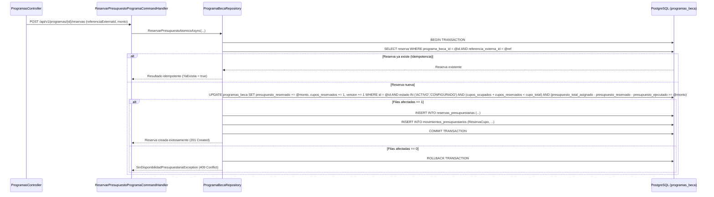

# Design

## Context

El microservicio **MS-PRG (`Ascenso.Programas`)** ya implementa los módulos `Donantes` (**RF-13**), `Universidades` (**RF-14**) y `Programas` (**RF-11**) bajo Arquitectura Hexagonal + DDD Táctico en .NET 10 (`Ascenso.Programas.Domain`, `Application`, `Infrastructure`, `Api`).

En **RF-11**, el agregado raíz `ProgramaBeca` fue creado con `PresupuestoTotalAsignado`, `PresupuestoEjecutado`, `CupoTotal` y `CuposOcupados`. El **RF-12 (Control de Balance Presupuestario, Reservas Atómicas y Cierre de Períodos)** extiende este contexto para resolver dos necesidades críticas del negocio:
1. **[HU-12.1]** Proveer un libro mayor inmutable (`MovimientoPresupuestario`) de cada variación presupuestaria y exponer consultas en tiempo real del balance financiero y de cupos (`Asignado`, `Reservado`, `Ejecutado`, `Disponible`).
2. **[HU-12.2]** Resolver el punto de **Concurrencia Crítica `C2` (`RN-PRG-03`)**: cuando múltiples solicitudes simultáneas intentan reservar el último cupo o el saldo disponible remanente de un programa (`ReservarPresupuestoProgramaCommand`), la verificación y el descuento deben ejecutarse de forma atómica en PostgreSQL (`ExecuteUpdateAsync` condicional dentro de una transacción) para impedir cualquier sobreasignación de cupos o presupuesto, además de gestionar la confirmación (`ConfirmarReservaPresupuestoCommand`), liberación (`LiberarReservaPresupuestoCommand`) y cierre de período (`CerrarPeriodoProgramaCommand`).

## Goals / Non-Goals

**Goals:**
- Incorporar en `Domain/Programas/` la entidad inmutable `MovimientoPresupuestario` (`EntidadInmutable`) y la entidad auditable `ReservaPresupuestaria` (`EntidadAuditable<Guid>`), junto con las enumeraciones `TipoMovimientoPresupuestario` y `EstadoReservaPresupuestaria`, eventos de dominio y excepciones de negocio con nomenclatura 100 % en español y sin setters públicos.
- Extender `ProgramaBeca` con `PresupuestoReservado`, `CuposReservados` y propiedades calculadas en tiempo real `PresupuestoDisponible` (`PresupuestoTotalAsignado - PresupuestoReservado - PresupuestoEjecutado`) y `CuposDisponibles` (`CupoTotal - CuposReservados - CuposOcupados`), registrando movimientos inmutables en cada operación financiera (incluyendo asignaciones y reajustes de fondos de donantes).
- Implementar la reserva atómica concurrente `C2` (`RN-PRG-03`) en `ProgramaBecaRepository` combinando idempotencia por `(ProgramaBecaId, ReferenciaExternaId)` y una sentencia SQL atómica condicional (`ExecuteUpdateAsync`) en transacción que garantice cero sobreasignación bajo ráfagas concurrentes.
- Implementar los casos de uso de confirmación, liberación y cierre contable de período, respetando `.ValueGeneratedNever()` en todos los `Id` UUIDv7 y `Version`, así como el prefijo `_camelCase` en campos privados (`IDE1006`).

**Non-Goals:**
- No se implementa el cálculo de liquidación de nómina ni órdenes de pago bancarias individuales (responsabilidad de `MS-FIN` en `RF-19`/`RF-20`).
- No se altera el motor de evaluación socioeconómica/académica de postulaciones (responsabilidad de `MS-PST`), el cual invoca los contratos de reserva/confirmación/liberación de `MS-PRG`.

## Decisions

### 1. Extensión del Agregado `ProgramaBeca` y Modelo de Dominio (`Domain/Programas/`)
- **Propiedades de balance y cupos en `ProgramaBeca`:**
  - `PresupuestoTotalAsignado` (`decimal`, suma de asignaciones vigentes de donantes).
  - `PresupuestoReservado` (`decimal`, suma de reservas activas en estado `Reservada`).
  - `PresupuestoEjecutado` (`decimal`, suma de reservas confirmadas / desembolsadas).
  - `PresupuestoDisponible => PresupuestoTotalAsignado - PresupuestoReservado - PresupuestoEjecutado` (`decimal`, calculado en tiempo real).
  - `CupoTotal` (`int`), `CuposReservados` (`int`), `CuposOcupados` (`int`) y `CuposDisponibles => CupoTotal - CuposReservados - CuposOcupados` (`int`, calculado en tiempo real).
- **Entidad Inmutable `MovimientoPresupuestario` (`EntidadInmutable`):**
  - Ubicada en `Domain/Programas/Entidades/MovimientoPresupuestario.cs`.
  - Hereda de `EntidadInmutable` (`Id` inicializado con `Guid.CreateVersion7()`, `FechaCreacion`, `UsuarioAutorId`, `CorrelacionId`).
  - Propiedades sin setters públicos: `ProgramaBecaId` (`Guid`), `TipoMovimiento` (`TipoMovimientoPresupuestario`), `Monto` (`decimal`, `>= 0`), `Moneda` (`Moneda`, por defecto `USD`), `ReferenciaExternaId` (`Guid?`), `PeriodoAcademicoId` (`Guid?`), `Descripcion` (`string`), `FechaMovimiento` (`DateTimeOffset`).
  - Enumeración `TipoMovimientoPresupuestario`: `AsignacionDonante = 1`, `ReajusteDonante = 2`, `ReservaCupo = 3`, `ConfirmacionDesembolso = 4`, `LiberacionReserva = 5`, `CierrePeriodo = 6`.
- **Entidad Auditable `ReservaPresupuestaria` (`EntidadAuditable<Guid>`):**
  - Ubicada en `Domain/Programas/Entidades/ReservaPresupuestaria.cs`.
  - Hereda de `EntidadAuditable<Guid>` (`Id` con `Guid.CreateVersion7()` y `Version` con `.ValueGeneratedNever()`).
  - Propiedades sin setters públicos: `ProgramaBecaId` (`Guid`), `ReferenciaExternaId` (`Guid`), `PeriodoAcademicoId` (`Guid`), `Monto` (`decimal > 0`), `Moneda` (`Moneda`), `Descripcion` (`string`), `Estado` (`EstadoReservaPresupuestaria`: `Reservada = 1`, `Confirmada = 2`, `Liberada = 3`), `MotivoLiberacion` (`string?`), `FechaReserva` (`DateTimeOffset`), `FechaResolucion` (`DateTimeOffset?`).
  - Métodos expresivos en `ReservaPresupuestaria`: `Confirmar(Guid? usuarioId = null)` y `Liberar(string motivo, Guid? usuarioId = null)`.
- **Métodos expresivos en `ProgramaBeca`:**
  - `AsignarFondoDonante(...)` y `ReajustarFondoDonante(...)`: además de actualizar `AsignacionFondoPrograma` y `PresupuestoTotalAsignado` (validando que `nuevoPresupuestoTotal >= PresupuestoReservado + PresupuestoEjecutado`), registran automáticamente un `MovimientoPresupuestario` de tipo `AsignacionDonante` o `ReajusteDonante`.
  - `ReservarPresupuesto(Guid referenciaExternaId, Guid periodoAcademicoId, decimal monto, string descripcion, Guid? usuarioId = null)`: valida idempotencia por `referenciaExternaId`, estado operativo (`Activo` o `Configurado`), disponibilidad de cupo (`CuposDisponibles >= 1`) y saldo (`PresupuestoDisponible >= monto`), incrementa `PresupuestoReservado += monto` y `CuposReservados += 1`, agrega la `ReservaPresupuestaria` (`Reservada`), registra el `MovimientoPresupuestario` (`ReservaCupo`) y emite `PresupuestoProgramaReservadoDominioEvent`.
  - `ConfirmarReservaPresupuesto(Guid referenciaExternaId, string? descripcion = null, Guid? usuarioId = null)`: busca la reserva por `referenciaExternaId` (si ya está `Confirmada`, opera de forma idempotente; si está `Liberada`, lanza `TransicionEstadoReservaInvalidaException`), transiciona a `Confirmada`, descuenta `PresupuestoReservado -= reserva.Monto`, incrementa `PresupuestoEjecutado += reserva.Monto`, descuenta `CuposReservados -= 1`, incrementa `CuposOcupados += 1`, registra `MovimientoPresupuestario` (`ConfirmacionDesembolso`) y emite `PresupuestoProgramaConfirmadoDominioEvent`.
  - `LiberarReservaPresupuesto(Guid referenciaExternaId, string motivo, Guid? usuarioId = null)`: busca la reserva por `referenciaExternaId` (si ya está `Liberada`, opera de forma idempotente; si está `Confirmada`, lanza `TransicionEstadoReservaInvalidaException`), transiciona a `Liberada`, descuenta `PresupuestoReservado -= reserva.Monto` y `CuposReservados -= 1`, registra `MovimientoPresupuestario` (`LiberacionReserva`) y emite `ReservaPresupuestoLiberadaDominioEvent`.
  - `CerrarPeriodo(Guid periodoAcademicoId, string observaciones, bool cerrarProgramaDefinitivamente = false, Guid? usuarioId = null)`: verifica que no existan reservas en estado `Reservada` para `periodoAcademicoId` (ni en todo el programa si `cerrarProgramaDefinitivamente == true`, lanzando `ReservasPendientesEnPeriodoException` -> `409 RESERVAS_PENDIENTES_EN_PERIODO`), calcula el saldo remanente no ejecutado (`PresupuestoDisponible`), registra `MovimientoPresupuestario` (`CierrePeriodo`) con el monto remanente consolidado, cambia `Estado` a `EstadoProgramaBeca.Cerrado` si `cerrarProgramaDefinitivamente == true`, y emite `PeriodoProgramaCerradoDominioEvent`.

### 2. Estrategia de Concurrencia Crítica `C2` (`RN-PRG-03`) en Persistencia (`Infrastructure/Persistence/`)

- **Por qué `ExecuteUpdateAsync` condicional dentro de transacción:** En PostgreSQL (`READ COMMITTED`), un `UPDATE ... WHERE (cupos_ocupados + cupos_reservados < cupo_total) AND (presupuesto_total_asignado - presupuesto_reservado - presupuesto_ejecutado >= @monto)` adquiere un bloqueo de fila (`ROW EXCLUSIVE`) sobre el registro de `programas_beca` y re-evalúa la cláusula `WHERE` contra la última versión confirmada de la fila. Si 10 hilos concurrentes compiten por el último cupo (`cupo_total = 1, cupos_reservados = 0`), PostgreSQL serializa la evaluación del `UPDATE` sobre la fila: exactamente 1 hilo obtiene `filasAfectadas = 1` e inserta su `ReservaPresupuestaria` y `MovimientoPresupuestario` en la misma transacción, mientras los otros 9 hilos obtienen `filasAfectadas = 0` y reciben `409 SIN_DISPONIBILIDAD_PRESUPUESTARIA` de manera determinista.
- **Configuración EF Core:**
  - `MovimientoPresupuestarioConfiguracion` (`movimientos_presupuestarios`): `builder.Property(x => x.Id).ValueGeneratedNever()`, conversión de `TipoMovimientoPresupuestario` a `UPPER_SNAKE_CASE`, índices por `(ProgramaBecaId, FechaMovimiento)` y `(ProgramaBecaId, PeriodoAcademicoId)`.
  - `ReservaPresupuestariaConfiguracion` (`reservas_presupuestarias`): `ConfiguracionPersistencia.ConfigurarEntidadAuditable(builder)` (que aplica `.ValueGeneratedNever()` en `Id` y `Version`), índice único compuesto `.HasIndex(x => new { x.ProgramaBecaId, x.ReferenciaExternaId }).IsUnique()` para blindar la idempotencia a nivel de motor relacional.
  - `ProgramaBecaConfiguracion` (`programas_beca`): agrega las columnas `presupuesto_reservado` (`numeric(18,2)`) y `cupos_reservados` (`integer`), e ignora las propiedades calculadas `PresupuestoDisponible` y `CuposDisponibles`.

### 3. Contratos REST y Códigos de Error Estándar
| Operación | Endpoint | Éxito | Errores de Dominio |
|---|---|---|---|
| Consultar balance en tiempo real (`[HU-12.1]`) | `GET /api/v1/programas/{id:guid}/balance` | `200 OK` | `404 PROGRAMA_BECA_NO_ENCONTRADO` |
| Consultar movimientos paginados (`[HU-12.1]`) | `GET /api/v1/programas/{id:guid}/movimientos` | `200 OK` | `404 PROGRAMA_BECA_NO_ENCONTRADO` |
| Reservar cupo y presupuesto (`[HU-12.2]`) | `POST /api/v1/programas/{id:guid}/reservas` | `201 Created` / `200 OK` (idempotente) | `404 PROGRAMA_BECA_NO_ENCONTRADO`, `409 SIN_DISPONIBILIDAD_PRESUPUESTARIA`, `409 ESTADO_PROGRAMA_INVALIDO_PARA_OPERACION`, `409 RESERVA_CON_PARAMETROS_DISTINTOS` |
| Confirmar reserva (`[HU-12.2]`) | `POST /api/v1/programas/{id:guid}/reservas/{referenciaExternaId:guid}/confirmar` | `200 OK` | `404 PROGRAMA_BECA_NO_ENCONTRADO`, `404 RESERVA_PRESUPUESTARIA_NO_ENCONTRADA`, `409 TRANSICION_ESTADO_RESERVA_INVALIDA` |
| Liberar reserva (`[HU-12.2]`) | `POST /api/v1/programas/{id:guid}/reservas/{referenciaExternaId:guid}/liberar` | `200 OK` | `404 PROGRAMA_BECA_NO_ENCONTRADO`, `404 RESERVA_PRESUPUESTARIA_NO_ENCONTRADA`, `409 TRANSICION_ESTADO_RESERVA_INVALIDA` |
| Cerrar período (`[HU-12.2]`) | `POST /api/v1/programas/{id:guid}/cerrar-periodo` | `200 OK` | `404 PROGRAMA_BECA_NO_ENCONTRADO`, `409 RESERVAS_PENDIENTES_EN_PERIODO`, `409 TRANSICION_ESTADO_PROGRAMA_INVALIDA` |

## Risks / Trade-offs

- **[Riesgo] `DbUpdateConcurrencyException` al agregar `ReservaPresupuestaria` o `MovimientoPresupuestario` a un `ProgramaBeca` ya rastreado por EF Core:**
  - *Mitigación:* Aplicar `.ValueGeneratedNever()` explícitamente en `MovimientoPresupuestarioConfiguracion` (`Id`) y `ConfiguracionPersistencia.ConfigurarEntidadAuditable` en `ReservaPresupuestariaConfiguracion` (`Id` y `Version`). Además, para la reserva atómica `C2`, ejecutar la actualización condicional y la inserción de `ReservaPresupuestaria` + `MovimientoPresupuestario` dentro de una transacción explícita en `ProgramaBecaRepository`, y para confirmación/liberación/cierre cargar el grafo con tracking (`ObtenerPorIdAsync` sin `AsNoTracking()`).
- **[Riesgo] Reajuste de fondos de donantes (`RF-11`) por debajo del monto ya reservado + ejecutado:**
  - *Mitigación:* Actualizar la validación en `ProgramaBeca.ReajustarFondoDonante` para exigir que `nuevoPresupuestoTotal >= PresupuestoReservado + PresupuestoEjecutado`, protegiendo tanto el saldo ejecutado como las reservas activas comprometidas.
