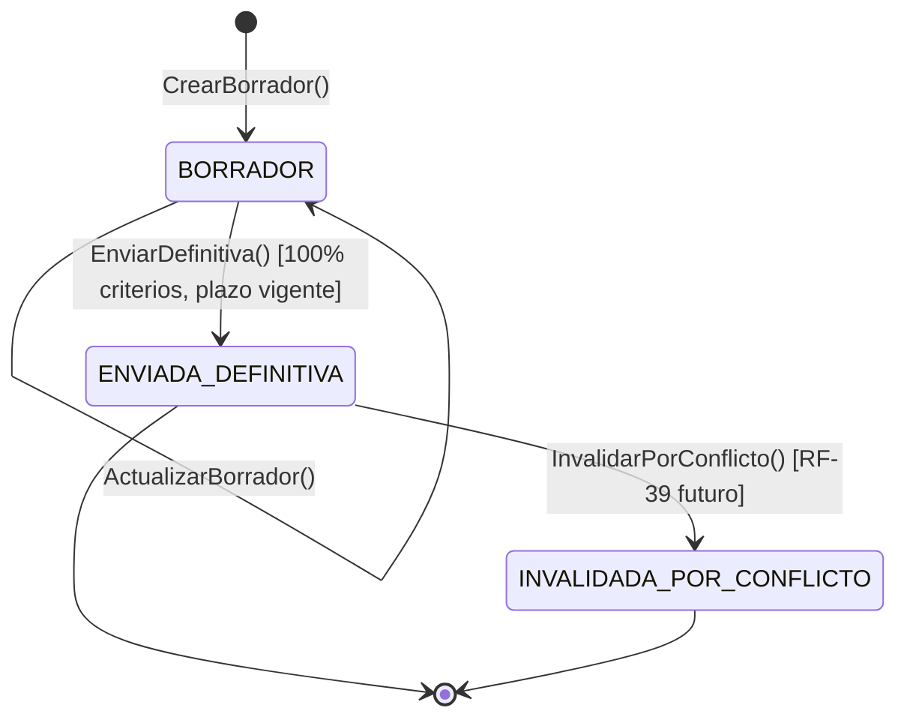
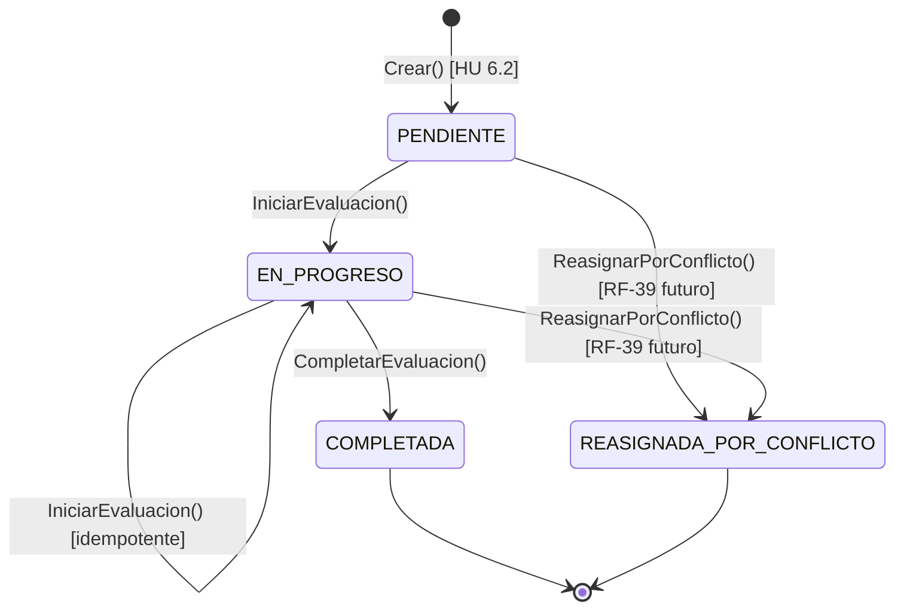

# Design

## Context

Motivación y alcance en `proposal.md`. Estado observado en `develop` dentro de `Apps/services/ms-postulaciones/`:

- **`Postulacion` no existe todavía.** Los agregados implementados son `Postulante` (+`MiembroFamiliar`), `RubricaEvaluacion` (+`CriterioEvaluacion`, HU 7.1–7.2), `ComiteEvaluador` (+`MiembroComite`, HU 6.1), `AsignacionEvaluacion` (HU 6.2) y `AutorizacionExcepcionEvaluadorUnico` (HU 6.3). Coherente con HU 6.2/6.3, `postulacionId` se referencia solo por identificador UUID sin FK ni consulta a `Postulacion`.
- **Bloqueo de `RubricaEvaluacion` ya implementado (HU 7.2):** `RubricaEvaluacion.Bloquear(MotivoBloqueoRubrica.PrimeraCalificacion, fecha, UsuarioSistema.Id)` y `BloquearRubricaCommandHandler` ya están registrados en `Application/DependencyInjection.cs`. El contrato de HU 7.2 D9 establece que HU 8.1 invoca ese bloqueo en proceso al registrarse la primera calificación.
- **`AsignacionEvaluacion` y `ComiteEvaluador`:** `AsignacionEvaluacion` posee `ComiteEvaluadorId`, `ConvocatoriaId`, `PostulacionId`, `MiembroComiteId`, `UsuarioEvaluadorId`, `FechaAsignacion`, `FechaLimiteEvaluacion` y `Estado` (`EstadoAsignacionEvaluacion`: `PENDIENTE`, `EN_PROGRESO`, `COMPLETADA`, `REASIGNADA_POR_CONFLICTO`), pero todavía no tiene métodos de transición de estado. `ComiteEvaluador` posee `(ProgramaBecaId, ConvocatoriaId)` (clave única) y `RubricaEvaluacion` también se identifica unívocamente por `(ProgramaBecaId, ConvocatoriaId)`: esa relación permite resolver exactamente la rúbrica de la asignación sin pedir `rubricaEvaluacionId` al cliente.
- **Convenciones verificadas por pruebas existentes:**
  - `ArchitectureTests` (`EncapsulamientoTests`, `DomainIndependenceTests`, `DependenciasEntreCapasTests`) prohíbe setters públicos en entidades y `ValueObject`, prohíbe colecciones mutables públicas y asegura que `Domain` no referencie infraestructura ni frameworks externos.
  - `IAsignacionEvaluacionRepositoryTests` valida por reflexión el conjunto exacto de métodos de `IAsignacionEvaluacionRepository`. Modificar puertos existentes rompería contratos y pruebas previas.
  - CQRS-Lite sin MediatR: handlers `sealed` con `HandleAsync`, `IUsuarioActual.ObtenerUsuarioIdRequerido()`, `IUnitOfWork`, `IValidator<T>` (FluentValidation), `TimeProvider`. `PostulacionesDbContext.GuardarCambiosAsync` traduce `DbUpdateConcurrencyException` a `ExcepcionConflictoConcurrencia` (`409`) y delega `DbUpdateException` a `TraductorExcepcionesPersistencia`; `ManejadorExcepcionesDominio` traduce `DomainException` a `ProblemDetails` con `codigo`.
  - Seguridad: JWT de Keycloak (`sub`, `roles`), roles literales `COORDINADOR_PROGRAMA`, `MIEMBRO_COMITE`, `ADMIN_FINANCIERO`; `ManejadorResultadoAutorizacionRubricas` es el único `IAuthorizationMiddlewareResultHandler` registrado en `Program.cs`.
- **Nomenclatura DDD V7:** `docs/Explicacion_del_DDD_V7.md` (§2.3.B y §5) nombra el agregado raíz `Evaluacion` y la entidad hija `CalificacionCriterio` (en lugar de `PuntuacionCriterio`). En cumplimiento de `docs/convenciones_c_y_ddd.md`, el modelo de dominio usa literalmente `Evaluacion` y `CalificacionCriterio`.
- **Hangfire:** `docs/Explicacion_del_DDD_V7.md` (§6.3) no exige trabajos en segundo plano para RF-08 y `ms-postulaciones` no registra Hangfire. La ejecución de HU 8.1 es completamente síncrona sin tocar `packages.lock.json` ni romper `dotnet restore --locked-mode`.

## Goals / Non-Goals

**Goals:**

- Modelar el agregado `Evaluacion`, la entidad hija `CalificacionCriterio`, el objeto de valor `DatosCalificacionCriterio`, el servicio puro `ServicioCalculoPuntajeEvaluacion` y las transiciones explícitas de `Evaluacion` y `AsignacionEvaluacion` cumpliendo SOLID y las invariantes de DDD V7 (`RN-POS-04`, `RN-POS-05`, `RN-PLT-02`, `C5`).
- Garantizar la evaluación ciega estricta (`403 EVALUACION_CONFIDENCIAL` entre evaluadores) y la segregación por rol (`MIEMBRO_COMITE`, `COORDINADOR_PROGRAMA`, `ADMIN_FINANCIERO → 403 PERMISO_DENEGADO`).
- Disparar de forma segura y concurrente (`C5`) el bloqueo `PUBLICADA → BLOQUEADA` (`PRIMERA_CALIFICACION`) de `RubricaEvaluacion` al guardarse el primer borrador.
- Persistir con integridad total en PostgreSQL (esquema `postulaciones`, `timestamptz`, tipos `numeric` exactos, índices únicos, `CHECK`, `FK` y concurrencia optimista).

**Non-Goals:**

- HU 8.2 / HUs posteriores de RF-08 (visibilidad cruzada entre coevaluadores al cerrar el periodo de revisión y validación contra el estado de cierre de `Convocatoria`).
- RF-09 (`ResultadoConsolidadoRanking`, promedio entre evaluadores, discrepancias), RF-10 (empates y `EntradaListaEspera`) y RF-39 (`ConflictoInteres`, `ReasignarPorConflicto`, `InvalidarPorConflicto`).
- Validación de existencia/estado de `Postulacion`, notificaciones (`RF-31`), eventos de integración (`MS-AUD`/`MS-PLT`), Hangfire, Outbox, MediatR.
- Modificar `Postulantes`, `ComitesEvaluadoresController`, `IComiteEvaluadorRepository`, `IRubricaRepository`, `IAsignacionEvaluacionRepository`, `RubricasController`, `AsignacionesEvaluacionController` ni `Domain/Comun`.

## Decisions

### D1. Aplicación práctica y auditable de SOLID

| Principio | Aplicación concreta en `rf8-1-int2-mspos` |
|---|---|
| **SRP** | `Evaluacion` gobierna su ciclo de vida e invariantes de negocio; `CalificacionCriterio` encapsula el puntaje y comentario de un criterio; `DatosCalificacionCriterio` valida la entrada inmutable por criterio; `ServicioCalculoPuntajeEvaluacion` calcula en puro C# el puntaje ponderado normalizado; `AsignacionEvaluacion` gobierna sus propias transiciones (`IniciarEvaluacion`, `CompletarEvaluacion`); cada comando/consulta tiene su propio `Command`/`Query`, `Validator`, `Handler` y `EvaluacionMapeador` concentra el mapeo a DTOs. |
| **OCP** | Se extiende de forma puramente aditiva: `AsignacionEvaluacion` solo agrega métodos de transición sin alterar `Crear` ni pruebas previas; `Evaluaciones` no reescribe lógica ni contratos de `Postulantes`, `Rubricas`, `Comites` ni `Asignaciones`; se reutiliza `BloquearRubricaCommandHandler` mediante un adaptador sin editar su clase; `ManejadorResultadoAutorizacionRubricas` y `TraductorExcepcionesPersistencia` solo agregan ramas nuevas. |
| **ISP** | En lugar de engordar `IRubricaRepository` o `IAsignacionEvaluacionRepository` (lo cual además violaría sus pruebas de contrato), se definen puertos pequeños y específicos: `IEvaluacionRepository`, `IConsultaAsignacionParaEvaluacionRepository`, `IConsultaRubricaParaEvaluacionRepository` e `IBloqueadorRubricaEvaluacion`. |
| **DIP** | `Domain` define los puertos de persistencia y permanece 100% libre de EF Core/Npgsql/ASP.NET Core (`DomainIndependenceTests`). Los handlers de `Application` dependen exclusivamente de interfaces (`IEvaluacionRepository`, `IConsultaAsignacionParaEvaluacionRepository`, `IComiteEvaluadorRepository`, `IConsultaRubricaParaEvaluacionRepository`, `IBloqueadorRubricaEvaluacion`, `IUsuarioActual`, `IUnitOfWork`, `IValidator<T>`, `TimeProvider`), lo que permite probarlos con dobles sin acoplarse a `BloquearRubricaCommandHandler` (`sealed`) ni a EF Core. |

### D2. Máquinas de estado explícitas (sin librerías externas)

#### 2.1 `EstadoEvaluacion` (`Domain/Enums/EstadoEvaluacion.cs`, con `CodigoEnum`)

| Valor C# | Código persistido (`VARCHAR(30)`) | Significado |
|---|---|---|
| `Borrador` | `BORRADOR` | Evaluación editable en progreso por el evaluador asignado |
| `EnviadaDefinitiva` | `ENVIADA_DEFINITIVA` | Evaluación enviada, completa, ponderada e inmutable |
| `InvalidadaPorConflicto` | `INVALIDADA_POR_CONFLICTO` | Reservado para RF-39; terminal e inmutable en HU 8.1 |

| Estado origen | Operación | Estado destino | Resultado / Excepción |
|---|---|---|---|
| `∅` | `Evaluacion.CrearBorrador(...)` | `BORRADOR` | Válida (exige pertenencia, plazo vigente, rúbrica `PUBLICADA`/`BLOQUEADA`, $\ge 1$ calificación válida en rango) |
| `BORRADOR` | `ActualizarBorrador(...)` | `BORRADOR` | Válida (reemplaza/actualiza calificaciones y comentarios, incrementa `Version`) |
| `BORRADOR` | `EnviarDefinitiva(...)` | `ENVIADA_DEFINITIVA` | Válida si 100% de criterios de la rúbrica están calificados y plazo vigente; calcula `PuntajeTotalPonderado` y `FechaEnvio` UTC |
| `ENVIADA_DEFINITIVA` | `ActualizarBorrador(...)` | — | Inválida → `EvaluacionYaEnviadaException` (`409 EVALUACION_YA_ENVIADA`) |
| `ENVIADA_DEFINITIVA` | `EnviarDefinitiva(...)` | — | Inválida → `EvaluacionYaEnviadaException` (`409 EVALUACION_YA_ENVIADA`) |
| `INVALIDADA_POR_CONFLICTO` | `ActualizarBorrador(...)` / `EnviarDefinitiva(...)` | — | Inválida → `EvaluacionInvalidadaException` (`409 EVALUACION_INVALIDADA`) |
| `ENVIADA_DEFINITIVA` | *(Futuro RF-39)* `InvalidarPorConflicto(...)` | `INVALIDADA_POR_CONFLICTO` | Fuera de alcance HU 8.1 (contrato en D10) |

#### 2.2 `EstadoAsignacionEvaluacion` (métodos aditivos en `AsignacionEvaluacion`)

| Estado origen | Método en `AsignacionEvaluacion` | Estado destino | Resultado / Excepción |
|---|---|---|---|
| `PENDIENTE` | `IniciarEvaluacion(fecha, evaluadorId)` | `EN_PROGRESO` | Válida; actualiza auditoría/`Version`; retorna `true` |
| `EN_PROGRESO` | `IniciarEvaluacion(fecha, evaluadorId)` | `EN_PROGRESO` | Idempotente; no altera auditoría ni `Version`; retorna `false` |
| `COMPLETADA` | `IniciarEvaluacion(...)` | — | Inválida → `EvaluacionYaEnviadaException` (`409 EVALUACION_YA_ENVIADA`) |
| `REASIGNADA_POR_CONFLICTO` | `IniciarEvaluacion(...)` | — | Inválida → `AsignacionNoEvaluableException` (`409 ASIGNACION_NO_EVALUABLE`) |
| `EN_PROGRESO` | `CompletarEvaluacion(fecha, evaluadorId)` | `COMPLETADA` | Válida; actualiza auditoría/`Version` |
| `PENDIENTE` | `CompletarEvaluacion(...)` | — | Inválida → `AsignacionNoEvaluableException` (`409 ASIGNACION_NO_EVALUABLE`) |
| `COMPLETADA` | `CompletarEvaluacion(...)` | — | Inválida → `EvaluacionYaEnviadaException` (`409 EVALUACION_YA_ENVIADA`) |
| `REASIGNADA_POR_CONFLICTO` | `CompletarEvaluacion(...)` | — | Inválida → `AsignacionNoEvaluableException` (`409 ASIGNACION_NO_EVALUABLE`) |

En ambos métodos, si `usuarioEvaluadorId != UsuarioEvaluadorId` se lanza `EvaluacionConfidencialException` (`403 EVALUACION_CONFIDENCIAL`) antes de revelar el estado de la asignación.

Alternativa descartada: usar una librería de máquina de estados (ej. Stateless). Añadiría una dependencia NuGet, rompería `DomainIndependenceTests` y ocultaría invariantes simples que en C# puro son explícitas, auditablemente legibles y directamente verificables con pruebas unitarias.

### D3. Modelo de Dominio (`Ascenso.Postulaciones.Domain`)

#### 3.1 Objeto de valor `DatosCalificacionCriterio` (`Domain/Evaluaciones/ObjetosValor/`)
- `public sealed record class DatosCalificacionCriterio : ValueObject` (mismo patrón que `DatosMiembroFamiliar`, solo `get` para pasar `EncapsulamientoTests`).
- Propiedades: `Guid CriterioEvaluacionId`, `decimal PuntajeAsignado`, `string? Comentario`.
- Reglas en constructor:
  - `criterioEvaluacionId == Guid.Empty` → `EvaluacionInvalidaException`.
  - `decimal.Round(puntajeAsignado, 2) != puntajeAsignado` → `EvaluacionInvalidaException` (máximo 2 decimales, coherente con `CriterioEvaluacion.DecimalesMaximos = 2`).
  - `comentario`: si es `null` o solo espacios → se normaliza a `null`; si `Trim().Length > 1000` (`LongitudMaximaComentario = 1000`) → `EvaluacionInvalidaException`.

#### 3.2 Entidad hija `CalificacionCriterio` (`Domain/Evaluaciones/Entidades/`)
- `public sealed class CalificacionCriterio : EntidadAuditable` (constructor privado para EF, setters privados).
- Propiedades: `EvaluacionId`, `CriterioEvaluacionId`, `PuntajeAsignado`, `Comentario`.
- Fábrica `internal static Crear(Guid evaluacionId, CriterioEvaluacion criterio, DatosCalificacionCriterio datos, DateTimeOffset fechaCreacion, Guid usuarioEvaluadorId)` y método `internal void Actualizar(CriterioEvaluacion criterio, DatosCalificacionCriterio datos, DateTimeOffset fechaModificacion, Guid usuarioEvaluadorId)`.
- Valida `datos.PuntajeAsignado >= criterio.PuntajeMinimo && datos.PuntajeAsignado <= criterio.PuntajeMaximo`; fuera de rango → `PuntajeFueraDeRangoException(criterio.Nombre, criterio.PuntajeMinimo, criterio.PuntajeMaximo, datos.PuntajeAsignado)`.
- Encapsulamiento `internal` en `Crear`/`Actualizar`: garantiza que ninguna calificación pueda instanciarse ni mutarse fuera de la raíz de agregado `Evaluacion`.

#### 3.3 Servicio de dominio puro `ServicioCalculoPuntajeEvaluacion` (`Domain/Evaluaciones/Servicios/`)
- Clase `public static class ServicioCalculoPuntajeEvaluacion`, sin dependencias externas.
- Método `public static decimal CalcularPuntajeTotalPonderado(RubricaEvaluacion rubrica, IReadOnlyCollection<CalificacionCriterio> calificaciones)`:
  - Verifica que el 100% de los criterios de `rubrica.Criterios` estén presentes en `calificaciones` (si faltan → `EvaluacionIncompletaException(faltantes)`), que no haya criterios ajenos (`CriterioNoPerteneceARubricaException`) ni duplicados (`EvaluacionInvalidaException`), y que cada puntaje respete `[criterio.PuntajeMinimo, criterio.PuntajeMaximo]` (`PuntajeFueraDeRangoException`).
  - Aplica las fórmulas exactas de DDD V7 (§2.3.B):
    $$\text{puntajeNormalizado}(c) = \frac{\text{puntajeAsignado}(c) - \text{puntajeMinimo}(c)}{\text{puntajeMaximo}(c) - \text{puntajeMinimo}(c)} \times 100$$
    $$\text{puntajeTotalPonderado} = \text{Round}\left(\sum_{c} \left(\text{puntajeNormalizado}(c) \times \frac{\text{pesoPorcentual}(c)}{100}\right),\; 2,\; \text{AwayFromZero}\right)$$
  - Al acumular con aritmética `decimal` completa y redondear una sola vez al final con `MidpointRounding.AwayFromZero`, garantiza precisión exacta en los extremos (`0.00` y `100.00`) y resultado determinista en `[0.00, 100.00]`.

#### 3.4 Raíz de agregado `Evaluacion` (`Domain/Evaluaciones/Agregados/`)
- `public sealed class Evaluacion : AggregateRoot` (constructor privado para EF, setters privados, `private readonly List<CalificacionCriterio> _calificaciones = [];`, `public IReadOnlyCollection<CalificacionCriterio> Calificaciones => _calificaciones.AsReadOnly();`).
- Constante `LongitudMaximaComentariosGenerales = 2000`.
- Propiedades (alineadas literalmente a DDD V7 §2.3.B):
  - `AsignacionEvaluacionId`, `PostulacionId`, `ConvocatoriaId`, `RubricaEvaluacionId`, `EvaluadorId`
  - `FechaInicio` (`DateTimeOffset` UTC), `FechaEnvio` (`DateTimeOffset?` UTC)
  - `PuntajeTotalPonderado` (`decimal?`, `null` en `BORRADOR`, `[0.00, 100.00]` en `ENVIADA_DEFINITIVA`)
  - `ComentariosGenerales` (`string?`, recortado o `null`)
  - `Estado` (`EstadoEvaluacion`)
  - `MotivoInvalidacion` (`string?`, `null` en HU 8.1)
- Métodos de dominio:
  - `static CrearBorrador(AsignacionEvaluacion asignacion, RubricaEvaluacion rubrica, IReadOnlyCollection<DatosCalificacionCriterio> calificaciones, string? comentariosGenerales, DateTimeOffset ahora, Guid usuarioEvaluadorId)`:
    - Valida argumentos técnicos (`ArgumentNullException` / `ArgumentException` para `ahora == default` o `usuarioEvaluadorId == Guid.Empty`).
    - Valida pertenencia: `asignacion.UsuarioEvaluadorId == usuarioEvaluadorId` → si no, `EvaluacionConfidencialException` (`403`).
    - Valida estado de asignación: `Completada` → `EvaluacionYaEnviadaException`; `ReasignadaPorConflicto` → `AsignacionNoEvaluableException`.
    - Valida plazo: `ahora <= asignacion.FechaLimiteEvaluacion` → si no, `PlazoEvaluacionVencidoException`.
    - Valida rúbrica: `rubrica.Estado == EstadoRubrica.Borrador` → `RubricaNoPublicadaException`; `rubrica.ConvocatoriaId != asignacion.ConvocatoriaId` → `EvaluacionInvalidaException`.
    - Valida `calificaciones`: al menos 1 elemento (cardinalidad `1..*` del DDD), sin `CriterioEvaluacionId` duplicado (`EvaluacionInvalidaException`), cada criterio presente en `rubrica.Criterios` (`CriterioNoPerteneceARubricaException`), cada puntaje dentro del rango del criterio (`PuntajeFueraDeRangoException`).
    - Normaliza `comentariosGenerales` (`Trim()`, `null` si vacío, máximo 2000 caracteres).
    - Nace en `Estado = EstadoEvaluacion.Borrador`, `FechaInicio = FechaCreacion` (UTC), `FechaEnvio = null`, `PuntajeTotalPonderado = null`.
  - `ActualizarBorrador(RubricaEvaluacion rubrica, IReadOnlyCollection<DatosCalificacionCriterio> calificaciones, string? comentariosGenerales, DateTimeOffset fechaLimiteEvaluacion, DateTimeOffset ahora, Guid usuarioEvaluadorId)`:
    - Valida pertenencia (`EvaluadorId == usuarioEvaluadorId` → `403 EVALUACION_CONFIDENCIAL`), estado `Borrador` (`EnviadaDefinitiva` → `EvaluacionYaEnviadaException`; `InvalidadaPorConflicto` → `EvaluacionInvalidadaException`), plazo (`ahora <= fechaLimiteEvaluacion` → `PlazoEvaluacionVencidoException`), coherencia de rúbrica (`rubrica.Id == RubricaEvaluacionId` y `rubrica.Estado != Borrador`), calificaciones no vacías, sin duplicados, pertenecientes a la rúbrica y en rango.
    - Sincroniza `_calificaciones` preservando instancias existentes por `CriterioEvaluacionId` (`Actualizar`), agregando nuevas (`Crear`) y removiendo las omitidas; actualiza `ComentariosGenerales` y llama `ActualizarAuditoria(usuarioEvaluadorId, ahora)`.
  - `EnviarDefinitiva(RubricaEvaluacion rubrica, DateTimeOffset fechaLimiteEvaluacion, DateTimeOffset ahora, Guid usuarioEvaluadorId)`:
    - Valida pertenencia (`EvaluadorId == usuarioEvaluadorId` → `403 EVALUACION_CONFIDENCIAL`), estado `Borrador` (`EnviadaDefinitiva` → `EvaluacionYaEnviadaException`; `InvalidadaPorConflicto` → `EvaluacionInvalidadaException`), plazo (`ahora <= fechaLimiteEvaluacion` → `PlazoEvaluacionVencidoException`), rúbrica igual a `RubricaEvaluacionId` y `rubrica.Estado != Borrador`.
    - Calcula `PuntajeTotalPonderado = ServicioCalculoPuntajeEvaluacion.CalcularPuntajeTotalPonderado(rubrica, _calificaciones)` (exige 100% de criterios en rango; si faltan lanza `EvaluacionIncompletaException`).
    - Llama `ActualizarAuditoria(usuarioEvaluadorId, ahora)`, fija `FechaEnvio = FechaUltimaModificacion` y `Estado = EstadoEvaluacion.EnviadaDefinitiva`.

### D4. Excepciones de dominio (`Domain/Excepciones/`)

Se reutilizan sin modificar `RubricaNoEncontradaException` (`404`), `RubricaNoPublicadaException` (`409`), `ComiteNoEncontradoException` (`404`), `NoAutenticadoException` (`401`) y `ExcepcionConflictoConcurrencia` (`409`). Se agregan:

| Excepción | Base | `CodigoError` | HTTP | Motivo |
|---|---|---|---|---|
| `AsignacionEvaluacionNoEncontradaException` | `ExcepcionEntidadNoEncontrada` | `ASIGNACION_NO_ENCONTRADA` | 404 | Asignación inexistente |
| `EvaluacionNoEncontradaException` | `ExcepcionEntidadNoEncontrada` | `EVALUACION_NO_ENCONTRADA` | 404 | Evaluación no encontrada para la asignación |
| `EvaluacionConfidencialException` | `ExcepcionReglaNegocio` | `EVALUACION_CONFIDENCIAL` *(RN-PLT-02)* | 403 | Acceso de `MIEMBRO_COMITE` sobre asignación/evaluación de otro evaluador |
| `AsignacionNoEvaluableException` | `ExcepcionReglaNegocio` | `ASIGNACION_NO_EVALUABLE` | 409 | Asignación en estado no evaluable (`REASIGNADA_POR_CONFLICTO` o transición inválida) |
| `EvaluacionYaEnviadaException` | `ExcepcionReglaNegocio` | `EVALUACION_YA_ENVIADA` | 409 | Mutación o reenvío de evaluación `ENVIADA_DEFINITIVA` o asignación `COMPLETADA` |
| `EvaluacionInvalidadaException` | `ExcepcionReglaNegocio` | `EVALUACION_INVALIDADA` | 409 | Mutación o envío de evaluación `INVALIDADA_POR_CONFLICTO` |
| `EvaluacionDuplicadaException` | `ExcepcionReglaNegocio` | `EVALUACION_DUPLICADA` | 409 | Violación de índice único 1:0..1 `asignacion_evaluacion_id` |
| `PlazoEvaluacionVencidoException` | `ExcepcionReglaNegocio` | `PLAZO_EVALUACION_VENCIDO` | 409 | `ahora > fechaLimiteEvaluacion` |
| `PuntajeFueraDeRangoException` | `ExcepcionReglaNegocio` | `PUNTAJE_FUERA_DE_RANGO` | 422 | `puntajeAsignado` fuera de `[puntajeMinimo, puntajeMaximo]` |
| `CriterioNoPerteneceARubricaException` | `ExcepcionReglaNegocio` | `CRITERIO_NO_PERTENECE_A_RUBRICA` | 422 | Criterio inexistente en la rúbrica de la convocatoria |
| `EvaluacionIncompletaException` | `ExcepcionReglaNegocio` | `EVALUACION_INCOMPLETA` | 422 | Envío definitivo con criterios faltantes |
| `EvaluacionInvalidaException` | `ExcepcionReglaNegocio` | `EVALUACION_INVALIDA` | 422 | Invariante estructural (sin calificaciones, duplicados, decimales, longitudes, convocatoria inconsistente) |

`ManejadorExcepcionesDominio` ya traduce toda `DomainException` a `ProblemDetails` con `codigo` y `Status = domainException.EstadoHttp`, por lo que no requiere modificación.

### D5. Puertos ISP (`Domain/Interfaces/` y `Application/Evaluaciones/Interfaces/`)

1. **`IEvaluacionRepository`** (`Domain/Interfaces/`):
   - `ObtenerPorAsignacionAsync(Guid asignacionEvaluacionId, CancellationToken ct = default)` *(AsNoTracking + Include `Calificaciones`)*
   - `ObtenerParaActualizarPorAsignacionAsync(Guid asignacionEvaluacionId, CancellationToken ct = default)` *(Tracked + Include `Calificaciones`)*
   - `ListarPorEvaluadorAsync(Guid evaluadorId, EstadoEvaluacion? estado, int pagina, int tamano, CancellationToken ct = default)` → `PaginaResultado<Evaluacion>` *(AsNoTracking + Include `Calificaciones`, orden `FechaUltimaModificacion` desc, `Id`)*
   - `ListarDefinitivasPorPostulacionAsync(Guid postulacionId, CancellationToken ct = default)` → `IReadOnlyList<Evaluacion>` *(AsNoTracking + Include `Calificaciones`, filtra `Estado != EstadoEvaluacion.Borrador`, orden `FechaEnvio`, `Id`)*
   - `AgregarAsync(Evaluacion evaluacion, CancellationToken ct = default)`
2. **`IConsultaAsignacionParaEvaluacionRepository`** (`Domain/Interfaces/`):
   - `ObtenerPorIdAsync(Guid asignacionEvaluacionId, CancellationToken ct = default)` *(AsNoTracking)*
   - `ObtenerParaActualizarPorIdAsync(Guid asignacionEvaluacionId, CancellationToken ct = default)` *(Tracked)*
3. **`IConsultaRubricaParaEvaluacionRepository`** (`Domain/Interfaces/`):
   - `ObtenerPorProgramaYConvocatoriaAsync(Guid programaBecaId, Guid convocatoriaId, CancellationToken ct = default)` *(AsNoTracking + Include `Criterios`)*
4. **`IBloqueadorRubricaEvaluacion`** (`Application/Evaluaciones/Interfaces/`):
   - `BloquearPorPrimeraCalificacionAsync(Guid rubricaId, CancellationToken ct = default)`
   - Implementado por `BloqueadorRubricaEvaluacionAdapter` (`Application/Evaluaciones/Servicios/`), que delega en `BloquearRubricaCommandHandler` (HU 7.2) con `MotivoBloqueoRubrica.PrimeraCalificacion`.

Se reutiliza `IComiteEvaluadorRepository.ObtenerPorIdAsync` (HU 6.1) sin modificar su interfaz ni su repositorio. Ningún puerto previo cambia.

### D6. Capa de Aplicación (`Ascenso.Postulaciones.Application`, CQRS sin MediatR, síncrona)

Carpeta `Application/Evaluaciones/` con `Comandos/<Caso>/`, `Consultas/<Caso>/`, `DTOs/`, `Interfaces/` y `Servicios/`:

| Caso | Entrada y validador | Flujo del handler |
|---|---|---|
| `GuardarBorradorEvaluacionCommand(AsignacionEvaluacionId, Calificaciones, ComentariosGenerales)` | Validador: `AsignacionEvaluacionId != Empty`, `Calificaciones` no nula ni vacía, cada elemento con `CriterioEvaluacionId != Empty`, `PuntajeAsignado` en `[0, 1000]` máx. 2 dec., `Comentario` máx. 1000, sin `CriterioEvaluacionId` repetidos, `ComentariosGenerales` máx. 2000. | Validar → `usuarioId = ObtenerUsuarioIdRequerido()` → cargar `AsignacionEvaluacion` (tracked; si `null` → `404 ASIGNACION_NO_ENCONTRADA`; si `UsuarioEvaluadorId != usuarioId` → `403 EVALUACION_CONFIDENCIAL`) → cargar `ComiteEvaluador` (`404 COMITE_NO_ENCONTRADO`) → cargar `RubricaEvaluacion` por `(comite.ProgramaBecaId, comite.ConvocatoriaId)` (`404 RUBRICA_NO_ENCONTRADA`) → cargar `Evaluacion` existente por asignación (tracked) → construir `DatosCalificacionCriterio` → si no existe: `Evaluacion.CrearBorrador(...)`, `asignacion.IniciarEvaluacion(...)`, `AgregarAsync` (`esCreacion = true`); si existe: `evaluacion.ActualizarBorrador(...)`, `asignacion.IniciarEvaluacion(...)` (`esCreacion = false`) → `GuardarCambiosAsync` → si `rubrica.Estado == EstadoRubrica.Publicada`: `_bloqueadorRubrica.BloquearPorPrimeraCalificacionAsync(rubrica.Id)` → retornar `ResultadoGuardarBorradorEvaluacionDto(evaluacion.ADto(), esCreacion)`. |
| `EnviarEvaluacionDefinitivaCommand(AsignacionEvaluacionId)` | Validador: `AsignacionEvaluacionId != Empty`. | Validar → `usuarioId = ObtenerUsuarioIdRequerido()` → cargar `AsignacionEvaluacion` (tracked; `404` / `403 EVALUACION_CONFIDENCIAL`) → cargar `Evaluacion` (tracked; si `null` → `404 EVALUACION_NO_ENCONTRADA`) → cargar `ComiteEvaluador` + `RubricaEvaluacion` (`404`) → `evaluacion.EnviarDefinitiva(rubrica, asignacion.FechaLimiteEvaluacion, ahora, usuarioId)` → `asignacion.CompletarEvaluacion(ahora, usuarioId)` → `GuardarCambiosAsync` → si `rubrica.Estado == EstadoRubrica.Publicada`: `_bloqueadorRubrica.BloquearPorPrimeraCalificacionAsync(rubrica.Id)` (resguardo idempotente) → retornar `EvaluacionDto`. |
| `ObtenerMiEvaluacionPorAsignacionQuery(AsignacionEvaluacionId)` | Validador: `AsignacionEvaluacionId != Empty`. | Validar → `usuarioId = ObtenerUsuarioIdRequerido()` → cargar `AsignacionEvaluacion` (no tracking; si `null` → `404 ASIGNACION_NO_ENCONTRADA`; si `UsuarioEvaluadorId != usuarioId` → `403 EVALUACION_CONFIDENCIAL`) → cargar `Evaluacion` por asignación (no tracking; si `null` → `404 EVALUACION_NO_ENCONTRADA`) → `evaluacion.ADto()`. |
| `ObtenerMisEvaluacionesQuery(Estado?, Pagina, Tamano)` | Validador: `Pagina >= 1`, `1 <= Tamano <= 100`, `Estado` definido si tiene valor. | Validar → `usuarioId = ObtenerUsuarioIdRequerido()` → `ListarPorEvaluadorAsync(usuarioId, Estado, Pagina, Tamano)` → `PaginaDto<ResumenMiEvaluacionDto>`. |
| `ObtenerEvaluacionesPostulacionQuery(PostulacionId)` | Validador: `PostulacionId != Empty`. | Validar → `ListarDefinitivasPorPostulacionAsync(PostulacionId)` → `EvaluacionesPostulacionDto(PostulacionId, evaluaciones)`. |

**Composición con `BloquearRubricaCommandHandler` y concurrencia `C5`:**
Al confirmar `GuardarCambiosAsync` de `Evaluacion` + `AsignacionEvaluacion` **antes** de invocar `IBloqueadorRubricaEvaluacion.BloquearPorPrimeraCalificacionAsync`, evitamos dos problemas críticos bajo concurrencia:
1. Un borrador inválido nunca bloquea la rúbrica prematuramente (todas las validaciones y restricciones de BD de la evaluación ya pasaron).
2. Si dos evaluadores (`E1` y `E2`) guardan su primer borrador simultáneamente sobre una rúbrica `PUBLICADA`, cada uno confirma primero su propia fila (`Evaluacion` + `AsignacionEvaluacion`) sin contención (`C5`). Luego ambos invocan `BloquearRubricaCommandHandler`: uno bloquea la rúbrica (`PUBLICADA → BLOQUEADA`) y el otro recibe `ExcepcionConflictoConcurrencia` solo sobre `RubricaEvaluacion`, que `BloquearRubricaCommandHandler` absorbe releyendo `BLOQUEADA`, sin contaminar ni revertir el `GuardarCambiosAsync` ya confirmado de `E2`.

Alternativa considerada: ejecutar `ExecuteUpdateAsync` de bloqueo dentro de una transacción explícita única con la evaluación. Garantiza atomicidad estricta ante caída del proceso entre ambos commits, pero duplica la lógica de `RubricaEvaluacion.Bloquear` en SQL de infraestructura saltándose el contrato de HU 7.2 D9 (`BloquearRubricaCommandHandler`). Se adopta la reutilización de `BloquearRubricaCommandHandler` con resguardo idempotente también en `EnviarEvaluacionDefinitivaCommandHandler`, documentando el trade-off en Riesgos.

**DTOs (`Application/Evaluaciones/DTOs/`):**
- `CalificacionCriterioDto(Id, CriterioEvaluacionId, PuntajeAsignado, Comentario)`
- `EvaluacionDto(Id, AsignacionEvaluacionId, PostulacionId, ConvocatoriaId, RubricaEvaluacionId, Estado, FechaInicio, FechaEnvio, PuntajeTotalPonderado, ComentariosGenerales, Calificaciones, Version)` — vista del evaluador (no incluye `EvaluadorId` ajeno ni datos de coevaluadores ni identidad del postulante; `Estado` como código `CodigoEnum` en mayúsculas).
- `ResultadoGuardarBorradorEvaluacionDto(EvaluacionDto Evaluacion, bool EsCreacion)` — permite al controlador responder `201 Created` (con `Location`) en el primer borrador y `200 OK` en actualizaciones.
- `ResumenMiEvaluacionDto(EvaluacionId, AsignacionEvaluacionId, PostulacionId, ConvocatoriaId, RubricaEvaluacionId, Estado, FechaInicio, FechaEnvio, PuntajeTotalPonderado, CantidadCriteriosCalificados, Version)` — para paginación ligera de `mis-evaluaciones`.
- `EvaluacionSupervisionDto(Id, AsignacionEvaluacionId, PostulacionId, ConvocatoriaId, RubricaEvaluacionId, EvaluadorId, Estado, FechaInicio, FechaEnvio, PuntajeTotalPonderado, ComentariosGenerales, MotivoInvalidacion, Calificaciones, Version)` y `EvaluacionesPostulacionDto(PostulacionId, IReadOnlyList<EvaluacionSupervisionDto> Evaluaciones)` — vista exclusiva de `COORDINADOR_PROGRAMA` solo para evaluaciones no borrador.
- `EvaluacionMapeador`: métodos de extensión puros (`ADto()`, `AResumenMiEvaluacionDto()`, `ASupervisionDto()`), ordenando `Calificaciones` de forma determinista por `CriterioEvaluacionId` e `Id`.
- Registro `AddScoped` en `Application/DependencyInjection.cs` para los 5 handlers y `IBloqueadorRubricaEvaluacion → BloqueadorRubricaEvaluacionAdapter` (los validadores ya se registran automáticamente vía `AddValidatorsFromAssembly`).

### D7. Persistencia (`Ascenso.Postulaciones.Infrastructure`, esquema `postulaciones`)

Nuevas configuraciones en `Infrastructure/Persistence/Configuraciones/` usando `ConfiguracionPersistencia.ConfigurarEntidadAuditable` y `ComoCodigoEnum`:

1. **Tabla `postulaciones.evaluaciones`** (`EvaluacionConfiguracion`):
   - `id uuid` (`pk_evaluaciones`, `ValueGeneratedNever`), auditoría `timestamptz` y `version` (`IsConcurrencyToken`).
   - `asignacion_evaluacion_id uuid NOT NULL`
   - `postulacion_id uuid NOT NULL`
   - `convocatoria_id uuid NOT NULL`
   - `rubrica_evaluacion_id uuid NOT NULL`
   - `evaluador_id uuid NOT NULL`
   - `fecha_inicio timestamptz NOT NULL`
   - `fecha_envio timestamptz NULL`
   - `puntaje_total_ponderado numeric(5,2) NULL`
   - `comentarios_generales varchar(2000) NULL`
   - `estado varchar(30) NOT NULL` (`ComoCodigoEnum`)
   - `motivo_invalidacion varchar(1000) NULL`
   - Claves foráneas:
     - `fk_evaluaciones_asignaciones_evaluacion` → `asignaciones_evaluacion(id)` (`ON DELETE RESTRICT`)
     - `fk_evaluaciones_rubricas` → `rubricas(id)` (`ON DELETE RESTRICT`)
   - Restricciones `CHECK`:
     - `ck_evaluaciones_estado_valido`: `estado IN ('BORRADOR', 'ENVIADA_DEFINITIVA', 'INVALIDADA_POR_CONFLICTO')` (`ValoresSql<EstadoEvaluacion>()`)
     - `ck_evaluaciones_puntaje_total_rango`: `puntaje_total_ponderado IS NULL OR (puntaje_total_ponderado >= 0 AND puntaje_total_ponderado <= 100)`
     - `ck_evaluaciones_envio_coherente`: `(estado = 'BORRADOR' AND fecha_envio IS NULL AND puntaje_total_ponderado IS NULL AND motivo_invalidacion IS NULL) OR (estado = 'ENVIADA_DEFINITIVA' AND fecha_envio IS NOT NULL AND puntaje_total_ponderado IS NOT NULL AND motivo_invalidacion IS NULL) OR (estado = 'INVALIDADA_POR_CONFLICTO' AND motivo_invalidacion IS NOT NULL AND length(btrim(motivo_invalidacion)) > 0)`
     - `ck_evaluaciones_comentarios_generales_no_vacios`: `comentarios_generales IS NULL OR length(btrim(comentarios_generales)) > 0`
   - Índices:
     - `ux_evaluaciones_asignacion_evaluacion` (UNIQUE en `asignacion_evaluacion_id` — garantiza cardinalidad `1:0..1`)
     - `ix_evaluaciones_evaluador_estado` en `(evaluador_id, estado, fecha_ultima_modificacion)`
     - `ix_evaluaciones_postulacion_estado` en `(postulacion_id, estado)`

2. **Tabla `postulaciones.calificaciones_criterio`** (`CalificacionCriterioConfiguracion`):
   - `id uuid` (`pk_calificaciones_criterio`, `ValueGeneratedNever`), auditoría `timestamptz` y `version` (`IsConcurrencyToken`).
   - `evaluacion_id uuid NOT NULL`
   - `criterio_evaluacion_id uuid NOT NULL`
   - `puntaje_asignado numeric(7,2) NOT NULL` *(misma precisión exacta que `CriterioEvaluacion.PuntajeMinimo`/`PuntajeMaximo`)*
   - `comentario varchar(1000) NULL`
   - Claves foráneas:
     - `fk_calificaciones_criterio_evaluaciones` → `evaluaciones(id)` (`ON DELETE CASCADE`, navegación `_calificaciones` con `PropertyAccessMode.Field`)
     - `fk_calificaciones_criterio_criterios_evaluacion` → `criterios_evaluacion(id)` (`ON DELETE RESTRICT`)
   - Restricciones `CHECK`:
     - `ck_calificaciones_criterio_puntaje_rango`: `puntaje_asignado >= 0 AND puntaje_asignado <= 1000`
     - `ck_calificaciones_criterio_comentario_no_vacio`: `comentario IS NULL OR length(btrim(comentario)) > 0`
   - Índice único:
     - `ux_calificaciones_criterio_evaluacion_criterio` (UNIQUE en `(evaluacion_id, criterio_evaluacion_id)`)

3. **`PostulacionesDbContext` y `TraductorExcepcionesPersistencia`:**
   - Nuevos `DbSet<Evaluacion> Evaluaciones` y `DbSet<CalificacionCriterio> CalificacionesCriterio`.
   - `TraductorExcepcionesPersistencia` agrega `IndiceEvaluacionAsignacionUnico = "ux_evaluaciones_asignacion_evaluacion"` → `EvaluacionDuplicadaException` (`409 EVALUACION_DUPLICADA`).
   - `Infrastructure/DependencyInjection.cs` registra `IEvaluacionRepository → EvaluacionRepository`, `IConsultaAsignacionParaEvaluacionRepository → ConsultaAsignacionParaEvaluacionRepository` e `IConsultaRubricaParaEvaluacionRepository → ConsultaRubricaParaEvaluacionRepository`.

4. **Migración:** nueva migración `EvaluacionesCriterios` generada en una **tarea separada justo antes de las pruebas con PostgreSQL real (Testcontainers)**; tras generarla se ejecuta `dotnet format Ascenso.Postulaciones.sln --no-restore --include <rutas-de-archivos-nuevos-o-modificados>` (nunca sin `--include`). Rollback: `dotnet ef database update ExcepcionEvaluadorUnico`.

### D8. API y Seguridad (`Ascenso.Postulaciones.Api`)

Nuevo controlador `Api/Controllers/v1/EvaluacionesController.cs`, ruta `api/v1/evaluaciones`, con `ProducesResponseType`, `ProblemDetails` y documentación Swagger:

| Método y ruta | Operación | Política / Rol | Éxito | Errores |
|---|---|---|---|---|
| `PUT /asignaciones/{asignacionEvaluacionId:guid}/borrador` | Guardar borrador (crear o actualizar) | `GestionMisEvaluaciones` (`MIEMBRO_COMITE`) | `201 Created` (`Location` → `GET /asignaciones/{id}`) en creación / `200 OK` en actualización + `EvaluacionDto` | `400`, `401`, `403` (`PERMISO_DENEGADO` / `EVALUACION_CONFIDENCIAL`), `404`, `409`, `422` |
| `POST /asignaciones/{asignacionEvaluacionId:guid}/enviar` | Enviar evaluación definitiva | `GestionMisEvaluaciones` (`MIEMBRO_COMITE`) | `200 OK` + `EvaluacionDto` | `400`, `401`, `403` (`PERMISO_DENEGADO` / `EVALUACION_CONFIDENCIAL`), `404`, `409`, `422` |
| `GET /asignaciones/{asignacionEvaluacionId:guid}` | Consultar mi evaluación por asignación | `GestionMisEvaluaciones` (`MIEMBRO_COMITE`) | `200 OK` + `EvaluacionDto` | `400`, `401`, `403` (`PERMISO_DENEGADO` / `EVALUACION_CONFIDENCIAL`), `404` |
| `GET /mis-evaluaciones?estado&pagina&tamano` | Listar mis evaluaciones paginadas | `GestionMisEvaluaciones` (`MIEMBRO_COMITE`) | `200 OK` + `PaginaDto<ResumenMiEvaluacionDto>` | `400`, `401`, `403` (`PERMISO_DENEGADO`) |
| `GET /postulaciones/{postulacionId:guid}` | Supervisión de evaluaciones definitivas por postulación | `SupervisionEvaluaciones` (`COORDINADOR_PROGRAMA`) | `200 OK` + `EvaluacionesPostulacionDto` | `400`, `401`, `403` (`PERMISO_DENEGADO`) |

**Políticas de autorización (`Api/Seguridad/PoliticasAutorizacionEvaluaciones.cs`):**
- `GestionMisEvaluaciones`: exige rol literal `MIEMBRO_COMITE` (`PoliticasAutorizacionRubricas.RolMiembroComite`).
- `SupervisionEvaluaciones`: exige rol literal `COORDINADOR_PROGRAMA` (`PoliticasAutorizacionRubricas.RolCoordinadorPrograma`).
- `ADMIN_FINANCIERO` recibe `403 Forbidden` con `codigo = PERMISO_DENEGADO` en todos los endpoints.
- `ManejadorResultadoAutorizacionRubricas` se amplía de forma mínima y aditiva para reconocer las dos políticas nuevas y devolver `ProblemDetails` con `codigo = PERMISO_DENEGADO` sin alterar ningún contrato ni mensaje de `Rubricas`, `Comites` ni `Asignaciones`. `Program.cs` únicamente agrega los dos `AddPolicy`.

### D9. Núcleo compartido (`Domain/Comun`)

No se modifica ni agrega ningún archivo en `Domain/Comun`. Se reutilizan `AggregateRoot`, `EntidadAuditable`, `ValueObject`, `UuidV7` y `UsuarioSistema` (vía `BloquearRubricaCommandHandler`).

### D10. Contratos de integración (fuera de alcance en HU 8.1)

| Contexto | Contrato previsto para cambios posteriores |
|---|---|
| **RF-39 (`ConflictoInteres`, `RN-POS-06`)** | Cuando un evaluador declare conflicto de interés sobre una postulación: (1) invocará un nuevo método de dominio `AsignacionEvaluacion.ReasignarPorConflicto(...)` (`PENDIENTE`/`EN_PROGRESO → REASIGNADA_POR_CONFLICTO`) liberando el índice único parcial para reasignación automática; (2) si ya existía `Evaluacion` en `BORRADOR` o `ENVIADA_DEFINITIVA`, invocará `Evaluacion.InvalidarPorConflicto(motivoJustificado, fecha, usuarioId)` pasando a `INVALIDADA_POR_CONFLICTO` (ya previsto en el enum y en `ck_evaluaciones_envio_coherente`), conservándola para auditoría y excluyéndola del promedio de RF-09; (3) antes de puntuar/consultar, RF-39 podrá agregar una verificación de ausencia de conflicto activo sin cambiar el contrato REST de HU 8.1. |
| **HU 8.2 (visibilidad post-cierre y ventana de revisión)** | Cuando exista el cierre formal del periodo de revisión de la `Convocatoria`, HU 8.2 podrá habilitar una consulta de lectura entre coevaluadores solo una vez cerrado el ciclo, y validar el estado de cierre de la convocatoria además de `asignacion.FechaLimiteEvaluacion`. |
| **RF-09 (`ResultadoConsolidadoRanking`)** | Consumirá las `Evaluacion` en estado `ENVIADA_DEFINITIVA` por `postulacionId` (índice `ix_evaluaciones_postulacion_estado`) tomando su `PuntajeTotalPonderado` persistido e inmutable para calcular el promedio aritmético y `diferenciaEntreEvaluadores`. |
| **`Postulacion` (Integrante 1, RF-02–RF-04)** | Cuando exista el agregado `Postulacion`, un puerto de lectura permitirá verificar que la postulación permanezca en `EN_EVALUACION` antes de aceptar borradores o envíos. |
| **RF-31 (`MS-PLT`) y RF-35 (`MS-AUD`)** | Sin Outbox ni eventos en esta HU; cuando se incorpore la mensajería, `EnviarEvaluacionDefinitiva` podrá emitir el evento de evaluación enviada para marcar cumplido el `PlazoVigilado` y alimentar `RegistroAuditoria`. |

## Risks / Trade-offs

- **Ventana mínima entre commit de evaluación y bloqueo de rúbrica (`BloquearRubricaCommandHandler`):** Si el proceso cayera exactamente tras confirmar el primer borrador y antes de bloquear la rúbrica, la rúbrica permanecería `PUBLICADA` brevemente → Mitigación: `EnviarEvaluacionDefinitivaCommandHandler` y cualquier borrador siguiente vuelven a disparar el bloqueo idempotente; la rúbrica `PUBLICADA` ya es inmutable frente a ediciones por HU 7.1/7.2.
- **Plazo de revisión validado contra `asignacion.FechaLimiteEvaluacion` sin `Convocatoria`:** `Convocatoria` aún no existe en `ms-postulaciones` → Mitigación: `FechaLimiteEvaluacion` en `AsignacionEvaluacion` actúa como frontera autoritativa en HU 8.1; contrato de extensión documentado para HU 8.2.
- **Borradores privados ocultos para `COORDINADOR_PROGRAMA`:** El coordinador solo ve evaluaciones no borrador en `GET /postulaciones/{postulacionId}` → Mitigación: protege la independencia del evaluador y evita presión durante la calificación en curso; para seguimiento del avance de asignaciones (`PENDIENTE`, `EN_PROGRESO`, `COMPLETADA`) ya existe `GET /api/v1/asignaciones-evaluacion/postulaciones/{postulacionId}` (HU 6.2).
- **Ampliar `ManejadorResultadoAutorizacionRubricas`:** Riesgo de alterar respuestas `403` existentes → Mitigación: cambios estrictamente aditivos verificados manteniendo sin cambios `AutorizacionRubricasTests`, `AutorizacionComitesTests`, `AutorizacionAsignacionesTests` y `AutorizacionExcepcionEvaluadorUnicoTests`.
- **Sincronización de hijos `CalificacionCriterio` con `ValueGeneratedNever()` en EF Core:** Al agregar nuevas calificaciones a una `Evaluacion` rastreada en `ActualizarBorrador`, EF debe detectarlas como `Added` y las existentes como `Modified` → Mitigación: prueba dedicada de `ChangeTracker` en `EvaluacionRepositoryTests` (patrón `RubricaRepositoryTests`) y prueba real de actualización completa con PostgreSQL (Testcontainers).

## Migration Plan

1. **Dominio (TDD):** `EstadoEvaluacion`, excepciones, `DatosCalificacionCriterio`, `CalificacionCriterio`, `ServicioCalculoPuntajeEvaluacion`, `Evaluacion`, métodos de transición en `AsignacionEvaluacion` y puertos ISP (`IEvaluacionRepository`, `IConsultaAsignacionParaEvaluacionRepository`, `IConsultaRubricaParaEvaluacionRepository`).
2. **Aplicación (TDD):** DTOs, mapeador, `IBloqueadorRubricaEvaluacion` + adaptador, comandos, consultas, validadores y registro `AddScoped` en `Application/DependencyInjection.cs`.
3. **Persistencia (modelo EF Core):** configuraciones, `DbSet`, repositorios, traducción en `TraductorExcepcionesPersistencia` y registro en `Infrastructure/DependencyInjection.cs`.
4. **API y seguridad:** `PoliticasAutorizacionEvaluaciones`, ampliación aditiva de `ManejadorResultadoAutorizacionRubricas`, `Program.cs`, `EvaluacionesController` y Swagger.
5. **Migración (tarea separada) y PostgreSQL real:** generar `EvaluacionesCriterios` con `dotnet-ef`, verificar `has-pending-model-changes`, formatear con `--include`, ejecutar suite `EvaluacionPostgreSqlTests` con Testcontainers (incluyendo carrera `C5` de dos evaluadores simultáneos bloqueando rúbrica, duplicado de asignación y concurrencia optimista).
6. **Verificación integral, roadmaps y bitácora.**
7. **Rollback:** `dotnet ef database update ExcepcionEvaluadorUnico` (tablas nuevas sin pérdida de datos existentes); el resto del cambio es aditivo.

## Open Questions

1. **Desglose formal de RF-08 en HUs:** confirmar con el equipo que HU 8.2 cubrirá la visibilidad cruzada entre coevaluadores tras el cierre formal de la convocatoria y la validación del cierre contra `Convocatoria` (dejando `RF-08` en `[ ]` al finalizar HU 8.1).
2. **Visibilidad del `COORDINADOR_PROGRAMA` antes del cierre:** confirmar si `COORDINADOR_PROGRAMA` puede ver las puntuaciones de evaluaciones `ENVIADA_DEFINITIVA` de inmediato (diseño actual en `GET /api/v1/evaluaciones/postulaciones/{postulacionId}`) o si también debe esperar al cierre del periodo de revisión (HU 8.2) viendo hasta entonces solo el estado de avance de `AsignacionEvaluacion`.
3. **Comentarios obligatorios u opcionales:** el diseño actual trata `comentario` por criterio y `comentariosGenerales` como opcionales (máx. 1000 y 2000 caracteres); confirmar si algún programa o criterio exigirá comentario obligatorio cuando se asigne un puntaje extremo.
4. **Evaluador desvinculado del comité (HU 6.1) con asignaciones abiertas:** coherente con HU 6.2, HU 8.1 valida la propiedad de la `AsignacionEvaluacion` y su estado sin volver a consultar si la membresía del comité sigue `Activo`; confirmar si al desvincular a un miembro debe bloquearse también el registro de evaluaciones.
5. **Reapertura excepcional de una evaluación enviada:** `docs/` establece inmutabilidad tras `ENVIADA_DEFINITIVA` (salvo `INVALIDADA_POR_CONFLICTO` en RF-39); confirmar que no existe ningún caso administrativo de reapertura por el coordinador.
