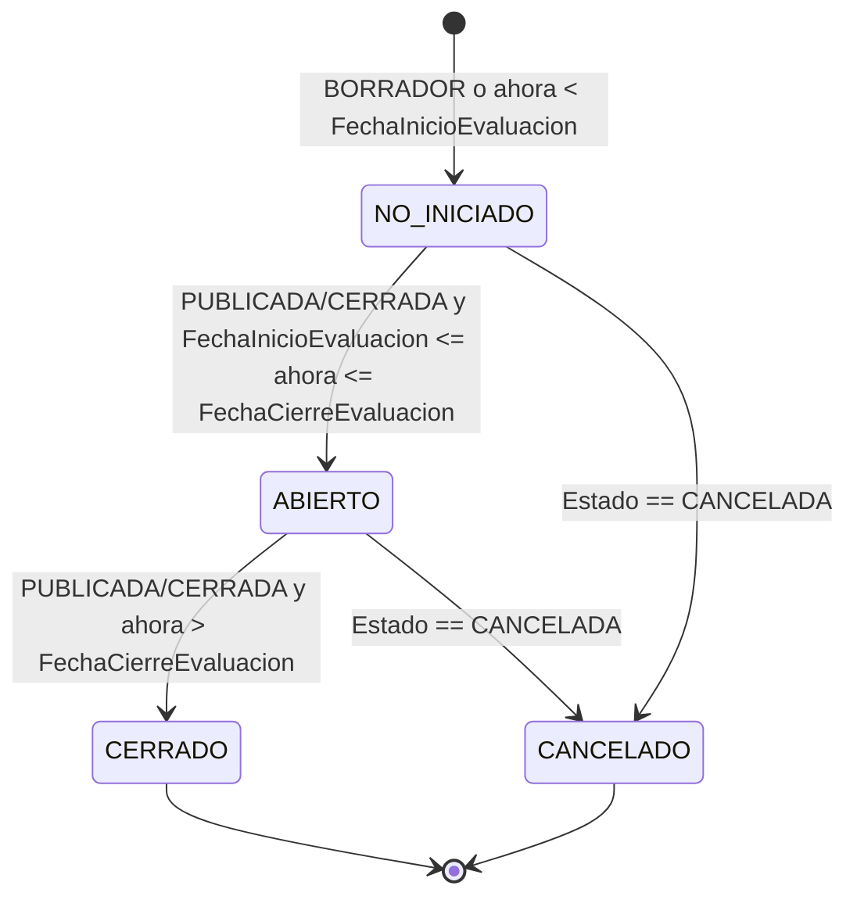

# Design

## Context

Motivación y alcance en `proposal.md`. Estado observado en `develop` dentro de `Apps/services/ms-postulaciones/` y en modo solo lectura dentro de `Apps/services/ms-prg/`:

- **Estado vigente de `ms-postulaciones` (975 pruebas en verde tras HU 8.1):**
  - El módulo `Evaluaciones` ya implementa el agregado `Evaluacion` (+`CalificacionCriterio`), `DatosCalificacionCriterio`, `ServicioCalculoPuntajeEvaluacion`, `EstadoEvaluacion`, los comandos `GuardarBorradorEvaluacion` y `EnviarEvaluacionDefinitiva`, las consultas `ObtenerMiEvaluacionPorAsignacion`, `ObtenerMisEvaluaciones` y `ObtenerEvaluacionesPostulacion`, y el controlador `EvaluacionesController` (`api/v1/evaluaciones`).
  - Los puertos de integración externa existentes (`IPeriodoAcademicoClient` hacia `MS-PLT` e `ICatalogoAcademicoClient` hacia `MS-PRG`) residen en `Ascenso.Postulaciones.Domain/Interfaces/` (con contratos en C# puro sin dependencias externas), y sus adaptadores HTTP fail-closed residen en `Ascenso.Postulaciones.Infrastructure/Adapters/` (`PeriodoAcademicoClient`, `CatalogoAcademicoClient`), configurados en `Infrastructure/DependencyInjection.cs` con `ServiciosExternosOptions` (`ServiciosExternos:Programas:UrlBase` y `TimeoutSegundos`, ya presentes en `Api/appsettings.json`).
  - `IEvaluacionRepositoryTests` valida por reflexión el conjunto exacto de métodos de `IEvaluacionRepository` (5), `IConsultaAsignacionParaEvaluacionRepository` (2) e `IConsultaRubricaParaEvaluacionRepository` (1). `IAsignacionEvaluacionRepositoryTests` hace lo mismo sobre `IAsignacionEvaluacionRepository`. Modificar cualquiera de esas interfaces rompería contratos y pruebas previas.
  - `ArchitectureTests` (`EncapsulamientoTests`, `DomainIndependenceTests`, `DependenciasEntreCapasTests`) prohíbe setters públicos (incluidos `init` públicos en `ValueObject`) y colecciones mutables en `Domain`, y exige que `Domain` no referencie `Application`, `Infrastructure`, `Api` ni frameworks externos.
  - Las tablas `postulaciones.asignaciones_evaluacion` y `postulaciones.evaluaciones` ya cuentan con el índice único parcial `ux_asignaciones_postulacion_evaluador_vigente` en `(postulacion_id, usuario_evaluador_id) WHERE estado <> 'REASIGNADA_POR_CONFLICTO'` y el índice compuesto `ix_evaluaciones_postulacion_estado` en `(postulacion_id, estado)`.
- **Contrato observado en `MS-PRG` (solo lectura, tras el merge de HU 2.1 `rf2-1-int1-msprg`):**
  - `ConvocatoriasInternasController` expone `GET /internal/v1/convocatorias/{convocatoriaId}` (`docs/contratos/ms-prg/convocatorias.md`), protegido con JWT Bearer y permiso `convocatorias:leer`.
  - Responde `200 OK` con `ConvocatoriaDetalleDto` (`id`, `programaBecaId`, `estado`, `fechaApertura`, `fechaCierre`, `fechaLimiteSubsanacionDocumentos`, `fechaInicioEvaluacion`, `fechaCierreEvaluacion`, `requiereRevisionDocumentalPrevia`, etc.) o `404 Not Found` (`CONVOCATORIA_NO_ENCONTRADA`).
  - **Detalle crítico verificado en `Ascenso.Programas.Domain/Convocatorias/Agregados/Convocatoria.cs`:** `EstadoConvocatoria` en `MS-PRG` solo tiene cuatro valores (`BORRADOR`, `PUBLICADA`, `CERRADA`, `CANCELADA`). La transición `PUBLICADA → CERRADA` ocurre al vencer `fechaCierre` (cierre de recepción de postulaciones), **no** al cerrar la evaluación. Cuando `requiereRevisionDocumentalPrevia == true`, toda la ventana de evaluación `[fechaInicioEvaluacion, fechaCierreEvaluacion]` ocurre mientras `estado == CERRADA`; cuando `requiereRevisionDocumentalPrevia == false`, la evaluación puede comenzar con `estado == PUBLICADA` y concluir con `estado == CERRADA`. Por tanto, el cierre del periodo de revisión se determina combinando `estado` (`PUBLICADA` o `CERRADA`) y los instantes UTC `fechaInicioEvaluacion` y `fechaCierreEvaluacion` detrás de un puerto ACL en `MS-POS`, aislando a `MS-POS` de futuras evoluciones del ciclo de vida de `Convocatoria` en `MS-PRG`.

## Goals / Non-Goals

**Goals:**

- Incorporar la validación fail-closed de la ventana de revisión de la `Convocatoria` (`MS-PRG`) en `GuardarBorradorEvaluacionCommandHandler` y `EnviarEvaluacionDefinitivaCommandHandler`, sin debilitar `asignacion.FechaLimiteEvaluacion` ni las invariantes de HU 8.1.
- Habilitar la consulta CQRS de solo lectura de evaluaciones definitivas (`ENVIADA_DEFINITIVA`) de coevaluadores para `MIEMBRO_COMITE` únicamente tras el cierre formal del periodo de revisión (`RN-POS-04`, `RN-PLT-02`, RF-37).
- Mantener 100% intactos los contratos de puertos previos, las 975 pruebas existentes (limitando cambios únicamente a inyección de dobles por el nuevo constructor/DI), `ArchitectureTests` y el esquema PostgreSQL (sin migraciones vacías).

**Non-Goals:**

- Modificar `MS-PRG` u otros microservicios, ni duplicar el agregado `Convocatoria` en `MS-POS`.
- Implementar RF-09 (ranking y promedios), RF-10 (empates y lista de espera), RF-39 (`ConflictoInteres`), `Postulacion` (Integrante 1), MediatR, Outbox, Hangfire o el flujo de emisión de tokens S2S en Keycloak.
- Modificar `Domain/Comun`, `Evaluacion`, `AsignacionEvaluacion`, `Postulantes`, `Rubricas`, `Comites`, `AsignacionesEvaluacionController`, `Program.cs` ni `ManejadorResultadoAutorizacionRubricas`.

## Decisions

### D1. Aplicación práctica y auditable de SOLID

| Principio | Aplicación concreta en `rf8-2-int2-mspos` |
|---|---|
| **SRP** | `VentanaRevisionConvocatoria` (Dominio) encapsula exclusivamente el cálculo y validación de la ventana temporal y estado del periodo de revisión; `ConvocatoriaEvaluacionClient` (Infraestructura) traduce exclusivamente el transporte HTTP y DTO externo de `MS-PRG` al objeto de valor del dominio; `ConsultaEvaluacionesCoevaluadoresRepository` encapsula las consultas de solo lectura post-cierre; `ObtenerEvaluacionesCoevaluadoresPostulacionQueryHandler` orquesta únicamente la consulta de visibilidad cruzada y su validador valida la entrada. |
| **OCP** | Extensión puramente aditiva: no se alteran métodos ni invariantes de `Evaluacion`, `AsignacionEvaluacion`, `RubricaEvaluacion` ni `ComiteEvaluador`; `EvaluacionMapeador` solo agrega `ACoevaluadorDto()`; `EvaluacionesController` solo agrega la acción `GET /postulaciones/{postulacionId}/coevaluadores` reutilizando la política `GestionMisEvaluaciones` existente sin tocar `Program.cs` ni `ManejadorResultadoAutorizacionRubricas`. |
| **ISP** | En lugar de engordar `IEvaluacionRepository` o `IConsultaAsignacionParaEvaluacionRepository` (lo que violaría sus pruebas de contrato por reflexión en `IEvaluacionRepositoryTests`), se crean dos puertos pequeños y específicos: `IConvocatoriaEvaluacionClient` (1 método) e `IConsultaEvaluacionesCoevaluadoresRepository` (2 métodos). |
| **DIP** | Siguiendo exactamente la convención ya establecida en `ms-postulaciones` por `IPeriodoAcademicoClient` e `ICatalogoAcademicoClient`, los puertos puros residen en `Domain/Interfaces/` (sin dependencias externas, validado por `DomainIndependenceTests` y `DependenciasEntreCapasTests`) y sus adaptadores en `Infrastructure/Adapters/` y `Infrastructure/Persistence/Repositorios/`. Todos los handlers dependen solo de abstracciones y `TimeProvider`, facilitando pruebas unitarias deterministas con NSubstitute. |

Alternativa considerada para el puerto ACL: ubicar `IConvocatoriaEvaluacionClient` en `Application/Evaluaciones/Interfaces/` en lugar de `Domain/Interfaces/`. Ambos cumplen `ArchitectureTests` (ya que `Infrastructure` referencia `Application` y `Domain`), pero ubicarlo en `Domain/Interfaces/` replica exactamente la convención existente de `IPeriodoAcademicoClient` e `ICatalogoAcademicoClient` (mismo namespace, misma forma de registro en `Infrastructure/DependencyInjection.cs` y misma ubicación de pruebas de contrato por reflexión en `Domain.Tests/Interfaces/`).

### D2. Tabla explícita de estados y reglas de la ventana de revisión (sin librerías externas)

Se modela el estado derivado del periodo de revisión (`EstadoPeriodoRevision`) como una función pura y determinista de `(EstadoConvocatoriaExterna, FechaInicioEvaluacion, FechaCierreEvaluacion, ahoraUtc)` en `VentanaRevisionConvocatoria`, sin librerías externas.

| `EstadoConvocatoria` (`MS-PRG`) | Condición temporal (`ahora` UTC) | `EstadoPeriodoRevision` | Guardar borrador / Enviar definitiva | Consultar coevaluadores (`MIEMBRO_COMITE`) |
|---|---|---|---|---|
| `BORRADOR` | Cualquiera | `NO_INICIADO` | `409 Conflict` (`PERIODO_REVISION_NO_INICIADO`) | `409 Conflict` (`PERIODO_REVISION_ABIERTO`) |
| `PUBLICADA` o `CERRADA` | `ahora < FechaInicioEvaluacion` | `NO_INICIADO` | `409 Conflict` (`PERIODO_REVISION_NO_INICIADO`) | `409 Conflict` (`PERIODO_REVISION_ABIERTO`) |
| `PUBLICADA` o `CERRADA` | `FechaInicioEvaluacion <= ahora <= FechaCierreEvaluacion` | `ABIERTO` | **Permitido** *(sujeto a `asignacion.FechaLimiteEvaluacion` y reglas HU 8.1)* | `409 Conflict` (`PERIODO_REVISION_ABIERTO`) |
| `PUBLICADA` o `CERRADA` | `ahora > FechaCierreEvaluacion` | `CERRADO` | `409 Conflict` (`PERIODO_REVISION_CERRADO`) | **Permitido** *(solo `ENVIADA_DEFINITIVA` de otros evaluadores)* |
| `CANCELADA` | Cualquiera | `CANCELADO` | `409 Conflict` (`CONVOCATORIA_CANCELADA`) | `409 Conflict` (`CONVOCATORIA_CANCELADA`) |
| *(No encontrada en `MS-PRG` / `404`)* | — | — | `404 Not Found` (`CONVOCATORIA_NO_ENCONTRADA`) | `404 Not Found` (`CONVOCATORIA_NO_ENCONTRADA`) |
| *(`MS-PRG` no disponible / error / timeout / JSON inválido)* | — | — | `503 Service Unavailable` (`DEPENDENCIA_NO_DISPONIBLE`) | `503 Service Unavailable` (`DEPENDENCIA_NO_DISPONIBLE`) |

**Justificación de los límites inclusivos `[FechaInicioEvaluacion, FechaCierreEvaluacion]`:** es coherente con `Evaluacion` (`ahora <= asignacion.FechaLimiteEvaluacion`) y con la normalización de `MS-PRG` (`fechaInicioEvaluacion` a las `00:00:00` y `fechaCierreEvaluacion` a las `23:59:59` de Caracas en UTC). Así, durante el último segundo `ahora == FechaCierreEvaluacion` la escritura sigue permitida y la consulta entre coevaluadores aún bloqueada (`PERIODO_REVISION_ABIERTO`); inmediatamente después (`ahora > FechaCierreEvaluacion`), la escritura se bloquea (`PERIODO_REVISION_CERRADO`) y se abre la lectura cruzada de definitivas, sin zona gris ni solapamiento donde un evaluador pueda leer a un par y todavía editar su propia nota.

Alternativa descartada: asumir que `EstadoConvocatoria == CERRADA` significa que la revisión terminó. Se descartó al verificar `MS-PRG` en código real: `CERRADA` marca el cierre de recepción de postulaciones (`fechaCierre`), momento en que normalmente **inicia** la evaluación.

### D3. Modelo de Dominio (`Ascenso.Postulaciones.Domain`)

1. **`EstadoConvocatoriaExterna` (`Domain/Enums/EstadoConvocatoriaExterna.cs`):** enum compatible con `CodigoEnum` (`Borrador` → `BORRADOR`, `Publicada` → `PUBLICADA`, `Cerrada` → `CERRADA`, `Cancelada` → `CANCELADA`).
2. **`EstadoPeriodoRevision` (`Domain/Enums/EstadoPeriodoRevision.cs`):** enum compatible con `CodigoEnum` (`NoIniciado` → `NO_INICIADO`, `Abierto` → `ABIERTO`, `Cerrado` → `CERRADO`, `Cancelado` → `CANCELADO`).
3. **`VentanaRevisionConvocatoria` (`Domain/Evaluaciones/ObjetosValor/VentanaRevisionConvocatoria.cs`):**
   - `public sealed record class VentanaRevisionConvocatoria : ValueObject` con propiedades de **solo `get;`** (sin `init` público, garantizando cumplimiento de `EncapsulamientoTests`).
   - Propiedades: `Guid ConvocatoriaId`, `EstadoConvocatoriaExterna EstadoConvocatoria`, `DateTimeOffset FechaInicioEvaluacion`, `DateTimeOffset FechaCierreEvaluacion`.
   - Validación en constructor:
     - `convocatoriaId == Guid.Empty` → `ArgumentException`.
     - `!Enum.IsDefined(estadoConvocatoria)` → `ArgumentException`.
     - `fechaInicioEvaluacion == default` o `fechaCierreEvaluacion == default` → `ArgumentException`.
     - Normaliza ambas fechas con `.ToUniversalTime()` y exige `FechaCierreEvaluacion > FechaInicioEvaluacion` (`ArgumentException` en caso contrario).
   - Métodos de comportamiento puro:
     - `EstadoPeriodoRevision ObtenerEstadoPeriodoRevision(DateTimeOffset ahora)`: valida `ahora != default`, normaliza `ahora.ToUniversalTime()` y aplica exactamente la tabla de D2.
     - `void AsegurarPeriodoAbiertoParaEvaluacion(DateTimeOffset ahora)`: permite solo `EstadoPeriodoRevision.Abierto`; lanza `PeriodoRevisionNoIniciadoException`, `PeriodoRevisionCerradoException` o `ConvocatoriaCanceladaException` según D2.
     - `void AsegurarPeriodoCerradoParaVisibilidadCoevaluadores(DateTimeOffset ahora)`: permite solo `EstadoPeriodoRevision.Cerrado`; lanza `PeriodoRevisionAbiertoException` (en `NoIniciado` y `Abierto`) o `ConvocatoriaCanceladaException` (en `Cancelado`) según D2.

### D4. Excepciones de dominio (`Domain/Excepciones/`)

Se reutilizan sin modificar `EvaluacionConfidencialException` (`403 EVALUACION_CONFIDENCIAL`) y `DependenciaNoDisponibleException` (`503 DEPENDENCIA_NO_DISPONIBLE`). Se agregan:

| Excepción | Base | `CodigoError` | HTTP | Motivo |
|---|---|---|---|---|
| `ConvocatoriaNoEncontradaException` | `ExcepcionEntidadNoEncontrada` | `CONVOCATORIA_NO_ENCONTRADA` | 404 | La convocatoria asociada no existe en `MS-PRG` |
| `PeriodoRevisionNoIniciadoException` | `ExcepcionReglaNegocio` | `PERIODO_REVISION_NO_INICIADO` | 409 | Intento de guardar borrador o enviar antes del inicio del periodo de revisión o con convocatoria en `BORRADOR` |
| `PeriodoRevisionCerradoException` | `ExcepcionReglaNegocio` | `PERIODO_REVISION_CERRADO` | 409 | Intento de guardar borrador o enviar cuando `ahora > fechaCierreEvaluacion` |
| `PeriodoRevisionAbiertoException` | `ExcepcionReglaNegocio` | `PERIODO_REVISION_ABIERTO` | 409 | Intento de consultar evaluaciones de coevaluadores antes del cierre formal del periodo de revisión |
| `ConvocatoriaCanceladaException` | `ExcepcionReglaNegocio` | `CONVOCATORIA_CANCELADA` | 409 | Operación de escritura o consulta de coevaluadores sobre una convocatoria `CANCELADA` |

`ManejadorExcepcionesDominio` ya serializa toda `DomainException` en `ProblemDetails` con `status = domainException.EstadoHttp` y `codigo = domainException.Codigo`; no requiere cambios.

### D5. Puertos ISP (`Domain/Interfaces/`)

1. **`IConvocatoriaEvaluacionClient`** (`Domain/Interfaces/IConvocatoriaEvaluacionClient.cs`):
   - `Task<VentanaRevisionConvocatoria?> ObtenerVentanaRevisionAsync(Guid convocatoriaId, CancellationToken cancellationToken = default);`
   - Retorna `null` ante `404 Not Found` de `MS-PRG`; lanza `DependenciaNoDisponibleException` (`503`) ante cualquier falla de comunicación, timeout, respuesta HTTP inesperada o contrato inválido.
2. **`IConsultaEvaluacionesCoevaluadoresRepository`** (`Domain/Interfaces/IConsultaEvaluacionesCoevaluadoresRepository.cs`):
   - `Task<AsignacionEvaluacion?> ObtenerAsignacionVigenteEvaluadorAsync(Guid postulacionId, Guid usuarioEvaluadorId, CancellationToken cancellationToken = default);` *(AsNoTracking; filtra `Estado != EstadoAsignacionEvaluacion.ReasignadaPorConflicto`)*
   - `Task<IReadOnlyList<Evaluacion>> ListarDefinitivasDeCoevaluadoresAsync(Guid postulacionId, Guid usuarioEvaluadorId, CancellationToken cancellationToken = default);` *(AsNoTracking + Include `Calificaciones`; filtra `EvaluadorId != usuarioEvaluadorId && Estado == EstadoEvaluacion.EnviadaDefinitiva`; orden `FechaEnvio`, `Id`)*

Ningún puerto existente (`IEvaluacionRepository`, `IConsultaAsignacionParaEvaluacionRepository`, `IConsultaRubricaParaEvaluacionRepository`, `IRubricaRepository`, `IComiteEvaluadorRepository`, `IAsignacionEvaluacionRepository`) se altera.

### D6. Capa de Aplicación (`Ascenso.Postulaciones.Application`, CQRS sin MediatR ni Hangfire)

1. **Integración en comandos de HU 8.1 (`GuardarBorradorEvaluacionCommandHandler` y `EnviarEvaluacionDefinitivaCommandHandler`):**
   - Ambos reciben `IConvocatoriaEvaluacionClient` en su constructor (nueva dependencia explícita por DIP).
   - **Orden exacto de validación:**
     1. Validar comando (`_validator.ValidateAndThrowAsync`).
     2. Obtener `usuarioEvaluadorId` (`_usuarioActual.ObtenerUsuarioIdRequerido()`).
     3. Cargar `AsignacionEvaluacion` (`404 ASIGNACION_NO_ENCONTRADA`).
     4. Verificar pertenencia: `asignacion.UsuarioEvaluadorId != usuarioEvaluadorId` → `403 EVALUACION_CONFIDENCIAL` *(siempre antes de invocar `MS-PRG` para no filtrar información ni disparar llamadas externas en solicitudes no autorizadas)*.
     5. Capturar `ahora = _timeProvider.GetUtcNow()`.
     6. Consultar `ventana = await _convocatoriaClient.ObtenerVentanaRevisionAsync(asignacion.ConvocatoriaId, cancellationToken) ?? throw new ConvocatoriaNoEncontradaException();` y ejecutar `ventana.AsegurarPeriodoAbiertoParaEvaluacion(ahora);`.
     7. Continuar exactamente con el flujo existente de HU 8.1 (`ComiteEvaluador`, `RubricaEvaluacion`, `Evaluacion`, plazo individual `asignacion.FechaLimiteEvaluacion`, persistencia `GuardarCambiosAsync` y bloqueo idempotente de rúbrica).
   - **Ajuste mínimo e inevitable en pruebas unitarias de HU 8.1:** en `GuardarBorradorEvaluacionCommandHandlerTests` y `EnviarEvaluacionDefinitivaCommandHandlerTests` se inyecta un sustituto por defecto de `IConvocatoriaEvaluacionClient` configurado con una `VentanaRevisionConvocatoria` abierta alrededor de `_ahora` (mismo patrón documentado en HU 6.3 con `IExcepcionEvaluadorUnicoRepository`), sin alterar ninguna aserción existente de HU 8.1.

2. **Nueva consulta CQRS (`Application/Evaluaciones/Consultas/ObtenerEvaluacionesCoevaluadoresPostulacion/`):**
   - `ObtenerEvaluacionesCoevaluadoresPostulacionQuery(Guid PostulacionId)`.
   - `ObtenerEvaluacionesCoevaluadoresPostulacionQueryValidator`: exige `PostulacionId != Guid.Empty` (`ErrorCode = "EVALUACION_INVALIDA"`).
   - `ObtenerEvaluacionesCoevaluadoresPostulacionQueryHandler`:
     1. Validar consulta (`_validator.ValidateAndThrowAsync`).
     2. `usuarioEvaluadorId = _usuarioActual.ObtenerUsuarioIdRequerido()`.
     3. `asignacionPropia = await _consultaCoevaluadoresRepository.ObtenerAsignacionVigenteEvaluadorAsync(query.PostulacionId, usuarioEvaluadorId, cancellationToken) ?? throw new EvaluacionConfidencialException();` *(bloquea tanto a evaluadores no asignados como a quienes tengan `REASIGNADA_POR_CONFLICTO`, antes de consultar `MS-PRG`)*.
     4. `ahora = _timeProvider.GetUtcNow()`.
     5. `ventana = await _convocatoriaClient.ObtenerVentanaRevisionAsync(asignacionPropia.ConvocatoriaId, cancellationToken) ?? throw new ConvocatoriaNoEncontradaException();`.
     6. `ventana.AsegurarPeriodoCerradoParaVisibilidadCoevaluadores(ahora);`.
     7. `evaluaciones = await _consultaCoevaluadoresRepository.ListarDefinitivasDeCoevaluadoresAsync(query.PostulacionId, usuarioEvaluadorId, cancellationToken);`.
     8. Filtrado defensivo en memoria (`evaluacion.Estado == EstadoEvaluacion.EnviadaDefinitiva && evaluacion.EvaluadorId != usuarioEvaluadorId`) + mapeo con `evaluacion.ACoevaluadorDto()` → retornar `EvaluacionesCoevaluadoresPostulacionDto(query.PostulacionId, asignacionPropia.ConvocatoriaId, ventana.FechaCierreEvaluacion, evaluacionesDto)`.

3. **DTOs y mapeador (`Application/Evaluaciones/DTOs/`):**
   - `EvaluacionCoevaluadorDto(Guid EvaluacionId, Guid RubricaEvaluacionId, string Estado, DateTimeOffset FechaEnvio, decimal PuntajeTotalPonderado, string? ComentariosGenerales, IReadOnlyList<CalificacionCriterioDto> Calificaciones)`.
     - **Confidencialidad:** no incluye datos personales del postulante, ni `EvaluadorId`, ni `AsignacionEvaluacionId` del par (impide además sondear `GET /asignaciones/{id}` de un coevaluador), ni `MotivoInvalidacion`, ni `Version`.
   - `EvaluacionesCoevaluadoresPostulacionDto(Guid PostulacionId, Guid ConvocatoriaId, DateTimeOffset FechaCierreRevision, IReadOnlyList<EvaluacionCoevaluadorDto> Evaluaciones)`.
   - Extensión aditiva en `EvaluacionMapeador`: `public static EvaluacionCoevaluadorDto ACoevaluadorDto(this Evaluacion evaluacion)` (exige `Estado == EstadoEvaluacion.EnviadaDefinitiva`, `FechaEnvio.HasValue` y `PuntajeTotalPonderado.HasValue`; ordena `Calificaciones` por `CriterioEvaluacionId` e `Id`).
   - Registro `AddScoped<ObtenerEvaluacionesCoevaluadoresPostulacionQueryHandler>()` en `Application/DependencyInjection.cs` (los validadores ya se descubren con `AddValidatorsFromAssembly`).

### D7. Infraestructura, ACL hacia `MS-PRG` y evaluación de migración EF Core (`Ascenso.Postulaciones.Infrastructure`)

1. **Adaptador HTTP `ConvocatoriaEvaluacionClient` (`Infrastructure/Adapters/ConvocatoriaEvaluacionClient.cs`):**
   - Replica exactamente el patrón fail-closed de `CatalogoAcademicoClient` y `PeriodoAcademicoClient`:
     - Usa `HttpClient`, `IOptions<ServiciosExternosOptions>` (`Programas.UrlBase` + fallback a `_httpClient.BaseAddress`) y `ILogger<ConvocatoriaEvaluacionClient>` con `LoggerMessage.Define`.
     - Ruta relativa: `internal/v1/convocatorias/{convocatoriaId:D}`.
     - Validación de argumento: `convocatoriaId == Guid.Empty` → `ArgumentException`.
     - Si no se puede resolver URI base → `DependenciaNoDisponibleException`.
     - `404 Not Found` → retorna `null`.
     - Cualquier otro status no 2xx (`401`, `403`, `5xx`, etc.) → log warning + `DependenciaNoDisponibleException`.
     - Deserializa únicamente el subconjunto ACL necesario (`Id`, `Estado`, `FechaInicioEvaluacion`, `FechaCierreEvaluacion`) con `JsonSerializerDefaults.Web`.
     - Valida que `dto` no sea nulo, `dto.Id == convocatoriaId`, `dto.Estado` no esté vacío y pertenezca a `EstadoConvocatoriaExterna` (`CodigoEnum.DesdeCodigo<EstadoConvocatoriaExterna>`), y que `dto.FechaInicioEvaluacion != default`, `dto.FechaCierreEvaluacion != default` y `dto.FechaCierreEvaluacion > dto.FechaInicioEvaluacion`; cualquier inconsistencia → log warning + `DependenciaNoDisponibleException`.
     - Manejo de excepciones: `OperationCanceledException` cuando `cancellationToken.IsCancellationRequested` se propaga; timeout (`OperationCanceledException` sin cancelación del caller), `HttpRequestException`, `JsonException` y `ArgumentException` → log warning + `DependenciaNoDisponibleException`.

2. **Repositorio ISP `ConsultaEvaluacionesCoevaluadoresRepository` (`Infrastructure/Persistence/Repositorios/ConsultaEvaluacionesCoevaluadoresRepository.cs`):**
   - Implementa `IConsultaEvaluacionesCoevaluadoresRepository` con `PostulacionesDbContext` (`AsNoTracking`).
   - Valida `postulacionId != Guid.Empty` y `usuarioEvaluadorId != Guid.Empty` (`ArgumentException`).
   - `ObtenerAsignacionVigenteEvaluadorAsync`: consulta `_contexto.AsignacionesEvaluacion.AsNoTracking().SingleOrDefaultAsync(a => a.PostulacionId == postulacionId && a.UsuarioEvaluadorId == usuarioEvaluadorId && a.Estado != EstadoAsignacionEvaluacion.ReasignadaPorConflicto, cancellationToken)` — apoyado directamente en el índice único parcial `ux_asignaciones_postulacion_evaluador_vigente`.
   - `ListarDefinitivasDeCoevaluadoresAsync`: consulta `_contexto.Evaluaciones.AsNoTracking().Include(e => e.Calificaciones).Where(e => e.PostulacionId == postulacionId && e.EvaluadorId != usuarioEvaluadorId && e.Estado == EstadoEvaluacion.EnviadaDefinitiva).OrderBy(e => e.FechaEnvio).ThenBy(e => e.Id).ToListAsync(cancellationToken)` — apoyado directamente en el índice `ix_evaluaciones_postulacion_estado`.

3. **Registro en `Infrastructure/DependencyInjection.cs`:**
   - `services.AddScoped<IConsultaEvaluacionesCoevaluadoresRepository, ConsultaEvaluacionesCoevaluadoresRepository>();`
   - `services.AddHttpClient<IConvocatoriaEvaluacionClient, ConvocatoriaEvaluacionClient>((proveedor, cliente) => { var opciones = proveedor.GetRequiredService<IOptions<ServiciosExternosOptions>>().Value; cliente.Timeout = ResolverTimeout(opciones.TimeoutSegundos); });`
   - Reutiliza `ServiciosExternos:Programas:UrlBase` y `ServiciosExternos:TimeoutSegundos` sin modificar `appsettings.json` ni `ServiciosExternosOptions`.

4. **Evaluación honesta de migración EF Core:**
   - **No se requiere nueva migración EF Core.** HU 8.2 no crea tablas ni columnas ni modifica configuraciones de entidades, claves foráneas, restricciones `CHECK` ni índices: las dos consultas de solo lectura ya están respaldadas por `ux_asignaciones_postulacion_evaluador_vigente` e `ix_evaluaciones_postulacion_estado` introducidos en HU 6.2 y HU 8.1. Por ello, **no se crea ninguna migración vacía** y durante la verificación se comprobará `dotnet ef migrations has-pending-model-changes` sin cambios pendientes, además de ejecutar pruebas reales contra PostgreSQL (Testcontainers) en `EvaluacionCoevaluadoresPostgreSqlTests`.

### D8. API y Seguridad (`Ascenso.Postulaciones.Api`)

Extensión estrictamente aditiva de `Api/Controllers/v1/EvaluacionesController.cs` (ruta base `api/v1/evaluaciones`):

| Método y ruta | Operación | Política / Rol | Éxito | Errores documentados |
|---|---|---|---|---|
| `GET /postulaciones/{postulacionId:guid}/coevaluadores` | Consultar evaluaciones definitivas de coevaluadores tras cierre del periodo de revisión | `GestionMisEvaluaciones` (`MIEMBRO_COMITE`) | `200 OK` + `EvaluacionesCoevaluadoresPostulacionDto` | `400`, `401`, `403` (`PERMISO_DENEGADO` / `EVALUACION_CONFIDENCIAL`), `404` (`CONVOCATORIA_NO_ENCONTRADA`), `409` (`PERIODO_REVISION_ABIERTO` / `CONVOCATORIA_CANCELADA`), `503` (`DEPENDENCIA_NO_DISPONIBLE`) |

Además, se añade `[ProducesResponseType(typeof(ProblemDetails), StatusCodes.Status503ServiceUnavailable)]` en `PUT /asignaciones/{asignacionEvaluacionId:guid}/borrador` y `POST /asignaciones/{asignacionEvaluacionId:guid}/enviar` para reflejar en Swagger el comportamiento fail-closed frente a `MS-PRG`.

- **Reutilización de políticas:** `GestionMisEvaluaciones` ya exige el rol literal `MIEMBRO_COMITE` y ya está registrada en `Program.cs` y reconocida en `ManejadorResultadoAutorizacionRubricas`, garantizando `403 PERMISO_DENEGADO` en `ProblemDetails` para `ADMIN_FINANCIERO`, `COORDINADOR_PROGRAMA` y cualquier otro rol no autorizado. No es necesario tocar `PoliticasAutorizacionEvaluaciones`, `ManejadorResultadoAutorizacionRubricas` ni `Program.cs`.

### D9. Núcleo compartido (`Domain/Comun`)

No se modifica ni agrega ningún archivo en `Domain/Comun`. Se reutiliza `ValueObject` para `VentanaRevisionConvocatoria`.

### D10. Contratos de integración y alcance futuro

| Contexto | Contrato / coordinación posterior |
|---|---|
| **Autenticación S2S `MS-POS → MS-PRG` (`convocatorias:leer`)** | `MS-PRG` exige JWT Bearer con `permissions: ["convocatorias:leer"]` (`docs/contratos/ms-prg/convocatorias.md`). Coherente con `PeriodoAcademicoClient` y `CatalogoAcademicoClient` en `ms-postulaciones`, cuando el equipo de plataforma incorpore el cliente Keycloak Client Credentials, bastará adjuntar un `DelegatingHandler` al `AddHttpClient<IConvocatoriaEvaluacionClient, ConvocatoriaEvaluacionClient>` sin cambiar el puerto, el dominio ni los handlers. |
| **Evolución futura de `EstadoConvocatoria` en `MS-PRG`** | Si `MS-PRG` agrega en el futuro un cierre manual explícito de la etapa de evaluación (por ejemplo un campo `periodoRevisionCerrado` o un estado `EVALUACION_CERRADA`), el cambio quedará encapsulado dentro de `ConvocatoriaEvaluacionClient` y `VentanaRevisionConvocatoria` sin alterar handlers ni controladores de `MS-POS`. |
| **RF-39 (`ConflictoInteres`, `RN-POS-06`)** | `ConsultaEvaluacionesCoevaluadoresRepository` ya excluye a evaluadores con asignación `REASIGNADA_POR_CONFLICTO` (`403 EVALUACION_CONFIDENCIAL`) y excluye evaluaciones `INVALIDADA_POR_CONFLICTO` de la respuesta de coevaluadores. |
| **RF-09 (`ResultadoConsolidadoRanking`) y RF-10 (empates)** | Quedan fuera de alcance; podrán reutilizar `IConvocatoriaEvaluacionClient` para exigir periodo de revisión cerrado antes de consolidar el ranking. |
| **Cierre de `RF-08`** | Con HU 8.1 y HU 8.2 se cubren todas las consideraciones de RF-08 en `PRD Desarrollo.md`, `RN-POS-04`, `RN-POS-05`, `RN-PLT-02` y RF-37; al finalizar HU 8.2 se marca `RF-08` como `[x]` en ambos roadmaps. |

## Risks / Trade-offs

- **Acoplamiento temporal en tiempo real con `MS-PRG` (fail-closed):** si `MS-PRG` está caído o excede el timeout (`3 s` por defecto), guardar borradores, enviar evaluaciones y consultar coevaluadores responderán `503 DEPENDENCIA_NO_DISPONIBLE` → Mitigación: timeout acotado y configurable en `ServiciosExternos:TimeoutSegundos`, error determinista `503` sin corrupción de estado y sin bloquear rúbricas ni persistir datos parciales; en el futuro puede agregarse caché corta o lectura de réplica local mediante decoración del puerto `IConvocatoriaEvaluacionClient` (OCP).
- **Ausencia de token S2S configurado aún en `ms-postulaciones`:** en despliegue real contra `MS-PRG` con autenticación activa, `ConvocatoriaEvaluacionClient` necesitará el `DelegatingHandler` de Client Credentials de Keycloak → Mitigación: diseño desacoplado sobre `IHttpClientFactory` (igual que `PeriodoAcademicoClient` y `CatalogoAcademicoClient`) y documentado en D10 y Preguntas Abiertas.
- **Ajustes en pruebas de HU 8.1 y fábricas `WebApplicationFactory`:** agregar `IConvocatoriaEvaluacionClient` a dos handlers existentes y dos puertos nuevos a `Infrastructure/DependencyInjection.cs` requiere actualizar el constructor de los 2 tests unitarios de HU 8.1 y el registro de dobles en las fábricas `WebApplicationFactory` existentes → Mitigación: cambios estrictamente mecánicos de configuración de dobles (sin modificar ninguna aserción de negocio), documentados archivo por archivo en la bitácora final.
- **Consistencia de reloj entre `MS-POS` y `MS-PRG`:** `VentanaRevisionConvocatoria` compara el `TimeProvider` UTC de `MS-POS` contra `fechaInicioEvaluacion`/`fechaCierreEvaluacion` en UTC provenientes de `MS-PRG` → Mitigación: ambos microservicios normalizan y almacenan todas las fechas en UTC (`timestamptz` / `DateTimeOffset` ISO 8601 con offset).

## Migration Plan

1. **Dominio (TDD):** `EstadoConvocatoriaExterna`, `EstadoPeriodoRevision`, excepciones de dominio, `VentanaRevisionConvocatoria` y puertos ISP (`IConvocatoriaEvaluacionClient`, `IConsultaEvaluacionesCoevaluadoresRepository`).
2. **Aplicación (TDD):** DTOs de coevaluadores y extensión de `EvaluacionMapeador`, consulta CQRS `ObtenerEvaluacionesCoevaluadoresPostulacion` (query, validator, handler), integración de `IConvocatoriaEvaluacionClient` en `GuardarBorradorEvaluacionCommandHandler` y `EnviarEvaluacionDefinitivaCommandHandler`, ajuste mínimo en constructores de los tests unitarios de HU 8.1 y registro en `Application/DependencyInjection.cs`.
3. **Infraestructura (TDD):** `ConvocatoriaEvaluacionClient` (pruebas HTTP completas), `ConsultaEvaluacionesCoevaluadoresRepository`, registro en `Infrastructure/DependencyInjection.cs`, verificación de `has-pending-model-changes` (0 migraciones nuevas) y suite real con PostgreSQL (Testcontainers).
4. **API y seguridad (TDD):** nueva acción `GET /api/v1/evaluaciones/postulaciones/{postulacionId}/coevaluadores` y respuestas `503` en `EvaluacionesController`, pruebas en `EvaluacionesControllerTests`, `AutorizacionEvaluacionesTests` y `SwaggerApiTests`, y ajuste mínimo de dobles en las fábricas `WebApplicationFactory` previas.
5. **Verificación integral, roadmaps (`HU 8.2` y `RF-08` en `[x]`) y bitácora final.**
6. **Rollback:** completamente seguro y reversible por Git sin script SQL ni rollback de base de datos, dado que no cambia el esquema PostgreSQL.

## Open Questions

1. **Anonimato de pares tras el cierre:** el diseño actual omite `EvaluadorId` y `AsignacionEvaluacionId` en `EvaluacionCoevaluadorDto` para maximizar privacidad y evitar sondeo de rutas `/asignaciones/{id}` ajenas; confirmar si el comité requiere ver el identificador o nombre del coevaluador una vez cerrado el periodo de revisión.
2. **Token S2S (`convocatorias:leer`) entre `MS-POS` y `MS-PRG`:** coordinar con el equipo de plataforma (Integrante 1 / Keycloak) el `DelegatingHandler` de Client Credentials compartido para `PeriodoAcademicoClient`, `CatalogoAcademicoClient` y `ConvocatoriaEvaluacionClient`.
3. **Evaluador asignado que no envió su evaluación antes del cierre:** el diseño actual permite la lectura post-cierre a todo `MIEMBRO_COMITE` con asignación vigente (distinta de `REASIGNADA_POR_CONFLICTO`) porque la ventana de escritura ya cerró; confirmar si se desea exigir además que la propia evaluación del solicitante esté en `ENVIADA_DEFINITIVA` o que su membresía en el comité siga `Activo == true`.
4. **Visibilidad del `COORDINADOR_PROGRAMA` antes del cierre (heredada de HU 8.1):** confirmar si `GET /api/v1/evaluaciones/postulaciones/{postulacionId}` mantiene acceso inmediato a evaluaciones `ENVIADA_DEFINITIVA` para supervisión del coordinador o si en una iteración futura también deberá esperar al cierre del periodo de revisión.
5. **Cierre manual anticipado del periodo de revisión:** confirmar si en el futuro `MS-PRG` incorporará un cierre explícito independiente de `fechaCierreEvaluacion` (encapsulable sin ruptura dentro de `ConvocatoriaEvaluacionClient` y `VentanaRevisionConvocatoria`).
