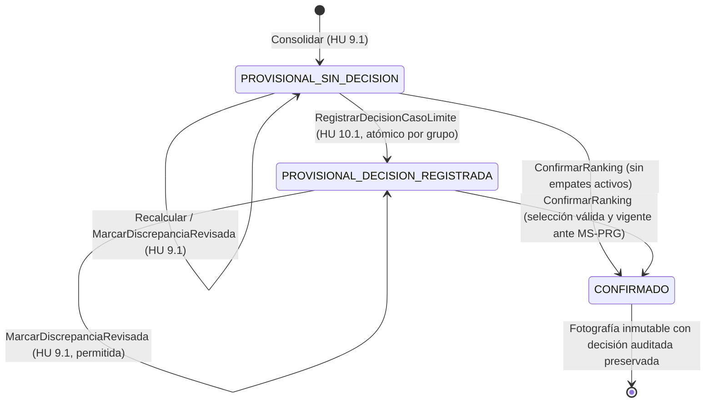

# Design

## Context

Motivación, precedencia normativa y alcance en `proposal.md`. Estado real observado en `develop` dentro de `Apps/services/ms-postulaciones/`:

- **Base vigente de HU 9.1 y HU 9.2 en `MS-POS` (1,433 pruebas en verde):**
  - `ResultadoConsolidadoRanking` (`Domain/Consolidacion/Agregados/ResultadoConsolidadoRanking.cs`) hereda de `AggregateRoot` (`EntidadAuditable`, `Id` UUIDv7, `Version` con concurrencia optimista `C1`), nace en `EstadoRanking.Provisional`, soporta `Recalcular(...)`, `MarcarDiscrepanciaRevisada(...)` y `ConfirmarRanking(...)` (`PROVISIONAL → CONFIRMADO`), y expone `EsAdjudicable`.
  - `ServicioCalculoRankingCorte` (`Domain/Consolidacion/Servicios/ServicioCalculoRankingCorte.cs`) ordena descendentemente por `PuntajeConsolidado DESC` (desempate técnico `FechaConsolidacion ASC, Id ASC`), traza la línea de corte por cupo y presupuesto efectivos sin saltar orden de mérito, detecta empates en frontera (`TieneEmpateEnLineaDeCorte = true`) y detecta advertencias de discrepancias sin revisar en o adyacentes al corte.
  - `ObtenerRankingConvocatoriaQueryHandler` y `ConfirmarRankingConvocatoriaCommandHandler` orquestan la proyección provisional, la confirmación atómica `PROVISIONAL → CONFIRMADO` (bloqueando con `422 EMPATES_SIN_RESOLVER` si `corte.TieneEmpateEnLineaDeCorte`) y la fotografía confirmada inmutable.
  - `RankingsController` (`api/v1/rankings`) expone `GET convocatorias/{convocatoriaId:guid}` (`ConsultaConsolidacion`) y `POST convocatorias/{convocatoriaId:guid}/confirmar` (`GestionConsolidacion`).
  - `ComiteEvaluador` (`Domain/Comites/Agregados/ComiteEvaluador.cs`) modela `ProgramaBecaId`, `ConvocatoriaId`, `JefaturaUsuarioId` (`Guid`, obligatorio), `Activo` (`bool`) y la colección `Miembros` (con la jefatura creada como miembro `RolMiembroComite.Jefatura` no desvinculable), persistido en `postulaciones.comites_evaluadores` con índice único `ux_comites_programa_convocatoria`.
  - `ResultadoConsolidadoRankingConfiguracion` mantiene 10 restricciones `CHECK` vigentes sobre `postulaciones.resultados_consolidados_ranking` y la última migración es `20261126194657_ConfirmacionRankingConvocatoria`. Como lección comprobada en HU 9.2, PostgreSQL evalúa las restricciones `CHECK` en **orden alfabético por nombre**, por lo que toda nueva `CHECK` debe garantizar que no intercepte las pruebas existentes de `ConsolidacionPostgreSqlTests` ni `RankingPostgreSqlTests`.
  - `PoliticasAutorizacionConsolidacion` (`ConsultaConsolidacion`, `GestionConsolidacion`, `ConsultaAdjudicabilidadInterna`), `ManejadorResultadoAutorizacionRubricas` (`403 PERMISO_DENEGADO`) y `IUsuarioActual` / `UsuarioActualJwt` están probados e intactos.
  - **20 puertos previos en `Domain/Interfaces/` (intocables):** `IAsignacionEvaluacionRepository`, `ICatalogoAcademicoClient`, `IComiteEvaluadorRepository`, `IConsultaAsignacionParaEvaluacionRepository`, `IConsultaDatosConsolidacionRepository`, `IConsultaEstadoEvaluacionesConvocatoriaRepository`, `IConsultaEvaluacionesCoevaluadoresRepository`, `IConsultaRubricaParaEvaluacionRepository`, `IConvocatoriaEvaluacionClient`, `IDisponibilidadRankingClient`, `IEvaluacionRepository`, `IExcepcionEvaluadorUnicoRepository`, `IPeriodoAcademicoClient`, `IPostulanteRepository`, `IProveedorMontoEstimadoBeca`, `IProveedorParametrosConsolidacion`, `IRankingConvocatoriaRepository`, `IResultadoConsolidadoRepository`, `IRubricaRepository`, `IUnitOfWork`.
  - **Guardrails arquitectónicos (`ArchitectureTests`):** `EncapsulamientoTests` prohíbe setters públicos (incluidos `init` públicos en `ValueObject`) y colecciones mutables en `Domain`; `DomainIndependenceTests` y `DependenciasEntreCapasTests` exigen C# puro en `Domain` y cero dependencias EF Core/ASP.NET/Npgsql/MassTransit en `Application`.
  - **Precedencia normativa:** aunque `openspec/specs/ms-pos/spec_pos.md` menciona desempate automático por subcriterio, prevalecen estrictamente PRD `RF-10`, Historia 10.1 (Criterios 1 a 4), `docs/Explicacion_del_DDD_V7.md` (§2.3.B y `RN-POS-07`) y `openspec/specs/ms-pos/consolidacion/spec.md` (resolución manual auditada con justificación obligatoria por `COORDINADOR_PROGRAMA` o `Jefatura del comité`).

## Goals / Non-Goals

**Goals:**

- Implementar **HU 10.1** dentro de **RF-10** con extensión 100% aditiva (OCP) sobre el módulo `Consolidacion` de `MS-POS`, sin romper ninguna de las 1,433 pruebas previas ni `ArchitectureTests`.
- Modelar, detectar y resolver manualmente empates en la línea de corte (`EMPATE_POR_CUPO`, `EMPATE_POR_PRESUPUESTO`) y casos límite presupuestarios sin empate (`CASO_LIMITE_PRESUPUESTARIO`) con justificación obligatoria (`10–1000` caracteres) e inalterabilidad estricta (`409 CASO_LIMITE_YA_RESUELTO`, `RN-AUD-01`).
- Aplicar autorización limpia en servidor para `COORDINADOR_PROGRAMA` y `Jefatura del comité` (`ComiteEvaluador.JefaturaUsuarioId` activa) sin debilitar ninguna política de autorización previa.
- Integrar las decisiones registradas en `ServicioCalculoRankingCorte`, `ObtenerRankingConvocatoriaQuery` y `ConfirmarRankingConvocatoriaCommand` para destrabar `422 EMPATES_SIN_RESOLVER` de forma determinista y auditable, y volver a bloquear si la disponibilidad de `MS-PRG` cambia y la selección registrada deja de caber.
- Dejar preparados los puntos de extensión OCP/ISP para RF-39 (`IVerificadorConflictoInteresDecisor`) y HU 10.2 (`EntradaListaEspera` a partir de las filas en `LISTA_DE_ESPERA`).

**Non-Goals:**

- Implementar HU 10.2 (`EntradaListaEspera`, cola de lista de espera, promoción/reasignación por vacante `C6`).
- Implementar RF-39 (`ConflictoInteres`) ni migrar autorización a Keycloak/PBAC.
- Implementar `Postulacion` (Integrante 1) ni emisión de cartas de otorgamiento (`MS-BEC` RF-15).
- Modificar `Postulantes`, `Rubricas`, `Comites`, `AsignacionesEvaluacionController`, `EvaluacionesController`, `ResultadosConsolidadosController`, `PostulacionesInternasController`, `Domain/Comun`, cualquiera de los 20 puertos previos de `Domain/Interfaces/`, `IUsuarioActual` ni otros microservicios (`ms-prg`, `ms-becas`, `ms-plt`, `ms-aud`).
- Introducir MediatR, Outbox/RabbitMQ o Hangfire.

## Decisions

### D1. Aplicación práctica y auditable de SOLID y extensibilidad OCP

| Principio | Aplicación concreta en `rf10-1-int2-mspos` |
|---|---|
| **SRP** | `ResultadoConsolidadoRanking` resguarda sus invariantes de decisión e inalterabilidad (`RegistrarDecisionCasoLimite(...)` y guarda en `Recalcular(...)`); `CasoLimiteRankingDetectado` encapsula el caso límite activo detectado; `ServicioCalculoRankingCorte` calcula ordenamiento, corte, detección de empates/casos límite y vigencia de decisiones frente a disponibilidad; `ServicioResolucionCasoLimite` valida y aplica una resolución propuesta sobre el grupo afectado; `ResolverCasoLimiteRankingCommandHandler` orquesta seguridad, precondiciones y persistencia atómica; `ResolverCasoLimiteRankingCommandValidator` valida entrada; `ConsolidacionMapeador` y `RankingMapeador` proyectan DTOs. |
| **OCP** | (1) `ResultadoConsolidadoRanking` y `postulaciones.resultados_consolidados_ranking` se extienden exclusivamente con 5 columnas anulables y 2 `CHECK` aditivas sin alterar las 10 `CHECK` ni métodos de HU 9.1/9.2. (2) `ServicioCalculoRankingCorte.Calcular(...)` conserva intacta su firma existente (compatible con todas las pruebas previas) y considera decisiones ya registradas sobre los agregados recibidos. (3) `ElementoRankingEvaluado`, `CorteRankingConvocatoria` y los 4 DTOs de consolidación/ranking solo añaden parámetros opcionales al final con valores por defecto. (4) `IVerificadorConflictoInteresDecisor` desacopla la futura validación de RF-39 sin reescribir el caso de uso. (5) Los resultados no seleccionados quedan en `LISTA_DE_ESPERA` listos para que HU 10.2 genere `EntradaListaEspera` al confirmarse el ranking. |
| **ISP** | Solo se introducen 2 puertos pequeños en `Domain/Interfaces/` (`IConsultaJefaturaComiteRepository` y `IVerificadorConflictoInteresDecisor`) y 1 puerto pequeño en `Application/Interfaces/` (`IRolesUsuarioActual`). Ninguno de los 20 puertos previos de dominio ni `IUsuarioActual` se modifica. |
| **DIP** | Dominio y Aplicación dependen únicamente de interfaces puras y `TimeProvider`; los adaptadores EF Core (`ConsultaJefaturaComiteRepository`), no-op (`VerificadorConflictoInteresDecisorSinOperacion`) y HTTP/claims (`RolesUsuarioActualJwt`) residen en `Infrastructure` y `Api`. |

### D2. Catálogo `TipoCasoLimite`, máquina de ciclo de resolución en `PROVISIONAL` y desbloqueo de confirmación (sin librerías externas)

#### D2.1 Catálogo `TipoCasoLimite` (`Domain/Enums/TipoCasoLimite.cs`, persistido con `CodigoEnum`)

| Miembro C# (`TipoCasoLimite`) | Código SQL / JSON (`CodigoEnum`) | Condición de detección en `PROVISIONAL` | ¿Bloquea `ConfirmarRanking` si está sin resolver? |
|---|---|---|---|
| `EmpatePorCupo` | `EMPATE_POR_CUPO` | Grupo empatado en `PuntajeConsolidado` (`|G| >= 2`) en la frontera donde `|G| > cuposRestantes`, `cuposRestantes >= 1` y `min(montos G) <= presupuestoRestante` | **Sí** (`422 EMPATES_SIN_RESOLVER`, `RN-POS-07`) |
| `EmpatePorPresupuesto` | `EMPATE_POR_PRESUPUESTO` | Grupo empatado en `PuntajeConsolidado` (`|G| >= 2`) en la frontera donde `|G| <= cuposRestantes`, `sum(montos G) > presupuestoRestante` y `min(montos G) <= presupuestoRestante` | **Sí** (`422 EMPATES_SIN_RESOLVER`, `RN-POS-07`) |
| `CasoLimitePresupuestario` | `CASO_LIMITE_PRESUPUESTARIO` | Sin empate en frontera, `cuposRestantes >= 1`, `presupuestoRestante > 0`, el siguiente grupo por mérito no cabe (`min(montos G) > presupuestoRestante`), y existe al menos un postulante posterior cuyo `montoEstimadoBeca <= presupuestoRestante` | **No** (mantiene corte estricto por mérito de HU 9.2 salvo decisión explícita; sí bloquea con `422 DECISION_CASO_LIMITE_EXCEDE_DISPONIBILIDAD` si ya se resolvió y luego bajó el presupuesto) |

#### D2.2 Ciclo de vida de resolución de caso límite e inalterabilidad

| Estado actual de `ResultadoConsolidadoRanking` | Operación solicitada | Estado resultante | Comportamiento / Excepción |
|---|---|---|---|
| `PROVISIONAL` (`TieneDecisionCasoLimite == false`) | `RegistrarDecisionCasoLimite(tipo, seleccionado, justificacion, fecha, actorId)` válida | `PROVISIONAL` (`TieneDecisionCasoLimite == true`) | Fija los 5 campos auditables, incrementa `Version` y actualiza auditoría |
| `PROVISIONAL` (`TieneDecisionCasoLimite == false`) | `RegistrarDecisionCasoLimite(...)` con justificación vacía, solo espacios, `< 10` o `> 1000` chars | Sin cambio | **Inválida:** `422 JUSTIFICACION_CASO_LIMITE_REQUERIDA` |
| `PROVISIONAL` (`TieneDecisionCasoLimite == false`) | `RegistrarDecisionCasoLimite(...)` con `tipoCasoLimite` fuera de catálogo | Sin cambio | **Inválida:** `422 CASO_LIMITE_INVALIDO` |
| `PROVISIONAL` (`TieneDecisionCasoLimite == true`) | `RegistrarDecisionCasoLimite(...)` (reintento o edición posterior) | Sin cambio | **Inválida (inalterabilidad Criterio 4):** `409 CASO_LIMITE_YA_RESUELTO` |
| `PROVISIONAL` (`TieneDecisionCasoLimite == true`) | `Recalcular(...)` con cálculo diferente al consolidado | Sin cambio | **Inválida (inalterabilidad Criterio 4):** `409 CASO_LIMITE_YA_RESUELTO` *(si `CoincideConCalculo == true`, retorna `false` idempotente sin mutar)* |
| `PROVISIONAL` (`TieneDecisionCasoLimite == true`) | `MarcarDiscrepanciaRevisada(...)` con alerta pendiente | `PROVISIONAL` (`TieneDecisionCasoLimite == true`) | Permitida (no altera puntaje ni decisión de caso límite) |
| `PROVISIONAL` (`TieneDecisionCasoLimite == true`) | `ConfirmarRanking(...)` cuando la selección sigue cabiendo en disponibilidad actual de `MS-PRG` | `CONFIRMADO` | Fija `PosicionRanking`, `MontoEstimadoBeca`, `Clasificacion`, `FechaConfirmacionRanking`, `ConfirmadoPorUsuarioId` y preserva intactos los 5 campos de caso límite |
| `CONFIRMADO` | `RegistrarDecisionCasoLimite(...)` | `CONFIRMADO` | **Inválida:** `409 RANKING_YA_CONFIRMADO` |

#### D2.3 Desbloqueo y re-bloqueo de `ConfirmarRankingConvocatoriaCommand`

| Situación evaluada por `ServicioCalculoRankingCorte` en `ConfirmarRankingConvocatoriaCommand` | `TieneEmpateEnLineaDeCorte` | `TieneDecisionCasoLimiteInvalidaPorDisponibilidad` | Resultado al confirmar |
|---|---|---|---|
| Empate en frontera sin decisión registrada | `true` | `false` | Bloquea con `422 EMPATES_SIN_RESOLVER` |
| Empate en frontera resuelto válidamente y selección cabe en cupo y presupuesto actuales de `MS-PRG` | `false` | `false` | **Desbloqueado:** avanza a validación de advertencia de discrepancias y confirmación `PROVISIONAL → CONFIRMADO` |
| Empate en frontera con decisión registrada, pero disponibilidad en `MS-PRG` bajó y la selección ya no cabe (aún existe empate en ese grupo) | `true` | `true` | **Re-bloquea:** `422 EMPATES_SIN_RESOLVER` |
| Caso límite presupuestario (o decisión previa) cuya selección ya no cabe en cupo o presupuesto actuales de `MS-PRG` (sin empate activo) | `false` | `true` | **Re-bloquea:** `422 DECISION_CASO_LIMITE_EXCEDE_DISPONIBILIDAD` |
| Caso límite presupuestario sin empate y sin decisión registrada | `false` | `false` | **Permitido (retrocompatible HU 9.2):** confirma respetando el corte estricto por orden de mérito |
| Caso límite presupuestario resuelto válidamente y selección cabe en cupo y presupuesto actuales de `MS-PRG` | `false` | `false` | **Permitido:** confirma aplicando `DENTRO_DE_CUPO` a las postulaciones seleccionadas y `LISTA_DE_ESPERA` al resto |

### D3. Modelo de Dominio (`Ascenso.Postulaciones.Domain`)

#### D3.1 Extensión aditiva de `ResultadoConsolidadoRanking`

En `Domain/Consolidacion/Agregados/ResultadoConsolidadoRanking.cs` se agregan sin alterar ninguna firma previa:
- Constantes:
  - `public const int LongitudMinimaJustificacionCasoLimite = 10;`
  - `public const int LongitudMaximaJustificacionCasoLimite = 1000;`
- Propiedades (todas `private set;`, nulas hasta registrar decisión):
  - `public TipoCasoLimite? TipoCasoLimite { get; private set; }`
  - `public bool? SeleccionadoEnCasoLimite { get; private set; }`
  - `public string? JustificacionDesempateCasoLimite { get; private set; }`
  - `public Guid? DecididoPorUsuarioId { get; private set; }`
  - `public DateTimeOffset? FechaDecisionCasoLimite { get; private set; }`
- Propiedad calculada (ignorada en EF Core):
  - `public bool TieneDecisionCasoLimite => TipoCasoLimite.HasValue;`
- Método de dominio:
  - `public void RegistrarDecisionCasoLimite(TipoCasoLimite tipoCasoLimite, bool seleccionado, string justificacion, DateTimeOffset fechaDecision, Guid usuarioDecisorId)`
  - Valida `ValidarArgumentosTemporalesYUsuario`, estado `PROVISIONAL` (`409 RANKING_YA_CONFIRMADO`), `!TieneDecisionCasoLimite` (`409 CASO_LIMITE_YA_RESUELTO`), `Enum.IsDefined(tipoCasoLimite)` (`422 CASO_LIMITE_INVALIDO`), y `justificacion.Trim()` entre `10` y `1000` caracteres (`422 JUSTIFICACION_CASO_LIMITE_REQUERIDA`); asigna los 5 campos (con `fechaUtc`) y llama `ActualizarAuditoria(usuarioDecisorId, fechaUtc)`.
- Guarda en `Recalcular(...)`: tras verificar `CoincideConCalculo(calculo)` (manteniendo idempotencia sin mutación), si `TieneDecisionCasoLimite` es `true` lanza `CasoLimiteYaResueltoException` (`409 CASO_LIMITE_YA_RESUELTO`).

#### D3.2 Objetos de valor inmutables (`Domain/Consolidacion/ObjetosValor/`)

Todos heredan de `ValueObject` con propiedades de **solo `get;`** (sin `init` público, cumpliendo `EncapsulamientoTests`):

1. **`CasoLimiteRankingDetectado` (nuevo):**
   - Propiedades:
     - `TipoCasoLimite Tipo`
     - `decimal? PuntajeAfectado` (`decimal?`: obligatorio en `[0.00, 100.00]` para `EmpatePorCupo`/`EmpatePorPresupuesto`; `null` para `CasoLimitePresupuestario`)
     - `int CuposDisponibles` (`>= 1`)
     - `decimal PresupuestoDisponible` (`> 0.00m`, máx. 2 decimales)
     - `IReadOnlyList<Guid> PostulacionesAfectadas` (al menos `2` en empate y al menos `1` en caso límite presupuestario, sin `Guid.Empty` ni duplicados)
   - Implementa igualdad estructural por valor (`Equals` / `GetHashCode` con `SequenceEqual`).
2. **`ElementoRankingEvaluado` (ampliación retrocompatible):**
   - Añade al final del constructor 6 parámetros opcionales con valor por defecto (`TipoCasoLimite? tipoCasoLimite = null, bool? seleccionadoEnCasoLimite = null, string? justificacionDesempateCasoLimite = null, Guid? decididoPorUsuarioId = null, DateTimeOffset? fechaDecisionCasoLimite = null, bool casoLimiteResuelto = false`) y sus 6 propiedades de solo `get;`, validando coherencia todo-nulo o todo-poblado y que `casoLimiteResuelto == true` requiera `tipoCasoLimite.HasValue`.
3. **`CorteRankingConvocatoria` (ampliación retrocompatible):**
   - Añade al final del constructor 2 parámetros opcionales (`CasoLimiteRankingDetectado? casoLimiteActivo = null, bool tieneDecisionCasoLimiteInvalidaPorDisponibilidad = false`) y expone `CasoLimiteActivo`, `TieneCasoLimiteActivo`, `TieneCasoLimiteResuelto` (`Elementos.Any(e => e.CasoLimiteResuelto)`) y `TieneDecisionCasoLimiteInvalidaPorDisponibilidad`, participando en `Equals` y `GetHashCode`.

#### D3.3 Extensión retrocompatible de `ServicioCalculoRankingCorte`

Se preserva exactamente la firma pública existente `Calcular(Guid convocatoriaId, IReadOnlyCollection<ResultadoConsolidadoRanking> resultados, IReadOnlyDictionary<Guid, decimal> montosEstimadosPorPostulacion, DisponibilidadProgramaRanking disponibilidad)` (cero rupturas en las 1,433 pruebas previas):

1. **Ordenamiento inicial:** `PuntajeConsolidado DESC`, `FechaConsolidacion ASC`, `Id ASC`.
2. **Recorrido por grupos de puntaje $G_1, \dots, G_k$:**
   - **Caso 1 — Grupo completo cabe (`m <= cuposRestantes && sumaGrupo <= presupuestoRestante`):** todos los miembros de $G_i$ quedan en `DENTRO_DE_CUPO`; se descuentan cupos y presupuesto. *(Si el grupo ya tenía decisiones registradas y luego la disponibilidad aumentó hasta caber todos, se conserva la metadata auditada en el elemento sin bloquear.)*
   - **Caso 2 — Ningún miembro de $G_i$ cabe (`cuposRestantes == 0 || minimoGrupo > presupuestoRestante`):**
     - `corteAlcanzado = true`; los miembros de $G_i$ quedan en `LISTA_DE_ESPERA`.
     - Si algún miembro de $G_i$ tenía `SeleccionadoEnCasoLimite == true` (p. ej. la disponibilidad cayó a `0` después de haberse resuelto un empate), se marca `tieneDecisionCasoLimiteInvalidaPorDisponibilidad = true`.
     - **Detección / aplicación de `CasoLimitePresupuestario` (si `cuposRestantes >= 1 && presupuestoRestante > 0 && minimoGrupo > presupuestoRestante`):**
       - Se examinan los candidatos posteriores a $G_i$ (`indiceFinGrupo .. N-1`):
         - **Si existen decisiones registradas de `CasoLimitePresupuestario` sobre candidatos posteriores:** se verifica si el conjunto con `SeleccionadoEnCasoLimite == true` tiene al menos 1 elemento, `count <= cuposRestantes` y `sum(montos) <= presupuestoRestante`.
           - Si cabe → los seleccionados pasan a `DENTRO_DE_CUPO` (conservando su `PosicionRanking` por mérito para que los postulantes de mayor puntaje que excedían presupuesto permanezcan primeros en `LISTA_DE_ESPERA` para HU 10.2), se marcan con `casoLimiteResuelto = true` los miembros con decisión y se descuentan cupos/presupuesto.
           - Si NO cabe (la disponibilidad bajó después de decidir) → todos quedan en `LISTA_DE_ESPERA` y se activa `tieneDecisionCasoLimiteInvalidaPorDisponibilidad = true`.
         - **Si NO existen decisiones de `CasoLimitePresupuestario` aún:** se recopila $E = \{ x \text{ posterior a } G_i \mid \text{Monto}(x) \le \text{presupuestoRestante} \}$. Si $|E| \ge 1$, se crea `casoLimiteActivo = new CasoLimiteRankingDetectado(TipoCasoLimite.CasoLimitePresupuestario, puntajeAfectado: null, cuposRestantes, presupuestoRestante, E.Select(x => x.PostulacionId))`, manteniendo todos los posteriores en `LISTA_DE_ESPERA` (preservando 100% el comportamiento de HU 9.2).
   - **Caso 3 — Empate real en la frontera (`m >= 2`, no cabe todo el grupo pero al menos uno cabe: `cuposRestantes >= 1 && minimoGrupo <= presupuestoRestante`):**
     - Determinar `tipoEmpate = m > cuposRestantes ? TipoCasoLimite.EmpatePorCupo : TipoCasoLimite.EmpatePorPresupuesto`.
     - Verificar si TODOS los miembros de $G_i$ tienen `TieneDecisionCasoLimite == true`, existe al menos `1` con `SeleccionadoEnCasoLimite == true`, `seleccionados.Count <= cuposRestantes` y `sum(montos de seleccionados) <= presupuestoRestante`:
       - **Resolución válida vigente:**
         - Reordenar internamente el bloque $G_i$ situando primero a los `SeleccionadoEnCasoLimite == true` (sub-orden `FechaConsolidacion ASC, Id ASC`) y luego a los `SeleccionadoEnCasoLimite == false` (sub-orden `FechaConsolidacion ASC, Id ASC`), de modo que `PosicionRanking` refleje a los ganadores antes que a los que pasan a `LISTA_DE_ESPERA` preservando `PuntajeConsolidado DESC`.
         - Clasificar seleccionados como `DENTRO_DE_CUPO` y no seleccionados como `LISTA_DE_ESPERA`; marcar `empatadosEnCorte = false`, `casoLimiteResuelto = true` en todo $G_i$; descontar cupos y presupuesto; establecer `corteAlcanzado = true`.
       - **Sin resolución o resolución invalidada por cambio de disponibilidad / nuevo empatado:**
         - Si ya existía alguna decisión en $G_i$ cuya selección ya no cabe en cupo/presupuesto actuales, marcar además `tieneDecisionCasoLimiteInvalidaPorDisponibilidad = true`.
         - Activar `corteAlcanzado = true`, `empatadosEnCorte[i] = true` en todo $G_i$, proyectar visualmente en orden de presentación (idéntico a HU 9.2) y registrar `casoLimiteActivo = new CasoLimiteRankingDetectado(tipoEmpate, puntajeGrupo, cuposRestantes, presupuestoRestante, G_i.Select(x => x.PostulacionId))`.
3. **Advertencia de discrepancias:** preserva exactamente las reglas de HU 9.2 (los elementos `DENTRO_DE_CUPO`, empatados en frontera o pertenecientes al primer grupo de puntaje de `LISTA_DE_ESPERA` con `AlertaDiscrepancia && !DiscrepanciaRevisada` activan la advertencia).

#### D3.4 Nuevo servicio de dominio puro `ServicioResolucionCasoLimite` (`Domain/Consolidacion/Servicios/ServicioResolucionCasoLimite.cs`)

`public static class ServicioResolucionCasoLimite`:
- Firma:
  `public static IReadOnlyList<ResultadoConsolidadoRanking> AplicarResolucion(CorteRankingConvocatoria corte, IReadOnlyCollection<ResultadoConsolidadoRanking> resultados, IReadOnlyCollection<Guid> postulacionesSeleccionadasIds, string justificacion, DateTimeOffset fechaDecision, Guid usuarioDecisorId)`
- Validaciones en orden determinista:
  1. Argumentos nulos y `corte.CasoLimiteActivo` → si `null`, lanza `CasoLimiteNoDetectadoException` (`422 CASO_LIMITE_NO_DETECTADO`).
  2. `postulacionesSeleccionadasIds` vacío, contiene `Guid.Empty` o duplicados → `SeleccionCasoLimiteInvalidaException` (`422 SELECCION_CASO_LIMITE_INVALIDA`).
  3. Toda postulación seleccionada debe pertenecer a `corte.CasoLimiteActivo.PostulacionesAfectadas` → si alguna no pertenece, `SeleccionCasoLimiteInvalidaException` (`422 SELECCION_CASO_LIMITE_INVALIDA`).
  4. Todas las postulaciones afectadas del grupo deben existir en `resultados` y ninguna debe tener `TieneDecisionCasoLimite == true` → si alguna ya tiene decisión, `CasoLimiteYaResueltoException` (`409 CASO_LIMITE_YA_RESUELTO`, **inalterabilidad Criterio 4**).
  5. Validar suficiencia simultánea contra la disponibilidad del grupo afectado (`postulacionesSeleccionadasIds.Count <= casoLimite.CuposDisponibles` y `sum(monto de cada seleccionada según corte.Elementos) <= casoLimite.PresupuestoDisponible`) → si excede cupo o presupuesto, `SeleccionCasoLimiteExcedeDisponibilidadException` (`422 SELECCION_CASO_LIMITE_EXCEDE_DISPONIBILIDAD`).
  6. Validar justificación y aplicar `RegistrarDecisionCasoLimite(casoLimite.Tipo, seleccionado: setSeleccionadas.Contains(resultado.PostulacionId), justificacion, fechaDecision, usuarioDecisorId)` sobre **cada** `ResultadoConsolidadoRanking` del grupo afectado (`casoLimite.PostulacionesAfectadas`), retornando los agregados modificados.

### D4. Excepciones de dominio (`Domain/Excepciones/`)

Se reutilizan sin modificar: `RankingYaConfirmadoException` (`409`), `EvaluacionesPendientesParaConsolidarException` (`409`), `ConvocatoriaNoEncontradaException` (`404`), `ConvocatoriaCanceladaException` (`409`), `PeriodoRevisionAbiertoException` (`409`), `PeriodoRevisionNoIniciadoException` (`409`), `DependenciaNoDisponibleException` (`503`), `ProgramaBecaNoEncontradoException` (`404`), `RankingSinResultadosConsolidadosException` (`422`), `RankingInvalidoException` (`422`), `EmpatesSinResolverEnCorteException` (`422`), `DiscrepanciasSinRevisarEnCorteException` (`422`), `ExcepcionConflictoConcurrencia` (`409`), `NoAutenticadoException` (`401`).

Se agregan:

| Excepción | Base | `CodigoError` | HTTP | Motivo |
|---|---|---|---|---|
| `CasoLimiteNoDetectadoException` | `ExcepcionReglaNegocio` | `CASO_LIMITE_NO_DETECTADO` | `422` | No existe empate en frontera ni caso límite presupuestario activo que resolver |
| `CasoLimiteYaResueltoException` | `ExcepcionConflicto` | `CASO_LIMITE_YA_RESUELTO` | `409` | Se intenta editar/sobrescribir una decisión ya registrada o mutar un resultado con decisión inalterable |
| `SeleccionCasoLimiteInvalidaException` | `ExcepcionReglaNegocio` | `SELECCION_CASO_LIMITE_INVALIDA` | `422` | Selección vacía, duplicada o con postulaciones ajenas al grupo afectado |
| `SeleccionCasoLimiteExcedeDisponibilidadException` | `ExcepcionReglaNegocio` | `SELECCION_CASO_LIMITE_EXCEDE_DISPONIBILIDAD` | `422` | Las postulaciones seleccionadas exceden los cupos o el presupuesto efectivos restantes |
| `JustificacionCasoLimiteInvalidaException` | `ExcepcionReglaNegocio` | `JUSTIFICACION_CASO_LIMITE_REQUERIDA` | `422` | Justificación ausente o fuera del rango `10–1000` caracteres tras `Trim()` |
| `CasoLimiteInvalidoException` | `ExcepcionReglaNegocio` | `CASO_LIMITE_INVALIDO` | `422` | `TipoCasoLimite` u objeto de caso límite inconsistente en dominio |
| `DecisionCasoLimiteInvalidaPorDisponibilidadException` | `ExcepcionReglaNegocio` | `DECISION_CASO_LIMITE_EXCEDE_DISPONIBILIDAD` | `422` | Una decisión de caso límite previamente registrada ya no cabe tras reducirse la disponibilidad en `MS-PRG` |
| `PermisoDenegadoResolucionCasoLimiteException` | `ExcepcionReglaNegocio` (con `estadoHttp: 403`) | `PERMISO_DENEGADO` | `403` | El usuario con rol `MIEMBRO_COMITE` no es la `JefaturaUsuarioId` activa del comité evaluador de la convocatoria |
| `ConflictoInteresDecisorCasoLimiteException` | `ExcepcionReglaNegocio` (con `estadoHttp: 403`) | `CONFLICTO_INTERES_DECISOR` | `403` | El usuario decisor posee un conflicto de interés declarado sobre el grupo afectado (`RN-POS-06`, punto de extensión RF-39) |

`ManejadorExcepcionesDominio` traduce automáticamente cualquier `DomainException` a `ProblemDetails` con `status = domainException.EstadoHttp` y `codigo = domainException.Codigo`; no requiere cambios.

### D5. Autoridad en la decisión (`COORDINADOR_PROGRAMA` o `Jefatura del comité`) y punto de extensión RF-39

1. **Verificación en `ComiteEvaluador` existente (`develop`):**
   - `ComiteEvaluador` posee `JefaturaUsuarioId` (`Guid`), `ConvocatoriaId` (`Guid`), `ProgramaBecaId` (`Guid`) y `Activo` (`bool`), mapeado en `postulaciones.comites_evaluadores`.
   - En `MS-POS`, la Jefatura del comité se autentica con rol `MIEMBRO_COMITE` y su `sub` coincide con `ComiteEvaluador.JefaturaUsuarioId`.
2. **Diseño de autorización en dos capas (defensa en profundidad sin debilitar políticas previas):**
   - **Capa 1 — Política ASP.NET (`PoliticasAutorizacionConsolidacion.ResolucionCasosLimiteRanking`):**
     - Permite únicamente los roles `COORDINADOR_PROGRAMA` o `MIEMBRO_COMITE`.
     - Rechaza inmediatamente en middleware con `403 Forbidden` (`codigo = PERMISO_DENEGADO`, vía `ManejadorResultadoAutorizacionRubricas`) a `DIRECCION`, `ADMIN_FINANCIERO`, `POSTULANTE` y tokens de servicio sin rol; y `401 Unauthorized` sin token.
     - Mantiene **100% intactas** `ConsultaConsolidacion` (`COORDINADOR_PROGRAMA`, `DIRECCION`), `GestionConsolidacion` (`COORDINADOR_PROGRAMA`) y `ConsultaAdjudicabilidadInterna`.
   - **Capa 2 — Verificación en servidor dentro de `ResolverCasoLimiteRankingCommandHandler`:**
     - Antes de consultar ranking o `MS-PRG`, si `!_rolesUsuarioActual.TieneRol(RolCoordinadorPrograma)`:
       - Consulta `_consultaJefaturaComiteRepository.EsJefaturaActivaEnConvocatoriaAsync(command.ConvocatoriaId, usuarioDecisorId, cancellationToken)`.
       - Si retorna `false` (evaluador regular sin jefatura, jefatura de otra convocatoria o comité inactivo/inexistente), lanza `PermisoDenegadoResolucionCasoLimiteException` (`403 PERMISO_DENEGADO`).
   - *Alternativas consideradas y descartadas:*
     - *Acoplar un `IAuthorizationHandler` con `PostulacionesDbContext` en `Api`:* mezclaría acceso a datos en la capa de transporte y dificultaría probar la autorización en `Application.Tests`.
     - *Ampliar `IComiteEvaluadorRepository` o `IUsuarioActual`:* violaría ISP y la restricción de no modificar ninguno de los 20 puertos previos de dominio ni romper `UsuarioActualJwtTests`.
3. **Punto de extensión OCP/ISP para RF-39 (`ConflictoInteres`):**
   - `IVerificadorConflictoInteresDecisor` se invoca en `ResolverCasoLimiteRankingCommandHandler` una vez identificado `corte.CasoLimiteActivo` (pasando `convocatoriaId`, `usuarioDecisorId` y `corte.CasoLimiteActivo.PostulacionesAfectadas`).
   - En HU 10.1 se registra `VerificadorConflictoInteresDecisorSinOperacion` (retorna `false`). Cuando se implemente RF-39, bastará sustituir esa implementación en `Infrastructure/DependencyInjection.cs` sin modificar el dominio ni el handler.

### D6. Puertos ISP nuevos — Cero modificaciones a los 20 puertos previos

- **En `Domain/Interfaces/`:**
  1. `IConsultaJefaturaComiteRepository`:
     - `Task<bool> EsJefaturaActivaEnConvocatoriaAsync(Guid convocatoriaId, Guid usuarioId, CancellationToken cancellationToken = default);`
  2. `IVerificadorConflictoInteresDecisor`:
     - `Task<bool> TieneConflictoEnPostulacionesAsync(Guid convocatoriaId, Guid usuarioDecisorId, IReadOnlyCollection<Guid> postulacionIds, CancellationToken cancellationToken = default);`
- **En `Application/Interfaces/`:**
  1. `IRolesUsuarioActual`:
     - `bool TieneRol(string rol);`

### D7. Capa de Aplicación (`Ascenso.Postulaciones.Application`, CQRS sin MediatR ni Hangfire)

1. **`ResolverCasoLimiteRankingCommand(Guid ConvocatoriaId, IReadOnlyList<Guid> PostulacionesSeleccionadasIds, string Justificacion)`:**
   - **Validator (`ResolverCasoLimiteRankingCommandValidator`):**
     - `ConvocatoriaId != Guid.Empty` (`ErrorCode = "RANKING_INVALIDO"`).
     - `PostulacionesSeleccionadasIds` no nulo, con al menos 1 elemento, sin `Guid.Empty` y sin duplicados (`ErrorCode = "SELECCION_CASO_LIMITE_INVALIDA"`).
     - `Justificacion` no vacía y con `Trim().Length` en `[10, 1000]` (`ErrorCode = "JUSTIFICACION_CASO_LIMITE_REQUERIDA"`).
   - **Handler (`ResolverCasoLimiteRankingCommandHandler`) — orden estricto de precondiciones:**
     1. Validar comando con FluentValidation (`400`).
     2. Obtener `usuarioDecisorId = _usuarioActual.ObtenerUsuarioIdRequerido()` (`401`).
     3. Verificar autoridad: si `!_rolesUsuarioActual.TieneRol("COORDINADOR_PROGRAMA")` y `!await _consultaJefaturaComiteRepository.EsJefaturaActivaEnConvocatoriaAsync(command.ConvocatoriaId, usuarioDecisorId, ct)` → `403 PERMISO_DENEGADO`.
     4. Cargar resultados rastreados vía `_rankingRepository.ListarParaConfirmarPorConvocatoriaAsync(command.ConvocatoriaId, ct)` (reutilizando `IRankingConvocatoriaRepository` sin modificarlo):
        - Si vacío → `422 RANKING_SIN_RESULTADOS`.
        - Si alguno en `CONFIRMADO` → `409 RANKING_YA_CONFIRMADO`.
     5. Verificar `_consultaEstadoEvaluacionesRepository.ExistenEvaluacionesPendientesOSinConsolidarAsync(command.ConvocatoriaId, ct)` → si `true`, `409 EVALUACIONES_PENDIENTES`.
     6. Validar cierre formal del periodo de revisión vía `_convocatoriaClient.ObtenerVentanaRevisionAsync(command.ConvocatoriaId, ct)` (`404 CONVOCATORIA_NO_ENCONTRADA`, `409 CONVOCATORIA_CANCELADA` / `PERIODO_REVISION_NO_INICIADO` / `PERIODO_REVISION_ABIERTO`, `503 DEPENDENCIA_NO_DISPONIBLE`).
     7. Obtener disponibilidad real vía `_disponibilidadClient.ObtenerDisponibilidadPorConvocatoriaAsync(...)` (`404` / `503`) y montos estimados vía `_proveedorMonto.ObtenerMontosEstimadosPorPostulacionAsync(...)` (`404` / `503`).
     8. Calcular `corteActual = ServicioCalculoRankingCorte.Calcular(command.ConvocatoriaId, resultados, montos, disponibilidad)`.
     9. Verificar existencia de caso límite activo (`corteActual.CasoLimiteActivo is null` → si además ya existen decisiones en las postulaciones seleccionadas, lanzar `409 CASO_LIMITE_YA_RESUELTO`; en caso contrario, `422 CASO_LIMITE_NO_DETECTADO`).
     10. Verificar conflicto de interés del decisor vía `_verificadorConflictoInteres.TieneConflictoEnPostulacionesAsync(command.ConvocatoriaId, usuarioDecisorId, corteActual.CasoLimiteActivo.PostulacionesAfectadas, ct)` → si `true`, `403 CONFLICTO_INTERES_DECISOR`.
     11. Aplicar `ServicioResolucionCasoLimite.AplicarResolucion(corteActual, resultados, command.PostulacionesSeleccionadasIds, command.Justificacion, ahora, usuarioDecisorId)`.
     12. Persistir atómicamente con `await _unitOfWork.GuardarCambiosAsync(ct)` (concurrencia optimista `C1` → `409 CONFLICTO_CONCURRENCIA`).
     13. Recalcular `corteActualizado = ServicioCalculoRankingCorte.Calcular(command.ConvocatoriaId, resultados, montos, disponibilidad)` y retornar `corteActualizado.ARankingProvisionalDto(filtroClasificacion: null, pagina: 1, tamano: resultados.Count)`.
2. **Integración con `ConfirmarRankingConvocatoriaCommandHandler`:**
   - Tras `ServicioCalculoRankingCorte.Calcular(...)`:
     - Si `corte.TieneEmpateEnLineaDeCorte` → `throw new EmpatesSinResolverEnCorteException()` (`422 EMPATES_SIN_RESOLVER`).
     - Si `corte.TieneDecisionCasoLimiteInvalidaPorDisponibilidad` → `throw new DecisionCasoLimiteInvalidaPorDisponibilidadException()` (`422 DECISION_CASO_LIMITE_EXCEDE_DISPONIBILIDAD`).
     - El resto del flujo (`DiscrepanciasSinRevisarEnCorteException`, `ConfirmarRanking(...)`, `_unitOfWork.GuardarCambiosAsync`) permanece intacto.
3. **Integración con `ObtenerRankingConvocatoriaQueryHandler`, DTOs y Mapeadores:**
   - Ampliación estrictamente aditiva (parámetros opcionales al final con valor por defecto) en:
     - `ResultadoConsolidadoDto` y `DetalleResultadoConsolidadoDto`: `TipoCasoLimite`, `SeleccionadoEnCasoLimite`, `JustificacionDesempateCasoLimite`, `DecididoPorUsuarioId`, `FechaDecisionCasoLimite`.
     - `ElementoRankingDto`: `TipoCasoLimite`, `SeleccionadoEnCasoLimite`, `JustificacionDesempateCasoLimite`, `DecididoPorUsuarioId`, `FechaDecisionCasoLimite`, `CasoLimiteResuelto`.
     - `RankingConvocatoriaDto`: `TieneCasoLimiteActivo`, `TipoCasoLimiteActivo`, `PostulacionesEnCasoLimiteActivo`, `CuposDisponiblesEnCasoLimite`, `PresupuestoDisponibleEnCasoLimite`, `TieneCasoLimiteResuelto`, `TieneDecisionCasoLimiteInvalidaPorDisponibilidad`.
   - `ConsolidacionMapeador` y `RankingMapeador` pueblan estos campos tanto en modo `PROVISIONAL` como en `CONFIRMADO`.
   - `Application/DependencyInjection.cs` registra `services.AddScoped<ResolverCasoLimiteRankingCommandHandler>();`.

### D8. Persistencia e Infraestructura (`Ascenso.Postulaciones.Infrastructure`)

1. **Extensión aditiva de `ResultadoConsolidadoRankingConfiguracion`:**
   - Ignora `resultado.TieneDecisionCasoLimite`.
   - Agrega 5 columnas anulables:
     - `tipo_caso_limite` (`varchar(40)`, `ComoCodigoEnumOpcional()`, NULL)
     - `seleccionado_en_caso_limite` (`boolean`, NULL)
     - `justificacion_desempate_caso_limite` (`varchar(1000)`, NULL)
     - `decidido_por_usuario_id` (`uuid`, NULL)
     - `fecha_decision_caso_limite` (`timestamptz`, NULL)
   - Agrega 2 restricciones `CHECK` nuevas (sin modificar ninguna de las 10 `CHECK` vigentes):
     - `ck_resultados_consolidados_tipo_caso_limite_valido`:
       `tipo_caso_limite IS NULL OR tipo_caso_limite IN ('EMPATE_POR_CUPO', 'EMPATE_POR_PRESUPUESTO', 'CASO_LIMITE_PRESUPUESTARIO')` (generado vía `ConfiguracionPersistencia.ValoresSql<TipoCasoLimite>()`).
     - `ck_resultados_consolidados_caso_limite_coherente`:
       `(tipo_caso_limite IS NULL AND seleccionado_en_caso_limite IS NULL AND justificacion_desempate_caso_limite IS NULL AND decidido_por_usuario_id IS NULL AND fecha_decision_caso_limite IS NULL) OR (tipo_caso_limite IS NOT NULL AND seleccionado_en_caso_limite IS NOT NULL AND justificacion_desempate_caso_limite IS NOT NULL AND length(btrim(justificacion_desempate_caso_limite)) >= 10 AND decidido_por_usuario_id IS NOT NULL AND fecha_decision_caso_limite IS NOT NULL) OR tipo_caso_limite NOT IN ('EMPATE_POR_CUPO', 'EMPATE_POR_PRESUPUESTO', 'CASO_LIMITE_PRESUPUESTARIO')`
   - **Verificación del orden alfabético `CHECK` en PostgreSQL:**
     - En todas las filas insertadas por `ConsolidacionPostgreSqlTests` y `RankingPostgreSqlTests` (incluso filas inválidas con `estado_confirmacion_ranking = 'INVALIDO'` o `clasificacion = 'INVALIDA'`), las 5 nuevas columnas son `NULL`, por lo que **ambas** nuevas `CHECK` evalúan a `TRUE` y jamás interceptan ninguna de las 10 `CHECK` previas.
     - Si una prueba inserta `tipo_caso_limite = 'INVALIDO'`, la cláusula `OR tipo_caso_limite NOT IN (...)` en `ck_resultados_consolidados_caso_limite_coherente` (alfabéticamente anterior) permite que falle exactamente `ck_resultados_consolidados_tipo_caso_limite_valido`.
2. **Adaptadores nuevos:**
   - `ConsultaJefaturaComiteRepository : IConsultaJefaturaComiteRepository`: consulta `_contexto.ComitesEvaluadores.AsNoTracking().AnyAsync(c => c.ConvocatoriaId == convocatoriaId && c.Activo && c.JefaturaUsuarioId == usuarioId, cancellationToken)`.
   - `VerificadorConflictoInteresDecisorSinOperacion : IVerificadorConflictoInteresDecisor`: retorna `Task.FromResult(false)` validando parámetros no nulos.
   - Registro en `Infrastructure/DependencyInjection.cs` (`AddScoped`).
3. **Migración EF Core separada:** `ResolucionCasosLimiteRanking` sobre `20261126194657_ConfirmacionRankingConvocatoria`, seguida de `dotnet ef migrations has-pending-model-changes` y `dotnet format Ascenso.Postulaciones.sln --no-restore --include <rutas>`.

### D9. API y Seguridad (`Ascenso.Postulaciones.Api`)

- **`RankingsController` (`api/v1/rankings`):** recibe `ResolverCasoLimiteRankingCommandHandler` por inyección y añade únicamente el endpoint aditivo:

| Ruta | Política / Autorización | Cuerpo | Éxito | Errores Swagger |
|---|---|---|---|---|
| `POST /api/v1/rankings/convocatorias/{convocatoriaId:guid}/casos-limite/resolver` | `ResolucionCasosLimiteRanking` (`COORDINADOR_PROGRAMA` o `MIEMBRO_COMITE` validando `ComiteEvaluador.JefaturaUsuarioId` en handler) | `ResolverCasoLimiteRankingRequest(IReadOnlyList<Guid> PostulacionesSeleccionadasIds, string Justificacion)` | `200 OK` + `RankingConvocatoriaDto` | `400`, `401`, `403` (`PERMISO_DENEGADO`, `CONFLICTO_INTERES_DECISOR`), `404` (`CONVOCATORIA_NO_ENCONTRADA`, `PROGRAMA_NO_ENCONTRADO`), `409` (`RANKING_YA_CONFIRMADO`, `EVALUACIONES_PENDIENTES`, `PERIODO_REVISION_ABIERTO`, `PERIODO_REVISION_NO_INICIADO`, `CONVOCATORIA_CANCELADA`, `CASO_LIMITE_YA_RESUELTO`, `CONFLICTO_CONCURRENCIA`), `422` (`RANKING_SIN_RESULTADOS`, `CASO_LIMITE_NO_DETECTADO`, `SELECCION_CASO_LIMITE_INVALIDA`, `SELECCION_CASO_LIMITE_EXCEDE_DISPONIBILIDAD`, `JUSTIFICACION_CASO_LIMITE_REQUERIDA`, `CASO_LIMITE_INVALIDO`, `RANKING_INVALIDO`), `503` (`DEPENDENCIA_NO_DISPONIBLE`) |

- **`PoliticasAutorizacionConsolidacion`:** agrega `ResolucionCasosLimiteRanking = "ResolucionCasosLimiteRanking"` y `RolMiembroComite = PoliticasAutorizacionRubricas.RolMiembroComite`.
- **`Program.cs`:** registra `AddScoped<IRolesUsuarioActual, RolesUsuarioActualJwt>()` y la política `ResolucionCasosLimiteRanking` (`RequireRole(RolCoordinadorPrograma, RolMiembroComite)`).
- **`ManejadorResultadoAutorizacionRubricas`:** añade `ResolucionCasosLimiteRanking` en `EndpointTienePoliticaDeRubricas` y `EndpointTienePoliticaDeConsolidacion` para emitir `403 Forbidden` con `codigo = PERMISO_DENEGADO` en `ProblemDetails`, sin alterar ninguna política previa.
- **Controladores intactos:** `ResultadosConsolidadosController`, `PostulacionesInternasController`, `EvaluacionesController`, `AsignacionesEvaluacionController`, `ComitesEvaluadoresController`, `RubricasController` y `PostulantesController`.

### D10. Preparación OCP para HU 10.2 y RF-39

| Contexto futuro | Punto de extensión preparado en HU 10.1 |
|---|---|
| **HU 10.2 (`EntradaListaEspera` y reasignación por vacante)** | Los postulantes no seleccionados en un desempate o caso límite quedan marcados con `SeleccionadoEnCasoLimite = false` y confirmados en `Clasificacion = LISTA_DE_ESPERA` con `PosicionRanking` determinista; en `CasoLimitePresupuestario`, los postulantes de mayor mérito que no cupieron por presupuesto conservan su `PosicionRanking` superior dentro de `LISTA_DE_ESPERA` para liderar la cola `EntradaListaEspera`. |
| **RF-39 (`ConflictoInteres`, `RN-POS-06`)** | `IVerificadorConflictoInteresDecisor` ya está integrado en `ResolverCasoLimiteRankingCommandHandler`; al existir la tabla `conflictos_interes`, solo se sustituye `VerificadorConflictoInteresDecisorSinOperacion` por el adaptador EF Core real. |

## Risks / Trade-offs

- **Cambio de disponibilidad en `MS-PRG` entre la resolución del caso límite y la confirmación final:** si tras registrar una decisión inalterable se reducen cupos o presupuesto en `MS-PRG` antes de confirmar, la selección registrada podría dejar de caber → *Mitigación:* `ServicioCalculoRankingCorte` revalida siempre contra la disponibilidad en vivo de `MS-PRG` y re-bloquea `ConfirmarRankingConvocatoriaCommand` (`422 EMPATES_SIN_RESOLVER` o `422 DECISION_CASO_LIMITE_EXCEDE_DISPONIBILIDAD`), garantizando nunca confirmar por encima del presupuesto o cupo real (`RN-PRG-03` / `RN-POS-07`).
- **Orden alfabético de restricciones `CHECK` en PostgreSQL:** un nombre de restricción nuevo que ordene antes que `ck_resultados_consolidados_estado_valido` podría interceptar inserts de prueba previos → *Mitigación:* ambas nuevas `CHECK` evalúan `TRUE` cuando las 5 columnas de caso límite son `NULL` y `ck_resultados_consolidados_caso_limite_coherente` incluye la guarda `OR tipo_caso_limite NOT IN (...)` para no interceptar `ck_resultados_consolidados_tipo_caso_limite_valido`.
- **Ajustes mecánicos de DI en `WebApplicationFactory` de pruebas existentes:** al introducir 2 nuevos puertos en `Domain/Interfaces/` (`IConsultaJefaturaComiteRepository` y `IVerificadorConflictoInteresDecisor`) consumidos por `RankingsController`, las fábricas de pruebas previas que reemplazan servicios de `Infrastructure` requerirán registrar los 2 sustitutos (`RolesUsuarioActualJwt` ya queda registrado en `Program.cs`) → *Mitigación:* ajuste estrictamente aditivo y mecánico sin alterar ninguna de las 1,433 pruebas previas, documentado exhaustivamente en la bitácora final.
- **Concurrencia optimista `C1` en resolución simultánea:** dos decisores (p. ej. Coordinador y Jefatura del comité) intentando resolver el mismo empate simultáneamente → *Mitigación:* EF Core verifica `Version` en todas las filas del grupo afectado dentro de la misma transacción `SaveChangesAsync`, garantizando todo-o-nada (`409 CONFLICTO_CONCURRENCIA` para el segundo sin sobrescribir la decisión del primero), verificado en Testcontainers PostgreSQL.

## Migration Plan

1. **Dominio (TDD):** `TipoCasoLimite`, nuevas excepciones, `CasoLimiteRankingDetectado`, ampliación retrocompatible de `ElementoRankingEvaluado`, `CorteRankingConvocatoria`, `ResultadoConsolidadoRanking` y `ServicioCalculoRankingCorte`, nuevo `ServicioResolucionCasoLimite` y 2 nuevos puertos ISP (`IConsultaJefaturaComiteRepository`, `IVerificadorConflictoInteresDecisor`) con pruebas de contrato por reflexión.
2. **Aplicación (TDD):** nuevo puerto `IRolesUsuarioActual`, `ResolverCasoLimiteRanking` (comando, validador, handler), integración con `ConfirmarRankingConvocatoriaCommandHandler` y `ObtenerRankingConvocatoriaQueryHandler`, ampliación retrocompatible de DTOs y mapeadores y registro DI.
3. **Infraestructura (TDD):** `ConsultaJefaturaComiteRepository`, `VerificadorConflictoInteresDecisorSinOperacion`, ampliación aditiva de `ResultadoConsolidadoRankingConfiguracion` y registro en `Infrastructure/DependencyInjection.cs`.
4. **API y seguridad (TDD):** `RolesUsuarioActualJwt`, ampliación aditiva de `PoliticasAutorizacionConsolidacion`, `ManejadorResultadoAutorizacionRubricas`, `Program.cs` y `RankingsController`, pruebas de controlador, autorización (`COORDINADOR_PROGRAMA`, `Jefatura del comité`, `MIEMBRO_COMITE` sin jefatura, `DIRECCION`, `ADMIN_FINANCIERO`, `401`) y Swagger.
5. **Migración EF Core y PostgreSQL real (TDD):** generar migración separada `ResolucionCasosLimiteRanking` sobre `20261126194657_ConfirmacionRankingConvocatoria`, verificar `has-pending-model-changes`, formatear archivos nuevos/modificados con `dotnet format --no-restore --include` y ejecutar Testcontainers PostgreSQL (resolución de empate por cupo, caso límite presupuestario, inalterabilidad, desbloqueo `PROVISIONAL → CONFIRMADO`, nuevas `CHECK` sin interceptar las 10 previas y concurrencia optimista `C1`).
6. **Verificación integral, actualización parcial de roadmaps (`HU 10.1` `[x]`, `RF-10` permanece `[ ]`) y bitácora final.**
7. **Rollback:** revertir la migración `ResolucionCasosLimiteRanking` (`dotnet ef database update ConfirmacionRankingConvocatoria`, que elimina únicamente las 5 columnas nuevas y las 2 `CHECK` nuevas sin afectar datos ni `CHECK` de HU 9.1/9.2) y revertir los commits del cambio.

## Open Questions

1. **Lectura dedicada para la Jefatura del comité antes de resolver un caso límite:** actualmente `GET /api/v1/rankings/convocatorias/{convocatoriaId}` exige `ConsultaConsolidacion` (`COORDINADOR_PROGRAMA` o `DIRECCION`, probado en `AutorizacionConsolidacionTests` / `AutorizacionRankingsTests`). Confirmar con negocio si en una iteración posterior conviene exponer un endpoint de lectura acotado exclusivamente al caso límite activo para la `Jefatura del comité` sin debilitar `ConsultaConsolidacion`.
2. **Procedimiento administrativo ante caída de disponibilidad en `MS-PRG` posterior a una decisión inalterable:** en HU 10.1, si una decisión ya registrada deja de caber tras reducirse cupos o presupuesto en `MS-PRG`, el sistema bloquea *fail-closed* la confirmación (`422`) respetando simultáneamente la inalterabilidad (Criterio 4) y el no sobregiro (`RN-PRG-03`). Confirmar con negocio si ante ese escenario excepcional (que requiere incrementar presupuesto/cupo en `MS-PRG`) se requerirá en el futuro un evento formal de anulación auditada por Dirección o si basta ajustar disponibilidad en `MS-PRG`.
3. **Delegación automática ante conflicto de interés del decisor (RF-39):** al implementarse `ConflictoInteres`, confirmar con negocio si `DIRECCION` actuará como delegada de resolución en `ResolucionCasosLimiteRanking` cuando exista un registro `ConflictoInteres` con `tipoDelegado = DIRECCION` (`RN-POS-06`).
4. **Publicación de evento de auditoría hacia `MS-AUD` (`RF-35`):** una vez habilitada la mensajería RabbitMQ/Outbox en `MS-POS`, definir el contrato del evento de integración emitido al resolverse un empate o caso límite con los 5 campos auditables ya persistidos en `ResultadoConsolidadoRanking`.
