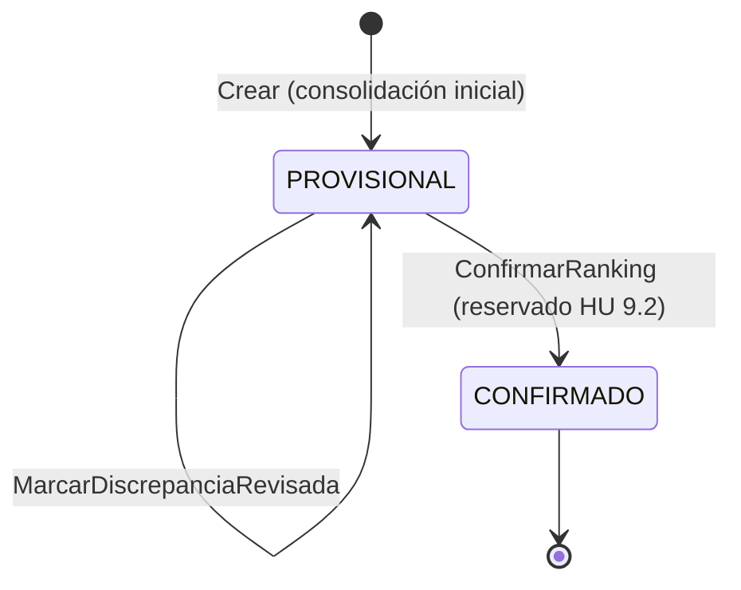

# Design

## Context

Motivación y alcance en `proposal.md`. Estado observado en `develop` dentro de `Apps/services/ms-postulaciones/`:

- **Ausencia de la entidad `Postulacion`:** no existe aún en `Ascenso.Postulaciones.Domain` (Integrante 1). Coherente con HU 6.2, HU 6.3, HU 8.1 y HU 8.2, `PostulacionId` sigue siendo un `Guid` opaco sin clave foránea en PostgreSQL.
- **Estado de `RubricaEvaluacion` (`Domain/Rubricas/Agregados/RubricaEvaluacion.cs`):** HU 7.1 dejó explícitamente fuera de alcance `EvaluadoresMinimosRequeridos` y `UmbralDiscrepanciaPuntos`, por lo que actualmente `rubricas` no tiene esas columnas. Dado que este cambio no puede tocar `Rubricas`, la lectura de ambos parámetros se abstrae tras un puerto DIP/OCP (`IProveedorParametrosConsolidacion`) respaldado por configuración (`ConsolidacionOptions`), listo para conectarse a `rubricas` cuando RF-07 incorpore dichas columnas.
- **Estado de `Evaluacion` y `EvaluacionRepository`:** `Evaluacion` almacena `PostulacionId`, `ConvocatoriaId`, `RubricaEvaluacionId`, `EvaluadorId`, `FechaEnvio`, `PuntajeTotalPonderado` (`numeric(5,2)` ∈ `[0.00, 100.00]`), `ComentariosGenerales` y `Estado` (`BORRADOR`, `ENVIADA_DEFINITIVA`, `INVALIDADA_POR_CONFLICTO`). **Hallazgo clave:** `EvaluacionRepository.ListarDefinitivasPorPostulacionAsync` filtra `Estado != Borrador` (incluyendo `InvalidadaPorConflicto` para supervisión de HU 8.1) y carga `Calificaciones`. Por ello, consolidación necesita su propio puerto ISP (`IConsultaDatosConsolidacionRepository`) que filtre estrictamente `Estado == EstadoEvaluacion.EnviadaDefinitiva` sin joins innecesarios a `calificaciones_criterio`.
- **Estado de `AutorizacionExcepcionEvaluadorUnico` (HU 6.3):** entidad inmutable `EntidadInmutable` en `postulaciones.excepciones_evaluador_unico` (única por `postulacion_id`), con `PostulacionId`, `Justificacion` (10–1000 chars), `UsuarioCreacionId` (coordinador autorizador) y `FechaCreacion` (UTC). `ServicioExcepcionEvaluadorUnico` permite autorizarla mientras existan `< 2` asignaciones vigentes, lo que incluye el caso en que ya exista `1` asignación vigente en estado `COMPLETADA` con evaluación `ENVIADA_DEFINITIVA`.
- **Patrón de desacople de disparos internos (HU 8.1):** `EnviarEvaluacionDefinitivaCommandHandler` y `GuardarBorradorEvaluacionCommandHandler` invocan el bloqueo de rúbrica a través del puerto de aplicación `IBloqueadorRubricaEvaluacion` (`BloqueadorRubricaEvaluacionAdapter` → `BloquearRubricaCommandHandler` con `UsuarioSistema.Id`), tras confirmar `GuardarCambiosAsync`.
- **Puertos protegidos por pruebas de contrato por reflexión:** `IEvaluacionRepository`, `IConsultaAsignacionParaEvaluacionRepository`, `IConsultaRubricaParaEvaluacionRepository`, `IConvocatoriaEvaluacionClient`, `IConsultaEvaluacionesCoevaluadoresRepository`, `IAsignacionEvaluacionRepository`, `IExcepcionEvaluadorUnicoRepository`, `IRubricaRepository` y `IComiteEvaluadorRepository`. Ninguno puede alterarse.
- **Guardrails arquitectónicos (`ArchitectureTests`):** `EncapsulamientoTests` prohíbe setters públicos (incluidos `init` públicos en `ValueObject`) y colecciones mutables en `Domain`; `DomainIndependenceTests` y `DependenciasEntreCapasTests` exigen C# puro en `Domain` y ausencia de dependencias EF Core/ASP.NET/Npgsql/MassTransit en `Application`.
- **Autorización (`ManejadorResultadoAutorizacionRubricas` y `Program.cs`):** el manejador traduce `403 Forbidden` a `ProblemDetails` con `codigo = PERMISO_DENEGADO` inspeccionando las políticas conocidas en metadatos del endpoint, preservando sin cambios el comportamiento de `Postulantes`, `Rubricas`, `Comites`, `Asignaciones` y `Evaluaciones`.

## Goals / Non-Goals

**Goals:**

- Modelar el agregado `ResultadoConsolidadoRanking` y el servicio de dominio puro `ServicioCalculoConsolidacion` cumpliendo las fórmulas deterministas de DDD V7 §2.3.B, `RN-POS-04`, soporte trazable de `AutorizacionExcepcionEvaluadorUnico` y revisión auditada de alertas de discrepancia.
- Integrar el disparo automático e idempotente de consolidación bajo concurrencia `C5` al completarse la última evaluación definitiva requerida (`EnviarEvaluacionDefinitivaCommandHandler`) y al autorizarse una excepción de evaluador único cuando ya exista una evaluación definitiva (`AutorizarExcepcionEvaluadorUnicoCommandHandler`).
- Preparar limpiamente por OCP la tabla `postulaciones.resultados_consolidados_ranking`, el enum `EstadoRanking` y el puerto `IProveedorParametrosConsolidacion` para extensiones aditivas futuras de HU 9.2, RF-10 y RF-07.
- Exponer endpoints REST v1 en `api/v1/resultados-consolidados` con RBAC por rol (`COORDINADOR_PROGRAMA` lectura/escritura, `DIRECCION` solo lectura, `MIEMBRO_COMITE` y `ADMIN_FINANCIERO` `403 PERMISO_DENEGADO`).

**Non-Goals:**

- Implementar lógica, campos o endpoints de HU 9.2 (`posicionRanking`, integración HTTP con `MS-PRG` de cupo/presupuesto, `montoEstimadoBeca`, `ClasificacionRanking`, confirmación de ranking) ni de RF-10 (`TipoCasoLimite`, desempates, `EntradaListaEspera`).
- Modificar `Postulantes`, `Rubricas`, `Comites`, `AsignacionesEvaluacionController`, `Domain/Comun`, puertos previos con pruebas de contrato por reflexión u otros microservicios.
- Incorporar MediatR, Outbox, Hangfire o la entidad `Postulacion`.

## Decisions

### D1. Aplicación práctica y auditable de SOLID y extensibilidad OCP

| Principio | Aplicación concreta en `rf9-1-int2-mspos` |
|---|---|
| **SRP** | `ServicioCalculoConsolidacion` (servicio de dominio puro) concentra exclusivamente las fórmulas deterministas de promedio, diferencia, umbral de discrepancia y aplicación de excepción; `ResultadoConsolidadoRanking` (agregado raíz) gestiona únicamente identidad, invariantes, recálculo idempotente y revisión de discrepancia; `ParametrosConsolidacion` y `ResultadoCalculoConsolidacion` son objetos de valor inmutables; cada comando y consulta CQRS tiene su propio handler, validador FluentValidation y mapeador (`ConsolidacionMapeador`). |
| **OCP** | (1) `ResultadoConsolidadoRanking` nace con `EstadoConfirmacionRanking = EstadoRanking.Provisional` y ya protege la inmutabilidad frente a `EstadoRanking.Confirmado` (`409 RANKING_YA_CONFIRMADO`), de modo que HU 9.2 podrá agregar columnas anulables (`posicion_ranking`, `monto_estimado_beca`, `clasificacion`, etc.) y el método `ConfirmarRanking(...)` de forma 100% aditiva sin reescribir HU 9.1. (2) `IProveedorParametrosConsolidacion` desacopla el origen de `EvaluadoresMinimosRequeridos` y `UmbralDiscrepanciaPuntos`, permitiendo pasar de configuración (`ConsolidacionOptions`) a `RubricaEvaluacion` en el futuro sin modificar dominio ni casos de uso. (3) `ManejadorResultadoAutorizacionRubricas` y `Program.cs` se amplían de forma estrictamente aditiva sin alterar políticas ni textos de módulos previos. |
| **ISP** | Se crean tres puertos pequeños y cohesivos en `Domain/Interfaces/` (`IResultadoConsolidadoRepository`, `IConsultaDatosConsolidacionRepository`, `IProveedorParametrosConsolidacion`) y un puerto de disparo de 1 método en Aplicación (`IConsolidadorPostulacionEvaluacion`), dejando intactos todos los puertos existentes. |
| **DIP** | Dominio y Aplicación dependen exclusivamente de interfaces puras y `TimeProvider`; las implementaciones EF Core (`ResultadoConsolidadoRepository`, `ConsultaDatosConsolidacionRepository`) y de configuración (`ProveedorParametrosConsolidacionConfigurado`) residen en `Infrastructure`. |

### D2. Estados y transiciones explícitas (sin librerías externas, persistidos con `CodigoEnum`)

#### D2.1 Estado de confirmación de ranking (`EstadoRanking`: `PROVISIONAL`, `CONFIRMADO`)

Se modela el enum `EstadoRanking` (`Domain/Enums/EstadoRanking.cs`) con valores `Provisional` (`PROVISIONAL`) y `Confirmado` (`CONFIRMADO`), persistido mediante `CodigoEnum`. En HU 9.1 ningún flujo asigna `CONFIRMADO` (reservado para HU 9.2), pero el agregado ya hace cumplir sus invariantes de bloqueo (mismo patrón que `EstadoRubrica.Bloqueada` en HU 7.1 y `EstadoEvaluacion.InvalidadaPorConflicto` en HU 8.1).

| Estado actual | Operación solicitada | Estado resultante | Resultado / Excepción |
|---|---|---|---|
| *(Inexistente)* | `ResultadoConsolidadoRanking.Crear(...)` | `PROVISIONAL` | Crea agregado con `Version = 1`, `DiscrepanciaRevisada = false` |
| `PROVISIONAL` | `Recalcular(...)` con snapshot idéntico | `PROVISIONAL` | **Idempotente:** retorna `false`, no altera `Version`, `FechaConsolidacion` ni revisión |
| `PROVISIONAL` | `Recalcular(...)` con snapshot distinto | `PROVISIONAL` | Retorna `true`, actualiza métricas, `FechaConsolidacion` y reinicia revisión de discrepancia |
| `PROVISIONAL` | `MarcarDiscrepanciaRevisada(...)` válida | `PROVISIONAL` | Actualiza `DiscrepanciaRevisada = true`, comentario, revisor, fecha UTC y `Version` |
| `CONFIRMADO` | `Recalcular(...)` | *(sin cambio)* | **Inválida:** `409 Conflict` (`RankingYaConfirmadoException`, `RANKING_YA_CONFIRMADO`) |
| `CONFIRMADO` | `MarcarDiscrepanciaRevisada(...)` | *(sin cambio)* | **Inválida:** `409 Conflict` (`RankingYaConfirmadoException`, `RANKING_YA_CONFIRMADO`) |

#### D2.2 Ciclo de alerta y revisión de discrepancia `(AlertaDiscrepancia, DiscrepanciaRevisada)`

| Estado `(Alerta, Revisada)` | Operación | Estado resultante | Resultado / Excepción |
|---|---|---|---|
| `(false, false)` | `MarcarDiscrepanciaRevisada(...)` | `(false, false)` | **Inválida:** `422 Unprocessable Entity` (`DiscrepanciaNoDetectadaException`, `DISCREPANCIA_NO_DETECTADA`) |
| `(false, false)` | `Recalcular(...)` con `diferencia > umbral` | `(true, false)` | Activa `AlertaDiscrepancia = true`, mantiene `DiscrepanciaRevisada = false` |
| `(true, false)` | `MarcarDiscrepanciaRevisada(...)` con comentario válido (`10..1000` chars) | `(true, true)` | Registra comentario normalizado, `RevisadoPorUsuarioId` y `FechaRevisionDiscrepancia` UTC |
| `(true, false)` | `MarcarDiscrepanciaRevisada(...)` con comentario vacío / `< 10` / `> 1000` | `(true, false)` | **Inválida:** `422` (`ComentarioRevisionDiscrepanciaInvalidoException`, `COMENTARIO_REVISION_REQUERIDO`) en dominio / `400` en FluentValidation |
| `(true, false)` | `Recalcular(...)` con `diferencia <= umbral` | `(false, false)` | Desactiva alerta |
| `(true, true)` | `MarcarDiscrepanciaRevisada(...)` | `(true, true)` | **Inválida:** `409 Conflict` (`DiscrepanciaYaRevisadaException`, `DISCREPANCIA_YA_REVISADA`) — preserva trazabilidad original (`RN-AUD-01`) |
| `(true, true)` | `Recalcular(...)` con snapshot **idéntico** | `(true, true)` | **Idempotente:** retorna `false`, conserva revisión y `Version` |
| `(true, true)` | `Recalcular(...)` con snapshot **distinto** y `alerta = true` | `(true, false)` | Reinicia revisión (limpia comentario, revisor y fecha) al cambiar las notas base |
| `(true, true)` | `Recalcular(...)` con snapshot **distinto** y `alerta = false` | `(false, false)` | Desactiva alerta y limpia revisión obsoleta |
| `(false, true)` | *(Cualquiera)* | — | **Estado imposible:** prohibido por invariantes de dominio y `CHECK` en PostgreSQL |

### D3. Modelo de Dominio (`Ascenso.Postulaciones.Domain`)

#### D3.1 Evaluación explícita de campos de HU 9.2 / RF-10 en `ResultadoConsolidadoRanking`

- **Se incluye ahora en HU 9.1:** `EstadoConfirmacionRanking` (`EstadoRanking`, nace en `PROVISIONAL`), porque define la máquina de estados del agregado desde el primer día, protege la inmutabilidad frente a `CONFIRMADO` sin refactorizar en HU 9.2 y evita migrar una columna `NOT NULL` sobre filas existentes. También se incluye `UmbralDiscrepanciaAplicado` (`numeric(5,2)`) y `FechaRevisionDiscrepancia` (`timestamptz?`) como fotografías auditables (`RN-AUD-01`) que permiten expresar en `CHECK` de PostgreSQL la coherencia exacta de alerta y revisión.
- **Se difiere explícitamente a HU 9.2 y RF-10:** `PosicionRanking`, `MontoEstimadoBeca`, `Clasificacion` (`ClasificacionRanking`), `TipoCasoLimite`, `JustificacionDesempateCasoLimite` y `DecididoPorUsuarioId`.
  - *Justificación:* introducir hoy columnas anulables sin semántica activa ni enums cerrados acoplaría HU 9.1 a decisiones de HU 9.2 (integración con `MS-PRG` y línea de corte) y RF-10 (casos límite). En PostgreSQL, añadir columnas anulables en la migración de HU 9.2 es una operación aditiva instantánea (metadato puro en PG 11+) y replica exactamente la estrategia ya probada en HU 7.1 → HU 7.2 (`20261122153053_BloqueoRubrica`).
  - *Alternativa descartada:* crear las 6 columnas nulas junto con enums vacíos `ClasificacionRanking`/`TipoCasoLimite` en HU 9.1. Se descartó para evitar código muerto, DTOs inflados con campos siempre nulos y pruebas artificiales de conceptos fuera de alcance.

#### D3.2 Objetos de valor (`Domain/Consolidacion/ObjetosValor/`)

Todos heredan de `ValueObject` con propiedades de **solo `get;`** (sin `init` público, cumpliendo `EncapsulamientoTests`):

1. **`ParametrosConsolidacion`:**
   - Constantes: `EvaluadoresMinimosPorDefecto = 2`, `UmbralDiscrepanciaPorDefecto = 20.00m`, `UmbralMinimoExclusivo = 0.00m`, `UmbralMaximo = 100.00m`.
   - Propiedades: `int EvaluadoresMinimosRequeridos`, `decimal UmbralDiscrepanciaPuntos`.
   - Validación en constructor: `EvaluadoresMinimosRequeridos >= 2`; `UmbralDiscrepanciaPuntos > 0.00m && <= 100.00m` y máximo 2 decimales (`decimal.Round(val, 2) == val`). Lanza `ConsolidacionInvalidaException` ante valores inválidos.
2. **`ResultadoCalculoConsolidacion`:**
   - Propiedades: `Guid ConvocatoriaId`, `Guid PostulacionId`, `bool ExcepcionEvaluadorUnico`, `string? JustificacionEvaluadorUnico`, `Guid? AutorizadorExcepcionId`, `int CantidadEvaluacionesValidas`, `decimal PuntajeConsolidado`, `decimal DiferenciaEntreEvaluadores`, `decimal UmbralDiscrepanciaAplicado`, `bool AlertaDiscrepancia`.
   - Constructor interno/público con validación de invariantes (rango `[0.00, 100.00]`, máximo 2 decimales, coherencia de excepción y alerta).

#### D3.3 Servicio de dominio puro (`Domain/Consolidacion/Servicios/ServicioCalculoConsolidacion.cs`)

`public static class ServicioCalculoConsolidacion`:
- `Calcular(Guid postulacionId, IReadOnlyCollection<Evaluacion> evaluacionesDefinitivas, AutorizacionExcepcionEvaluadorUnico? excepcionEvaluadorUnico, ParametrosConsolidacion parametros)` → `ResultadoCalculoConsolidacion`.
- Validaciones previas:
  - `postulacionId == Guid.Empty` → `ConsolidacionInvalidaException`.
  - `evaluacionesDefinitivas` nulo → `ArgumentNullException`; `parametros` nulo → `ArgumentNullException`.
  - Si `excepcionEvaluadorUnico is not null && excepcionEvaluadorUnico.PostulacionId != postulacionId` → `ConsolidacionInvalidaException`.
  - Si `evaluacionesDefinitivas.Count == 0` → `EvaluadoresInsuficientesException` (`422 EVALUACIONES_INSUFICIENTES`).
  - Valida cada evaluación: no nula, `Estado == EstadoEvaluacion.EnviadaDefinitiva`, `PostulacionId == postulacionId`, misma `ConvocatoriaId` en todas, `PuntajeTotalPonderado.HasValue` en `[0.00m, 100.00m]`, y sin `EvaluadorId` duplicado (`ConsolidacionInvalidaException` si falla alguna).
- Cálculo determinista (DDD V7 §2.3.B):
  - **Camino multi-evaluador (`cantidad >= parametros.EvaluadoresMinimosRequeridos`):**
    - `puntajeConsolidado = decimal.Round(notas.Sum() / cantidad, 2, MidpointRounding.AwayFromZero)`
    - `diferencia = decimal.Round(notas.Max() - notas.Min(), 2, MidpointRounding.AwayFromZero)`
    - `alertaDiscrepancia = diferencia > parametros.UmbralDiscrepanciaPuntos` *(estrictamente mayor; igualdad exacta no dispara alerta)*
    - `excepcionEvaluadorUnico = false`, `justificacion = null`, `autorizadorId = null` *(prevalece modo multi-evaluador si se alcanzaron >= mínimo evaluaciones definitivas)*.
  - **Camino excepción de evaluador único (`cantidad == 1 && excepcionEvaluadorUnico is not null`):**
    - `puntajeConsolidado = decimal.Round(notas[0], 2, MidpointRounding.AwayFromZero)`
    - `diferencia = 0.00m`
    - `alertaDiscrepancia = false` *(siempre `false` en evaluador único)*
    - `excepcionEvaluadorUnico = true`, `justificacion = excepcionEvaluadorUnico.Justificacion`, `autorizadorId = excepcionEvaluadorUnico.UsuarioCreacionId`.
  - **Insuficiencia (`cantidad < parametros.EvaluadoresMinimosRequeridos` sin excepción aplicable):**
    - Lanza `EvaluadoresInsuficientesException` (`422 EVALUACIONES_INSUFICIENTES`).

#### D3.4 Agregado raíz `ResultadoConsolidadoRanking` (`Domain/Consolidacion/Agregados/ResultadoConsolidadoRanking.cs`)

Hereda de `AggregateRoot` (`EntidadAuditable` con `Id` UUIDv7, auditoría UTC y `Version`). Todos los setters son `private`.
- Constantes: `LongitudMinimaComentarioRevision = 10`, `LongitudMaximaComentarioRevision = 1000`, `LongitudMaximaJustificacionExcepcion = AutorizacionExcepcionEvaluadorUnico.LongitudMaximaJustificacion` (`1000`).
- Propiedades: `ConvocatoriaId`, `PostulacionId`, `ExcepcionEvaluadorUnico`, `JustificacionEvaluadorUnico`, `AutorizadorExcepcionId`, `CantidadEvaluacionesValidas`, `PuntajeConsolidado`, `DiferenciaEntreEvaluadores`, `UmbralDiscrepanciaAplicado`, `AlertaDiscrepancia`, `DiscrepanciaRevisada`, `ComentarioRevisionDiscrepancia`, `RevisadoPorUsuarioId`, `FechaRevisionDiscrepancia`, `EstadoConfirmacionRanking`, `FechaConsolidacion`.
- Métodos de comportamiento:
  - `public static ResultadoConsolidadoRanking Crear(ResultadoCalculoConsolidacion calculo, DateTimeOffset fechaConsolidacion, Guid usuarioActorId)`: crea en `EstadoRanking.Provisional` normalizando `FechaConsolidacion` a UTC.
  - `public bool CoincideConCalculo(ResultadoCalculoConsolidacion calculo)`: compara el snapshot determinista (`ConvocatoriaId`, `PostulacionId`, `ExcepcionEvaluadorUnico`, `JustificacionEvaluadorUnico`, `AutorizadorExcepcionId`, `CantidadEvaluacionesValidas`, `PuntajeConsolidado`, `DiferenciaEntreEvaluadores`, `UmbralDiscrepanciaAplicado`, `AlertaDiscrepancia`).
  - `public bool Recalcular(ResultadoCalculoConsolidacion calculo, DateTimeOffset fechaConsolidacion, Guid usuarioActorId)`:
    - Rechaza con `RankingYaConfirmadoException` si `EstadoConfirmacionRanking == EstadoRanking.Confirmado`.
    - Valida que `calculo.PostulacionId == PostulacionId` y `calculo.ConvocatoriaId == ConvocatoriaId` (`ConsolidacionInvalidaException`).
    - Si `CoincideConCalculo(calculo)` es `true` → retorna `false` (idempotente: no incrementa `Version` ni borra revisión).
    - Si difiere → actualiza métricas y snapshot, `FechaConsolidacion` UTC, reinicia `DiscrepanciaRevisada = false` y limpia `ComentarioRevisionDiscrepancia`, `RevisadoPorUsuarioId` y `FechaRevisionDiscrepancia`, actualiza auditoría y retorna `true`.
  - `public void MarcarDiscrepanciaRevisada(string comentario, DateTimeOffset fechaRevision, Guid usuarioRevisorId)`:
    - Valida `fechaRevision != default` y `usuarioRevisorId != Guid.Empty` (`ArgumentException`).
    - Si `EstadoConfirmacionRanking == EstadoRanking.Confirmado` → `RankingYaConfirmadoException` (`409`).
    - Si `!AlertaDiscrepancia` → `DiscrepanciaNoDetectadaException` (`422`).
    - Si `DiscrepanciaRevisada` → `DiscrepanciaYaRevisadaException` (`409`).
    - Normaliza `comentario.Trim()`; exige no vacío y longitud `[10, 1000]` → de lo contrario `ComentarioRevisionDiscrepanciaInvalidoException` (`422`).
    - Asigna `DiscrepanciaRevisada = true`, `ComentarioRevisionDiscrepancia`, `RevisadoPorUsuarioId = usuarioRevisorId`, `FechaRevisionDiscrepancia = fechaRevision.ToUniversalTime()` y llama `ActualizarAuditoria(usuarioRevisorId, fechaRevision)`.

### D4. Excepciones de dominio (`Domain/Excepciones/`)

Se reutilizan sin modificar `EvaluadoresInsuficientesException` (`422 EVALUACIONES_INSUFICIENTES`), `ExcepcionConflictoConcurrencia` (`409 CONFLICTO_CONCURRENCIA`) y `NoAutenticadoException` (`401`). Se agregan:

| Excepción | Base | `CodigoError` | HTTP | Motivo |
|---|---|---|---|---|
| `ResultadoConsolidadoNoEncontradoException` | `ExcepcionEntidadNoEncontrada` | `RESULTADO_CONSOLIDADO_NO_ENCONTRADO` | `404` | No existe resultado consolidado para la postulación |
| `ResultadoConsolidadoDuplicadoException` | `ExcepcionReglaNegocio` | `RESULTADO_CONSOLIDADO_DUPLICADO` | `409` | Violación de unicidad 1:1 en `ux_resultados_consolidados_ranking_postulacion` |
| `ConsolidacionInvalidaException` | `ExcepcionReglaNegocio` | `CONSOLIDACION_INVALIDA` | `422` | Parámetros o datos de consolidación inconsistentes en dominio |
| `EvaluacionesPendientesParaConsolidarException` | `ExcepcionReglaNegocio` | `EVALUACIONES_PENDIENTES` | `409` | Existen asignaciones vigentes sin completar al consolidar manualmente |
| `DiscrepanciaNoDetectadaException` | `ExcepcionReglaNegocio` | `DISCREPANCIA_NO_DETECTADA` | `422` | Intento de revisar discrepancia cuando `AlertaDiscrepancia == false` |
| `DiscrepanciaYaRevisadaException` | `ExcepcionReglaNegocio` | `DISCREPANCIA_YA_REVISADA` | `409` | Intento de sobrescribir una discrepancia ya revisada |
| `ComentarioRevisionDiscrepanciaInvalidoException` | `ExcepcionReglaNegocio` | `COMENTARIO_REVISION_REQUERIDO` | `422` | Comentario ausente, vacío o fuera de `[10, 1000]` caracteres |
| `RankingYaConfirmadoException` | `ExcepcionReglaNegocio` | `RANKING_YA_CONFIRMADO` | `409` | Mutación/recálculo/revisión sobre resultado en estado `CONFIRMADO` |

`ManejadorExcepcionesDominio` traduce automáticamente cualquier `DomainException` a `ProblemDetails` con `Status` y `codigo`; no requiere cambios.

### D5. Puertos ISP (`Domain/Interfaces/`)

Todos los métodos asíncronos terminan en `Async` y reciben `CancellationToken cancellationToken = default`:

1. **`IResultadoConsolidadoRepository`** (`Domain/Interfaces/IResultadoConsolidadoRepository.cs`):
   - `Task<ResultadoConsolidadoRanking?> ObtenerPorPostulacionAsync(Guid postulacionId, CancellationToken cancellationToken = default);` *(AsNoTracking)*
   - `Task<ResultadoConsolidadoRanking?> ObtenerParaActualizarPorPostulacionAsync(Guid postulacionId, CancellationToken cancellationToken = default);` *(Tracked)*
   - `Task<ResultadoConsolidadoRanking?> RecargarParaActualizarPorPostulacionAsync(Guid postulacionId, CancellationToken cancellationToken = default);` *(Descarta entradas locales rastreadas de esa postulación y recarga fresca desde PostgreSQL para reintento seguro en `C5`)*
   - `Task<PaginaResultado<ResultadoConsolidadoRanking>> ListarPorConvocatoriaAsync(Guid convocatoriaId, bool? alertaDiscrepancia, bool? discrepanciaRevisada, int pagina, int tamano, CancellationToken cancellationToken = default);` *(AsNoTracking, orden `PuntajeConsolidado DESC, FechaConsolidacion ASC, Id ASC`)*
   - `Task AgregarAsync(ResultadoConsolidadoRanking resultado, CancellationToken cancellationToken = default);`
2. **`IConsultaDatosConsolidacionRepository`** (`Domain/Interfaces/IConsultaDatosConsolidacionRepository.cs`):
   - `Task<IReadOnlyList<AsignacionEvaluacion>> ListarAsignacionesVigentesPorPostulacionAsync(Guid postulacionId, CancellationToken cancellationToken = default);` *(AsNoTracking, `Estado != EstadoAsignacionEvaluacion.ReasignadaPorConflicto`)*
   - `Task<IReadOnlyList<Evaluacion>> ListarEvaluacionesDefinitivasPorPostulacionAsync(Guid postulacionId, CancellationToken cancellationToken = default);` *(AsNoTracking, estrictamente `Estado == EstadoEvaluacion.EnviadaDefinitiva`, orden `FechaEnvio ASC, Id ASC`, sin incluir `Calificaciones`)*
   - `Task<AutorizacionExcepcionEvaluadorUnico?> ObtenerExcepcionEvaluadorUnicoPorPostulacionAsync(Guid postulacionId, CancellationToken cancellationToken = default);` *(AsNoTracking)*
3. **`IProveedorParametrosConsolidacion`** (`Domain/Interfaces/IProveedorParametrosConsolidacion.cs`):
   - `Task<ParametrosConsolidacion> ObtenerParametrosAsync(Guid convocatoriaId, Guid rubricaEvaluacionId, CancellationToken cancellationToken = default);`

Ningún puerto previo del dominio se modifica.

### D6. Capa de Aplicación (`Ascenso.Postulaciones.Application`, CQRS sin MediatR ni Hangfire)

#### D6.1 Disparo automático desacoplado e idempotente (`C5`)

- **Puerto de aplicación:** `Application/Consolidacion/Interfaces/IConsolidadorPostulacionEvaluacion.cs`:
  - `Task IntentarConsolidarAutomaticamenteAsync(Guid postulacionId, CancellationToken cancellationToken = default);`
- **Adaptador:** `Application/Consolidacion/Servicios/ConsolidadorPostulacionEvaluacionAdapter.cs`:
  - Invoca `ConsolidarPostulacionCommandHandler.IntentarConsolidarAutomaticamenteAsync(postulacionId, cancellationToken)` usando actor `UsuarioSistema.Id`.
- **Puntos de enganche (patrón `IBloqueadorRubricaEvaluacion` de HU 8.1):**
  1. **`EnviarEvaluacionDefinitivaCommandHandler`:** recibe `IConsolidadorPostulacionEvaluacion` en el constructor; tras `await _unitOfWork.GuardarCambiosAsync(cancellationToken)` y el resguardo idempotente de bloqueo de rúbrica, invoca `await _consolidadorPostulacion.IntentarConsolidarAutomaticamenteAsync(asignacion.PostulacionId, cancellationToken)`.
  2. **`AutorizarExcepcionEvaluadorUnicoCommandHandler`:** recibe `IConsolidadorPostulacionEvaluacion` en el constructor; tras `await _unitOfWork.GuardarCambiosAsync(cancellationToken)`, invoca `await _consolidadorPostulacion.IntentarConsolidarAutomaticamenteAsync(command.PostulacionId, cancellationToken)`. Si aún no hay evaluaciones definitivas (flujo habitual previo a asignar/calificar), el consolidado es un no-op inmediato; si ya existía `1` asignación vigente `COMPLETADA` con evaluación `ENVIADA_DEFINITIVA`, consolida automáticamente al instante.
- **Ajustes mínimos y documentados en tests previos:** inyectar un sustituto por defecto de `IConsolidadorPostulacionEvaluacion` en los constructores/fábricas de `EnviarEvaluacionDefinitivaCommandHandlerTests`, `EnviarEvaluacionDefinitivaVentanaRevisionTests`, `EvaluacionPostgreSqlTests`, `AutorizarExcepcionEvaluadorUnicoCommandHandlerTests` y `ExcepcionEvaluadorUnicoPostgreSqlTests`, sin modificar ninguna aserción de negocio existente.

#### D6.2 Flujo de `ConsolidarPostulacionCommandHandler` y estrategia de concurrencia `C5`

Expone dos operaciones claras compartiendo la misma lógica determinista de cálculo:
- `HandleAsync(ConsolidarPostulacionCommand command, CancellationToken ct)` *(modo manual del coordinador)*:
  1. Valida `command` (`PostulacionId != Guid.Empty`), obtiene `usuarioId = _usuarioActual.ObtenerUsuarioIdRequerido()`.
  2. Lee `asignacionesVigentes`, `evaluacionesDefinitivas` y `excepcion` vía `IConsultaDatosConsolidacionRepository`.
  3. Si existe alguna asignación vigente con `Estado != EstadoAsignacionEvaluacion.Completada` → lanza `EvaluacionesPendientesParaConsolidarException` (`409 EVALUACIONES_PENDIENTES`).
  4. Si `evaluacionesDefinitivas.Count == 0` → lanza `EvaluadoresInsuficientesException` (`422 EVALUACIONES_INSUFICIENTES`).
  5. Obtiene `parametros = await _proveedorParametros.ObtenerParametrosAsync(convocatoriaId, rubricaId, ct)` y calcula `calculo = ServicioCalculoConsolidacion.Calcular(...)`.
  6. Ejecuta persistencia idempotente con manejo `C5` (paso común abajo) y retorna `ResultadoConsolidarPostulacionDto(Resultado, EsCreacion)`.
- `IntentarConsolidarAutomaticamenteAsync(Guid postulacionId, CancellationToken ct)` *(modo automático, actor `UsuarioSistema.Id`)*:
  1. Lee `asignacionesVigentes`, `evaluacionesDefinitivas` y `excepcion`.
  2. Si `asignacionesVigentes.Count == 0` o existe alguna asignación vigente con `Estado != EstadoAsignacionEvaluacion.Completada` → retorna sin persistir (no-op).
  3. Si `evaluacionesDefinitivas.Count == 0` → retorna sin persistir (no-op).
  4. Obtiene `parametros`; verifica si cumple mínimo efectivo (`evaluacionesDefinitivas.Count >= parametros.EvaluadoresMinimosRequeridos || (evaluacionesDefinitivas.Count == 1 && excepcion is not null)`). Si no cumple → retorna sin persistir (no-op).
  5. Calcula `calculo = ServicioCalculoConsolidacion.Calcular(...)` y ejecuta la persistencia idempotente con manejo `C5`.

**Persistencia idempotente con resolución de carrera `C5`:**
1. Busca `existente = await _resultadoRepository.ObtenerParaActualizarPorPostulacionAsync(postulacionId, ct)`.
2. Si `existente is null`: crea `nuevo = ResultadoConsolidadoRanking.Crear(calculo, ahora, actorId)` y llama `AgregarAsync(nuevo, ct)` → `GuardarCambiosAsync(ct)`.
3. Si `existente is not null`: llama `var cambio = existente.Recalcular(calculo, ahora, actorId)`; si `!cambio`, retorna inmediatamente sin `GuardarCambiosAsync` (idempotente). Si `cambio`, llama `GuardarCambiosAsync(ct)`.
4. **Ante `catch (ResultadoConsolidadoDuplicadoException)` o `catch (ExcepcionConflictoConcurrencia)`:**
   - Recarga el estado real de BD con `actual = await _resultadoRepository.RecargarParaActualizarPorPostulacionAsync(postulacionId, ct)` (que descarta el rastreo fallido del `ChangeTracker`).
   - Re-lee `evaluacionesActuales` y `excepcionActual` y recalcula `calculoActual` (cubre el caso escalonado donde una tercera o segunda evaluación se confirmó entremedio).
   - Si `actual is not null && actual.CoincideConCalculo(calculoActual)` → **retorna `actual` idempotente sin error (`EsCreacion = false`)!** (Caso típico `C5` cuando A y B envían a la vez).
   - Si `actual is not null && actual.EstadoConfirmacionRanking == EstadoRanking.Provisional` y difiere de `calculoActual` → aplica `actual.Recalcular(calculoActual, ahora, actorId)` y realiza **1 reintento acotado** de `GuardarCambiosAsync(ct)` (si vuelve a chocar, revalida una última vez `CoincideConCalculo` y si sigue distinto propaga el `409`).

#### D6.3 Comandos, consultas, validadores, DTOs y DI

- **Comandos:**
  - `ConsolidarPostulacionCommand(Guid PostulacionId)` + Validator (`PostulacionId != Guid.Empty`, `ErrorCode = "CONSOLIDACION_INVALIDA"`).
  - `RevisarDiscrepanciaConsolidacionCommand(Guid PostulacionId, string Comentario)` + Validator (`PostulacionId != Guid.Empty`, `Comentario` no vacío, longitud `[10, 1000]` tras `Trim()`, `ErrorCode = "COMENTARIO_REVISION_REQUERIDO"`). Handler: carga `ObtenerParaActualizarPorPostulacionAsync` (`404 RESULTADO_CONSOLIDADO_NO_ENCONTRADO`), ejecuta `MarcarDiscrepanciaRevisada(command.Comentario, _timeProvider.GetUtcNow(), usuarioId)`, guarda con `_unitOfWork.GuardarCambiosAsync` y retorna `ResultadoConsolidadoDto`.
- **Consultas:**
  - `ObtenerResultadoConsolidadoPostulacionQuery(Guid PostulacionId)` + Validator (`PostulacionId != Guid.Empty`) + Handler: lee `ResultadoConsolidadoRanking` (`404 RESULTADO_CONSOLIDADO_NO_ENCONTRADO`) y lee evaluaciones `ENVIADA_DEFINITIVA` por `IConsultaDatosConsolidacionRepository`, retornando `DetalleResultadoConsolidadoDto`.
  - `ListarResultadosConsolidadosConvocatoriaQuery(Guid ConvocatoriaId, bool? AlertaDiscrepancia = null, bool? DiscrepanciaRevisada = null, int Pagina = 1, int Tamano = 20)` + Validator (`ConvocatoriaId != Guid.Empty`, `Pagina >= 1`, `Tamano` entre `1` y `100`) + Handler: retorna `PaginaDto<ResultadoConsolidadoDto>` (reutilizando `PaginaDto<T>` existente).
- **DTOs y mapeador (`Application/Consolidacion/DTOs/`):**
  - `ResultadoConsolidadoDto`, `ResultadoConsolidarPostulacionDto(ResultadoConsolidadoDto Resultado, bool EsCreacion)`, `NotaEvaluacionIndividualDto`, `DetalleResultadoConsolidadoDto`, `ConsolidacionMapeador` (serializa `EstadoConfirmacionRanking` con `CodigoEnum.ACodigo()`).
- **Registro DI (`Application/DependencyInjection.cs`):** `AddScoped` para los 4 handlers y `IConsolidadorPostulacionEvaluacion → ConsolidadorPostulacionEvaluacionAdapter` (los validadores ya se registran vía `AddValidatorsFromAssembly`).

### D7. Persistencia e Infraestructura (`Ascenso.Postulaciones.Infrastructure`)

#### D7.1 Tabla `postulaciones.resultados_consolidados_ranking`

Configuración en `Infrastructure/Persistence/Configuraciones/ResultadoConsolidadoRankingConfiguracion.cs`:

- **Clave primaria:** `pk_resultados_consolidados_ranking` en `id` (`uuid`, `ValueGeneratedNever`).
- **Auditoría y concurrencia:** `ConfiguracionPersistencia.ConfigurarEntidadAuditable(builder)` (`fecha_creacion`, `usuario_creacion_id`, `fecha_ultima_modificacion`, `usuario_modificacion_id`, `version` como `IsConcurrencyToken()`).
- **Columnas:**
  - `convocatoria_id` (`uuid`, NOT NULL)
  - `postulacion_id` (`uuid`, NOT NULL)
  - `excepcion_evaluador_unico` (`boolean`, NOT NULL)
  - `justificacion_evaluador_unico` (`varchar(1000)`, NULL)
  - `autorizador_excepcion_id` (`uuid`, NULL)
  - `cantidad_evaluaciones_validas` (`integer`, NOT NULL)
  - `puntaje_consolidado` (`numeric(5,2)`, NOT NULL)
  - `diferencia_entre_evaluadores` (`numeric(5,2)`, NOT NULL)
  - `umbral_discrepancia_aplicado` (`numeric(5,2)`, NOT NULL)
  - `alerta_discrepancia` (`boolean`, NOT NULL)
  - `discrepancia_revisada` (`boolean`, NOT NULL)
  - `comentario_revision_discrepancia` (`varchar(1000)`, NULL)
  - `revisado_por_usuario_id` (`uuid`, NULL)
  - `fecha_revision_discrepancia` (`timestamptz`, NULL)
  - `estado_confirmacion_ranking` (`varchar(20)`, `ComoCodigoEnum()`, NOT NULL)
  - `fecha_consolidacion` (`timestamptz`, NOT NULL)
- **Índices:**
  - `ux_resultados_consolidados_ranking_postulacion`: **UNIQUE** en `(postulacion_id)` — garantiza relación 1:1 por postulación (estrictamente más fuerte que `(convocatoria_id, postulacion_id)`).
  - `ix_resultados_consolidados_ranking_convocatoria_puntaje`: en `(convocatoria_id, puntaje_consolidado, fecha_consolidacion, id)` — acelera listado paginado por convocatoria y prepara HU 9.2.
  - `ix_resultados_consolidados_ranking_convocatoria_discrepancia`: en `(convocatoria_id, alerta_discrepancia, discrepancia_revisada)` — acelera filtrado de alertas activas/pendientes/revisadas.
- **Restricciones `CHECK`:**
  - `ck_resultados_consolidados_estado_valido`: `estado_confirmacion_ranking IN ('PROVISIONAL', 'CONFIRMADO')` (generado vía `ConfiguracionPersistencia.ValoresSql<EstadoRanking>()`).
  - `ck_resultados_consolidados_puntaje_rango`: `puntaje_consolidado >= 0 AND puntaje_consolidado <= 100`.
  - `ck_resultados_consolidados_diferencia_rango`: `diferencia_entre_evaluadores >= 0 AND diferencia_entre_evaluadores <= 100`.
  - `ck_resultados_consolidados_umbral_rango`: `umbral_discrepancia_aplicado > 0 AND umbral_discrepancia_aplicado <= 100`.
  - `ck_resultados_consolidados_excepcion_coherente`: `(excepcion_evaluador_unico = true AND cantidad_evaluaciones_validas = 1 AND justificacion_evaluador_unico IS NOT NULL AND length(btrim(justificacion_evaluador_unico)) > 0 AND autorizador_excepcion_id IS NOT NULL AND diferencia_entre_evaluadores = 0 AND alerta_discrepancia = false) OR (excepcion_evaluador_unico = false AND cantidad_evaluaciones_validas >= 2 AND justificacion_evaluador_unico IS NULL AND autorizador_excepcion_id IS NULL)`.
  - `ck_resultados_consolidados_alerta_coherente`: `(excepcion_evaluador_unico = true AND alerta_discrepancia = false) OR (excepcion_evaluador_unico = false AND alerta_discrepancia = (diferencia_entre_evaluadores > umbral_discrepancia_aplicado))`.
  - `ck_resultados_consolidados_revision_coherente`: `(discrepancia_revisada = false AND comentario_revision_discrepancia IS NULL AND revisado_por_usuario_id IS NULL AND fecha_revision_discrepancia IS NULL) OR (discrepancia_revisada = true AND alerta_discrepancia = true AND comentario_revision_discrepancia IS NOT NULL AND length(btrim(comentario_revision_discrepancia)) > 0 AND revisado_por_usuario_id IS NOT NULL AND fecha_revision_discrepancia IS NOT NULL)`.

#### D7.2 Traducción de excepciones, repositorios, opciones y migración

- **`TraductorExcepcionesPersistencia`:** agregar constante `IndiceResultadoConsolidadoPostulacionUnico = "ux_resultados_consolidados_ranking_postulacion"` y traducción a `ResultadoConsolidadoDuplicadoException`.
- **`PostulacionesDbContext`:** agregar `public DbSet<ResultadoConsolidadoRanking> ResultadosConsolidadosRanking => Set<ResultadoConsolidadoRanking>();`.
- **Repositorios:** `ResultadoConsolidadoRepository` y `ConsultaDatosConsolidacionRepository` bajo `Infrastructure/Persistence/Repositorios/`.
- **Adaptador de parámetros (`Infrastructure/Adapters/`):**
  - `ConsolidacionOptions` (`Seccion = "Consolidacion"`): `int EvaluadoresMinimosRequeridos { get; set; } = ParametrosConsolidacion.EvaluadoresMinimosPorDefecto;` (`2`), `decimal UmbralDiscrepanciaPuntos { get; set; } = ParametrosConsolidacion.UmbralDiscrepanciaPorDefecto;` (`20.00m`).
  - `ProveedorParametrosConsolidacionConfigurado : IProveedorParametrosConsolidacion`: construye `ParametrosConsolidacion` validando los valores configurados.
- **Migración EF Core:** nueva migración `ResultadosConsolidadosRanking` creada en tarea separada justo antes de las pruebas con PostgreSQL real (Testcontainers), verificando `has-pending-model-changes` y ejecutando `dotnet format --no-restore --include <rutas>` inmediatamente después.

### D8. API y Seguridad (`Ascenso.Postulaciones.Api`)

Nuevo controlador `Api/Controllers/v1/ResultadosConsolidadosController.cs` con ruta base `api/v1/resultados-consolidados`:

| Método y ruta | Operación | Política / Roles | Éxito | Errores documentados |
|---|---|---|---|---|
| `POST /postulaciones/{postulacionId:guid}` | Consolidar o recalcular manualmente una postulación | `GestionConsolidacion` (`COORDINADOR_PROGRAMA`) | `201 Created` (con `Location`) o `200 OK` + `ResultadoConsolidadoDto` | `400`, `401`, `403` (`PERMISO_DENEGADO`), `409` (`EVALUACIONES_PENDIENTES`, `RANKING_YA_CONFIRMADO`, `CONFLICTO_CONCURRENCIA`), `422` (`EVALUACIONES_INSUFICIENTES`, `CONSOLIDACION_INVALIDA`) |
| `POST /postulaciones/{postulacionId:guid}/discrepancia/revisar` | Marcar alerta de discrepancia como revisada con comentario obligatorio | `GestionConsolidacion` (`COORDINADOR_PROGRAMA`) | `200 OK` + `ResultadoConsolidadoDto` | `400`, `401`, `403` (`PERMISO_DENEGADO`), `404` (`RESULTADO_CONSOLIDADO_NO_ENCONTRADO`), `409` (`DISCREPANCIA_YA_REVISADA`, `RANKING_YA_CONFIRMADO`, `CONFLICTO_CONCURRENCIA`), `422` (`DISCREPANCIA_NO_DETECTADA`, `COMENTARIO_REVISION_REQUERIDO`) |
| `GET /postulaciones/{postulacionId:guid}` | Consultar resultado consolidado por postulación con sus notas definitivas individuales | `ConsultaConsolidacion` (`COORDINADOR_PROGRAMA`, `DIRECCION`) | `200 OK` + `DetalleResultadoConsolidadoDto` | `400`, `401`, `403` (`PERMISO_DENEGADO`), `404` (`RESULTADO_CONSOLIDADO_NO_ENCONTRADO`) |
| `GET /convocatorias/{convocatoriaId:guid}` | Listar resultados consolidados / alertas por convocatoria (paginado, filtros `alertaDiscrepancia` y `discrepanciaRevisada`) | `ConsultaConsolidacion` (`COORDINADOR_PROGRAMA`, `DIRECCION`) | `200 OK` + `PaginaDto<ResultadoConsolidadoDto>` | `400`, `401`, `403` (`PERMISO_DENEGADO`) |

- **`PoliticasAutorizacionConsolidacion` (`Api/Seguridad/`):**
  - `ConsultaConsolidacion = "ConsultaConsolidacion"` → `RequireRole("COORDINADOR_PROGRAMA", "DIRECCION")`.
  - `GestionConsolidacion = "GestionConsolidacion"` → `RequireRole("COORDINADOR_PROGRAMA")`.
  - `RolCoordinadorPrograma = PoliticasAutorizacionRubricas.RolCoordinadorPrograma` (`"COORDINADOR_PROGRAMA"`).
  - `RolDireccion = "DIRECCION"`.
- **Ampliación estrictamente aditiva:**
  - `Program.cs`: registrar `ConsultaConsolidacion` y `GestionConsolidacion`.
  - `ManejadorResultadoAutorizacionRubricas`: reconocer ambas políticas nuevas devolviendo `403 Forbidden` en `ProblemDetails` con `codigo = PERMISO_DENEGADO` y detalle específico de consolidación, sin alterar ninguna rama ni texto previo.
  - `appsettings.json`: agregar sección `Consolidacion` (`EvaluadoresMinimosRequeridos: 2`, `UmbralDiscrepanciaPuntos: 20.00`).

### D9. Núcleo compartido (`Domain/Comun`)

No se modifica ni agrega ningún archivo en `Domain/Comun`. Se reutilizan `AggregateRoot`, `ValueObject`, `UuidV7` y `UsuarioSistema`.

### D10. Contratos de integración y extensión futura

| Contexto | Contrato / evolución aditiva |
|---|---|
| **HU 9.2 (Ranking, cupo/presupuesto `MS-PRG` y confirmación)** | Añadirá columnas anulables (`posicion_ranking`, `monto_estimado_beca`, `clasificacion`, etc.) en `resultados_consolidados_ranking`, métodos en `ResultadoConsolidadoRanking` para asignar clasificación y confirmar (`PROVISIONAL → CONFIRMADO`), y cliente HTTP hacia `MS-PRG` (`GET /internal/v1/programas/{id}/disponibilidad`). Podrá bloquear confirmación si existen alertas sin revisar (`AlertaDiscrepancia && !DiscrepanciaRevisada`). |
| **RF-10 (`EntradaListaEspera` y desempates)** | Añadirá campos de caso límite/desempate sobre `ResultadoConsolidadoRanking` y el agregado `EntradaListaEspera` sin alterar la consolidación de HU 9.1. |
| **RF-07 (ampliación de `RubricaEvaluacion`)** | Cuando se agreguen `evaluadores_minimos_requeridos` y `umbral_discrepancia_puntos` a `rubricas`, bastará reemplazar el adaptador `IProveedorParametrosConsolidacion` para leerlos por `rubricaEvaluacionId` con fallback a `ConsolidacionOptions`. |
| **RF-39 (`ConflictoInteres`, `RN-POS-06`)** | Al invalidar una evaluación (`INVALIDADA_POR_CONFLICTO`) y reasignar (`REASIGNADA_POR_CONFLICTO`), las consultas de `IConsultaDatosConsolidacionRepository` ya excluyen ambas automáticamente; RF-39 podrá disparar recálculo manual/automático si la postulación ya estaba consolidada en `PROVISIONAL`. |
| **Entidad `Postulacion` (Integrante 1)** | Cuando exista, podrá verificarse que la postulación esté en `EN_EVALUACION` y transicionarla a `EVALUADA` tras consolidar, mediante un puerto ISP aditivo. |

## Risks / Trade-offs

- **Umbral de discrepancia y mínimo de evaluadores desde configuración temporal (`ConsolidacionOptions`):** al no existir todavía esas columnas en `RubricaEvaluacion` (y estar prohibido modificar `Rubricas` en este cambio), todas las convocatorias comparten inicialmente los valores configurados (`2` evaluadores y `20.00` puntos) → *Mitigación:* aislamiento total tras `IProveedorParametrosConsolidacion` + persistencia del snapshot `umbral_discrepancia_aplicado` en cada fila para trazabilidad histórica inmutable cuando RF-07 habilite umbrales por rúbrica.
- **Disparo automático en dos handlers existentes (`EnviarEvaluacionDefinitivaCommandHandler` y `AutorizarExcepcionEvaluadorUnicoCommandHandler`):** agrega una dependencia por constructor que exige actualizar los sustitutos en 5 archivos de prueba existentes y en las fábricas `WebApplicationFactory` → *Mitigación:* cambios estrictamente mecánicos de inyección de sustitutos sin tocar ninguna aserción de negocio previa, siguiendo exactamente el antecedente de HU 6.3 y HU 8.2, y documentados en la bitácora final.
- **Consistencia bajo concurrencia `C5` (dos evaluadores enviando en el mismo milisegundo):** ambas transacciones pueden intentar insertar `ResultadoConsolidadoRanking` a la vez → *Mitigación:* índice único `ux_resultados_consolidados_ranking_postulacion` + traducción a `ResultadoConsolidadoDuplicadoException` + recarga limpia (`RecargarParaActualizarPorPostulacionAsync`) con verificación idempotente `CoincideConCalculo` y 1 reintento acotado si llegó una evaluación concurrente, verificado con prueba real de barrera sobre PostgreSQL en Testcontainers.
- **¿Fallo transitorio en consolidación automática durante `EnviarEvaluacionDefinitiva`?** Si ocurriera una excepción inesperada tras `GuardarCambiosAsync` del envío definitivo, la evaluación ya persistió en `ENVIADA_DEFINITIVA` y el coordinador dispone además del endpoint `POST /api/v1/resultados-consolidados/postulaciones/{postulacionId}` para consolidar/recalcular explícitamente.

## Migration Plan

1. **Dominio (TDD):** `EstadoRanking`, excepciones de dominio, `ParametrosConsolidacion`, `ResultadoCalculoConsolidacion`, `ServicioCalculoConsolidacion`, `ResultadoConsolidadoRanking` y puertos ISP (`IResultadoConsolidadoRepository`, `IConsultaDatosConsolidacionRepository`, `IProveedorParametrosConsolidacion`).
2. **Aplicación (TDD):** DTOs y `ConsolidacionMapeador`, `ConsolidarPostulacion`, `RevisarDiscrepanciaConsolidacion`, `ObtenerResultadoConsolidadoPostulacion`, `ListarResultadosConsolidadosConvocatoria`, `IConsolidadorPostulacionEvaluacion` + `ConsolidadorPostulacionEvaluacionAdapter`, integración en `EnviarEvaluacionDefinitivaCommandHandler` y `AutorizarExcepcionEvaluadorUnicoCommandHandler`, y registro `AddScoped` en `Application/DependencyInjection.cs`.
3. **Infraestructura (TDD):** `ResultadoConsolidadoRankingConfiguracion`, `DbSet` en `PostulacionesDbContext`, `TraductorExcepcionesPersistencia`, `ResultadoConsolidadoRepository`, `ConsultaDatosConsolidacionRepository`, `ConsolidacionOptions`, `ProveedorParametrosConsolidacionConfigurado` y registro en `Infrastructure/DependencyInjection.cs`.
4. **API y seguridad (TDD):** `PoliticasAutorizacionConsolidacion`, ampliación aditiva de `ManejadorResultadoAutorizacionRubricas`, `Program.cs`, `appsettings.json`, `ResultadosConsolidadosController`, pruebas de controlador, autorización y Swagger.
5. **Migración y PostgreSQL real (TDD):** generar migración separada `ResultadosConsolidadosRanking`, verificar script SQL, formatear solo archivos nuevos/modificados con `--include`, y ejecutar pruebas reales con Testcontainers (incluyendo `C5` con barrera entre dos `DbContext`).
6. **Verificación integral, actualización de roadmaps (`HU 9.1` `[x]`, `RF-09` `[ ]`) y bitácora final.**
7. **Rollback:** revertir la migración `ResultadosConsolidadosRanking` (`dotnet ef database update EvaluacionesCriterios`, que elimina la tabla `postulaciones.resultados_consolidados_ranking` sin afectar tablas previas) y revertir commits de código.

## Open Questions

1. **Valor por defecto del umbral de discrepancia (`UmbralDiscrepanciaPuntos = 20.00`):** confirmar con negocio si `20.00` puntos sobre escala `[0.00, 100.00]` es el umbral institucional por defecto hasta que una extensión futura de RF-07 incorpore el umbral configurable por rúbrica (`RubricaEvaluacion.UmbralDiscrepanciaPuntos`).
2. **Facultad de `DIRECCION` para revisar discrepancias:** en HU 9.1 `DIRECCION` tiene acceso de solo lectura (`ConsultaConsolidacion`) y solo `COORDINADOR_PROGRAMA` marca discrepancias como revisadas (`GestionConsolidacion`); confirmar si `DIRECCION` debe poder revisar discrepancias directamente sin delegación por conflicto de interés (RF-39).
3. **Bloqueo de confirmación de ranking con discrepancias sin revisar (HU 9.2):** confirmar si en HU 9.2 la confirmación del ranking (`PROVISIONAL → CONFIRMADO`) deberá exigir que todas las postulaciones con `alertaDiscrepancia == true` tengan `discrepanciaRevisada == true`, o si la revisión es solo informativa/recomendada.
4. **Comportamiento ante invalidación posterior por conflicto (RF-39):** si una postulación ya consolidada en `PROVISIONAL` pierde una evaluación por `INVALIDADA_POR_CONFLICTO` quedando por debajo del mínimo requerido, confirmar si en RF-39 el resultado provisional se marcará pendiente/obsoleto o se recalculará únicamente al completarse la reasignación.
