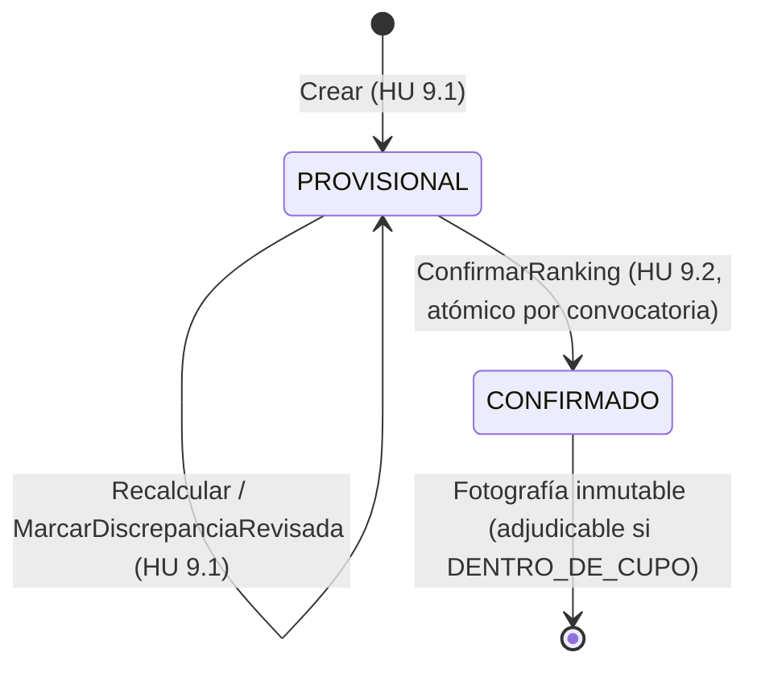

# Design

## Context

Motivación y alcance en `proposal.md`. Estado real observado en `develop` dentro de `Apps/services/ms-postulaciones/` y en modo solo lectura dentro de `Apps/services/ms-prg/`:

- **Base existente de HU 9.1 en `MS-POS` (1,279 pruebas en verde):**
  - `ResultadoConsolidadoRanking` (`Domain/Consolidacion/Agregados/ResultadoConsolidadoRanking.cs`) hereda de `AggregateRoot` (`EntidadAuditable`, `Id` UUIDv7, `Version` con concurrencia optimista), nace en `EstadoConfirmacionRanking = EstadoRanking.Provisional` y ya rechaza `Recalcular(...)` y `MarcarDiscrepanciaRevisada(...)` cuando `EstadoConfirmacionRanking == EstadoRanking.Confirmado` (`409 RANKING_YA_CONFIRMADO`).
  - La tabla `postulaciones.resultados_consolidados_ranking` (`ResultadoConsolidadoRankingConfiguracion`) cuenta con 7 restricciones `CHECK`, índice único `ux_resultados_consolidados_ranking_postulacion` e índices compuestos por convocatoria/puntaje y convocatoria/discrepancia. Las pruebas de PostgreSQL (`ConsolidacionPostgreSqlTests`) insertan filas `PROVISIONAL` directamente por SQL sin las columnas nuevas diferidas a HU 9.2.
  - `ResultadosConsolidadosController` (`api/v1/resultados-consolidados`), `PoliticasAutorizacionConsolidacion` (`ConsultaConsolidacion`, `GestionConsolidacion`) y `ManejadorResultadoAutorizacionRubricas` (`403 PERMISO_DENEGADO`) están probados e intactos.
  - `IConvocatoriaEvaluacionClient` y `ConvocatoriaEvaluacionClient` (HU 8.2) ya consultan `GET /internal/v1/convocatorias/{convocatoriaId}` en `MS-PRG` en modo *fail-closed* y devuelven `VentanaRevisionConvocatoria` con `ObtenerEstadoPeriodoRevision(DateTimeOffset ahora)` (`NoIniciado`, `Abierto`, `Cerrado`, `Cancelado`).
  - **Puertos protegidos por pruebas de contrato por reflexión (intocables):** `IResultadoConsolidadoRepository`, `IConsultaDatosConsolidacionRepository`, `IProveedorParametrosConsolidacion`, `IEvaluacionRepository`, `IAsignacionEvaluacionRepository`, `IExcepcionEvaluadorUnicoRepository`, `IRubricaRepository`, `IComiteEvaluadorRepository`, `IConvocatoriaEvaluacionClient`, `IConsultaEvaluacionesCoevaluadoresRepository`.
  - **Guardrails arquitectónicos (`ArchitectureTests`):** `EncapsulamientoTests` prohíbe setters públicos (incluidos `init` públicos en `ValueObject`) y colecciones mutables en `Domain`; `DomainIndependenceTests` y `DependenciasEntreCapasTests` exigen C# puro en `Domain` y cero dependencias EF Core/ASP.NET/Npgsql/MassTransit en `Application`.
  - **Ausencia de la entidad `Postulacion`:** aún no existe en `Ascenso.Postulaciones.Domain` (Integrante 1), por lo que `PostulacionId` sigue siendo un `Guid` opaco sin FK ni datos de universidad/carrera/estudiante locales.
- **Contrato real observado en `MS-PRG` (`Apps/services/ms-prg/`, solo lectura) y `docs/contratos/ms-prg/convocatorias.md`:**
  - `GET /internal/v1/convocatorias/{convocatoriaId}` (`ConvocatoriasInternasController`, policy `convocatorias:leer`): **existe** y retorna `ConvocatoriaDetalleDto` con `id`, `programaBecaId`, `periodoAcademicoId`, `estado`, `fechaInicioEvaluacion`, `fechaCierreEvaluacion` y `cuposAsignados` (`int`). Responde `404` (`CONVOCATORIA_NO_ENCONTRADA`).
  - `GET /api/v1/programas/{programaId}/balance` (`ProgramasController`): **existe** y retorna `BalancePresupuestarioProgramaResponse` con `programaBecaId`, `moneda`, `presupuestoTotalAsignado`, `presupuestoReservado`, `presupuestoEjecutado`, `presupuestoDisponible`, `cupoTotal`, `cuposReservados`, `cuposOcupados`, `cuposDisponibles`. En `MS-PRG` RF-12, `presupuestoDisponible = presupuestoTotalAsignado - presupuestoReservado - presupuestoEjecutado` y `cuposDisponibles = cupoTotal - cuposReservados - cuposOcupados` (las reservas de ofertas y renovaciones pendientes ya se contabilizan en `presupuestoReservado` y `cuposReservados`).
  - `GET /api/v1/programas/{programaId}` (`ProgramasController`): **existe** y retorna `ProgramaBecaDetalleDto`, incluyendo `politicaCobertura` (`modalidad`, `porcentajeCobertura`, `montoFijoPeriodo`, `moneda`).
  - `GET /api/v1/universidades/{universidadId}/carreras/{carreraId}/costos-matricula` (`UniversidadesController`): **existe**, pero requiere `universidadId` y `carreraId` de cada postulante (dato aún ausente en `MS-POS` por no existir `Postulacion`).
  - `GET /internal/v1/programas/{id}/disponibilidad` (DDD V7 §6.2): **aún no está implementado en `ms-prg` en `develop`**, ni existe un campo separado `comprometidoRenovacionesPendientes` en `BalancePresupuestarioProgramaResponse`. Por ello, aislar la consulta tras puertos ACL desacoplados en `MS-POS` (con ruta configurable y soporte nativo para descontar `comprometidoRenovacionesPendientes` si viene informado) es indispensable para funcionar hoy contra `ms-prg` real y adoptar el endpoint interno de DDD V7 sin reescribir dominio ni casos de uso.

## Goals / Non-Goals

**Goals:**

- Cerrar **RF-09 al 100%** implementando **HU 9.2**: cálculo y consulta del ranking por convocatoria ordenado descendentemente por `puntajeConsolidado`, integración *fail-closed* con `MS-PRG` para disponibilidad de cupo y presupuesto (descontando comprometido en renovaciones pendientes), trazado automático de la línea de corte (`DENTRO_DE_CUPO` vs `LISTA_DE_ESPERA`), advertencia por discrepancias sin revisar en o adyacentes a la línea de corte, detección de empates en la línea de corte bloqueando la confirmación (`422 EMPATES_SIN_RESOLVER`, `RN-POS-07`), y confirmación atómica `PROVISIONAL → CONFIRMADO`.
- Extender `ResultadoConsolidadoRanking` y `postulaciones.resultados_consolidados_ranking` de forma 100% aditiva (OCP) sin romper ninguna de las 1,279 pruebas previas ni `ArchitectureTests`, dejando preparado el terreno para que RF-10 (desempates manuales con justificación y `EntradaListaEspera`) se construya sin reescribir HU 9.2.
- Exponer el contrato interno de solo lectura `GET /internal/v1/postulaciones/{postulacionId}/adjudicable` (DDD V7 §6.2) para habilitar la verificación de adjudicabilidad desde `MS-BEC` (RF-15) sobre postulantes confirmados `DENTRO_DE_CUPO`.

**Non-Goals:**

- Implementar RF-10 (resolución manual de empates/casos límite con justificación, `TipoCasoLimite`, `JustificacionDesempateCasoLimite`, `DecididoPorUsuarioId` y agregado `EntradaListaEspera`).
- Implementar RF-39 (`ConflictoInteres`), entidad `Postulacion` (Integrante 1) ni emisión de ofertas (`MS-BEC` RF-15).
- Modificar `ms-prg`, `ms-bec`, `ms-plt`, `ms-aud`, `Postulantes`, `Rubricas`, `Comites`, `AsignacionesEvaluacionController`, `EvaluacionesController`, `ResultadosConsolidadosController`, `Domain/Comun` o puertos previos con pruebas de contrato por reflexión.
- Incorporar MediatR, Outbox o Hangfire.

## Decisions

### D1. Aplicación práctica y auditable de SOLID y extensibilidad OCP hacia RF-10

| Principio | Aplicación concreta en `rf9-2-int2-mspos` |
|---|---|
| **SRP** | `ServicioCalculoRankingCorte` (servicio de dominio puro) concentra exclusivamente ordenamiento determinista, trazado de línea de corte por cupo y presupuesto, detección de empates en frontera y detección de discrepancias sin revisar en o adyacentes al corte; `ResultadoConsolidadoRanking` gestiona identidad, invariantes y transición `ConfirmarRanking(...)`; `DisponibilidadProgramaRanking`, `ElementoRankingEvaluado` y `CorteRankingConvocatoria` son objetos de valor inmutables; `DisponibilidadRankingClient` y `ProveedorMontoEstimadoBecaClient` encapsulan HTTP *fail-closed* hacia `MS-PRG`; cada comando y consulta CQRS tiene su propio handler, validador FluentValidation y mapeador (`RankingMapeador` / extensión aditiva de `ConsolidacionMapeador`). |
| **OCP** | (1) `ResultadoConsolidadoRanking` se amplía únicamente con 5 columnas anulables (`posicion_ranking`, `monto_estimado_beca`, `clasificacion`, `fecha_confirmacion_ranking`, `confirmado_por_usuario_id`), `ConfirmarRanking(...)` y `EsAdjudicable`, sin tocar las 7 `CHECK` ni la lógica de HU 9.1. (2) RF-10 podrá inyectar una estrategia/ajuste de desempate manual y generar `EntradaListaEspera` a partir de los resultados `LISTA_DE_ESPERA` sin reescribir `ServicioCalculoRankingCorte` ni el ciclo `PROVISIONAL → CONFIRMADO`. (3) `IProveedorMontoEstimadoBeca` desacopla la estimación del monto por beca (hoy basada en `PoliticaCobertura` de `MS-PRG` + referencia configurable) para sustituirse por arancel real por carrera cuando exista `Postulacion`. (4) `DisponibilidadRankingClient` parametriza la ruta de disponibilidad de programa para pasar de `api/v1/programas/{programaId}/balance` a `internal/v1/programas/{programaId}/disponibilidad` por configuración. |
| **ISP** | Cuatro puertos pequeños y cohesivos en `Domain/Interfaces/` (`IRankingConvocatoriaRepository`, `IConsultaEstadoEvaluacionesConvocatoriaRepository`, `IDisponibilidadRankingClient`, `IProveedorMontoEstimadoBeca`). Ninguno de los 10 puertos existentes con pruebas de contrato por reflexión se modifica. |
| **DIP** | Dominio y Aplicación dependen exclusivamente de interfaces puras y `TimeProvider`; los adaptadores HTTP (`DisponibilidadRankingClient`, `ProveedorMontoEstimadoBecaClient`) y EF Core (`RankingConvocatoriaRepository`, `ConsultaEstadoEvaluacionesConvocatoriaRepository`) residen en `Infrastructure`. |

### D2. Estados, clasificaciones, transiciones y condiciones de bloqueo/advertencia (sin librerías externas)

#### D2.1 Máquina de estados de `EstadoRanking` (`PROVISIONAL` → `CONFIRMADO`)

| Estado actual | Operación solicitada | Estado resultante | Resultado / Excepción |
|---|---|---|---|
| `PROVISIONAL` | `ConfirmarRanking(posicion, monto, clasificacion, fecha, actorId)` válida | `CONFIRMADO` | Fija `PosicionRanking`, `MontoEstimadoBeca`, `Clasificacion`, `FechaConfirmacionRanking` (UTC), `ConfirmadoPorUsuarioId`, incrementa `Version` |
| `PROVISIONAL` | `ConfirmarRanking(...)` con `posicion < 1`, `monto <= 0`, `> 2` decimales o clasificación fuera de catálogo | `PROVISIONAL` | **Inválida:** `422 Unprocessable Entity` (`RankingInvalidoException`, `RANKING_INVALIDO`) |
| `CONFIRMADO` | `ConfirmarRanking(...)` | `CONFIRMADO` | **Inválida:** `409 Conflict` (`RankingYaConfirmadoException`, `RANKING_YA_CONFIRMADO`) |
| `CONFIRMADO` | `Recalcular(...)` o `MarcarDiscrepanciaRevisada(...)` | `CONFIRMADO` | **Inválida:** `409 Conflict` (`RankingYaConfirmadoException`, `RANKING_YA_CONFIRMADO`, ya garantizado desde HU 9.1) |

#### D2.2 Valores de `ClasificacionRanking` (persistido con `CodigoEnum`)

| Miembro C# (`ClasificacionRanking`) | Código SQL / JSON (`CodigoEnum`) | Semántica de negocio | `EsAdjudicable` en `CONFIRMADO` |
|---|---|---|---|
| `DentroDeCupo` | `DENTRO_DE_CUPO` | Postulante ubicado por encima de la línea de corte; cabe en cupo y presupuesto efectivos | `true` |
| `ListaDeEspera` | `LISTA_DE_ESPERA` | Postulante elegible por debajo de la línea de corte por agotamiento de cupo o presupuesto | `false` (`FUERA_DE_CUPO_EN_LISTA_DE_ESPERA`) |

*(En estado `PROVISIONAL`, `ResultadoConsolidadoRanking.Clasificacion` se persiste siempre como `NULL`; la clasificación se proyecta en vivo al consultar y se fija en BD únicamente al transicionar a `CONFIRMADO`.)*

#### D2.3 Condiciones de bloqueo y advertencia previas a `ConfirmarRankingConvocatoriaCommand`

Evaluadas en orden determinista antes de mutar cualquier agregado:

| Orden | Condición evaluada | Tipo | Código HTTP y `codigo` | Comportamiento |
|---|---|---|---|---|
| 1 | `ConvocatoriaId == Guid.Empty` | Validación entrada | `400 Bad Request` (`RANKING_INVALIDO`) | Rechazo inmediato por FluentValidation |
| 2 | Usuario sin autenticar | Seguridad | `401 Unauthorized` | Rechazo por middleware JWT / `NoAutenticadoException` |
| 3 | Sin rol `COORDINADOR_PROGRAMA` | Seguridad | `403 Forbidden` (`PERMISO_DENEGADO`) | Rechazo por política `GestionConsolidacion` |
| 4 | `0` resultados consolidados para la convocatoria | Bloqueo | `422 Unprocessable Entity` (`RANKING_SIN_RESULTADOS`) | No se puede confirmar un ranking vacío |
| 5 | Algún resultado de la convocatoria ya está en `CONFIRMADO` | Bloqueo | `409 Conflict` (`RANKING_YA_CONFIRMADO`) | Impide reconfirmación silenciosa |
| 6 | Existen asignaciones vigentes (`!= REASIGNADA_POR_CONFLICTO`) no `COMPLETADA` o postulaciones con asignaciones vigentes sin `ResultadoConsolidadoRanking` | Bloqueo | `409 Conflict` (`EVALUACIONES_PENDIENTES`) | Reutiliza `EvaluacionesPendientesParaConsolidarException` |
| 7 | Convocatoria inexistente (`404`), cancelada (`CANCELADA`), periodo de revisión `NO_INICIADO` o `ABIERTO`, o `MS-PRG` caído (vía `IConvocatoriaEvaluacionClient`) | Bloqueo *fail-closed* | `404` (`CONVOCATORIA_NO_ENCONTRADA`), `409` (`CONVOCATORIA_CANCELADA` / `PERIODO_REVISION_NO_INICIADO` / `PERIODO_REVISION_ABIERTO`), `503` (`DEPENDENCIA_NO_DISPONIBLE`) | Exige periodo de revisión formalmente cerrado (`ahora > fechaCierreEvaluacion`) |
| 8 | Error o `404` al consultar disponibilidad o monto estimado en `MS-PRG` | Bloqueo *fail-closed* | `404` (`CONVOCATORIA_NO_ENCONTRADA` / `PROGRAMA_NO_ENCONTRADO`) o `503` (`DEPENDENCIA_NO_DISPONIBLE`) | Nunca confirma con cupo/presupuesto stale o asumido |
| 9 | Existe empate real de `PuntajeConsolidado` en la línea de corte (`RN-POS-07`) | **Bloqueo duro** | `422 Unprocessable Entity` (`EMPATES_SIN_RESOLVER`) | Bloquea confirmación hasta resolución de empate (RF-10) |
| 10 | Existe al menos una discrepancia sin revisar (`AlertaDiscrepancia && !DiscrepanciaRevisada`) dentro de cupo o adyacente a la línea de corte y `confirmarConAdvertenciaDiscrepancias == false` | **Advertencia con acuse explícito** | `422 Unprocessable Entity` (`DISCREPANCIAS_SIN_REVISAR_EN_CORTE`) | Advierte al coordinador; si reenvía con `confirmarConAdvertenciaDiscrepancias = true`, **permite confirmar** (Criterio 4 HU 9.2) |
| 11 | Conflicto de concurrencia optimista (`Version`) al persistir atómicamente | Concurrencia | `409 Conflict` (`CONFLICTO_CONCURRENCIA`) | Rollback atómico total de toda la convocatoria |

### D3. Modelo de Dominio (`Ascenso.Postulaciones.Domain`)

#### D3.1 Enum `ClasificacionRanking` (`Domain/Enums/ClasificacionRanking.cs`)

`public enum ClasificacionRanking { DentroDeCupo, ListaDeEspera }` → `CodigoEnum.ACodigo()` genera `"DENTRO_DE_CUPO"` y `"LISTA_DE_ESPERA"`.

#### D3.2 Objetos de valor inmutables (`Domain/Consolidacion/ObjetosValor/`)

Todos heredan de `ValueObject` con propiedades de **solo `get;`** (sin `init` público, cumpliendo `EncapsulamientoTests`) y colecciones solo de lectura (`IReadOnlyList<T>` respaldadas por arreglos internos):

1. **`DisponibilidadProgramaRanking`:**
   - Propiedades:
     - `Guid ConvocatoriaId`
     - `Guid ProgramaBecaId`
     - `int CuposAsignadosConvocatoria` (`>= 0`)
     - `int CuposDisponiblesPrograma` (`>= 0`)
     - `int CuposDisponiblesEfectivos` (`Math.Min(CuposAsignadosConvocatoria, CuposDisponiblesPrograma)`)
     - `decimal PresupuestoDisponibleBruto` (`>= 0.00m`, máx. 2 decimales)
     - `decimal PresupuestoComprometidoRenovaciones` (`>= 0.00m`, máx. 2 decimales)
     - `decimal PresupuestoDisponibleEfectivo` (`Math.Max(0.00m, decimal.Round(PresupuestoDisponibleBruto - PresupuestoComprometidoRenovaciones, 2, MidpointRounding.AwayFromZero))`)
     - `string Moneda` (obligatorio, normalizado en mayúsculas, máx. 10 caracteres, p. ej. `"USD"`)
   - Valida en constructor que `ConvocatoriaId != Guid.Empty`, `ProgramaBecaId != Guid.Empty`, cupos `>= 0`, montos `>= 0` con máx. 2 decimales y `Moneda` no vacía; ante incumplimiento lanza `RankingInvalidoException`.
2. **`ElementoRankingEvaluado`:**
   - Propiedades: `Guid ResultadoConsolidadoId`, `Guid PostulacionId`, `int PosicionRanking` (`>= 1`), `decimal PuntajeConsolidado`, `decimal MontoEstimadoBeca` (`> 0.00m`, máx. 2 decimales), `ClasificacionRanking Clasificacion`, `bool EmpatadoEnLineaDeCorte`, `bool AlertaDiscrepancia`, `bool DiscrepanciaRevisada`, `bool AfectaAdvertenciaDiscrepanciaEnCorte`, `bool ExcepcionEvaluadorUnico`, `DateTimeOffset FechaConsolidacion`.
3. **`CorteRankingConvocatoria`:**
   - Propiedades:
     - `Guid ConvocatoriaId`
     - `DisponibilidadProgramaRanking Disponibilidad`
     - `IReadOnlyList<ElementoRankingEvaluado> Elementos` (ordenados `1..N`)
     - `int TotalPostulantes`
     - `int TotalDentroDeCupo`
     - `int TotalListaDeEspera`
     - `decimal MontoTotalDentroDeCupo` (`numeric` a 2 decimales, suma de `MontoEstimadoBeca` de `DENTRO_DE_CUPO`)
     - `bool TieneEmpateEnLineaDeCorte`
     - `decimal? PuntajeEmpateEnLineaDeCorte`
     - `IReadOnlyList<Guid> PostulacionesEmpatadasEnCorte`
     - `bool TieneAdvertenciaDiscrepanciasEnCorte`
     - `int CantidadDiscrepanciasSinRevisarEnCorte`
     - `IReadOnlyList<Guid> PostulacionesConDiscrepanciaSinRevisarEnCorte`

#### D3.3 Servicio de dominio puro `ServicioCalculoRankingCorte` (`Domain/Consolidacion/Servicios/ServicioCalculoRankingCorte.cs`)

`public static class ServicioCalculoRankingCorte`:

- Firma principal:
  `public static CorteRankingConvocatoria Calcular(Guid convocatoriaId, IReadOnlyCollection<ResultadoConsolidadoRanking> resultados, IReadOnlyDictionary<Guid, decimal> montosEstimadosPorPostulacion, DisponibilidadProgramaRanking disponibilidad)`
- **Validaciones de entrada:**
  - `convocatoriaId == Guid.Empty` → `RankingInvalidoException`.
  - Argumentos nulos → `ArgumentNullException`.
  - `disponibilidad.ConvocatoriaId != convocatoriaId` → `RankingInvalidoException`.
  - Cada resultado debe ser no nulo, pertenecer a `convocatoriaId`, sin `PostulacionId` duplicado, y tener entrada en `montosEstimadosPorPostulacion` con monto `> 0.00m` y máximo 2 decimales (`RankingInvalidoException` si falta o es inválido).
- **Algoritmo determinista (HU 9.2 Criterios 1 a 5 y `RN-POS-07`):**
  1. **Ordenamiento (Criterio 1):** ordenar por `PuntajeConsolidado DESC`, luego desempate técnico exclusivamente para presentación por `FechaConsolidacion ASC`, `Id ASC`. Asignar `PosicionRanking` secuencial `1..N`.
  2. **Agrupación por puntaje real y trazado de línea de corte (Criterios 2, 3 y 5):**
     - Agrupar consecutivamente por `PuntajeConsolidado` exacto: $G_1, G_2, \dots, G_k$.
     - Mantener `cuposRestantes = disponibilidad.CuposDisponiblesEfectivos`, `presupuestoRestante = disponibilidad.PresupuestoDisponibleEfectivo`, `corteAlcanzado = false`.
     - Para cada grupo $G_i$ de tamaño $m = |G_i|$:
       - Si `corteAlcanzado`: todos los elementos de $G_i$ quedan en `ClasificacionRanking.ListaDeEspera` (`EmpatadoEnLineaDeCorte = false`).
       - Si `!corteAlcanzado`:
         - Calcular `sumaGrupo = G_i.Sum(x => monto(x))` y `minimoGrupo = G_i.Min(x => monto(x))`.
         - **Caso 1 — Grupo completo cabe (`m <= cuposRestantes && sumaGrupo <= presupuestoRestante`):** todos los elementos de $G_i$ se clasifican `DENTRO_DE_CUPO` (`EmpatadoEnLineaDeCorte = false`); descontar `cuposRestantes -= m`, `presupuestoRestante -= sumaGrupo`.
         - **Caso 2 — Ningún elemento del grupo cabe (`cuposRestantes == 0 || minimoGrupo > presupuestoRestante`):** `corteAlcanzado = true`; todos los elementos de $G_i$ se clasifican `LISTA_DE_ESPERA` (`EmpatadoEnLineaDeCorte = false`). *(Nota: no se salta a un puntaje inferior aunque cueste menos, preservando estrictamente el orden de mérito; ese escenario corresponde a casos límite presupuestarios de RF-10.)*
         - **Caso 3 — Empate real en la frontera (`m >= 2`, no cabe todo el grupo pero al menos uno sí cabe: `cuposRestantes >= 1 && minimoGrupo <= presupuestoRestante`):**
           - Activar `tieneEmpateEnLineaDeCorte = true`, `puntajeEmpateEnLineaDeCorte = G_i.PuntajeConsolidado`, `corteAlcanzado = true`.
           - Todos los miembros de $G_i$ quedan marcados con `EmpatadoEnLineaDeCorte = true`.
           - Para la visualización provisional de la línea de corte, se proyectan los cupos/presupuesto restantes en orden de presentación dentro de $G_i$ (los que alcanzan quedan proyectados como `DENTRO_DE_CUPO` y el resto como `LISTA_DE_ESPERA`), quedando bloqueada la confirmación hasta desempate (`422 EMPATES_SIN_RESOLVER`).
  3. **Detección de advertencias por discrepancias sin revisar en o adyacentes a la línea de corte (Criterio 4):**
     - Determinar `puntajePrimerGrupoEspera`: el `PuntajeConsolidado` del primer elemento clasificado como `LISTA_DE_ESPERA` (si existe alguno).
     - Un elemento `e` activa `AfectaAdvertenciaDiscrepanciaEnCorte = true` si y solo si `e.AlertaDiscrepancia && !e.DiscrepanciaRevisada` **Y** cumple al menos una de las siguientes condiciones:
       - `e.Clasificacion == ClasificacionRanking.DentroDeCupo`, **o**
       - `e.EmpatadoEnLineaDeCorte == true`, **o**
       - `e.Clasificacion == ClasificacionRanking.ListaDeEspera && puntajePrimerGrupoEspera.HasValue && e.PuntajeConsolidado == puntajePrimerGrupoEspera.Value` (primer grupo de puntuación inmediatamente debajo de la línea de corte).
     - `TieneAdvertenciaDiscrepanciasEnCorte = elementos.Any(e => e.AfectaAdvertenciaDiscrepanciaEnCorte)`.

#### D3.4 Extensión aditiva de `ResultadoConsolidadoRanking` (`Domain/Consolidacion/Agregados/ResultadoConsolidadoRanking.cs`)

Se agregan sin alterar ninguna firma ni propiedad existente:
- Propiedades (todas `private set;`, nulas en `PROVISIONAL`):
  - `public int? PosicionRanking { get; private set; }`
  - `public decimal? MontoEstimadoBeca { get; private set; }`
  - `public ClasificacionRanking? Clasificacion { get; private set; }`
  - `public DateTimeOffset? FechaConfirmacionRanking { get; private set; }`
  - `public Guid? ConfirmadoPorUsuarioId { get; private set; }`
- Propiedad calculada (sin setter):
  - `public bool EsAdjudicable => EstadoConfirmacionRanking == EstadoRanking.Confirmado && Clasificacion == ClasificacionRanking.DentroDeCupo;`
- Método de transición:
  - `public void ConfirmarRanking(int posicionRanking, decimal montoEstimadoBeca, ClasificacionRanking clasificacion, DateTimeOffset fechaConfirmacion, Guid usuarioConfirmadorId)`
  - Valida argumentos, estado `PROVISIONAL` (`409 RANKING_YA_CONFIRMADO`), `posicionRanking >= 1`, `montoEstimadoBeca > 0` con máx. 2 decimales y `Enum.IsDefined(clasificacion)` (`422 RANKING_INVALIDO`), asigna los 5 campos + `EstadoConfirmacionRanking = EstadoRanking.Confirmado` y llama `ActualizarAuditoria(usuarioConfirmadorId, fechaUtc)`.

### D4. Excepciones de dominio (`Domain/Excepciones/`)

Se reutilizan sin modificar: `RankingYaConfirmadoException` (`409 RANKING_YA_CONFIRMADO`), `EvaluacionesPendientesParaConsolidarException` (`409 EVALUACIONES_PENDIENTES`), `ConvocatoriaNoEncontradaException` (`404 CONVOCATORIA_NO_ENCONTRADA`), `ConvocatoriaCanceladaException` (`409 CONVOCATORIA_CANCELADA`), `PeriodoRevisionAbiertoException` (`409 PERIODO_REVISION_ABIERTO`), `PeriodoRevisionNoIniciadoException` (`409 PERIODO_REVISION_NO_INICIADO`), `DependenciaNoDisponibleException` (`503 DEPENDENCIA_NO_DISPONIBLE`), `ResultadoConsolidadoNoEncontradoException` (`404 RESULTADO_CONSOLIDADO_NO_ENCONTRADO`), `ExcepcionConflictoConcurrencia` (`409 CONFLICTO_CONCURRENCIA`) y `NoAutenticadoException` (`401`).

Se agregan:

| Excepción | Base | `CodigoError` | HTTP | Motivo |
|---|---|---|---|---|
| `EmpatesSinResolverEnCorteException` | `ExcepcionReglaNegocio` | `EMPATES_SIN_RESOLVER` | `422` | Existen empates de `puntajeConsolidado` en la línea de corte (`RN-POS-07`) |
| `DiscrepanciasSinRevisarEnCorteException` | `ExcepcionReglaNegocio` | `DISCREPANCIAS_SIN_REVISAR_EN_CORTE` | `422` | Existen discrepancias sin revisar en o adyacentes a la línea de corte sin acuse explícito (`confirmarConAdvertenciaDiscrepancias = true`) |
| `RankingSinResultadosConsolidadosException` | `ExcepcionReglaNegocio` | `RANKING_SIN_RESULTADOS` | `422` | No existen resultados consolidados para confirmar el ranking de la convocatoria |
| `RankingInvalidoException` | `ExcepcionReglaNegocio` | `RANKING_INVALIDO` | `422` | Parámetros o datos de ranking inconsistentes en dominio |
| `ProgramaBecaNoEncontradoException` | `ExcepcionEntidadNoEncontrada` | `PROGRAMA_NO_ENCONTRADO` | `404` | El `programaBecaId` referenciado por la convocatoria no existe en `MS-PRG` |

`ManejadorExcepcionesDominio` traduce automáticamente cualquier `DomainException` a `ProblemDetails`; no requiere cambios.

### D5. Puertos ISP nuevos (`Domain/Interfaces/`) — Cero cambios a puertos previos

Todos los métodos asíncronos terminan en `Async` con `CancellationToken cancellationToken = default`:

1. **`IRankingConvocatoriaRepository`** (`Domain/Interfaces/IRankingConvocatoriaRepository.cs`):
   - `Task<IReadOnlyList<ResultadoConsolidadoRanking>> ListarPorConvocatoriaAsync(Guid convocatoriaId, CancellationToken cancellationToken = default);` *(AsNoTracking; ordenado por `PosicionRanking ASC` cuando exista, o por `PuntajeConsolidado DESC, FechaConsolidacion ASC, Id ASC`)*
   - `Task<IReadOnlyList<ResultadoConsolidadoRanking>> ListarParaConfirmarPorConvocatoriaAsync(Guid convocatoriaId, CancellationToken cancellationToken = default);` *(Tracked, para confirmar atómicamente todas las filas de la convocatoria)*
2. **`IConsultaEstadoEvaluacionesConvocatoriaRepository`** (`Domain/Interfaces/IConsultaEstadoEvaluacionesConvocatoriaRepository.cs`):
   - `Task<bool> ExistenEvaluacionesPendientesOSinConsolidarAsync(Guid convocatoriaId, CancellationToken cancellationToken = default);` *(Verifica en PostgreSQL que no exista ninguna `AsignacionEvaluacion` vigente `!= REASIGNADA_POR_CONFLICTO` en estado `!= COMPLETADA`, ni ninguna `PostulacionId` con asignaciones vigentes en la convocatoria que carezca de `ResultadoConsolidadoRanking`)*
3. **`IDisponibilidadRankingClient`** (`Domain/Interfaces/IDisponibilidadRankingClient.cs`):
   - `Task<DisponibilidadProgramaRanking?> ObtenerDisponibilidadPorConvocatoriaAsync(Guid convocatoriaId, CancellationToken cancellationToken = default);` *(Retorna `null` si la convocatoria responde `404`; lanza `ProgramaBecaNoEncontradoException` si el programa responde `404`; falla cerrado con `DependenciaNoDisponibleException` `503` ante errores HTTP, red, timeout o JSON inválido)*
4. **`IProveedorMontoEstimadoBeca`** (`Domain/Interfaces/IProveedorMontoEstimadoBeca.cs`):
   - `Task<IReadOnlyDictionary<Guid, decimal>> ObtenerMontosEstimadosPorPostulacionAsync(Guid convocatoriaId, Guid programaBecaId, IReadOnlyCollection<Guid> postulacionIds, CancellationToken cancellationToken = default);` *(Resolución en lote para evitar N+1)*

### D6. Capa de Aplicación (`Ascenso.Postulaciones.Application`, CQRS sin MediatR ni Hangfire)

#### D6.1 Reutilización de `IConvocatoriaEvaluacionClient` para validación de ventana de revisión

En `ConfirmarRankingConvocatoriaCommandHandler` se **reutiliza directamente** `IConvocatoriaEvaluacionClient` (puerto existente de HU 8.2, sin modificarlo) para validar que el periodo de revisión de la convocatoria esté formalmente cerrado (`ventana.ObtenerEstadoPeriodoRevision(ahora) == EstadoPeriodoRevision.Cerrado`).

- *Justificación:* mantiene SRP entre validación de ventana temporal (`IConvocatoriaEvaluacionClient`, probado con su contrato por reflexión intacto) y disponibilidad financiera/cupos (`IDisponibilidadRankingClient`); evita duplicar lógica de estados de ventana en `DisponibilidadProgramaRanking`; y en `ObtenerRankingConvocatoriaQuery` (consulta provisional) no exige cierre de periodo para que coordinador y dirección puedan previsualizar el ranking durante el proceso.
- *Alternativa descartada:* incrustar `FechaInicioEvaluacion`/`FechaCierreEvaluacion` en `DisponibilidadProgramaRanking` o ampliar `IConvocatoriaEvaluacionClient` con `CuposAsignados` (rompería la prueba de contrato por reflexión de `IConvocatoriaEvaluacionClient`).

#### D6.2 Casos de uso CQRS

1. **`ObtenerRankingConvocatoriaQuery(Guid ConvocatoriaId, string? Clasificacion = null, int Pagina = 1, int Tamano = 20)`:**
   - Validador: `ConvocatoriaId != Guid.Empty`, `Pagina >= 1`, `Tamano` en `[1, 100]`, y si `Clasificacion` no es nulo/vacío debe corresponder a `ClasificacionRanking` (`DENTRO_DE_CUPO` o `LISTA_DE_ESPERA`, `ErrorCode = "RANKING_INVALIDO"`).
   - Handler:
     - Carga `resultados = await _rankingRepository.ListarPorConvocatoriaAsync(query.ConvocatoriaId, ct)`.
     - **Rama `CONFIRMADO`** (si `resultados.Count > 0 && resultados.All(r => r.EstadoConfirmacionRanking == EstadoRanking.Confirmado)`):
       - No llama a `MS-PRG`; arma `RankingConvocatoriaDto` directamente desde la fotografía confirmada ordenada por `PosicionRanking ASC`, calculando totales globales (`TotalPostulantes`, `TotalDentroDeCupo`, `TotalListaDeEspera`, `MontoTotalDentroDeCupo`), `FechaConfirmacionRanking`, `ConfirmadoPorUsuarioId`, `TieneEmpateEnLineaDeCorte = false`, `Disponibilidad = null`, y aplicando filtro opcional por `clasificacion` y paginación sobre `Elementos`.
     - **Rama `PROVISIONAL`:**
       - Consulta `disponibilidad = await _disponibilidadClient.ObtenerDisponibilidadPorConvocatoriaAsync(query.ConvocatoriaId, ct)`; si `null` → `ConvocatoriaNoEncontradaException` (`404`).
       - Si `resultados.Count == 0` → retorna `RankingConvocatoriaDto` en `PROVISIONAL` con `Disponibilidad` informada, totales en `0` y página vacía.
       - Si `resultados.Count > 0` → obtiene `montos = await _proveedorMonto.ObtenerMontosEstimadosPorPostulacionAsync(...)`, ejecuta `ServicioCalculoRankingCorte.Calcular(...)`, aplica filtro opcional `clasificacion` y paginación sobre `Elementos`, preservando todos los indicadores globales de corte, empates y advertencias de discrepancias.
2. **`ConfirmarRankingConvocatoriaCommand(Guid ConvocatoriaId, bool ConfirmarConAdvertenciaDiscrepancias = false)`:**
   - Validador: `ConvocatoriaId != Guid.Empty` (`ErrorCode = "RANKING_INVALIDO"`).
   - Handler: ejecuta las precondiciones D2.3 en orden estricto (usuario requerido → cargar resultados rastreados → validar no vacío y no confirmado → validar sin evaluaciones pendientes/sin consolidar → validar ventana de revisión cerrada vía `IConvocatoriaEvaluacionClient` → obtener disponibilidad vía `IDisponibilidadRankingClient` → obtener montos vía `IProveedorMontoEstimadoBeca` → calcular `CorteRankingConvocatoria` → bloquear si `TieneEmpateEnLineaDeCorte` con `422 EMPATES_SIN_RESOLVER` → exigir acuse si `TieneAdvertenciaDiscrepanciasEnCorte && !ConfirmarConAdvertenciaDiscrepancias` con `422 DISCREPANCIAS_SIN_REVISAR_EN_CORTE`), aplica `ConfirmarRanking(...)` sobre cada agregado en memoria y persiste atómicamente con un único `_unitOfWork.GuardarCambiosAsync(ct)`. Retorna `RankingConvocatoriaDto` confirmado (con `Disponibilidad` capturada en el instante de confirmación).
3. **`ConsultarAdjudicabilidadPostulacionQuery(Guid PostulacionId)` (contrato interno `MS-BEC → MS-POS`, DDD V7 §6.2):**
   - Validador: `PostulacionId != Guid.Empty` (`ErrorCode = "RANKING_INVALIDO"`).
   - Handler: lee `resultado = await _resultadoRepository.ObtenerPorPostulacionAsync(query.PostulacionId, ct)` (reutiliza `IResultadoConsolidadoRepository` sin modificarlo); si `null` → `ResultadoConsolidadoNoEncontradoException` (`404`). Construye `AdjudicabilidadPostulacionDto`:
     - `Adjudicable = resultado.EsAdjudicable` (`EstadoConfirmacionRanking == Confirmado && Clasificacion == DentroDeCupo`).
     - `MotivoNoAdjudicable`: `null` si `Adjudicable == true`; `"RANKING_NO_CONFIRMADO"` si `EstadoConfirmacionRanking == Provisional`; `"FUERA_DE_CUPO_EN_LISTA_DE_ESPERA"` si `EstadoConfirmacionRanking == Confirmado && Clasificacion == ListaDeEspera`.
     - Incluye `PostulacionId`, `ConvocatoriaOrigenId`, `EstadoConfirmacionRanking`, `Clasificacion`, `PosicionRanking`, `MontoEstimadoBeca`, `FechaConfirmacionRanking`.
     - *Nota de evolución con `MS-BEC`:* los campos adicionales de estudiante/carrera documentados en `docs/contratos/ms-bec/identidad-integraciones.md` (`programaBecaId`, `periodoAcademicoId`, `universidadAliadaId`, `carreraId`, `postulanteEstudianteId`, `nombreEstudiante`, `numeroDocumentoEstudiante`) no existen localmente por no haberse implementado aún `Postulacion` (Integrante 1) y se agregarán de forma aditiva cuando dicha entidad exista (ver Preguntas Abiertas).

#### D6.3 DTOs, mapeadores y DI

- **Ampliación aditiva sin ruptura en DTOs de HU 9.1 (`Application/Consolidacion/DTOs/`):**
  - `ResultadoConsolidadoDto` y `DetalleResultadoConsolidadoDto` añaden 5 parámetros opcionales con valor por defecto `null` al final (`int? PosicionRanking = null, decimal? MontoEstimadoBeca = null, string? Clasificacion = null, DateTimeOffset? FechaConfirmacionRanking = null, Guid? ConfirmadoPorUsuarioId = null`), preservando 100% compatibilidad fuente y JSON con las pruebas existentes de HU 9.1.
- **Nuevos DTOs de HU 9.2 (`Application/Consolidacion/DTOs/`):**
  - `DisponibilidadRankingDto`, `ElementoRankingDto`, `RankingConvocatoriaDto`, `AdjudicabilidadPostulacionDto` y `RankingMapeador` (serializando `EstadoRanking` y `ClasificacionRanking` con `CodigoEnum.ACodigo()`).
- **Registro DI (`Application/DependencyInjection.cs`):** `AddScoped` para `ObtenerRankingConvocatoriaQueryHandler`, `ConfirmarRankingConvocatoriaCommandHandler` y `ConsultarAdjudicabilidadPostulacionQueryHandler` (los validadores FluentValidation se registran automáticamente vía `AddValidatorsFromAssembly`).

### D7. Persistencia e Infraestructura (`Ascenso.Postulaciones.Infrastructure`)

#### D7.1 Extensión aditiva de `postulaciones.resultados_consolidados_ranking`

En `ResultadoConsolidadoRankingConfiguracion` se mantienen intactas todas las columnas, índices y las 7 restricciones `CHECK` de HU 9.1, agregando:

- **Columnas nuevas (todas anulables en PostgreSQL → migración aditiva instantánea):**
  - `posicion_ranking` (`integer`, NULL)
  - `monto_estimado_beca` (`numeric(12,2)`, NULL)
  - `clasificacion` (`varchar(20)`, `ComoCodigoEnum()`, NULL)
  - `fecha_confirmacion_ranking` (`timestamptz`, NULL)
  - `confirmado_por_usuario_id` (`uuid`, NULL)
- **Nuevo índice único parcial:**
  - `ux_resultados_consolidados_ranking_convocatoria_posicion`: `UNIQUE (convocatoria_id, posicion_ranking) WHERE posicion_ranking IS NOT NULL` — impide duplicación de posiciones confirmadas en la misma convocatoria. Se agrega la constante y traducción a `ExcepcionConflictoConcurrencia` en `TraductorExcepcionesPersistencia` (sin alterar las 10 traducciones previas).
- **Tres nuevas restricciones `CHECK`:**
  - `ck_resultados_consolidados_clasificacion_valida`: `clasificacion IS NULL OR clasificacion IN ('DENTRO_DE_CUPO', 'LISTA_DE_ESPERA')` (vía `ConfiguracionPersistencia.ValoresSql<ClasificacionRanking>()`).
  - `ck_resultados_consolidados_ranking_campos_rango`: `(posicion_ranking IS NULL OR posicion_ranking >= 1) AND (monto_estimado_beca IS NULL OR monto_estimado_beca > 0)`.
  - `ck_resultados_consolidados_confirmacion_coherente`: `(estado_confirmacion_ranking = 'PROVISIONAL' AND posicion_ranking IS NULL AND monto_estimado_beca IS NULL AND clasificacion IS NULL AND fecha_confirmacion_ranking IS NULL AND confirmado_por_usuario_id IS NULL) OR (estado_confirmacion_ranking = 'CONFIRMADO' AND posicion_ranking IS NOT NULL AND monto_estimado_beca IS NOT NULL AND clasificacion IS NOT NULL AND fecha_confirmacion_ranking IS NOT NULL AND confirmado_por_usuario_id IS NOT NULL)`.

#### D7.2 Adaptadores HTTP *fail-closed* hacia `MS-PRG` y opciones `RankingOptions`

Siguiendo exactamente el patrón de `ConvocatoriaEvaluacionClient` y `CatalogoAcademicoClient` (`ServiciosExternos:Programas:UrlBase`, `ServiciosExternos:TimeoutSegundos = 3`, `LoggerMessage.Define`, `JsonSerializerDefaults.Web`, propagación de `CancellationToken` y captura de `HttpRequestException`, `TaskCanceledException`/`OperationCanceledException` no cancelada por caller, `JsonException` y códigos HTTP no exitosos → `503 DEPENDENCIA_NO_DISPONIBLE`):

1. **`RankingOptions` (`Seccion = "Ranking"` en `appsettings.json`):**
   - `string RutaDisponibilidadPrograma { get; set; } = "api/v1/programas/{programaId}/balance";` *(ruta real verificada en `ms-prg` en `develop`; al publicarse `internal/v1/programas/{programaId}/disponibilidad` de DDD V7 §6.2, basta actualizar esta configuración).*
   - `string RutaDetallePrograma { get; set; } = "api/v1/programas/{programaId}";`
   - `decimal MontoEstimadoBecaReferenciaPorDefecto { get; set; } = 1000.00m;` *(costo de matrícula de referencia temporal usado únicamente cuando el programa tiene cobertura `TOTAL`/`PARCIAL` sin `montoFijoPeriodo > 0`, mientras no exista `Postulacion` con universidad/carrera).*
2. **`DisponibilidadRankingClient : IDisponibilidadRankingClient`:**
   - Paso 1: `GET internal/v1/convocatorias/{convocatoriaId}` → obtiene `programaBecaId` y `cuposAsignados`. Si `404` → retorna `null`.
   - Paso 2: `GET {RutaDisponibilidadPrograma}` reemplazando `{programaId}` → parsea `cuposDisponibles`, `presupuestoDisponible`, `moneda` y el campo opcional `comprometidoRenovacionesPendientes` (por defecto `0.00m` en `BalancePresupuestarioProgramaResponse` donde `presupuestoDisponible` ya descuenta `presupuestoReservado`, o valor explícito si `MS-PRG` lo informa en `/disponibilidad` para descontarlo en `DisponibilidadProgramaRanking`). Si `404` → lanza `ProgramaBecaNoEncontradoException`.
   - Cualquier otro error HTTP, timeout, fallo de red, `UrlBase` no configurada o JSON inválido/inconsistente → `DependenciaNoDisponibleException` (`503 DEPENDENCIA_NO_DISPONIBLE`).
3. **`ProveedorMontoEstimadoBecaClient : IProveedorMontoEstimadoBeca`:**
   - Si `postulacionIds.Count == 0` → retorna diccionario vacío sin llamada HTTP.
   - `GET {RutaDetallePrograma}` reemplazando `{programaId}` → lee `politicaCobertura` (`modalidad`, `porcentajeCobertura`, `montoFijoPeriodo`).
   - Cálculo determinista del monto por postulación:
     - Si `montoFijoPeriodo > 0` → usa `decimal.Round(montoFijoPeriodo, 2, MidpointRounding.AwayFromZero)`.
     - Si `modalidad == "PARCIAL"` y `porcentajeCobertura > 0` y `MontoEstimadoBecaReferenciaPorDefecto > 0` → usa `decimal.Round(MontoEstimadoBecaReferenciaPorDefecto * (porcentajeCobertura / 100m), 2, MidpointRounding.AwayFromZero)`.
     - Si `MontoEstimadoBecaReferenciaPorDefecto > 0` (p. ej. `TOTAL`) → usa `decimal.Round(MontoEstimadoBecaReferenciaPorDefecto, 2, MidpointRounding.AwayFromZero)`.
     - Si no puede determinarse un monto `> 0` → falla cerrado con `DependenciaNoDisponibleException` (`503`).
   - `404` → `ProgramaBecaNoEncontradoException`; fallos de red/timeout/HTTP/JSON → `DependenciaNoDisponibleException` (`503`).
4. **Registro en `Infrastructure/DependencyInjection.cs`:**
   - `AddScoped<IRankingConvocatoriaRepository, RankingConvocatoriaRepository>()`
   - `AddScoped<IConsultaEstadoEvaluacionesConvocatoriaRepository, ConsultaEstadoEvaluacionesConvocatoriaRepository>()`
   - `Configure<RankingOptions>(configuration.GetSection(RankingOptions.Seccion))`
   - `AddHttpClient<IDisponibilidadRankingClient, DisponibilidadRankingClient>(...)` (con `Timeout` de `ServiciosExternosOptions`)
   - `AddHttpClient<IProveedorMontoEstimadoBeca, ProveedorMontoEstimadoBecaClient>(...)` (con `Timeout` de `ServiciosExternosOptions`)
5. **Migración EF Core:** nueva migración `ConfirmacionRankingConvocatoria` generada en tarea separada inmediatamente antes de las pruebas con Testcontainers PostgreSQL, seguida de `has-pending-model-changes` y `dotnet format --no-restore --include <rutas>`.

### D8. API y Seguridad (`Ascenso.Postulaciones.Api`)

#### D8.1 Justificación de controladores nuevos (`RankingsController` y `PostulacionesInternasController`)

- Se crea **`Api/Controllers/v1/RankingsController.cs`** (`api/v1/rankings`) en lugar de sobrecargar `ResultadosConsolidadosController` (`api/v1/resultados-consolidados`):
  - *Justificación:* mantiene SRP por recurso REST (`resultados-consolidados` = consolidación individual por postulación y revisión de discrepancias de HU 9.1; `rankings` = ordenamiento agregado por convocatoria, línea de corte, confirmación final de HU 9.2 y futuras operaciones de desempate de RF-10), deja `ResultadosConsolidadosController` y sus pruebas 100% intactos, y sigue la convención de rutas kebab-case en plural de `openspec/config.yaml`.
- Se crea **`Api/Controllers/Internal/v1/PostulacionesInternasController.cs`** (`internal/v1/postulaciones`) siguiendo explícitamente la ubicación prescrita por `openspec/config.yaml` (`Api/Controllers/Internal/v1/`) y DDD V7 §6.2.

| Controlador / Ruta | Operación | Política / Roles | Éxito | Errores documentados Swagger |
|---|---|---|---|---|
| `GET /api/v1/rankings/convocatorias/{convocatoriaId:guid}` | Consultar ranking de convocatoria (proyección viva en `PROVISIONAL` o fotografía inmutable en `CONFIRMADO`, paginado, filtro `clasificacion`) | `ConsultaConsolidacion` (`COORDINADOR_PROGRAMA`, `DIRECCION`) | `200 OK` + `RankingConvocatoriaDto` | `400`, `401`, `403` (`PERMISO_DENEGADO`), `404` (`CONVOCATORIA_NO_ENCONTRADA`, `PROGRAMA_NO_ENCONTRADO`), `503` (`DEPENDENCIA_NO_DISPONIBLE`) |
| `POST /api/v1/rankings/convocatorias/{convocatoriaId:guid}/confirmar` | Confirmar ranking final (`PROVISIONAL → CONFIRMADO`, cuerpo opcional `ConfirmarRankingConvocatoriaRequest`) | `GestionConsolidacion` (`COORDINADOR_PROGRAMA`) | `200 OK` + `RankingConvocatoriaDto` | `400`, `401`, `403` (`PERMISO_DENEGADO`), `404` (`CONVOCATORIA_NO_ENCONTRADA`, `PROGRAMA_NO_ENCONTRADO`), `409` (`RANKING_YA_CONFIRMADO`, `EVALUACIONES_PENDIENTES`, `PERIODO_REVISION_ABIERTO`, `PERIODO_REVISION_NO_INICIADO`, `CONVOCATORIA_CANCELADA`, `CONFLICTO_CONCURRENCIA`), `422` (`EMPATES_SIN_RESOLVER`, `DISCREPANCIAS_SIN_REVISAR_EN_CORTE`, `RANKING_SIN_RESULTADOS`, `RANKING_INVALIDO`), `503` (`DEPENDENCIA_NO_DISPONIBLE`) |
| `GET /internal/v1/postulaciones/{postulacionId:guid}/adjudicable` | Consultar si una postulación está habilitada para otorgamiento (`CONFIRMADO && DENTRO_DE_CUPO`) | `ConsultaAdjudicabilidadInterna` (`COORDINADOR_PROGRAMA`, `DIRECCION`, o token de servicio con `scope` `postulaciones.internal.read` / `permissions` `postulaciones:leer`) | `200 OK` + `AdjudicabilidadPostulacionDto` | `400`, `401`, `403` (`PERMISO_DENEGADO`), `404` (`RESULTADO_CONSOLIDADO_NO_ENCONTRADO`) |

- **Ampliación estrictamente aditiva de seguridad:**
  - `PoliticasAutorizacionConsolidacion`: agregar constantes `ConsultaAdjudicabilidadInterna`, `ScopeLecturaInterna = "postulaciones.internal.read"` y `PermisoLecturaInterna = "postulaciones:leer"`.
  - `Program.cs`: registrar la política `ConsultaAdjudicabilidadInterna` con `RequireAssertion` verificando rol `COORDINADOR_PROGRAMA`/`DIRECCION` en `roles`, o `postulaciones.internal.read` en `scope`/`scp` (separado por espacios o repetido), o `postulaciones:leer` en `permissions`.
  - `ManejadorResultadoAutorizacionRubricas`: incluir `ConsultaAdjudicabilidadInterna` en `EndpointTienePoliticaDeRubricas` y `EndpointTienePoliticaDeConsolidacion` para devolver siempre `403 Forbidden` en `ProblemDetails` con `codigo = PERMISO_DENEGADO`, sin alterar ninguna política ni texto previo.
  - `appsettings.json`: agregar sección `Ranking` con `RutaDisponibilidadPrograma`, `RutaDetallePrograma` y `MontoEstimadoBecaReferenciaPorDefecto`.

### D9. Núcleo compartido (`Domain/Comun`) y contratos previos

- No se modifica ni crea ningún archivo en `Domain/Comun`.
- No se modifica ningún puerto previo con pruebas de contrato por reflexión ni `Postulantes`, `Rubricas`, `Comites`, `AsignacionesEvaluacionController`, `EvaluacionesController`, `ResultadosConsolidadosController` ni otros microservicios.

### D10. Preparación OCP para RF-10 y futuras evoluciones

| Contexto futuro | Punto de extensión preparado en HU 9.2 |
|---|---|
| **RF-10 (Resolución manual de empates y `EntradaListaEspera`)** | `ResultadoConsolidadoRanking` ya fija `PosicionRanking`, `MontoEstimadoBeca` y `Clasificacion` al confirmar; RF-10 podrá agregar las columnas anulables `tipo_caso_limite`, `justificacion_desempate_caso_limite` y `decidido_por_usuario_id`, inyectar resoluciones de empate para destrabar `EMPATES_SIN_RESOLVER`, y crear el agregado `EntradaListaEspera` a partir de las filas confirmadas en `LISTA_DE_ESPERA` sin reescribir HU 9.2. |
| **Integración definitiva `MS-POS → MS-PRG` (`/internal/v1/programas/{id}/disponibilidad`)** | Cuando `MS-PRG` implemente el endpoint interno con `comprometidoRenovacionesPendientes`, solo se cambia `Ranking:RutaDisponibilidadPrograma` en configuración (y token de servicio cuando Keycloak/MS-PLT lo habiliten) sin cambiar dominio ni aplicación. |
| **Entidad `Postulacion` (Integrante 1) + aranceles por carrera** | Cuando exista `Postulacion` con `UniversidadAliadaId` y `CarreraId`, bastará sustituir la implementación de `IProveedorMontoEstimadoBeca` para consultar `GET /api/v1/universidades/{u}/carreras/{c}/costos-matricula` y enriquecer `AdjudicabilidadPostulacionDto` con los datos del estudiante esperados por `MS-BEC`. |

## Risks / Trade-offs

- **Desajuste temporal entre contrato DDD V7 (`GET /internal/v1/programas/{id}/disponibilidad`) y rutas actuales de `MS-PRG` en `develop` (`GET /api/v1/programas/{id}/balance`):** `MS-PRG` aún no expone un controlador `/internal/v1/programas` → *Mitigación:* aislamiento total tras `IDisponibilidadRankingClient` + ruta configurable `Ranking:RutaDisponibilidadPrograma` con soporte nativo para el campo opcional `comprometidoRenovacionesPendientes` y descuento determinista en `DisponibilidadProgramaRanking`.
- **Proyección temporal de `montoEstimadoBeca` sin entidad `Postulacion`:** hoy `MS-POS` no conoce la universidad/carrera de cada postulación, por lo que programas de cobertura `TOTAL`/`PARCIAL` sin `montoFijoPeriodo` usan `Ranking:MontoEstimadoBecaReferenciaPorDefecto` → *Mitigación:* aislamiento completo tras `IProveedorMontoEstimadoBeca`, soporte nativo en `ServicioCalculoRankingCorte` para montos heterogéneos por postulación desde el primer día, y trazabilidad en BD del `monto_estimado_beca` fijado en la confirmación.
- **Llamada doble a `internal/v1/convocatorias/{id}` durante `ConfirmarRanking` (una vía `IConvocatoriaEvaluacionClient` y otra vía `IDisponibilidadRankingClient`):** → *Mitigación:* operación de muy baja frecuencia (una única vez por convocatoria al confirmar), priorizando mantener intacto `IConvocatoriaEvaluacionClient` (protegido por pruebas de contrato por reflexión) y el principio SRP.
- **Confirmación masiva atómica y concurrencia optimista:** una convocatoria puede tener decenas o cientos de resultados consolidados; si un coordinador revisa una discrepancia o confirma en paralelo, las filas comparten `Version` → *Mitigación:* EF Core ejecuta el `SaveChangesAsync` en una única transacción PostgreSQL verificando `Version` en cada fila, garantizando todo-o-nada (`409 CONFLICTO_CONCURRENCIA` ante colisión sin estados parcialmente confirmados), verificado en Testcontainers PostgreSQL.
- **Ajustes mínimos de DI en fábricas `WebApplicationFactory` de pruebas existentes:** al registrar los 4 nuevos puertos de dominio consumidos por los nuevos controladores/handlers, las pruebas existentes que reemplazan servicios de `Infrastructure` deberán agregar sustitutos para los 4 nuevos puertos → *Mitigación:* adición estrictamente mecánica sin modificar ni una sola aserción previa, documentada en la bitácora final.

## Migration Plan

1. **Dominio (TDD):** `ClasificacionRanking`, nuevas excepciones, `DisponibilidadProgramaRanking`, `ElementoRankingEvaluado`, `CorteRankingConvocatoria`, `ServicioCalculoRankingCorte`, extensión aditiva de `ResultadoConsolidadoRanking` y 4 nuevos puertos ISP (`IRankingConvocatoriaRepository`, `IConsultaEstadoEvaluacionesConvocatoriaRepository`, `IDisponibilidadRankingClient`, `IProveedorMontoEstimadoBeca`) con pruebas de contrato por reflexión.
2. **Aplicación (TDD):** extensión aditiva de DTOs de consolidación, nuevos DTOs y `RankingMapeador`, `ObtenerRankingConvocatoria`, `ConfirmarRankingConvocatoria`, `ConsultarAdjudicabilidadPostulacion` y registro `AddScoped` en `Application/DependencyInjection.cs`.
3. **Infraestructura (TDD):** extensión aditiva de `ResultadoConsolidadoRankingConfiguracion` y `TraductorExcepcionesPersistencia`, `RankingConvocatoriaRepository`, `ConsultaEstadoEvaluacionesConvocatoriaRepository`, `RankingOptions`, `DisponibilidadRankingClient`, `ProveedorMontoEstimadoBecaClient` (con pruebas HTTP stub) y registro en `Infrastructure/DependencyInjection.cs`.
4. **API y seguridad (TDD):** extensión aditiva de `PoliticasAutorizacionConsolidacion`, `ManejadorResultadoAutorizacionRubricas`, `Program.cs` y `appsettings.json`, nuevos controladores `RankingsController` y `PostulacionesInternasController`, pruebas de controladores, autorización y Swagger.
5. **Migración y PostgreSQL real (TDD):** generar migración separada `ConfirmacionRankingConvocatoria`, verificar `has-pending-model-changes`, formatear únicamente archivos nuevos/modificados con `--include`, y ejecutar pruebas reales con Testcontainers (confirmación atómica, persistencia de corte, `CHECK`, índice único parcial y concurrencia optimista).
6. **Verificación integral, actualización de roadmaps (`HU 9.2` `[x]` y `RF-09` `[x]` en ambos roadmaps) y bitácora final.**
7. **Rollback:** revertir la migración `ConfirmacionRankingConvocatoria` (`dotnet ef database update ResultadosConsolidadosRanking`, que elimina únicamente las 5 columnas nuevas, las 3 `CHECK` nuevas y el índice parcial de posición sin afectar datos de HU 9.1) y revertir commits de código.

## Open Questions

1. **Contrato definitivo `MS-POS → MS-PRG` (`GET /internal/v1/programas/{id}/disponibilidad`):** confirmar con el Integrante 3 (`MS-PRG`) cuándo se publicará el endpoint interno de disponibilidad de DDD V7 §6.2 y si su campo `presupuestoDisponible` vendrá ya neto de `comprometidoRenovacionesPendientes` (como hoy en `/balance` vía `presupuestoReservado`) o bruto para que `MS-POS` reste `comprometidoRenovacionesPendientes`.
2. **Resolución de `montoEstimadoBeca` por carrera/universidad:** cuando el Integrante 1 incorpore la entidad `Postulacion` (`universidadAliadaId`, `carreraId`), confirmar si `MS-PRG` expondrá una consulta en lote de aranceles vigentes o si el adaptador `IProveedorMontoEstimadoBeca` consultará `GET /api/v1/universidades/{id}/carreras/{id}/costos-matricula` por par único `(universidad, carrera)`.
3. **Enriquecimiento de `GET /internal/v1/postulaciones/{postulacionId}/adjudicable` para `MS-BEC`:** confirmar con el Integrante 3/4 (`MS-BEC`) la sincronización de los campos de datos de estudiante y programa (`programaBecaId`, `periodoAcademicoId`, `universidadAliadaId`, `carreraId`, `postulanteEstudianteId`, `nombreEstudiante`, `numeroDocumentoEstudiante`) una vez que `Postulacion` exista en `MS-POS`, así como el nombre definitivo del `scope`/`permission` y audiencia del *Service Account Token* en Keycloak (`MS-PLT`).
4. **Criterio de adyacencia en advertencia de discrepancias:** en HU 9.2 se considera adyacente a la línea de corte todo postulante dentro de cupo, en el grupo empatado en frontera o perteneciente al primer grupo de puntaje de `LISTA_DE_ESPERA` inmediatamente debajo del corte; confirmar con negocio si en convocatorias con alta varianza desean un margen configurable en puntos debajo del puntaje de corte (p. ej. `±5.00` puntos).
5. **Orden de mérito ante caso límite presupuestario sin empate (RF-10):** en HU 9.2, cuando el siguiente postulante por mérito no cabe en el presupuesto restante (sin empate), la línea de corte se traza antes de él sin saltar a un postulante de menor puntaje con beca más económica; confirmar que el eventual aprovechamiento de ese remanente quedará bajo decisión justificada del coordinador en RF-10.
