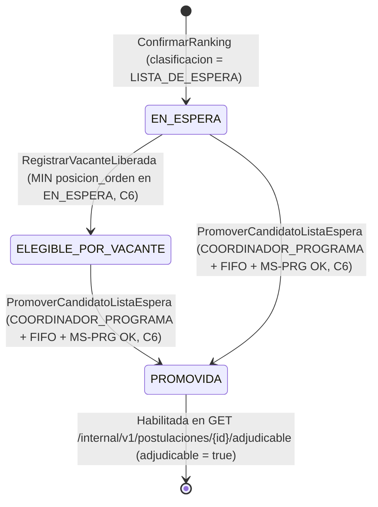

# Design

## Context

Motivación y alcance en `proposal.md`. Estado real observado en `develop` dentro de `Apps/services/ms-postulaciones/`:

- **Base vigente de HU 9.1, HU 9.2 y HU 10.1 en `MS-POS` (1,514 pruebas en verde):**
  - `ResultadoConsolidadoRanking` (`Domain/Consolidacion/Agregados/ResultadoConsolidadoRanking.cs`) hereda de `AggregateRoot` (`Id` UUIDv7, auditoría, `Version` con concurrencia optimista `C1`), confirma `PosicionRanking`, `MontoEstimadoBeca`, `Clasificacion` (`DENTRO_DE_CUPO` o `LISTA_DE_ESPERA`), `FechaConfirmacionRanking` y `ConfirmadoPorUsuarioId`, y conserva los metadatos auditables de desempate/caso límite de HU 10.1 (`TipoCasoLimite`, `SeleccionadoEnCasoLimite`, `JustificacionDesempateCasoLimite`, `DecididoPorUsuarioId`, `FechaDecisionCasoLimite`).
  - `ConfirmarRankingConvocatoriaCommandHandler` confirma atómicamente todos los resultados de una convocatoria (`PROVISIONAL → CONFIRMADO`) tras consultar disponibilidad real en `MS-PRG` (`IDisponibilidadRankingClient`, que ya retorna `DisponibilidadProgramaRanking` con `ProgramaBecaId`, `CuposDisponiblesEfectivos` y `PresupuestoDisponibleEfectivo`) y persiste en un único `await _unitOfWork.GuardarCambiosAsync(cancellationToken)`.
  - `ConsultarAdjudicabilidadPostulacionQueryHandler` y `PostulacionesInternasController` (`GET /internal/v1/postulaciones/{postulacionId:guid}/adjudicable`) consultan `IResultadoConsolidadoRepository` y mapean vía `RankingMapeador.AAdjudicabilidadDto(...)` hacia `AdjudicabilidadPostulacionDto` (compatible con el contrato `MS-BEC → MS-POS` en `docs/contratos/ms-bec/identidad-integraciones.md` y `Apps/services/ms-becas/deploy/wiremock/mappings/postulacion-adjudicable.json`, donde `postulacionId` sigue siendo UUID opaco hasta que Integrante 1 implemente `Postulacion`).
  - `PostulacionesDbContext` implementa `IUnitOfWork` con traducción de restricciones únicas en `TraductorExcepcionesPersistencia` y última migración `20261127012016_ResolucionCasosLimiteRanking`.
  - `PoliticasAutorizacionConsolidacion`, `ManejadorResultadoAutorizacionRubricas` (`403 PERMISO_DENEGADO` en `ProblemDetails`), `IUsuarioActual` (`UsuarioActualJwt`), `IRolesUsuarioActual` (`RolesUsuarioActualJwt`) y `UsuarioSistema.Id` (`00000000-0000-0000-0000-000000000001`) están implementados y probados.
  - **22 puertos previos en `Domain/Interfaces/` (intocables):** `IAsignacionEvaluacionRepository`, `ICatalogoAcademicoClient`, `IComiteEvaluadorRepository`, `IConsultaAsignacionParaEvaluacionRepository`, `IConsultaDatosConsolidacionRepository`, `IConsultaEstadoEvaluacionesConvocatoriaRepository`, `IConsultaEvaluacionesCoevaluadoresRepository`, `IConsultaJefaturaComiteRepository`, `IConsultaRubricaParaEvaluacionRepository`, `IConvocatoriaEvaluacionClient`, `IDisponibilidadRankingClient`, `IEvaluacionRepository`, `IExcepcionEvaluadorUnicoRepository`, `IPeriodoAcademicoClient`, `IPostulanteRepository`, `IProveedorMontoEstimadoBeca`, `IProveedorParametrosConsolidacion`, `IRankingConvocatoriaRepository`, `IResultadoConsolidadoRepository`, `IRubricaRepository`, `IUnitOfWork`, `IVerificadorConflictoInteresDecisor`.
  - **Guardrails arquitectónicos (`ArchitectureTests`):** `EncapsulamientoTests` prohíbe setters públicos (incluidos `init` públicos en `ValueObject`) y colecciones mutables en `Domain`; `DomainIndependenceTests` y `DependenciasEntreCapasTests` exigen C# puro en `Domain` y cero referencias a EF Core, ASP.NET, Npgsql o MassTransit en `Application`.
  - **Precedencia normativa:** prevalecen `openspec/config.yaml`, `docs/Enunciado/PRD Desarrollo.md` (`RF-10`), Historia 10.2 (Criterios 1 a 4), `docs/Explicacion_del_DDD_V7.md` (§2.3.B `EntradaListaEspera`, §4.2 `RN-POS-07`, §4.3 `C6`, §6.2 contratos `MS-POS → MS-PRG` y `MS-BEC → MS-POS`) y `openspec/specs/ms-pos/consolidacion/spec.md`, ignorando restricciones desactualizadas en `docs/organizacion_repositorio.md` y `openspec/specs/ms-pos/spec_pos.md`.

## Goals / Non-Goals

**Goals:**

- Implementar **HU 10.2** dentro de **RF-10** cerrando **RF-10 al 100%** en `MS-POS`, sin romper ninguna de las 1,514 pruebas previas ni `ArchitectureTests`.
- Modelar `EntradaListaEspera` como agregado raíz independiente (`Domain/ListaEspera/Agregados/EntradaListaEspera.cs`) con su máquina de estados explícita `EstadoListaEspera` (`EN_ESPERA`, `ELEGIBLE_POR_VACANTE`, `PROMOVIDA`).
- Integrar por OCP la generación automática y atómica de la lista de espera al confirmarse el ranking (`ConfirmarRankingConvocatoriaCommandHandler`) y el reconocimiento de postulantes promovidos en `GET /internal/v1/postulaciones/{postulacionId}/adjudicable` (`ConsultarAdjudicabilidadPostulacionQueryHandler`).
- Desacoplar el caso de uso de vacante liberada (`RegistrarVacanteLiberadaCommand`) de todo transporte para que funcione vía API pública, API interna (`/internal/v1/lista-espera/...`) y futuros consumidores MassTransit/RabbitMQ (`OfertaBecaRechazada` / `OfertaBecaExpirada` / `OfertaBecaAnulada`).
- Garantizar la promoción manual asistida por `COORDINADOR_PROGRAMA` verificando *fail-closed* cupo y presupuesto efectivos en `MS-PRG`, estricto orden FIFO por `PosicionOrden` y control de concurrencia atómico `C6` real en PostgreSQL.

**Non-Goals:**

- Implementar RF-39 (`ConflictoInteres`), migración a Keycloak/PBAC, entidad `Postulacion` (Integrante 1) ni emisión de cartas de otorgamiento (`MS-BEC` RF-15).
- Introducir MediatR, MassTransit/RabbitMQ, Outbox o Hangfire.
- Modificar `Postulantes`, `Rubricas`, `Comites`, `ResultadosConsolidadosController`, `EvaluacionesController`, `AsignacionesEvaluacionController`, `ComitesEvaluadoresController`, `RubricasController`, `PostulantesController`, `RankingsController`, `PostulacionesInternasController`, `Domain/Comun`, cualquiera de los 22 puertos previos de `Domain/Interfaces/`, `IUsuarioActual`, `IRolesUsuarioActual` ni otros microservicios (`ms-prg`, `ms-becas`, `ms-plt`, `ms-aud`).

## Decisions

### D1. Aplicación práctica y auditable de SOLID y extensibilidad OCP

| Principio | Aplicación concreta en `rf10-2-int2-mspos` |
|---|---|
| **SRP** | `EntradaListaEspera` resguarda exclusivamente las invariantes de cada entrada en cola (`Crear`, `MarcarElegiblePorVacante`, `Promover`); `ServicioConstruccionListaEspera` construye la secuencia `1..M` desde resultados confirmados; `ServicioPromocionListaEspera` valida orden FIFO estricto y suficiencia de cupo/presupuesto; los 4 casos de uso CQRS (`ObtenerListaEsperaConvocatoriaQuery`, `ObtenerSiguienteCandidatoListaEsperaQuery`, `RegistrarVacanteLiberadaCommand`, `PromoverCandidatoListaEsperaCommand`) tienen responsabilidades únicas y validadores dedicados; `ListaEsperaController` y `ListaEsperaInternaController` separan rutas públicas e internas. |
| **OCP** | (1) `ConfirmarRankingConvocatoriaCommandHandler` delega la materialización de la lista de espera al puerto de aplicación `IGeneradorListaEsperaRanking` sin acoplarse a detalles internos de construcción de cola, ejecutándose dentro del mismo `IUnitOfWork.GuardarCambiosAsync`. (2) `ConsultarAdjudicabilidadPostulacionQueryHandler` consulta `IEntradaListaEsperaRepository` únicamente cuando el resultado confirmado está en `LISTA_DE_ESPERA`, ampliando `AdjudicabilidadPostulacionDto` con parámetros opcionales al final para preservar 100% compatibilidad con HU 9.2 y `MS-BEC`. (3) `RegistrarVacanteLiberadaCommandHandler` es agnóstico al transporte: hoy se invoca desde REST y mañana un consumidor MassTransit de `OfertaBecaRechazada` / `OfertaBecaExpirada` / `OfertaBecaAnulada` lo invocará sin tocar dominio ni aplicación. (4) Ningún controlador existente es modificado. |
| **ISP** | Solo se agregan 2 puertos pequeños en `Domain/Interfaces/` (`IEntradaListaEsperaRepository` y `IGestorConcurrenciaListaEspera`) y 1 puerto de aplicación (`IGeneradorListaEsperaRanking`). Ninguno de los 22 puertos previos de `Domain/Interfaces/`, `IUsuarioActual` ni `IRolesUsuarioActual` se altera. |
| **DIP** | Dominio y Aplicación desconocen EF Core, Npgsql, PostgreSQL, locks SQL y HTTP; la serialización `C6` vive detrás de `IGestorConcurrenciaListaEspera` implementada en `Infrastructure` (`GestorConcurrenciaListaEsperaPostgreSql`), y la verificación de disponibilidad reutiliza el puerto `IDisponibilidadRankingClient` ya existente. |

### D2. Máquina de estados de `EstadoListaEspera` (sin librerías externas)

#### D2.1 Elección del conjunto mínimo exacto de estados

Se adopta el conjunto mínimo exacto `{EnEspera, ElegiblePorVacante, Promovida}` (`Domain/Enums/EstadoListaEspera.cs`, serializado con `CodigoEnum`):

| Miembro C# (`EstadoListaEspera`) | Código SQL / JSON (`CodigoEnum`) | Significado de negocio |
|---|---|---|
| `EnEspera` | `EN_ESPERA` | Postulante elegible fuera de cupo ingresado automáticamente al confirmarse el ranking, esperando en cola según `PosicionOrden`. |
| `ElegiblePorVacante` | `ELEGIBLE_POR_VACANTE` | Candidato marcado al registrarse una vacante liberada (`RF-15`/`RF-16`), alertando al `COORDINADOR_PROGRAMA` sin promoverlo ni emitir oferta desatendida (`RN-POS-07`). |
| `Promovida` | `PROMOVIDA` | Estado terminal tras la confirmación manual asistida del `COORDINADOR_PROGRAMA` validando cupo y presupuesto en `MS-PRG`; habilita `adjudicable = true` en `/internal/v1/postulaciones/{postulacionId}/adjudicable`. |

> **Evaluación de estado de descarte/cierre (por qué NO se inventa en HU 10.2):** ni el PRD (`RF-10`), ni la Historia 10.2 (Criterios 1 a 4), ni DDD V7 (§2.3.B y `RN-POS-07`) definen un flujo ni criterio de aceptación para descartar manualmente o expirar entradas de lista de espera. Mantener el conjunto mínimo exacto de 3 estados evita introducir endpoints, reglas y transiciones inventadas; por OCP, si un cambio posterior de cierre de convocatoria requiere `EXPIRADA` o `DESCARTADA`, podrá añadirse aditivamente sin romper este contrato.

#### D2.2 Diagrama de transición de estados



> **Justificación de `EN_ESPERA → PROMOVIDA` junto a `ELEGIBLE_POR_VACANTE → PROMOVIDA`:**
> - Ante una vacante liberada por rechazo/expiración/anulación de oferta (`RF-15`/`RF-16`), `RN-POS-07` exige que la cola marque al primero en `EN_ESPERA` como `ELEGIBLE_POR_VACANTE` sin emitir oferta desatendida, y luego el coordinador confirma `ELEGIBLE_POR_VACANTE → PROMOVIDA`.
> - Adicionalmente, DDD V7 §4.3 `C6` contempla la promoción directa del candidato con `MIN(posicion_orden)` cuando existe disponibilidad real verificada en `MS-PRG` (por ejemplo, tras una ampliación presupuestaria o de cupos del programa en `MS-PRG` sin rechazo previo de oferta).
> - Permitir `Promover(...)` desde `ELEGIBLE_POR_VACANTE` **y** desde `EN_ESPERA` —siempre bajo autorización exclusiva de `COORDINADOR_PROGRAMA`, orden FIFO estricto y verificación *fail-closed* de `MS-PRG`— armoniza `RN-POS-07` y `C6` sin contradicción.

#### D2.3 Tabla explícita de transiciones válidas e inválidas

| Estado actual | Operación solicitada | Estado resultante | Efecto / Excepción |
|---|---|---|---|
| *(No existe)* | `EntradaListaEspera.Crear(...)` | `EN_ESPERA` | Crea agregado con `Id` UUIDv7, `Version = 1`, `FechaIngreso` UTC y campos de elegibilidad/promoción nulos |
| `EN_ESPERA` | `MarcarElegiblePorVacante(fechaUtc, actorId)` | `ELEGIBLE_POR_VACANTE` | Fija `FechaElegibilidad` UTC, actualiza auditoría e incrementa `Version` |
| `EN_ESPERA` | `Promover(fechaUtc, coordinadorId, motivo?)` | `PROMOVIDA` | Fija `FechaPromocion` UTC, `PromovidoPorUsuarioId`, `MotivoPromocion?` (`FechaElegibilidad` permanece `null`), actualiza auditoría e incrementa `Version` |
| `ELEGIBLE_POR_VACANTE` | `Promover(fechaUtc, coordinadorId, motivo?)` | `PROMOVIDA` | Fija `FechaPromocion` UTC, `PromovidoPorUsuarioId`, `MotivoPromocion?` (conservando `FechaElegibilidad`), actualiza auditoría e incrementa `Version` |
| `ELEGIBLE_POR_VACANTE` | `MarcarElegiblePorVacante(...)` | `ELEGIBLE_POR_VACANTE` | **Inválida:** `409 ENTRADA_LISTA_ESPERA_YA_ELEGIBLE` |
| `PROMOVIDA` | `MarcarElegiblePorVacante(...)` | `PROMOVIDA` | **Inválida:** `409 ENTRADA_LISTA_ESPERA_YA_PROMOVIDA` |
| `PROMOVIDA` | `Promover(...)` | `PROMOVIDA` | **Inválida:** `409 ENTRADA_LISTA_ESPERA_YA_PROMOVIDA` |
| `EN_ESPERA` o `ELEGIBLE_POR_VACANTE` | `Promover(...)` con `motivoPromocion.Trim().Length > 500` | Sin cambio | **Inválida:** `422 MOTIVO_PROMOCION_INVALIDO` |

### D3. Modelo de Dominio (`Ascenso.Postulaciones.Domain`)

#### D3.1 Agregado raíz `EntradaListaEspera` (`Domain/ListaEspera/Agregados/EntradaListaEspera.cs`)

Hereda de `AggregateRoot` (`Id` UUIDv7, `FechaCreacion`, `UsuarioCreacionId`, `FechaUltimaModificacion`, `UsuarioModificacionId`, `Version`), constructor privado para EF Core, todas las propiedades mutables con `private set;`:

- Constante: `public const int LongitudMaximaMotivoPromocion = 500;`
- Propiedades persistidas:
  - `public Guid ConvocatoriaId { get; private set; }`
  - `public Guid ProgramaBecaId { get; private set; }`
  - `public Guid PostulacionId { get; private set; }`
  - `public int PosicionOrden { get; private set; }` (`>= 1`)
  - `public decimal MontoEstimadoBecaSnapshot { get; private set; }` (`> 0.00m`, máximo 2 decimales; fotografía inmutable del monto confirmado en `ResultadoConsolidadoRanking`, trazable y útil para consultas de lista de espera y verificación en promoción)
  - `public EstadoListaEspera Estado { get; private set; }`
  - `public DateTimeOffset FechaIngreso { get; private set; }` (UTC)
  - `public DateTimeOffset? FechaElegibilidad { get; private set; }` (UTC?)
  - `public DateTimeOffset? FechaPromocion { get; private set; }` (UTC?)
  - `public Guid? PromovidoPorUsuarioId { get; private set; }`
  - `public string? MotivoPromocion { get; private set; }` (opcional, recortado con `Trim()`, `null` si vacío/espacios, máx. 500 chars)
- Propiedades calculadas (ignoradas en EF Core):
  - `public bool EstaPromovida => Estado == EstadoListaEspera.Promovida;`
  - `public bool EstaPendiente => Estado != EstadoListaEspera.Promovida;`
- Fábrica y métodos:
  - `Crear(Guid convocatoriaId, Guid programaBecaId, Guid postulacionId, int posicionOrden, decimal montoEstimadoBecaSnapshot, DateTimeOffset fechaIngreso, Guid usuarioActorId)`
  - `MarcarElegiblePorVacante(DateTimeOffset fechaElegibilidad, Guid usuarioActorId)`
  - `Promover(DateTimeOffset fechaPromocion, Guid promovidoPorUsuarioId, string? motivoPromocion = null)`

#### D3.2 Servicios de dominio puros (`Domain/ListaEspera/Servicios/`)

1. **`ServicioConstruccionListaEspera`** (`public static class`):
   - `ConstruirDesdeResultadosConfirmados(Guid convocatoriaId, Guid programaBecaId, IReadOnlyCollection<ResultadoConsolidadoRanking> resultadosConfirmados, DateTimeOffset fechaIngreso, Guid usuarioActorId) : IReadOnlyList<EntradaListaEspera>`
   - Valida `convocatoriaId != Guid.Empty`, `programaBecaId != Guid.Empty`, `resultadosConfirmados` no nulo y que todo resultado pertenezca a `convocatoriaId` y esté en `EstadoRanking.Confirmado` con `PosicionRanking`, `MontoEstimadoBeca` y `Clasificacion` poblados (`422 LISTA_ESPERA_INVALIDA` si algún resultado es incoherente).
   - Filtra `Clasificacion == ClasificacionRanking.ListaDeEspera`, ordena por `PosicionRanking!.Value ASC`, luego `Id ASC`, y crea las instancias secuenciales con `posicionOrden = 1..M`. Si no hay resultados en `LISTA_DE_ESPERA`, retorna `[]`.
2. **`ServicioPromocionListaEspera`** (`public static class`):
   - `SeleccionarSiguienteParaVacante(IReadOnlyList<EntradaListaEspera> entradasOrdenadas) : EntradaListaEspera`:
     - Recorre `entradasOrdenadas` por `PosicionOrden ASC` y devuelve el primero en estado `EstadoListaEspera.EnEspera`. Si no existe ninguno, lanza `ListaEsperaSinCandidatosException` (`404 LISTA_ESPERA_SIN_CANDIDATOS`).
   - `ResolverCandidatoAPromover(IReadOnlyList<EntradaListaEspera> entradasOrdenadas, Guid? entradaListaEsperaId) : EntradaListaEspera`:
     - Ordena por `PosicionOrden ASC` (defensivo) y determina los pendientes (`Estado != EstadoListaEspera.Promovida`).
     - Si `entradaListaEsperaId` tiene valor:
       - Busca la entrada en `entradasOrdenadas`; si no existe → `EntradaListaEsperaNoEncontradaException` (`404 ENTRADA_LISTA_ESPERA_NO_ENCONTRADA`).
       - Si `objetivo.EstaPromovida` → `EntradaListaEsperaYaPromovidaException` (`409 ENTRADA_LISTA_ESPERA_YA_PROMOVIDA`).
       - Verifica FIFO estricto: si `pendientes[0].Id != objetivo.Id` (existe al menos un candidato con menor `PosicionOrden` todavía pendiente en `EN_ESPERA` o `ELEGIBLE_POR_VACANTE`) → `OrdenListaEsperaVioladoException` (`409 ORDEN_LISTA_ESPERA_VIOLADO`).
       - Retorna `objetivo`.
     - Si `entradaListaEsperaId` es `null` (promoción del siguiente en cola):
       - Si `pendientes.Count == 0` → `ListaEsperaSinCandidatosException` (`404 LISTA_ESPERA_SIN_CANDIDATOS`).
       - Retorna `pendientes[0]`.
   - `ValidarDisponibilidadParaPromocion(DisponibilidadProgramaRanking disponibilidad, decimal montoEstimadoBeca)`:
     - Si `disponibilidad.CuposDisponiblesEfectivos < 1` → `SinCupoDisponiblePromocionException` (`409 SIN_CUPO_DISPONIBLE_PROMOCION`).
     - Si `disponibilidad.PresupuestoDisponibleEfectivo < montoEstimadoBeca` → `PresupuestoInsuficientePromocionException` (`422 PRESUPUESTO_INSUFICIENTE_PROMOCION`).

### D4. Excepciones de dominio (`Domain/Excepciones/`)

Todas las nuevas excepciones heredan **estrictamente** de las clases base reales existentes (`ExcepcionEntidadNoEncontrada` o `ExcepcionReglaNegocio` con `estadoHttp` explícito) y se traducen automáticamente a `ProblemDetails` vía `ManejadorExcepcionesDominio`:

| Excepción | Clase base real | `CodigoError` | HTTP | Motivo |
|---|---|---|---|---|
| `EntradaListaEsperaNoEncontradaException` | `ExcepcionEntidadNoEncontrada` | `ENTRADA_LISTA_ESPERA_NO_ENCONTRADA` | `404` | No existe la entrada de lista de espera indicada para la convocatoria |
| `ListaEsperaSinCandidatosException` | `ExcepcionEntidadNoEncontrada` | `LISTA_ESPERA_SIN_CANDIDATOS` | `404` | No existen candidatos pendientes (`EN_ESPERA` o sin promover) en la lista de espera de la convocatoria |
| `EntradaListaEsperaYaPromovidaException` | `ExcepcionReglaNegocio` (`estadoHttp: 409`) | `ENTRADA_LISTA_ESPERA_YA_PROMOVIDA` | `409` | La entrada ya fue promovida previamente |
| `EntradaListaEsperaYaElegibleException` | `ExcepcionReglaNegocio` (`estadoHttp: 409`) | `ENTRADA_LISTA_ESPERA_YA_ELEGIBLE` | `409` | La entrada ya se encuentra en estado `ELEGIBLE_POR_VACANTE` |
| `EntradaListaEsperaDuplicadaException` | `ExcepcionReglaNegocio` (`estadoHttp: 409`) | `ENTRADA_LISTA_ESPERA_DUPLICADA` | `409` | Violación de unicidad `ux_entradas_lista_espera_postulacion` |
| `OrdenListaEsperaVioladoException` | `ExcepcionReglaNegocio` (`estadoHttp: 409`) | `ORDEN_LISTA_ESPERA_VIOLADO` | `409` | Se intentó promover a un candidato saltándose a otro con menor `PosicionOrden` todavía pendiente |
| `SinCupoDisponiblePromocionException` | `ExcepcionReglaNegocio` (`estadoHttp: 409`) | `SIN_CUPO_DISPONIBLE_PROMOCION` | `409` | `MS-PRG` reporta `cuposDisponiblesEfectivos < 1` al momento de promover |
| `PresupuestoInsuficientePromocionException` | `ExcepcionReglaNegocio` (`estadoHttp: 422`) | `PRESUPUESTO_INSUFICIENTE_PROMOCION` | `422` | `MS-PRG` reporta `presupuestoDisponibleEfectivo < montoEstimadoBeca` del candidato |
| `ListaEsperaInvalidaException` | `ExcepcionReglaNegocio` (`estadoHttp: 422`) | `LISTA_ESPERA_INVALIDA` | `422` | Datos o invariantes de dominio inválidos para `EntradaListaEspera` |
| `MotivoPromocionInvalidoException` | `ExcepcionReglaNegocio` (`estadoHttp: 422`) | `MOTIVO_PROMOCION_INVALIDO` | `422` | `MotivoPromocion` excede `500` caracteres tras `Trim()` |

Se reutilizan sin cambios: `ConvocatoriaNoEncontradaException` (`404`), `ProgramaBecaNoEncontradoException` (`404`), `DependenciaNoDisponibleException` (`503`), `ExcepcionConflictoConcurrencia` (`409`), `NoAutenticadoException` (`401`), `ResultadoConsolidadoNoEncontradoException` (`404`).

### D5. Puertos ISP nuevos — Cero cambios en los 22 puertos previos

- **En `Domain/Interfaces/` (2 puertos nuevos):**
  1. `IEntradaListaEsperaRepository`:
     - `Task AgregarRangoAsync(IReadOnlyCollection<EntradaListaEspera> entradas, CancellationToken cancellationToken = default);`
     - `Task<EntradaListaEspera?> ObtenerPorIdAsync(Guid entradaListaEsperaId, CancellationToken cancellationToken = default);`
     - `Task<EntradaListaEspera?> ObtenerPorPostulacionAsync(Guid postulacionId, CancellationToken cancellationToken = default);`
     - `Task<IReadOnlyList<EntradaListaEspera>> ListarPorConvocatoriaAsync(Guid convocatoriaId, EstadoListaEspera? estado = null, CancellationToken cancellationToken = default);`
     - `Task<EntradaListaEspera?> ObtenerSiguientePendientePorConvocatoriaAsync(Guid convocatoriaId, CancellationToken cancellationToken = default);`
  2. `IGestorConcurrenciaListaEspera`:
     - `Task<TResult> EjecutarConBloqueoConvocatoriaAsync<TResult>(Guid convocatoriaId, Func<IReadOnlyList<EntradaListaEspera>, CancellationToken, Task<TResult>> accionBloqueada, CancellationToken cancellationToken = default);`
- **En `Application/ListaEspera/Interfaces/` (1 puerto OCP interno de aplicación):**
  1. `IGeneradorListaEsperaRanking`:
     - `Task<int> GenerarDesdeRankingConfirmadoAsync(Guid convocatoriaId, Guid programaBecaId, IReadOnlyCollection<ResultadoConsolidadoRanking> resultadosConfirmados, DateTimeOffset fechaIngreso, Guid usuarioActorId, CancellationToken cancellationToken = default);`

### D6. Capa de Aplicación (`Ascenso.Postulaciones.Application`, CQRS sin MediatR ni Hangfire)

1. **Integración OCP en `ConfirmarRankingConvocatoriaCommandHandler`:**
   - Recibe `IGeneradorListaEsperaRanking` por constructor (registrado automáticamente en `Application/DependencyInjection.cs`).
   - Inmediatamente después del bucle `resultadosPorId[...].ConfirmarRanking(...)` y **antes** del único `await _unitOfWork.GuardarCambiosAsync(cancellationToken)`:
     ```csharp
     await _generadorListaEspera.GenerarDesdeRankingConfirmadoAsync(
         command.ConvocatoriaId,
         disponibilidad.ProgramaBecaId,
         resultados,
         ahora,
         usuarioConfirmadorId,
         cancellationToken);
     ```
   - `GeneradorListaEsperaRankingAdapter` invoca `ServicioConstruccionListaEspera.ConstruirDesdeResultadosConfirmados(...)` y, si `entradas.Count > 0`, agrega el rango vía `_entradaListaEsperaRepository.AgregarRangoAsync(entradas, cancellationToken)` sin guardar cambios por separado, garantizando **atomicidad total** en la transacción de `GuardarCambiosAsync`.
   - *Impacto mínimo y documentado en pruebas previas:* 4 archivos que instancian directamente `new ConfirmarRankingConvocatoriaCommandHandler(...)` (`ConfirmarRankingConvocatoriaCommandHandlerTests.cs`, `ConfirmarRankingConCasoLimiteTests.cs`, `RankingPostgreSqlTests.cs`, `CasosLimitePostgreSqlTests.cs`) reciben el parámetro adicional sin modificar una sola aserción previa.
2. **Integración OCP en `ConsultarAdjudicabilidadPostulacionQueryHandler` y `AdjudicabilidadPostulacionDto`:**
   - Recibe `IEntradaListaEsperaRepository` por constructor.
   - Si `resultado.EsAdjudicable` (`CONFIRMADO` + `DENTRO_DE_CUPO`) o `resultado.EstadoConfirmacionRanking == EstadoRanking.Provisional` → retorna `resultado.AAdjudicabilidadDto()` sin consulta extra.
   - Si `resultado.EstadoConfirmacionRanking == EstadoRanking.Confirmado && resultado.Clasificacion == ClasificacionRanking.ListaDeEspera`:
     - Consulta `var entrada = await _entradaListaEsperaRepository.ObtenerPorPostulacionAsync(query.PostulacionId, cancellationToken);`
     - Retorna `resultado.AAdjudicabilidadDto(entrada)`:
       - Si `entrada?.EstaPromovida == true` → `Adjudicable = true`, `MotivoNoAdjudicable = null`, `PromovidaDeListaEspera = true`, `EstadoListaEspera = "PROMOVIDA"`, `PosicionListaEspera = entrada.PosicionOrden`, `FechaPromocionListaEspera = entrada.FechaPromocion`, `ProgramaBecaId = entrada.ProgramaBecaId`.
       - En caso contrario (`EN_ESPERA`, `ELEGIBLE_POR_VACANTE` o `null`) → `Adjudicable = false`, `MotivoNoAdjudicable = RankingMapeador.MotivoFueraDeCupoEnListaDeEspera`, `PromovidaDeListaEspera = false`, `EstadoListaEspera = entrada?.Estado.ACodigo()`, `PosicionListaEspera = entrada?.PosicionOrden`, `FechaPromocionListaEspera = null`, `ProgramaBecaId = entrada?.ProgramaBecaId`.
   - `AdjudicabilidadPostulacionDto` añade únicamente parámetros opcionales al final (`bool PromovidaDeListaEspera = false, string? EstadoListaEspera = null, int? PosicionListaEspera = null, DateTimeOffset? FechaPromocionListaEspera = null, Guid? ProgramaBecaId = null`), preservando compatibilidad binaria y JSON con `MS-BEC` y con todas las pruebas previas.
   - *Impacto mínimo y documentado en pruebas previas:* `ConsultarAdjudicabilidadPostulacionQueryHandlerTests.cs` (1 archivo) recibe el sustituto `IEntradaListaEsperaRepository` en `CrearHandler()` sin modificar ninguna aserción existente.
3. **Nuevos casos de uso en `Application/ListaEspera/`:**
   - `ObtenerListaEsperaConvocatoriaQuery(Guid ConvocatoriaId, string? Estado = null, int Pagina = 1, int Tamano = 20)` + validator + handler → retorna `ListaEsperaConvocatoriaDto(Guid ConvocatoriaId, int TotalEnListaEspera, int TotalEnEspera, int TotalElegiblesPorVacante, int TotalPromovidas, PaginaDto<EntradaListaEsperaDto> Entradas)`.
   - `ObtenerSiguienteCandidatoListaEsperaQuery(Guid ConvocatoriaId)` + validator + handler → retorna `EntradaListaEsperaDto` o lanza `404 LISTA_ESPERA_SIN_CANDIDATOS`.
   - `RegistrarVacanteLiberadaCommand(Guid ConvocatoriaId, string? MotivoVacante = null)` + validator + handler:
     - Resuelve `usuarioActorId = _usuarioActual.EstaAutenticado ? _usuarioActual.UsuarioId : UsuarioSistema.Id` (permitiendo invocación con JWT de coordinador, con Service Account Token sin `sub` de usuario, o desde un futuro consumidor MassTransit).
     - Bajo `_gestorConcurrencia.EjecutarConBloqueoConvocatoriaAsync(command.ConvocatoriaId, ...)`:
       1. `var siguiente = ServicioPromocionListaEspera.SeleccionarSiguienteParaVacante(entradasBloqueadas);`
       2. `siguiente.MarcarElegiblePorVacante(_timeProvider.GetUtcNow(), usuarioActorId);`
       3. `await _unitOfWork.GuardarCambiosAsync(ct);`
       4. Retorna `siguiente.ADto()`.
   - `PromoverCandidatoListaEsperaCommand(Guid ConvocatoriaId, Guid? EntradaListaEsperaId = null, string? MotivoPromocion = null)` + validator + handler:
     - Valida comando con FluentValidation (`400`) y exige `usuarioPromotorId = _usuarioActual.ObtenerUsuarioIdRequerido()` (`401`).
     - Bajo `_gestorConcurrencia.EjecutarConBloqueoConvocatoriaAsync(command.ConvocatoriaId, ...)`:
       1. `var candidato = ServicioPromocionListaEspera.ResolverCandidatoAPromover(entradasBloqueadas, command.EntradaListaEsperaId);`
       2. Consulta `var resultado = await _resultadoRepository.ObtenerPorPostulacionAsync(candidato.PostulacionId, ct);` y determina `var montoRequerido = resultado?.MontoEstimadoBeca ?? candidato.MontoEstimadoBecaSnapshot;`.
       3. Consulta disponibilidad real *fail-closed* en `MS-PRG` vía `var disponibilidad = await _disponibilidadClient.ObtenerDisponibilidadPorConvocatoriaAsync(command.ConvocatoriaId, ct) ?? throw new ConvocatoriaNoEncontradaException();`.
       4. Ejecuta `ServicioPromocionListaEspera.ValidarDisponibilidadParaPromocion(disponibilidad, montoRequerido);` (`409 SIN_CUPO_DISPONIBLE_PROMOCION` / `422 PRESUPUESTO_INSUFICIENTE_PROMOCION`).
       5. Ejecuta `candidato.Promover(_timeProvider.GetUtcNow(), usuarioPromotorId, command.MotivoPromocion);`.
       6. Persiste con `await _unitOfWork.GuardarCambiosAsync(ct);`.
       7. Retorna `new PromocionListaEsperaDto(candidato.ADto(), disponibilidad.ADto(), HabilitadaParaAdjudicacion: true)`.
   - Registro en `Application/DependencyInjection.cs` (`AddScoped` para `IGeneradorListaEsperaRanking` y los 4 handlers nuevos; los validadores se registran automáticamente por `AddValidatorsFromAssembly`).

### D7. Persistencia y Concurrencia `C6` en PostgreSQL (`Ascenso.Postulaciones.Infrastructure`)

#### D7.1 Esquema `postulaciones.entradas_lista_espera` (`EntradaListaEsperaConfiguracion`)

- **Tabla:** `postulaciones.entradas_lista_espera`, PK `pk_entradas_lista_espera` sobre `id` (`uuid`, `ValueGeneratedNever`).
- **Auditoría y concurrencia `C1`:** `ConfiguracionPersistencia.ConfigurarEntidadAuditable(builder)` (`fecha_creacion`, `usuario_creacion_id`, `fecha_ultima_modificacion`, `usuario_modificacion_id`, `version` como token de concurrencia optimista).
- **Columnas de dominio:**
  - `convocatoria_id` (`uuid`, `NOT NULL`)
  - `programa_beca_id` (`uuid`, `NOT NULL`)
  - `postulacion_id` (`uuid`, `NOT NULL`)
  - `posicion_orden` (`integer`, `NOT NULL`)
  - `monto_estimado_beca_snapshot` (`numeric(12,2)`, `NOT NULL`)
  - `estado` (`varchar(30)`, `ComoCodigoEnum()`, `NOT NULL`)
  - `fecha_ingreso` (`timestamptz`, `NOT NULL`)
  - `fecha_elegibilidad` (`timestamptz`, `NULL`)
  - `fecha_promocion` (`timestamptz`, `NULL`)
  - `promovido_por_usuario_id` (`uuid`, `NULL`)
  - `motivo_promocion` (`varchar(500)`, `NULL`)
- **Índices:**
  - `ux_entradas_lista_espera_postulacion` (`UNIQUE` en `postulacion_id`) — traducido en `TraductorExcepcionesPersistencia` a `EntradaListaEsperaDuplicadaException` (`409 ENTRADA_LISTA_ESPERA_DUPLICADA`).
  - `ux_entradas_lista_espera_convocatoria_posicion` (`UNIQUE` en `(convocatoria_id, posicion_orden)`) — traducido en `TraductorExcepcionesPersistencia` a `ExcepcionConflictoConcurrencia(..., CodigoRestriccionUnicidad)` (`409`).
  - `ix_entradas_lista_espera_convocatoria_estado_posicion` (compuesto en `(convocatoria_id, estado, posicion_orden)`) — acelera las consultas filtradas por estado y la selección FIFO.
- **Restricciones `CHECK` (cuidando lógica trivaluada SQL con `NULL` y orden alfabético en PostgreSQL):**
  1. `ck_entradas_lista_espera_estado_valido`:
     `estado IN ('EN_ESPERA', 'ELEGIBLE_POR_VACANTE', 'PROMOVIDA')` (generado vía `ConfiguracionPersistencia.ValoresSql<EstadoListaEspera>()`).
  2. `ck_entradas_lista_espera_posicion_positiva`:
     `posicion_orden >= 1`.
  3. `ck_entradas_lista_espera_monto_positivo`:
     `monto_estimado_beca_snapshot > 0`.
  4. `ck_entradas_lista_espera_estado_coherente` *(alfabéticamente anterior a `..._estado_valido`, por lo que incluye la guarda `OR estado NOT IN (...)` para que un estado fuera de catálogo falle exactamente `ck_entradas_lista_espera_estado_valido`)*:
     ```sql
     (estado = 'EN_ESPERA' AND fecha_elegibilidad IS NULL AND fecha_promocion IS NULL AND promovido_por_usuario_id IS NULL AND motivo_promocion IS NULL)
     OR (estado = 'ELEGIBLE_POR_VACANTE' AND fecha_elegibilidad IS NOT NULL AND fecha_promocion IS NULL AND promovido_por_usuario_id IS NULL AND motivo_promocion IS NULL)
     OR (estado = 'PROMOVIDA' AND fecha_promocion IS NOT NULL AND promovido_por_usuario_id IS NOT NULL AND (motivo_promocion IS NULL OR length(btrim(motivo_promocion)) > 0))
     OR estado NOT IN ('EN_ESPERA', 'ELEGIBLE_POR_VACANTE', 'PROMOVIDA')
     ```

#### D7.2 Mecanismo real de concurrencia `C6` en PostgreSQL (`GestorConcurrenciaListaEsperaPostgreSql`)

Para cumplir DDD V7 §4.3 `C6` ("La promoción selecciona y bloquea atómicamente al candidato con `MIN(posicion_orden)`") y evitar tanto promociones duplicadas como inversiones FIFO o condiciones de carrera de `EvalPlanQual` con `LIMIT 1`:

1. Si ya existe una transacción activa en `_contexto.Database.CurrentTransaction`, se reutiliza; en caso contrario se inicia una nueva transacción PostgreSQL (`await using var transaccion = await _contexto.Database.BeginTransactionAsync(cancellationToken)`).
2. Se adquiere un lock transaccional por convocatoria en PostgreSQL con espacio de nombres dedicado (`1002`):
   ```sql
   SELECT pg_advisory_xact_lock(hashtextextended(@convocatoriaIdText, 1002))
   ```
   (ejecutado vía `ExecuteSqlInterpolatedAsync` con parámetro seguro, liberado automáticamente al hacer `Commit` o `Rollback`).
3. Se cargan y bloquean atómicamente en orden determinista las filas de la convocatoria (`tracked` en EF Core, sin `AsNoTracking`) mediante `FromSqlInterpolated`:
   ```sql
   SELECT *
     FROM postulaciones.entradas_lista_espera
    WHERE convocatoria_id = @convocatoriaId
    ORDER BY posicion_orden ASC
      FOR UPDATE
   ```
4. Se ejecuta el delegado `accionBloqueada(entradasBloqueadas, cancellationToken)` que valida dominio/FIFO/disponibilidad, muta la entidad seleccionada (incrementando `Version` para concurrencia optimista `C1`) y confirma con `_unitOfWork.GuardarCambiosAsync(cancellationToken)`.
5. Se confirma la transacción (`await transaccion.CommitAsync(cancellationToken)`). Ante cualquier excepción (`404`, `409`, `422`, `503`), la transacción hace rollback automático y libera el lock.

**Garantías verificadas:**
- **Cero deadlocks:** el orden de adquisición de bloqueos es estrictamente determinista (lock de convocatoria → filas ordenadas por `posicion_orden ASC`).
- **Dos coordinadores promoviendo al mismo candidato en simultáneo:** TX1 adquiere el lock, promueve `posicionOrden = 1` (`PROMOVIDA`, `version = 2`) y hace commit; TX2 desbloquea inmediatamente, lee el estado recién confirmado (`PROMOVIDA`) y falla con `409 ENTRADA_LISTA_ESPERA_YA_PROMOVIDA` sin doble promoción.
- **Dos registros paralelos de vacante liberada sobre la misma convocatoria:** TX1 marca `posicionOrden = 1` como `ELEGIBLE_POR_VACANTE` y confirma; TX2 lee el estado confirmado y marca `posicionOrden = 2` como `ELEGIBLE_POR_VACANTE` sin colisiones ni huecos.
- **Lecturas sin bloqueo:** `GET /api/v1/lista-espera/...` y `GET /internal/v1/postulaciones/{id}/adjudicable` ejecutan consultas `AsNoTracking` sin `FOR UPDATE`, preservando rendimiento CQRS-Lite.

#### D7.3 Migración EF Core separada

Nueva migración `ListaEsperaPostulaciones` generada sobre `20261127012016_ResolucionCasosLimiteRanking` (sin tocar migraciones previas ni la tabla `resultados_consolidados_ranking`), verificada con `dotnet ef migrations has-pending-model-changes` y formateada inmediatamente con `dotnet format Ascenso.Postulaciones.sln --no-restore --include <rutas>`.

### D8. API REST y Seguridad (`Ascenso.Postulaciones.Api`)

#### D8.1 Controladores nuevos (todos los controladores previos permanecen 100% intactos)

1. **`Api/Controllers/v1/ListaEsperaController.cs`** (`[Route("api/v1/lista-espera")]`):

| Ruta | Política | Cuerpo / Query | Éxito | Errores Swagger |
|---|---|---|---|---|
| `GET /api/v1/lista-espera/convocatorias/{convocatoriaId:guid}` | `ConsultaListaEspera` (`COORDINADOR_PROGRAMA`, `DIRECCION`) | `?estado=&pagina=1&tamano=20` | `200 OK` (`ListaEsperaConvocatoriaDto`) | `400`, `401`, `403` |
| `GET /api/v1/lista-espera/convocatorias/{convocatoriaId:guid}/siguiente` | `ConsultaListaEspera` (`COORDINADOR_PROGRAMA`, `DIRECCION`) | — | `200 OK` (`EntradaListaEsperaDto`) | `400`, `401`, `403`, `404` (`LISTA_ESPERA_SIN_CANDIDATOS`) |
| `POST /api/v1/lista-espera/convocatorias/{convocatoriaId:guid}/vacantes-liberadas` | `GestionListaEspera` (`COORDINADOR_PROGRAMA`) | `RegistrarVacanteLiberadaRequest?(string? MotivoVacante)` | `200 OK` (`EntradaListaEsperaDto`) | `400`, `401`, `403`, `404` (`LISTA_ESPERA_SIN_CANDIDATOS`), `409` (`CONFLICTO_CONCURRENCIA`) |
| `POST /api/v1/lista-espera/convocatorias/{convocatoriaId:guid}/entradas/{entradaListaEsperaId:guid}/promover` | `GestionListaEspera` (`COORDINADOR_PROGRAMA`) | `PromoverCandidatoListaEsperaRequest?(string? MotivoPromocion)` | `200 OK` (`PromocionListaEsperaDto`) | `400`, `401`, `403`, `404` (`ENTRADA_LISTA_ESPERA_NO_ENCONTRADA`, `CONVOCATORIA_NO_ENCONTRADA`, `PROGRAMA_NO_ENCONTRADO`), `409` (`ENTRADA_LISTA_ESPERA_YA_PROMOVIDA`, `ORDEN_LISTA_ESPERA_VIOLADO`, `SIN_CUPO_DISPONIBLE_PROMOCION`, `CONFLICTO_CONCURRENCIA`), `422` (`PRESUPUESTO_INSUFICIENTE_PROMOCION`, `MOTIVO_PROMOCION_INVALIDO`), `503` (`DEPENDENCIA_NO_DISPONIBLE`) |
| `POST /api/v1/lista-espera/convocatorias/{convocatoriaId:guid}/promover-siguiente` | `GestionListaEspera` (`COORDINADOR_PROGRAMA`) | `PromoverCandidatoListaEsperaRequest?(string? MotivoPromocion)` | `200 OK` (`PromocionListaEsperaDto`) | `400`, `401`, `403`, `404` (`LISTA_ESPERA_SIN_CANDIDATOS`, `CONVOCATORIA_NO_ENCONTRADA`, `PROGRAMA_NO_ENCONTRADO`), `409` (`SIN_CUPO_DISPONIBLE_PROMOCION`, `CONFLICTO_CONCURRENCIA`), `422` (`PRESUPUESTO_INSUFICIENTE_PROMOCION`, `MOTIVO_PROMOCION_INVALIDO`), `503` (`DEPENDENCIA_NO_DISPONIBLE`) |

2. **`Api/Controllers/Internal/v1/ListaEsperaInternaController.cs`** (`[Route("internal/v1/lista-espera")]`):

| Ruta | Política | Cuerpo | Éxito | Errores Swagger |
|---|---|---|---|---|
| `POST /internal/v1/lista-espera/convocatorias/{convocatoriaId:guid}/vacantes-liberadas` | `RegistroVacanteListaEsperaInterna` (`COORDINADOR_PROGRAMA` o token de servicio con `scope`/`scp` `postulaciones.internal.write` o `permissions` `postulaciones:escribir`) | `RegistrarVacanteLiberadaRequest?(string? MotivoVacante)` | `200 OK` (`EntradaListaEsperaDto`) | `400`, `401`, `403`, `404` (`LISTA_ESPERA_SIN_CANDIDATOS`), `409` (`CONFLICTO_CONCURRENCIA`) |

#### D8.2 Políticas de autorización aditivas (`PoliticasAutorizacionListaEspera`)

- Nueva clase `Api/Seguridad/PoliticasAutorizacionListaEspera.cs`:
  - `ConsultaListaEspera`: `RequireRole(RolCoordinadorPrograma, RolDireccion)`.
  - `GestionListaEspera`: `RequireRole(RolCoordinadorPrograma)`.
  - `RegistroVacanteListaEsperaInterna`: `RequireAssertion(...)` permitiendo `COORDINADOR_PROGRAMA`, o claim `scope`/`scp` conteniendo `postulaciones.internal.write`, o claim `permissions` igual a `postulaciones:escribir`.
- `ManejadorResultadoAutorizacionRubricas`: agrega de forma aditiva las 3 políticas de lista de espera para responder siempre `403 Forbidden` con `codigo = PERMISO_DENEGADO` en `ProblemDetails` (preservando intactas todas las políticas previas).

## Risks / Trade-offs

- **Duración de llamada HTTP a `MS-PRG` dentro del bloqueo `C6` en promoción:** `IDisponibilidadRankingClient` tiene *timeout* configurado de `3` segundos y se ejecuta con la cola de la convocatoria bloqueada para validar cupo y presupuesto del candidato real seleccionado → *Mitigación:* el bloqueo está particionado exclusivamente por `convocatoriaId` (no bloquea otras convocatorias ni lecturas `AsNoTracking`), propaga `CancellationToken` y previene que una promoción simultánea use disponibilidad obsoleta sobre el último cupo.
- **Ausencia de reserva inmediata de cupo desde `MS-POS` (propiedad de `MS-BEC`/`MS-PRG`):** conforme al DDD V7 §6.2, `MS-POS` verifica disponibilidad en `MS-PRG` y habilita al postulante en `PROMOVIDA` (`/adjudicable = true`), mientras la reserva atómica `C2` (`POST /internal/v1/programas/{id}/reservas`) ocurre cuando `MS-BEC` emite la `OfertaBeca` (`RF-15`) → *Mitigación:* si otro proceso consume el cupo en el intervalo entre promoción y emisión, `MS-PRG` protege el no sobregiro (`RN-PRG-03`) en `C2`; esto queda documentado como comportamiento esperado del diseño híbrido DDD V7.
- **Ajustes mínimos de DI y constructores en pruebas previas:**
  - Los 2 nuevos puertos de `Domain/Interfaces/` (`IEntradaListaEsperaRepository`, `IGestorConcurrenciaListaEspera`) deberán registrarse como sustitutos en `InyeccionDependenciasTests.cs` y en las fábricas `WebApplicationFactory` de `IntegrationTests` (sin alterar ninguna aserción).
  - Los 4 archivos de pruebas que instancian `new ConfirmarRankingConvocatoriaCommandHandler(...)` y el archivo que instancia `new ConsultarAdjudicabilidadPostulacionQueryHandler(...)` recibirán el nuevo parámetro de constructor sin tocar ninguna aserción existente.
- **Preguntas abiertas para iteraciones futuras (fuera de alcance de HU 10.2):**
  1. **Integración asíncrona con `MS-BEC` vía RabbitMQ/MassTransit:** al habilitar mensajería en `MS-POS`, definir los contratos de consumo `OfertaBecaRechazada` / `OfertaBecaExpirada` / `OfertaBecaAnulada` (con *Idempotent Inbox* por `eventId`) que invoquen directamente `RegistrarVacanteLiberadaCommandHandler`, y el evento de integración `CandidatoListaEsperaElegible` / `CandidatoListaEsperaPromovido` hacia `MS-PLT` y `MS-AUD`.
  2. **Descarte o cierre masivo de entradas pendientes al cerrar una convocatoria:** confirmar con negocio si una HU futura requerirá transicionar entradas `EN_ESPERA`/`ELEGIBLE_POR_VACANTE` remanentes a un estado terminal de cierre (`EXPIRADA`/`DESCARTADA`) al finalizar el periodo académico.
  3. **Idempotencia HTTP (`Idempotency-Key`) en `POST /internal/v1/lista-espera/convocatorias/{convocatoriaId}/vacantes-liberadas`:** cuando `MS-BEC` consuma este endpoint síncronamente con reintentos (antes de migrar a eventos), acordar con el equipo de `MS-BEC` una clave de idempotencia por `ofertaId` para evitar marcar dos candidatos ante un reintento de red.
